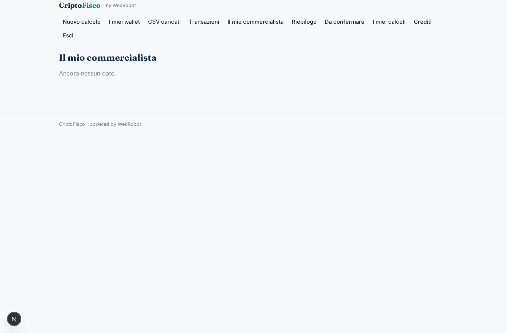
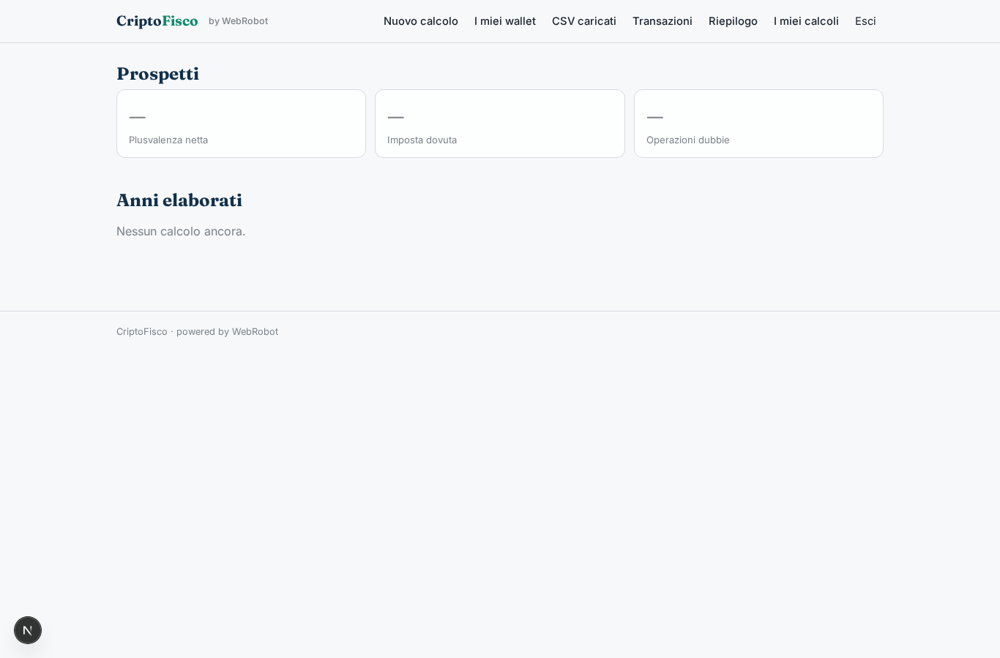
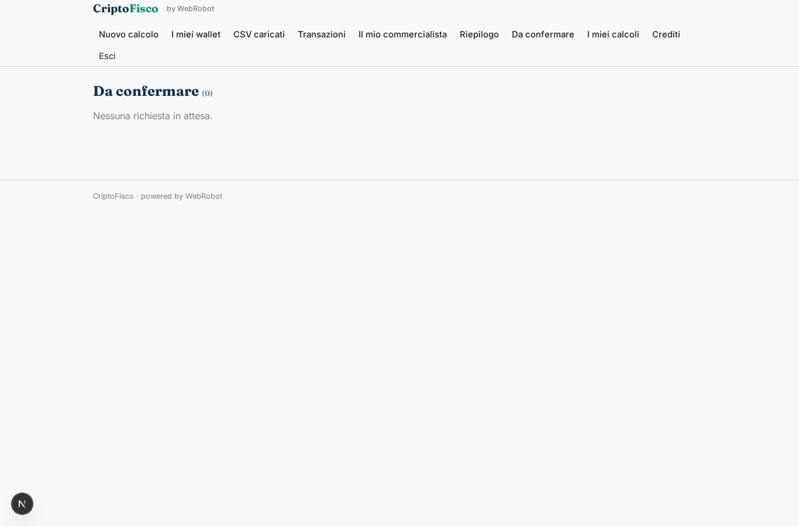
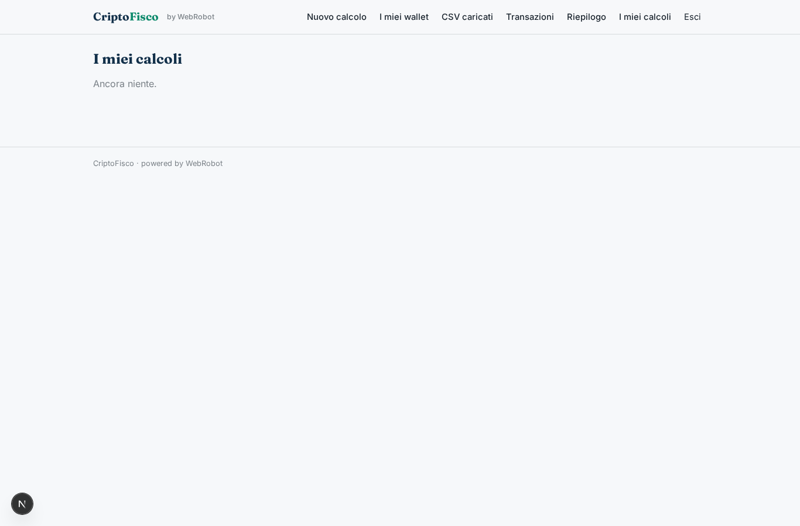
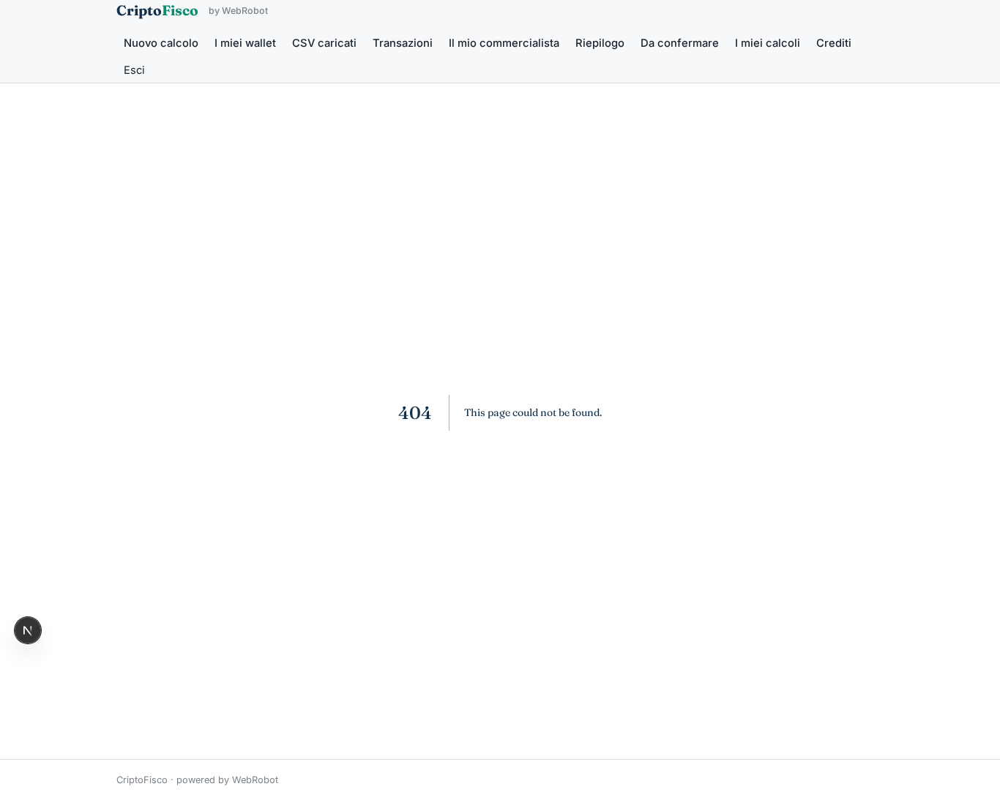
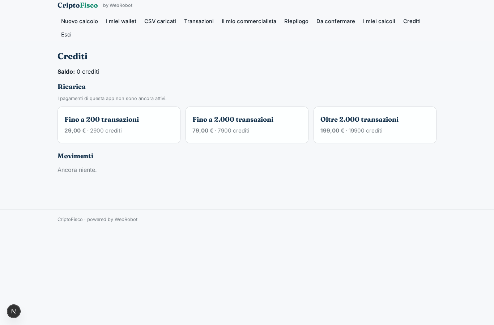

# CriptoFisco

_Plusvalenze cripto e dati per quadro RT e RW, pronti per la dichiarazione._

**Manifest status:** valid (schema validator + runtime contract)

## Description given to the app builder (Italian)

Voglio CriptoFisco, un'app che calcola plusvalenze e minusvalenze su cripto-attività e prepara i dati per la dichiarazione dei redditi italiana (quadro RT e quadro RW). Ruoli: contribuente, commercialista e admin. Il contribuente indica anno fiscale, residenza e metodo di calcolo, poi collega i suoi exchange con chiavi API in sola lettura, inserisce gli indirizzi pubblici dei wallet e, per le piattaforme non supportate, carica i CSV di esportazione. Un agente importa tutte le transazioni dalle API degli exchange e dagli explorer on-chain pubblici, riconcilia i trasferimenti tra conti propri per non contarli come vendite, classifica operazioni (acquisto, vendita, swap, staking, airdrop, commissioni) e recupera i prezzi storici in euro. Un secondo agente applica il calcolo FIFO, determina il valore di inizio e fine anno per il monitoraggio e l'imposta dovuta, segnalando le transazioni dubbie che l'utente deve confermare a mano. Il risultato è una dashboard con riepilogo e un report PDF ed Excel con il prospetto per quadro. Il contribuente può delegare un commercialista, che vede solo i clienti che lo hanno autorizzato e approva il report finale. Le chiavi sono cifrate e mai visibili. Prezzo annuale per fascia di transazioni. Italiano.

## Features not expressible today (spec.extensions)

- **exchange_api_keys**: Collegamento degli exchange con chiavi API in sola lettura cifrate: non ancora disponibile (richiede credenziali del cliente). Per ora CSV incollati come testo.
- **file_upload**: Caricamento di file CSV non disponibile: il contribuente incolla il contenuto.
- **pdf_excel_export**: Export PDF ed Excel: oggi il report è stampabile (salva come PDF); l'Excel non è ancora generabile.
- **evm_explorers**: Explorer on-chain che richiedono chiave (es. Etherscan) non inclusi: solo Bitcoin via Blockstream; altre reti tramite CSV.

## Screenshots (interpretive runtime)

### home-anon

### home-mobile

### home

### new_run

### wallets_view

### csv_view

### transactions_view

### delegations_view

### dashboard

### approvals_view

### history

### clients

### account

