# CriptoFisco

_Plusvalenze cripto e dati per i quadri RT e RW, pronti per la dichiarazione._

**Manifest:** valid (schema + runtime contract) · **Functional test:** passed (21 checks passed)

## Description given to the app builder (Italian)

Voglio CriptoFisco, un'app che calcola plusvalenze e minusvalenze su cripto-attività e prepara i dati per la dichiarazione dei redditi italiana (quadro RT e quadro RW). Ruoli: contribuente, commercialista e admin. Il contribuente indica anno fiscale, residenza e metodo di calcolo, poi collega i suoi exchange con chiavi API in sola lettura, inserisce gli indirizzi pubblici dei wallet e, per le piattaforme non supportate, carica i CSV di esportazione. Un agente importa tutte le transazioni dalle API degli exchange e dagli explorer on-chain pubblici, riconcilia i trasferimenti tra conti propri per non contarli come vendite, classifica operazioni (acquisto, vendita, swap, staking, airdrop, commissioni) e recupera i prezzi storici in euro. Un secondo agente applica il calcolo FIFO, determina il valore di inizio e fine anno per il monitoraggio e l'imposta dovuta, segnalando le transazioni dubbie che l'utente deve confermare a mano. Il risultato è una dashboard con riepilogo e un report PDF ed Excel con il prospetto per quadro. Il contribuente può delegare un commercialista, che vede solo i clienti che lo hanno autorizzato e approva il report finale. Le chiavi sono cifrate e mai visibili. Prezzo annuale per fascia di transazioni. Italiano.

## Features not expressible today (spec.extensions)

- **exchange_signed_api**: Molti exchange (Binance, Kraken, Coinbase) richiedono richieste firmate (HMAC) con la chiave: il runtime non può firmarle. Oggi l'importazione da exchange funziona solo per endpoint con la sola chiave in header; per gli altri si usano i CSV di esportazione.
- **excel_export**: L'esportazione Excel nativa non è disponibile: il prospetto è stampabile in PDF e le tabelle si scaricano in CSV (apribile in Excel).

## Screenshots (interpretive runtime, no data)

### home-anon

### home-mobile

### home

### new_run
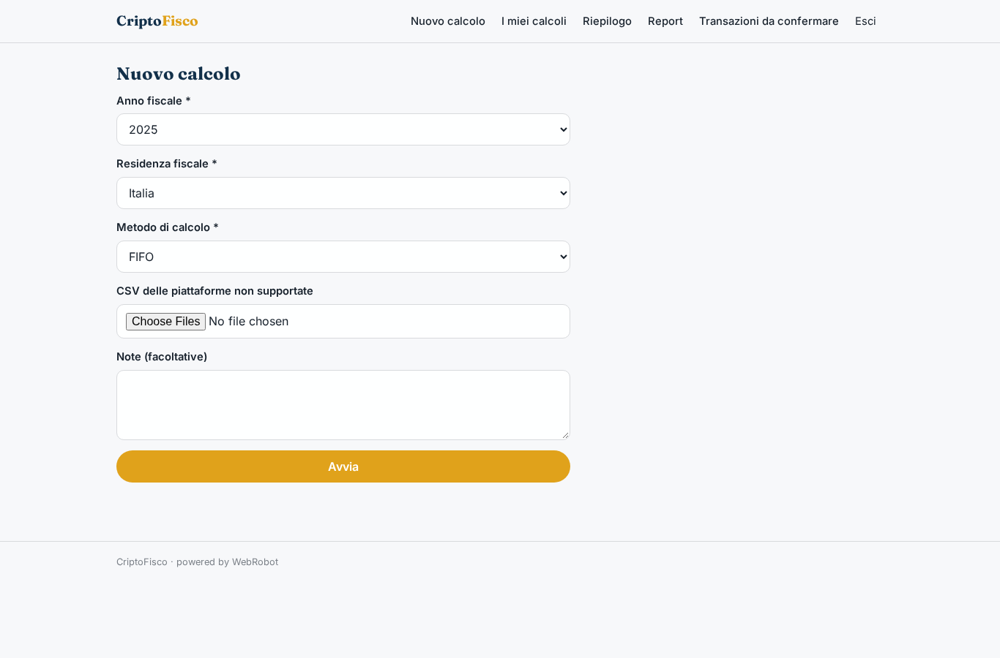

### history
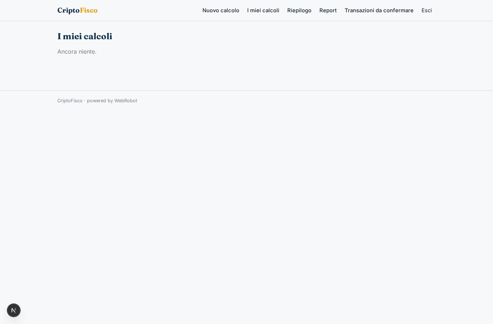

### dashboard
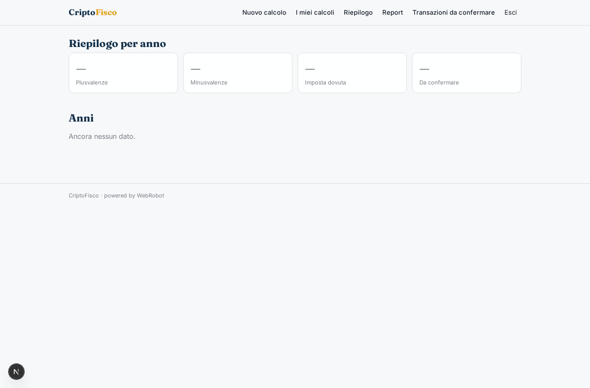

### reports
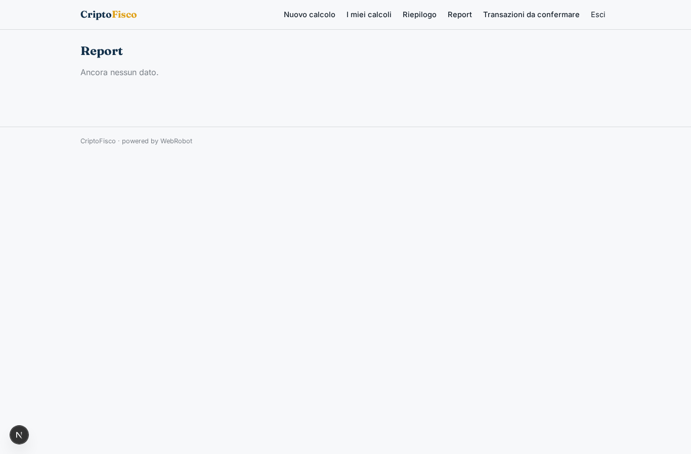

### to_confirm
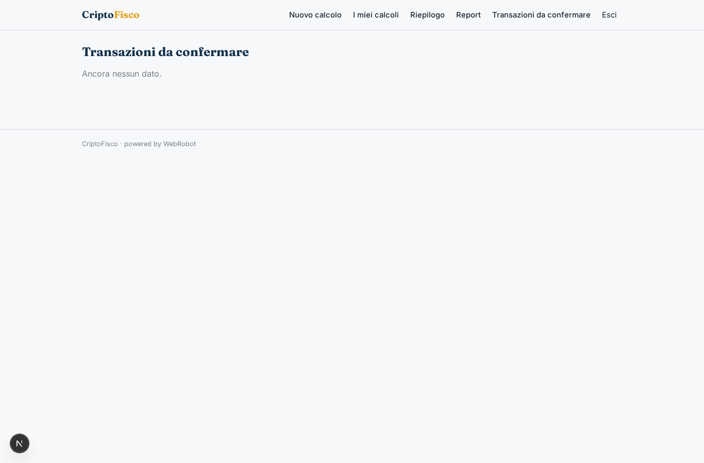

### confirm_tx
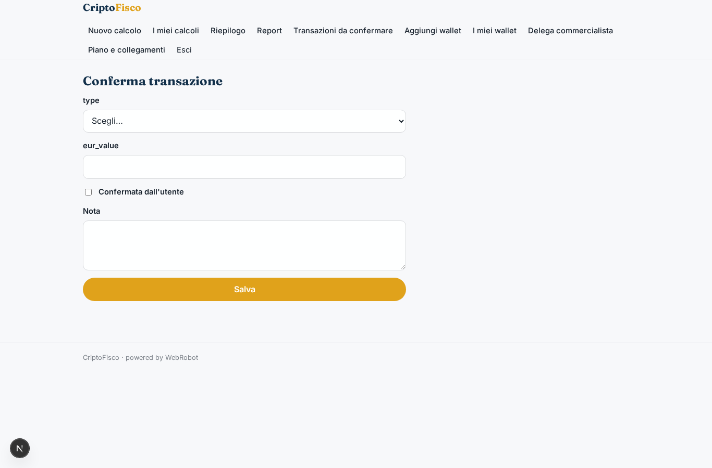

### add_wallet
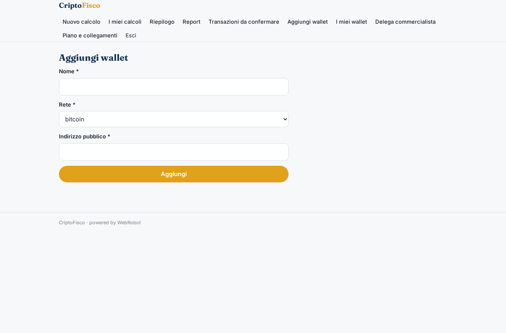

### my_wallets
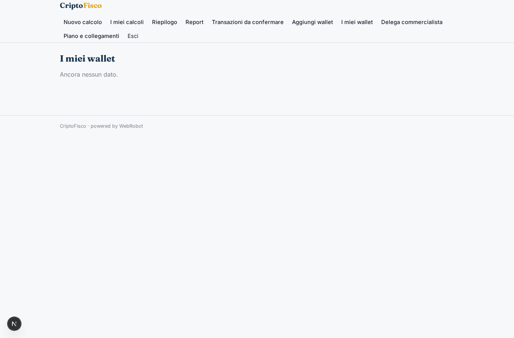

### delegate
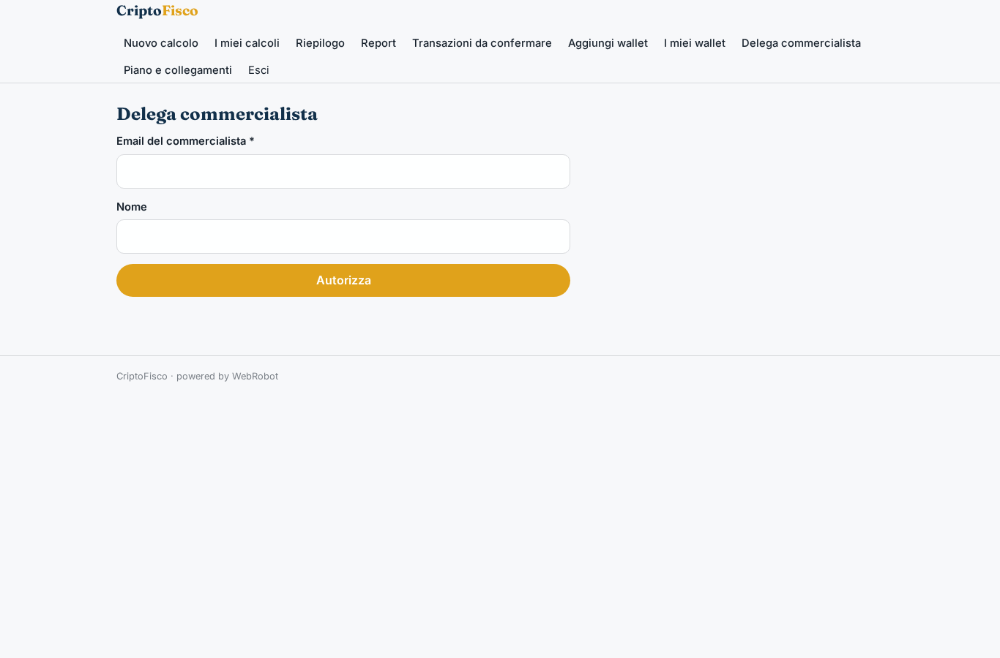

### clients
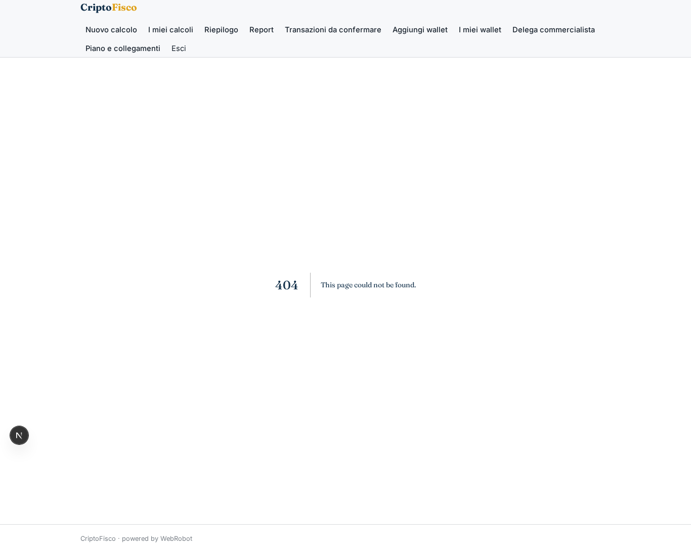

### approvals

### account
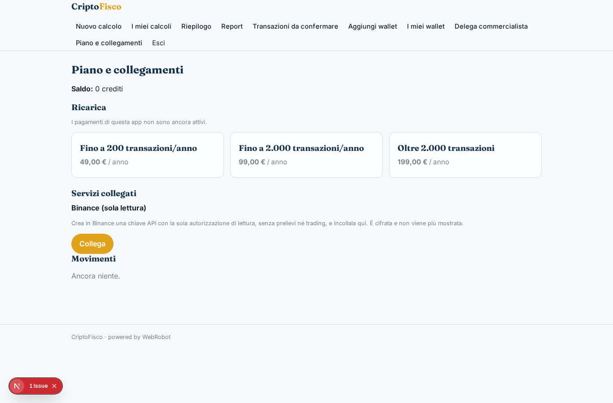
