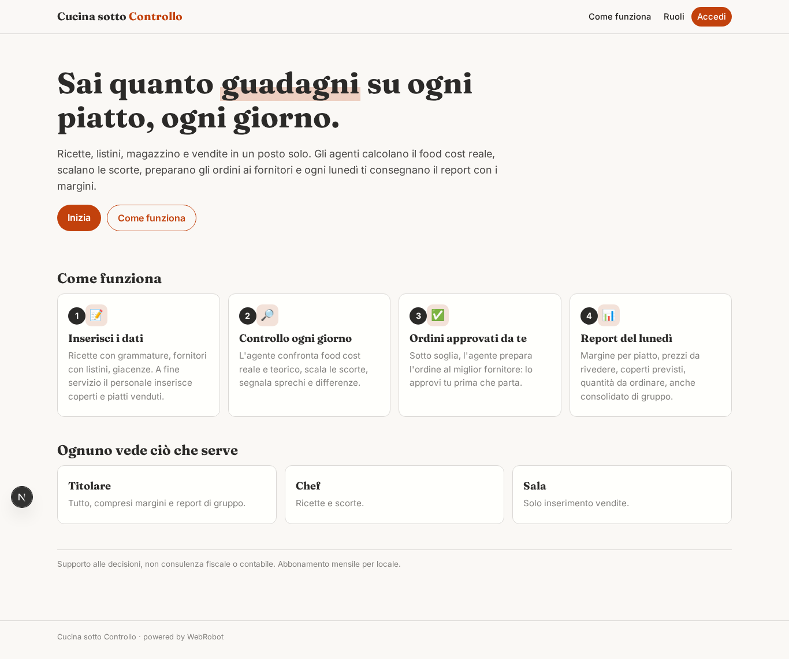
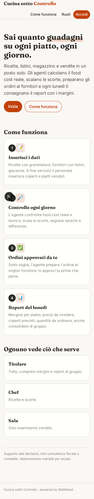
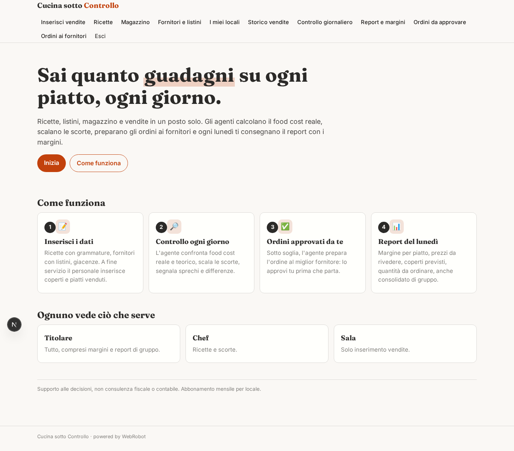
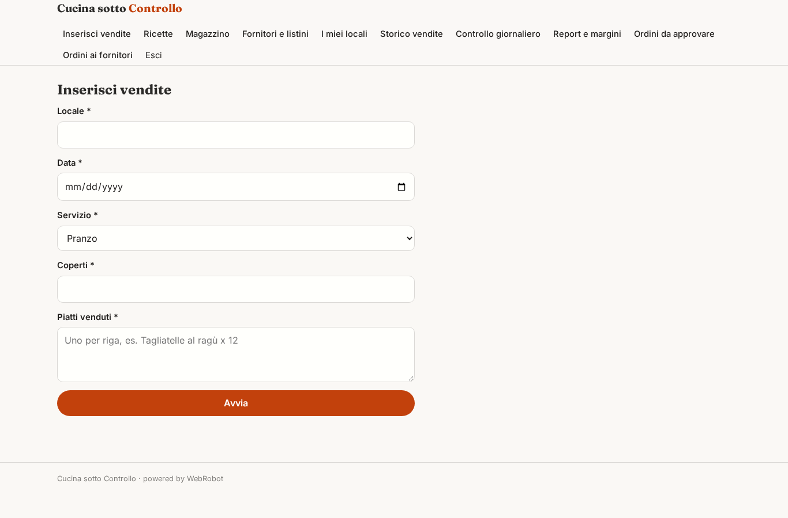
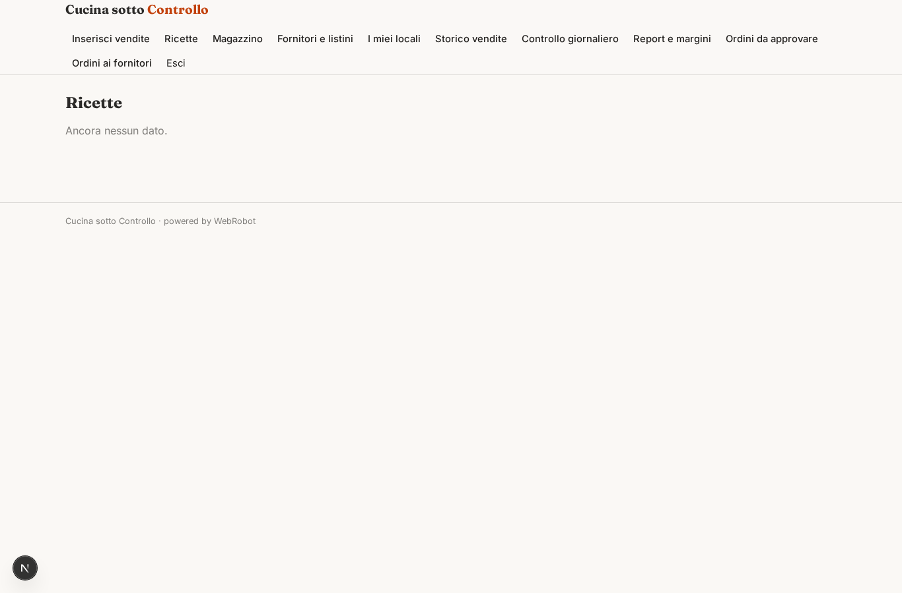
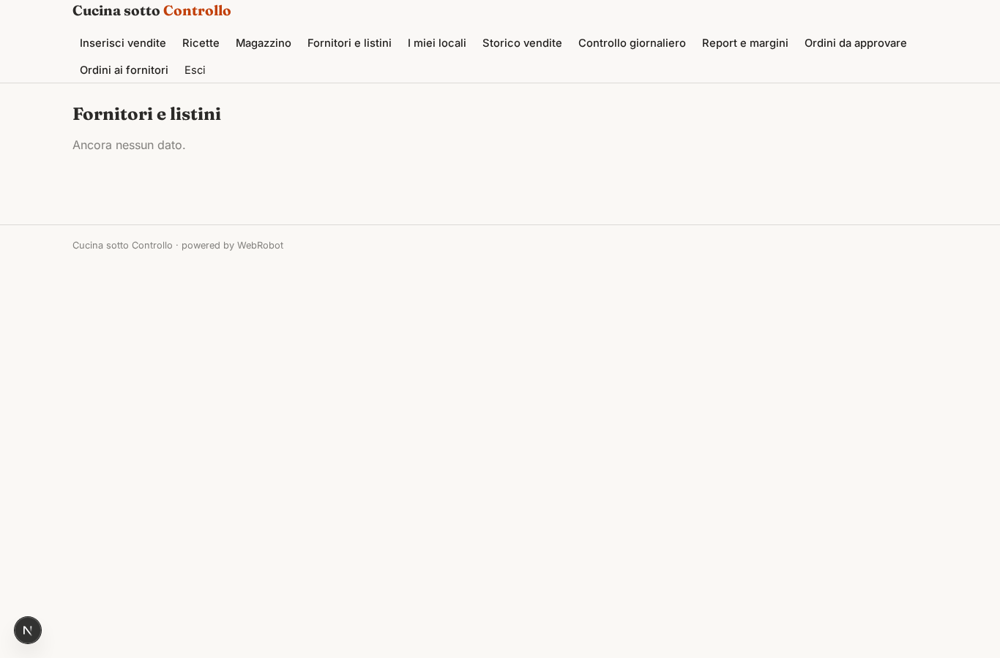
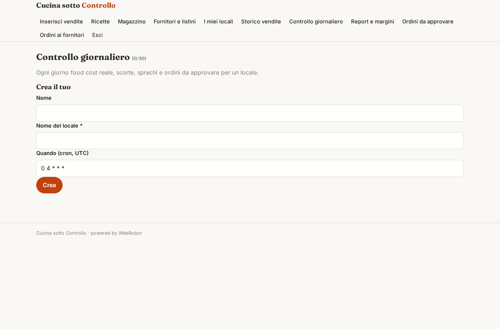
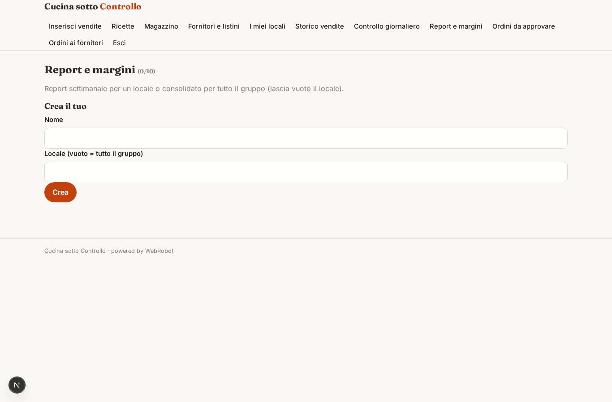
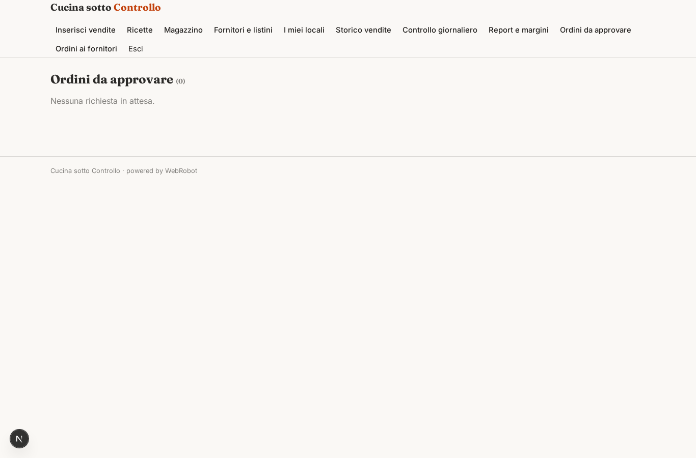
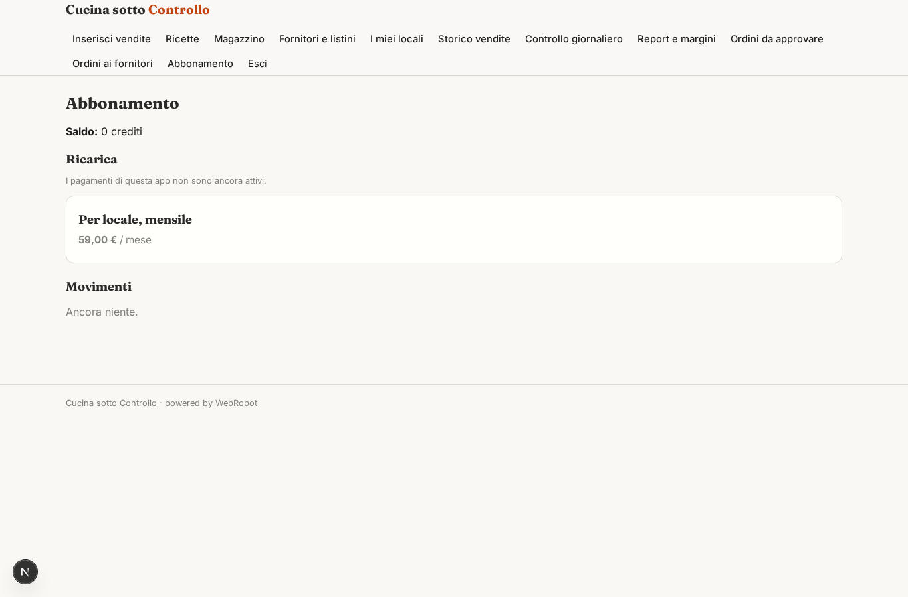

# Cucina sotto Controllo

_Food cost reale, scorte e ordini ai fornitori sotto controllo, ogni giorno._

**Stato manifest:** valido (validatore Python + contratto runtime)

## Descrizione data all'app builder

Mi serve Cucina sotto Controllo, un gestionale con agenti per ristoranti. Il titolare inserisce le ricette con ingredienti e grammature, i fornitori con listini, e le giacenze del magazzino. Le vendite giornaliere devono arrivare in automatico dalla cassa o dal POS del locale; in alternativa il personale inserisce a fine servizio i coperti e i piatti venduti. Un agente calcola ogni giorno il food cost reale di ogni piatto, lo confronta con quello teorico, scala le scorte, segnala sprechi e differenze inventariali, e quando un ingrediente scende sotto la soglia prepara l'ordine al fornitore, che il titolare approva prima dell'invio via email. Ogni lunedì un agente produce un report con margine per piatto, piatti da rivedere nel prezzo, previsione dei coperti della settimana e quantità da ordinare. Lo chef vede ricette e scorte, il personale di sala solo l'inserimento vendite, il titolare tutto incluso i margini. Più locali dello stesso gruppo hanno dati separati ma un report consolidato. Abbonamento mensile per locale, in italiano.

## Funzioni non esprimibili oggi (spec.extensions)

- **pos_sync**: Le vendite automatiche dalla cassa/POS richiedono credenziali del singolo cliente e non sono ancora disponibili: per ora il personale inserisce coperti e piatti a fine servizio. Il POS potrà alimentare la collezione vendite.
- **email_ordini**: L'invio email al fornitore non è ancora disponibile: dopo l'approvazione il titolare riceve il testo email pronto e l'ordine risulta in 'Ordini ai fornitori'; l'invio resta manuale.
- **staff_access**: Chef e sala sono inviati dal titolare e accedono ai dati del titolare tramite condivisione dei record (sharing); la visibilità per ruolo è data dalle viste. Il prezzo per locale va applicato con una quantità di abbonamenti pari ai locali (una sola voce di piano oggi).

## Screenshot (runtime interpretativo)

### home-anon

### home-mobile

### home

### nuove_vendite

### ricette_v

### scorte_v

### fornitori_v

### locali_v

### vendite_v

### controlli

### report

### ordini_v

### ordini_storico

### account

