# Cucina sotto Controllo

_Food cost, scorte e ordini sotto controllo, ogni giorno, per ogni locale._

**Manifest:** valid (schema + runtime contract) · **Functional test:** passed (23 checks passed)

## Description given to the app builder (Italian)

Mi serve Cucina sotto Controllo, un gestionale con agenti per ristoranti. Il titolare inserisce le ricette con ingredienti e grammature, i fornitori con listini, e le giacenze del magazzino. Le vendite giornaliere devono arrivare in automatico dalla cassa o dal POS del locale; in alternativa il personale inserisce a fine servizio i coperti e i piatti venduti. Un agente calcola ogni giorno il food cost reale di ogni piatto, lo confronta con quello teorico, scala le scorte, segnala sprechi e differenze inventariali, e quando un ingrediente scende sotto la soglia prepara l'ordine al fornitore, che il titolare approva prima dell'invio via email. Ogni lunedì un agente produce un report con margine per piatto, piatti da rivedere nel prezzo, previsione dei coperti della settimana e quantità da ordinare. Lo chef vede ricette e scorte, il personale di sala solo l'inserimento vendite, il titolare tutto incluso i margini. Più locali dello stesso gruppo hanno dati separati ma un report consolidato. Abbonamento mensile per locale, in italiano.

## Functional test: what did not pass

- **saved record shown where its collection is read** (view ricette): a record was saved in ricette (by user) but the page does not show it (as chef) _(warning)_
- **saved record shown where its collection is read** (view giacenze): a record was saved in giacenze (by user) but the page does not show it (as chef) _(warning)_

## Features not expressible today (spec.extensions)

- **pos_connector**: La cassa o il POS invia le vendite al webhook /api/hooks/pos_vendite (locale, date, covers, items, source); un connettore specifico per ogni marca di POS non è incluso. Nel record vanno inseriti anche gli indirizzi email in members per l'accesso di chef e sala.

## Screenshots (interpretive runtime, no data)

### home-anon

### home-mobile

### home

### vendite_form
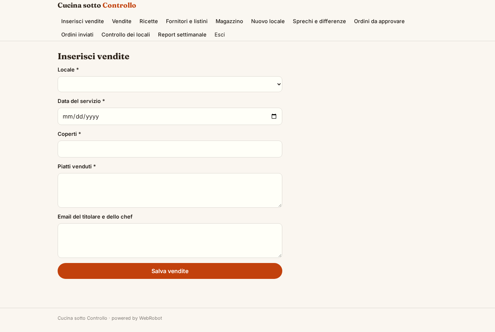

### vendite_storico
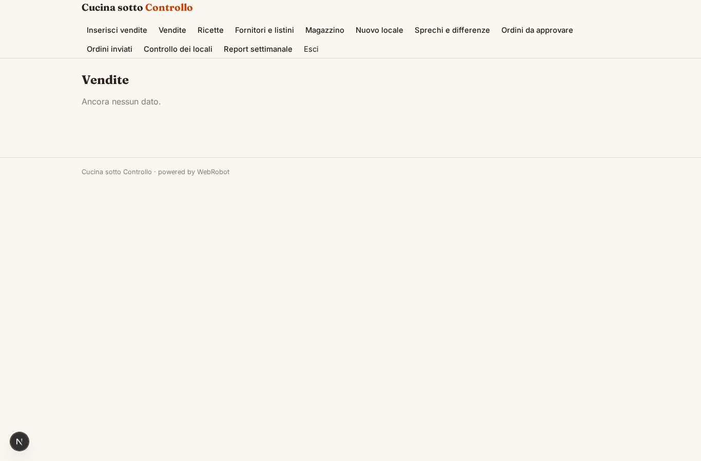

### ricette_form
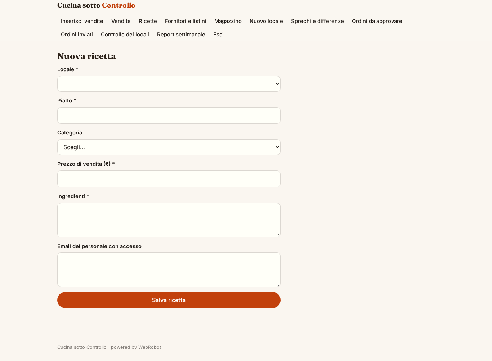

### ricette

### fornitori_form
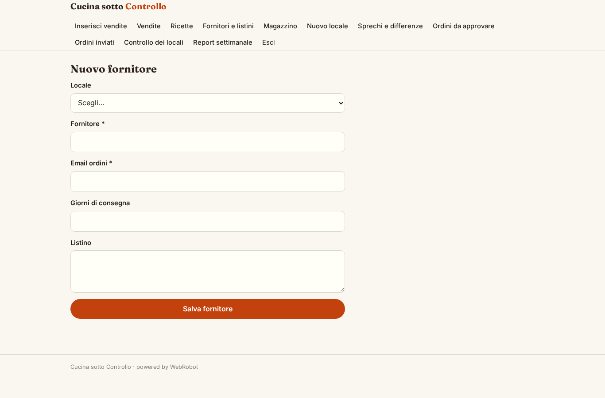

### fornitori

### giacenze_form
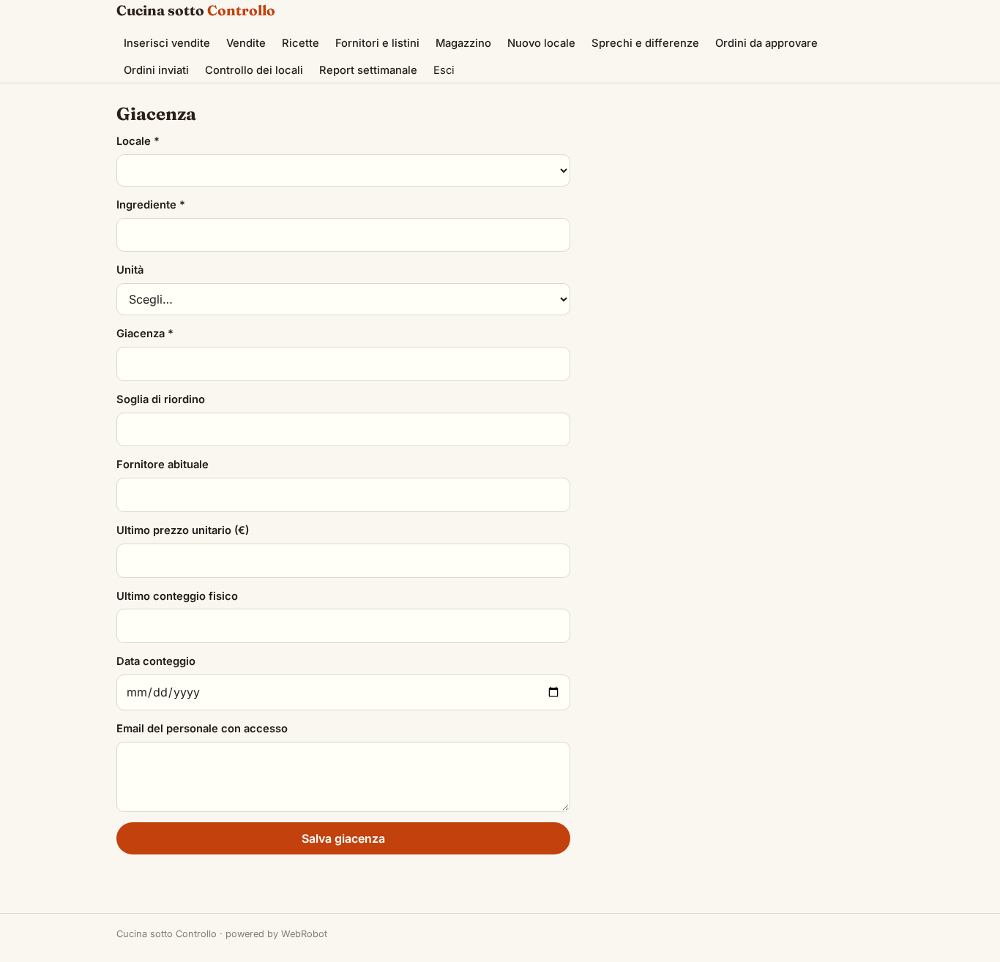

### giacenze
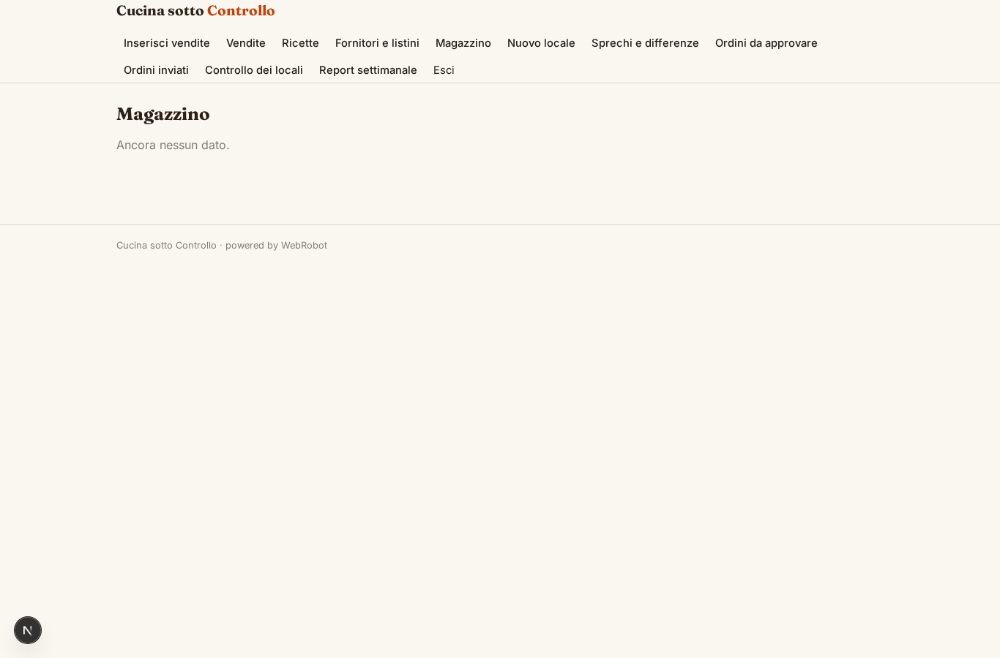

### locali_form
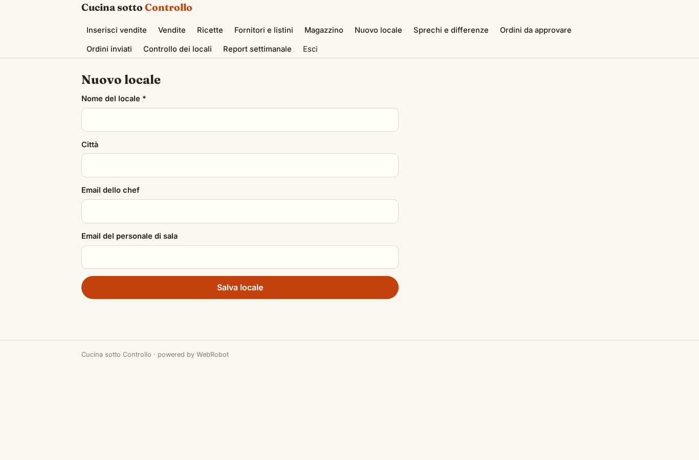

### segnalazioni
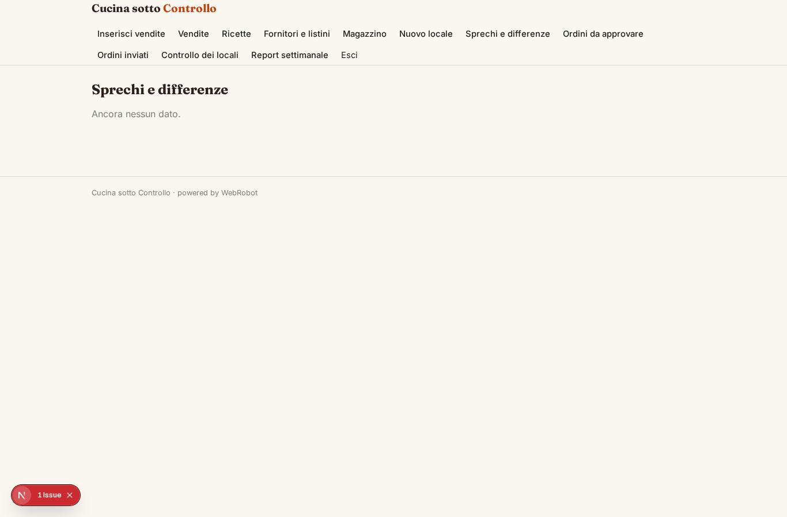

### approvazioni
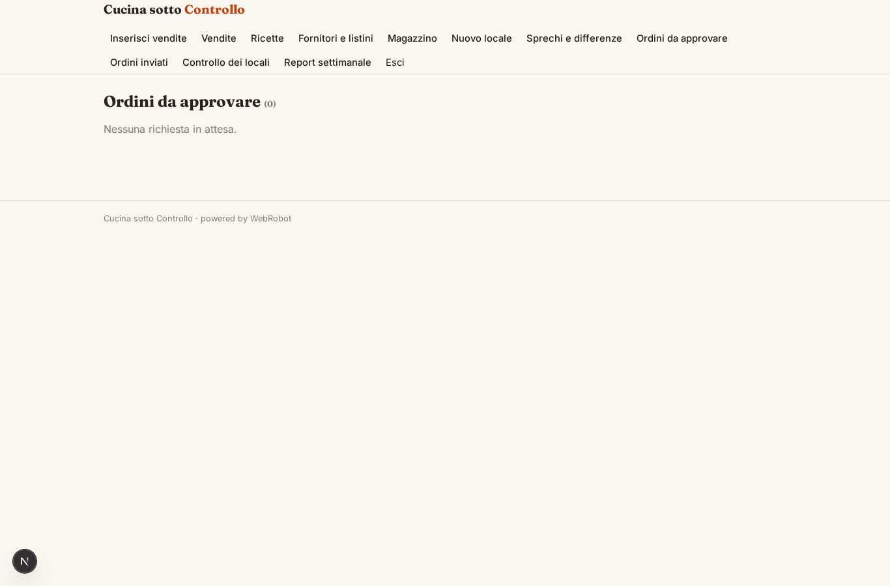

### ordini

### controlli
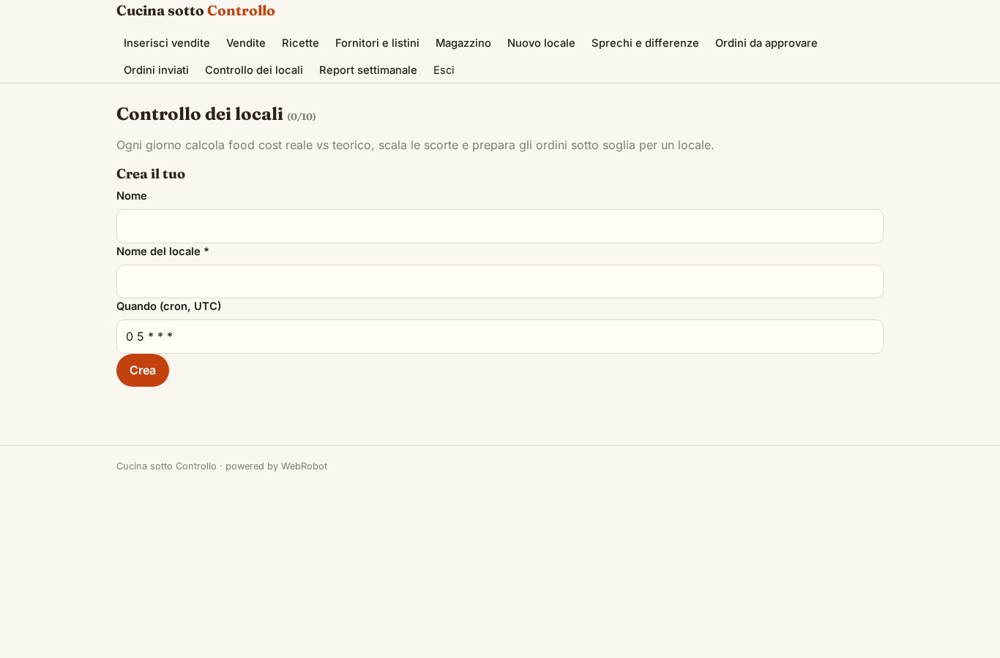

### report
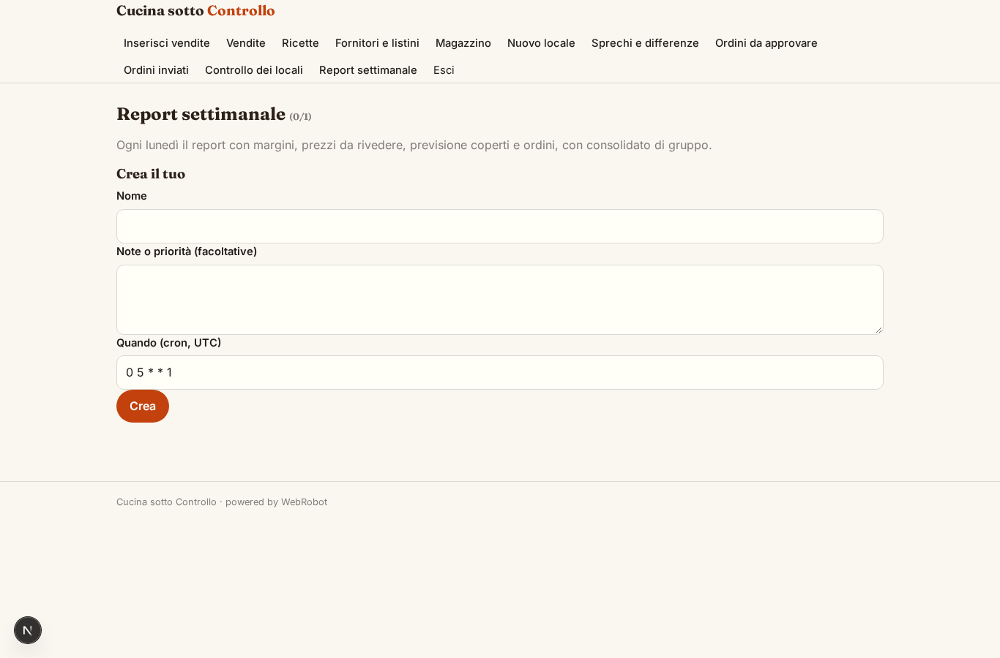

### account
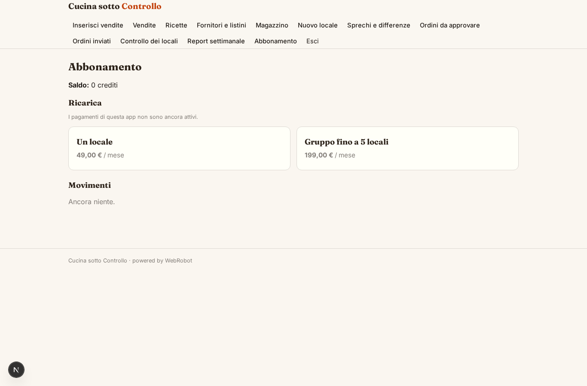
