# MenteSerena

_Prenota una seduta con uno psicologo o medico iscritto all'albo, in modo semplice e riservato._

**Manifest:** valid (schema + runtime contract) · **Functional test:** passed (19 checks passed)

## Description given to the app builder (Italian)

Di MenteSerena descrivo solo lo strato software di prenotazione e gestione: le sedute le svolgono psicologi e medici iscritti agli albi, e la videochiamata è un servizio esterno. L'utente si registra e compila un questionario iniziale: motivo della richiesta, preferenze sul professionista (genere, approccio, lingua), fasce orarie disponibili, eventuale bonus o convenzione aziendale. Un agente legge il questionario solo per abbinare l'utente a tre professionisti compatibili, senza fare valutazioni cliniche, e mostra i loro profili; se dalle risposte emergono segnali di urgenza mostra subito i numeri di emergenza. L'utente sceglie, prenota uno slot dal calendario del professionista e paga la seduta o il pacchetto con carta; riceve email e promemoria con il link alla videochiamata. Il professionista vede solo i propri pazienti, tiene note cliniche private e cifrate, e può proporre il cambio di terapeuta. I dati sanitari sono trattati come categoria particolare: consenso esplicito, accesso registrato, nessun dato clinico visibile all'admin, che vede solo agenda, pagamenti e dashboard di utilizzo. Le aziende convenzionate vedono solo numeri aggregati anonimi. Pagamento per seduta o abbonamento. Italiano e inglese.

## Functional test: what did not pass

- **form saves a record** (form propose_change): only role professional may fill it, and the test cannot hold that role _(warning)_
- **form saves a record** (form new_note): only role professional may fill it, and the test cannot hold that role _(warning)_
- **page opened by a role allowed to** (view my_patients): only role professional may open it, the test cannot hold it _(warning)_
- **page opened by a role allowed to** (view propose_change): only role professional may open it, the test cannot hold it _(warning)_
- **page opened by a role allowed to** (view new_note): only role professional may open it, the test cannot hold it _(warning)_
- **saved record shown where its collection is read** (view company_stats): a record was saved in intake (by user) but the page does not show it (as admin) _(warning)_

## Features not expressible today (spec.extensions)

- **health_data_controls**: Needed beyond the manifest: encryption at rest of clinical_notes, an access log of who read special-category records, and excluding admins from intake, care_relations and clinical_notes (the runtime lets admins reach user records by default). Also a DPA/DPIA with the hosting provider.
- **professional_onboarding**: Professional profiles (professionals) are loaded by the owner; role professional is assigned by invite. appointments.professional_email must be copied from the booked professional's email, and the video call link (external service) is stored on the professional's record; per-professional slots are set in the record's slots field.
- **company_scoping**: Company statistics are aggregated with minCount 5, but a view limited to the viewer's own company agreement is not expressible yet; it needs a per-company filter.
- **video_call_and_sms**: The video call is an external service. SMS/WhatsApp reminders are not available; only email. The session reminder cannot skip cancelled bookings (date triggers have no where filter).

## Screenshots (interpretive runtime, no data)

### home-anon
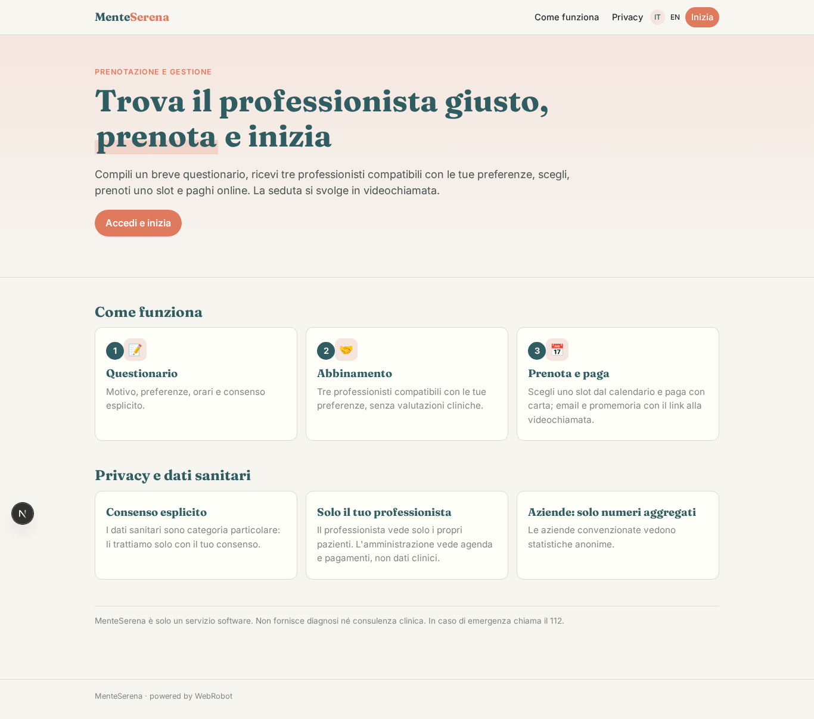

### home-mobile
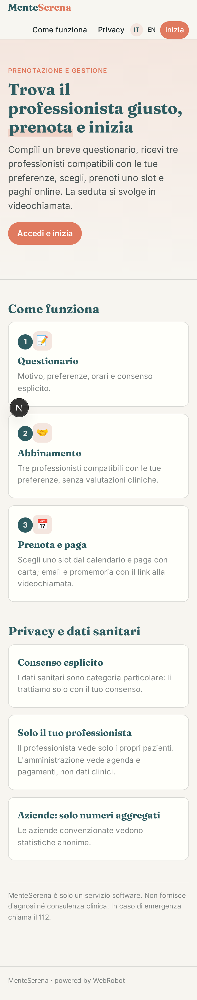

### home
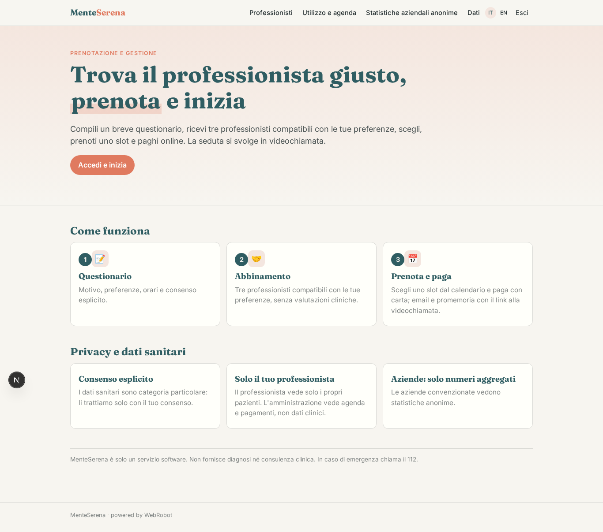

### intake_form
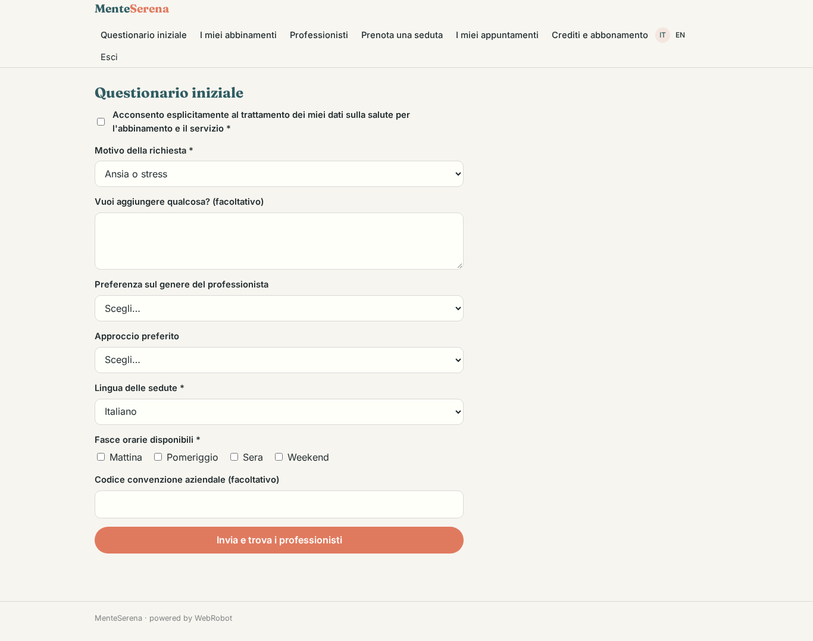

### matches
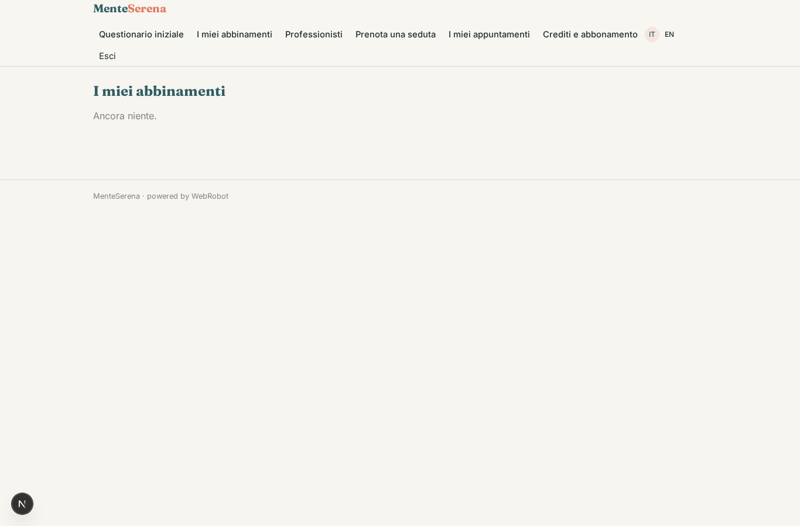

### professionals_list
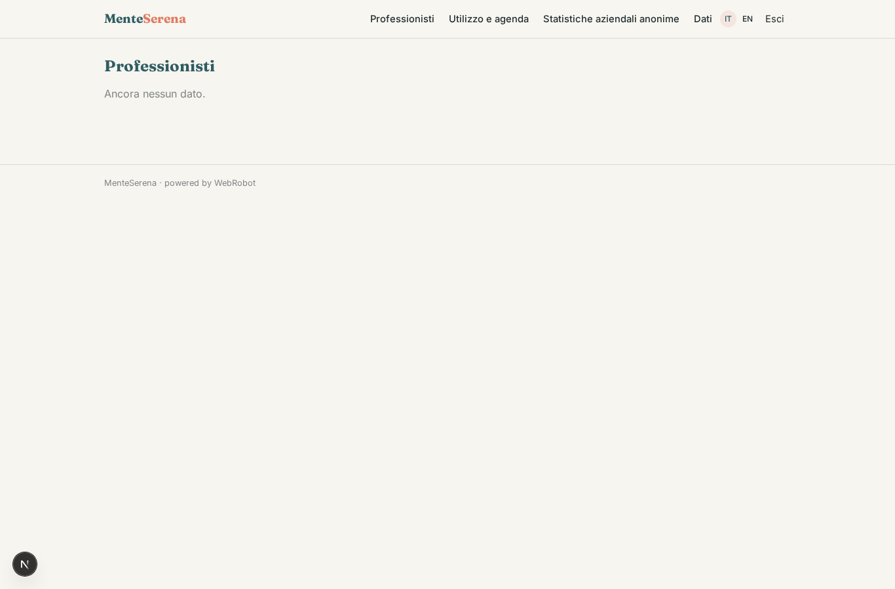

### book

### my_appointments
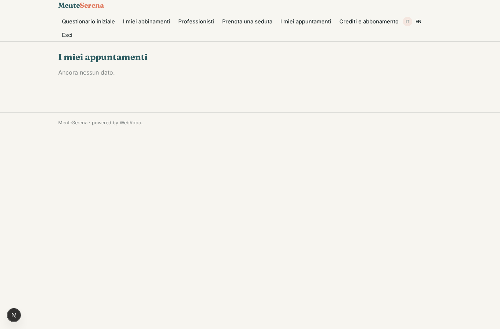

### my_patients
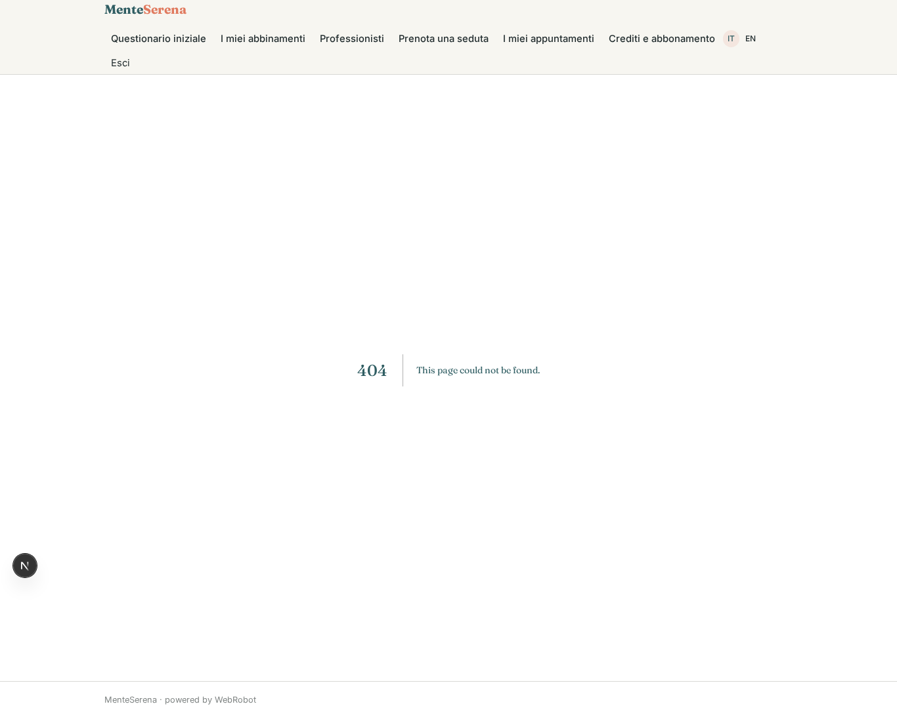

### propose_change

### new_note

### usage
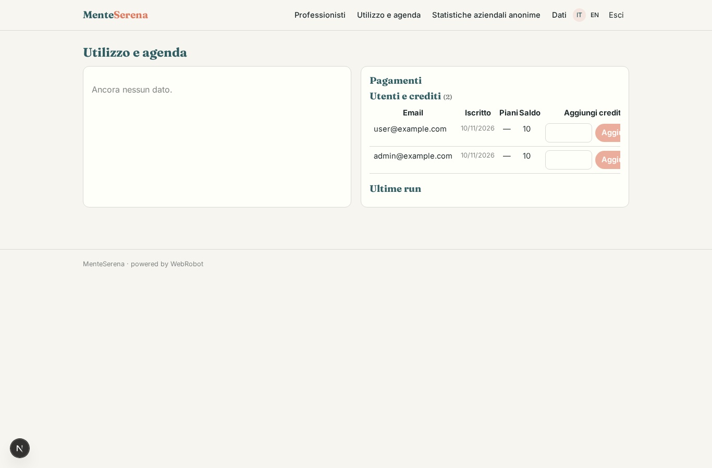

### usage_table
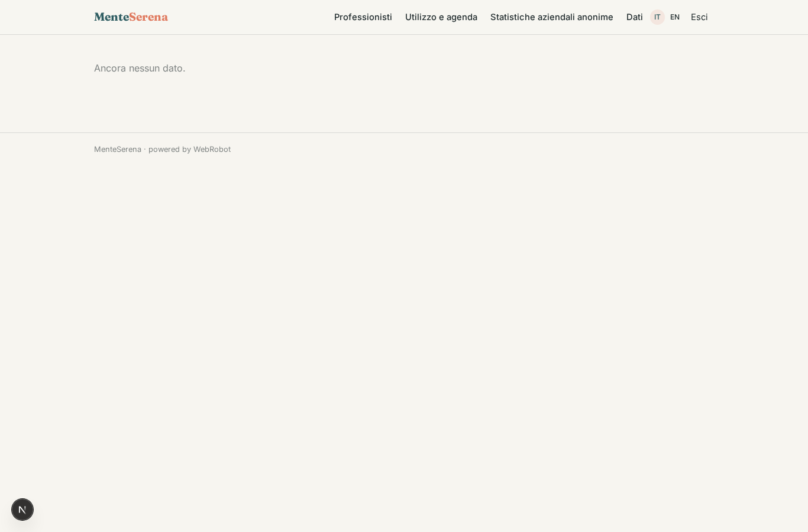

### payments_admin
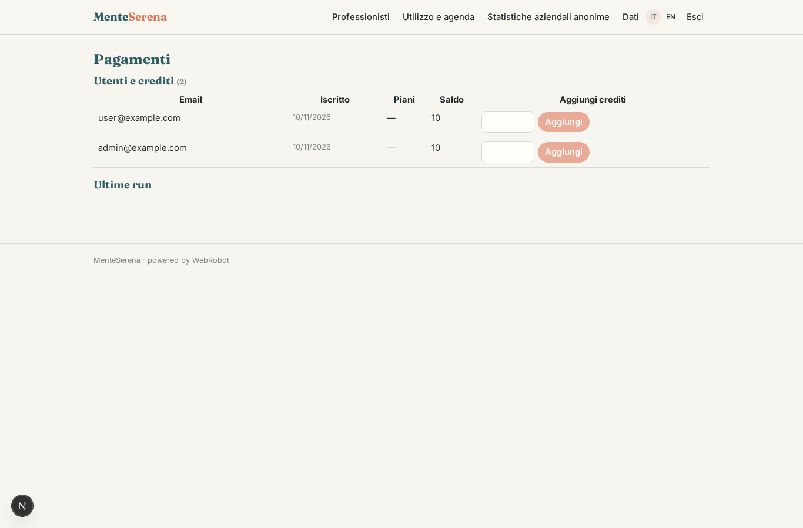

### company_stats
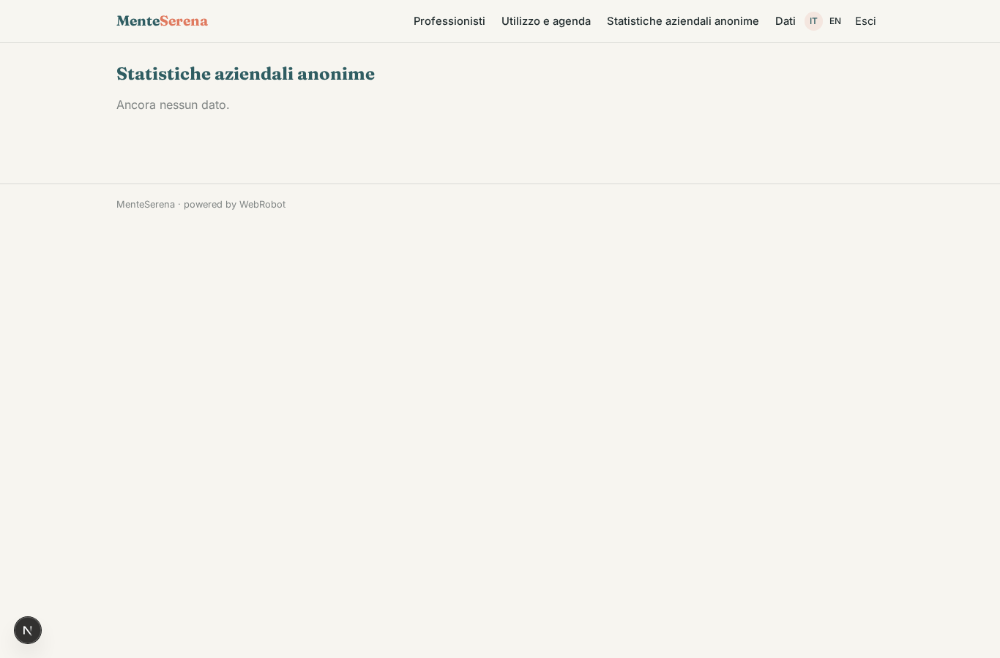

### account
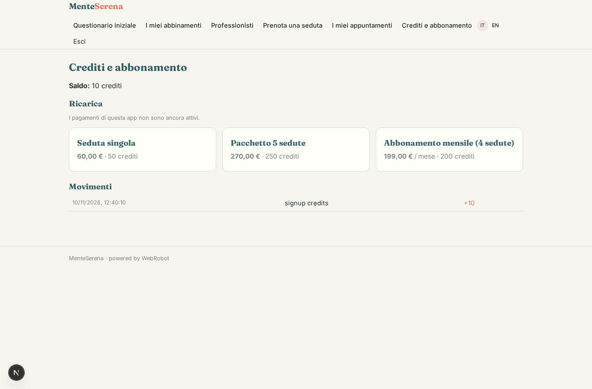
