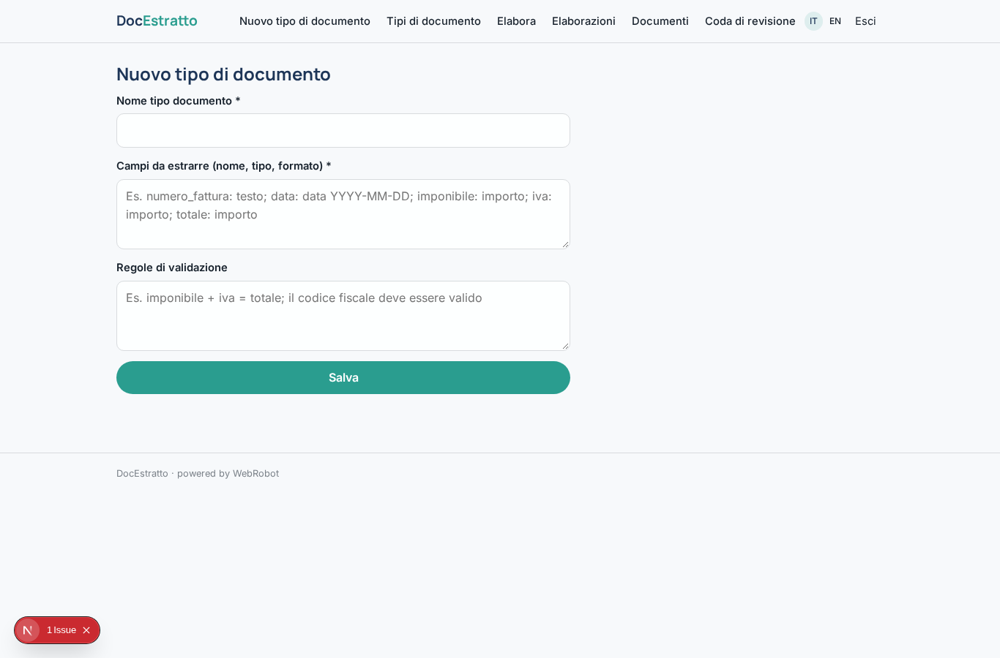
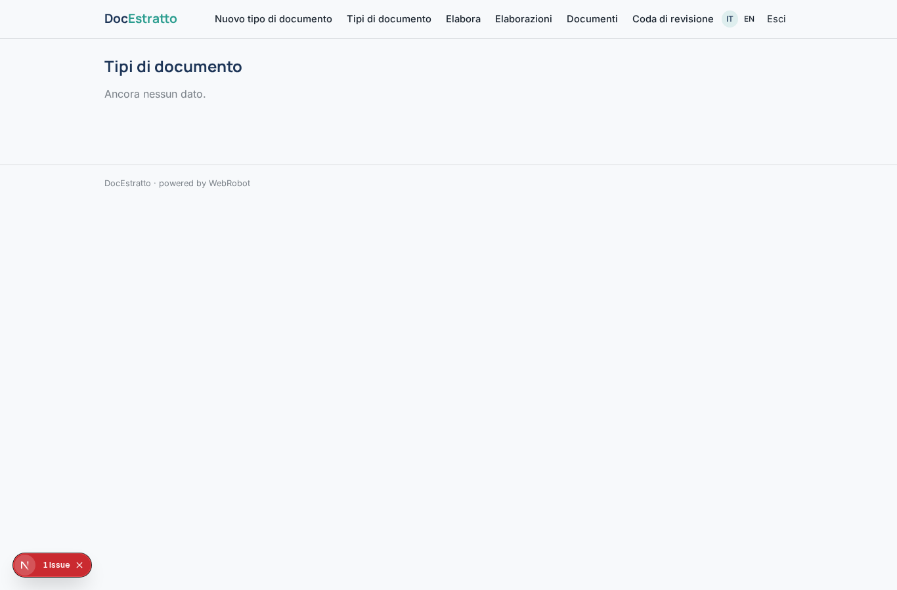
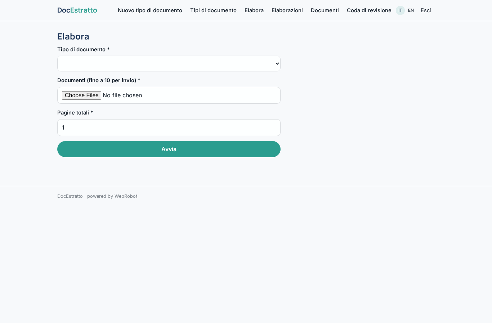
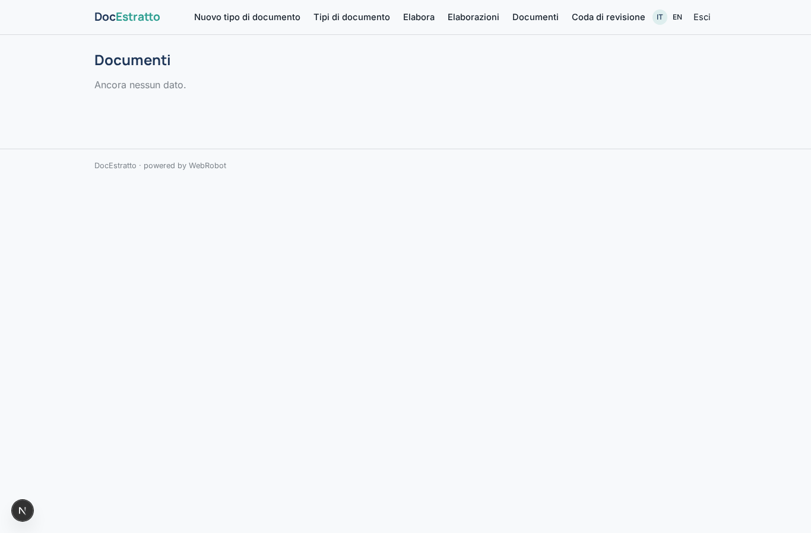
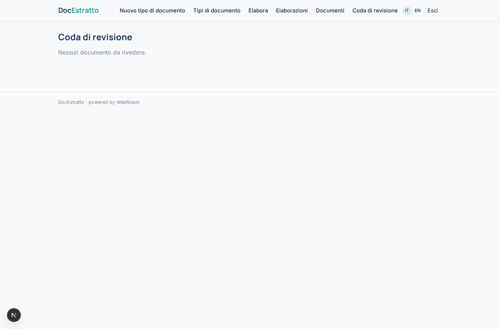
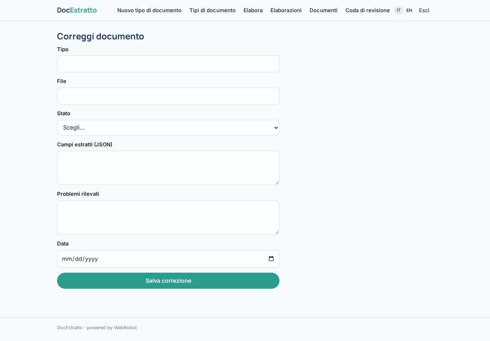
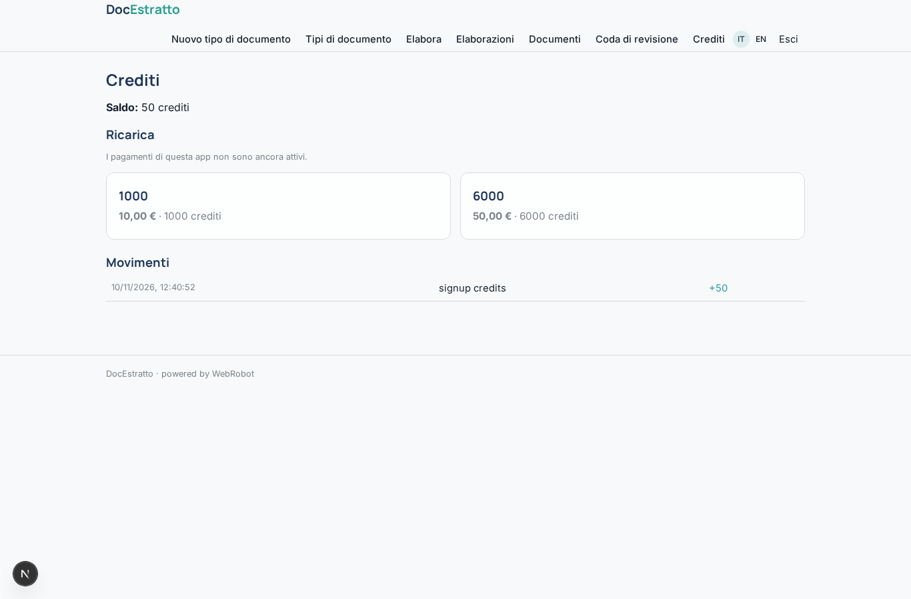

# DocEstratto

_Dai documenti ai dati: estrazione, validazione e revisione._

**Manifest:** valid (schema + runtime contract) · **Functional test:** passed (13 checks passed)

## Description given to the app builder (Italian)

DocEstratto è un servizio di elaborazione intelligente dei documenti per uffici amministrativi, assicurazioni e studi professionali. L'utente definisce un tipo di documento (fattura, bolla di consegna, documento d'identità, perizia, busta paga) e i campi da estrarre, con formato e regole di validazione. Poi carica i documenti, anche scansioni e foto storte, singolarmente o in lotti di centinaia, oppure li invia via email a un indirizzo dedicato. Il sistema esegue l'OCR, un agente estrae i campi richiesti, li normalizza (date, importi, codici fiscali) e verifica la coerenza interna, per esempio che imponibile più IVA dia il totale. I documenti con bassa confidenza finiscono in una coda di revisione dove un operatore vede l'immagine accanto ai campi e corregge. I risultati sono esportabili in CSV o Excel, consultabili in tabella e inviabili via webhook al gestionale del cliente. Ogni organizzazione vede solo i propri documenti, conservati per il periodo scelto. Si paga a consumo, con crediti per pagina elaborata. In italiano e inglese.

## Features not expressible today (spec.extensions)

- **batch_upload**: Batches of hundreds of documents and automatic splitting: a run takes up to 10 files, larger batches need a bulk ingest not available yet.
- **email_inbox**: Receiving documents at a dedicated email address and turning attachments into runs is not available yet.
- **outbound_webhook**: Sending results to the customer's ERP by webhook (customer-specific URL) is not available yet; CSV export is.
- **image_side_by_side**: Review screen with the document image next to the editable fields is not available; the review form shows the extracted fields only.
- **excel_export**: Excel export (CSV is available).
- **org_teams**: Multiple operators per organisation sharing documents: here each account sees its own records; shared team access can be added with a members field.

## Screenshots (interpretive runtime, no data)

### home-anon

### home-mobile

### home

### types_new

### types

### new

### runs

### documents

### review

### fix

### account

