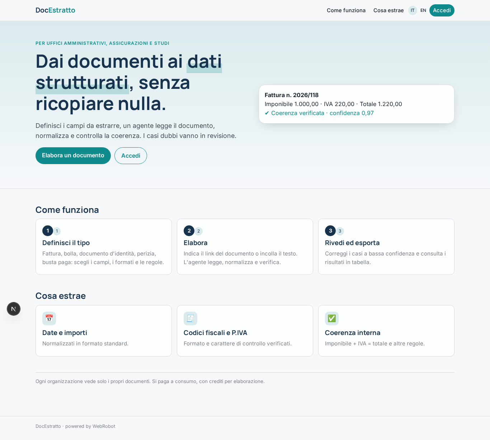
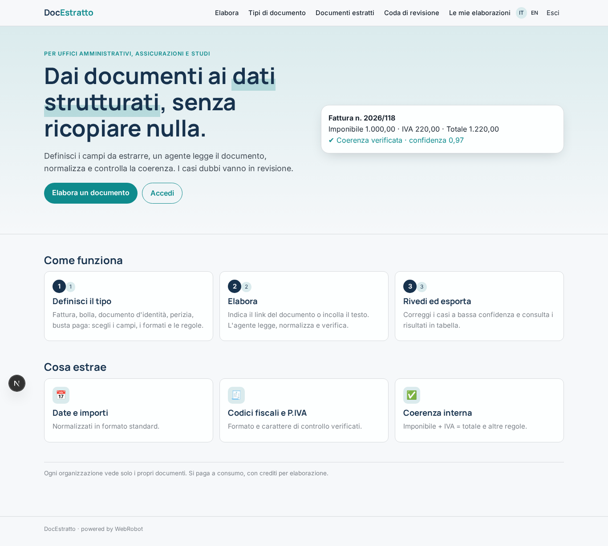
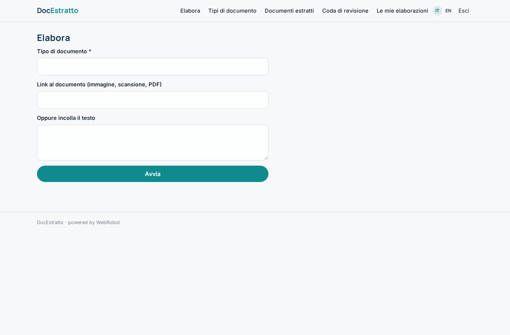
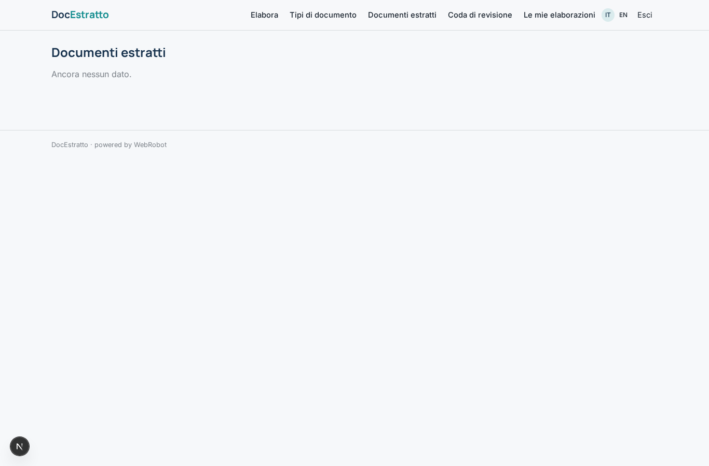
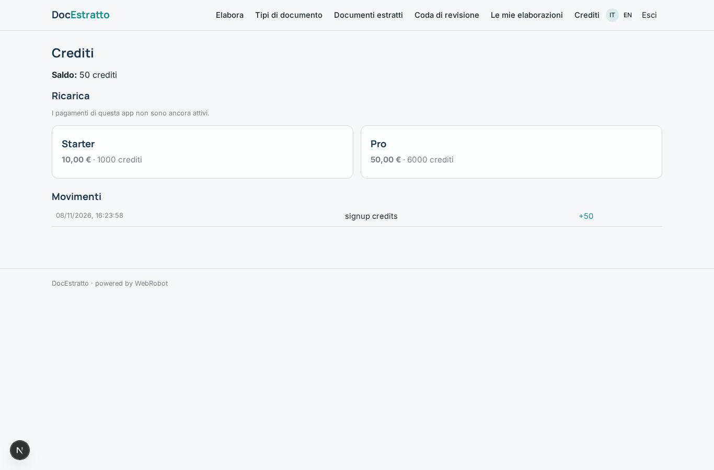

# DocEstratto

_Dai documenti ai dati strutturati, con revisione umana dove serve._

**Stato manifest:** valido (validatore Python + contratto runtime)

## Descrizione data all'app builder

DocEstratto è un servizio di elaborazione intelligente dei documenti per uffici amministrativi, assicurazioni e studi professionali. L'utente definisce un tipo di documento (fattura, bolla di consegna, documento d'identità, perizia, busta paga) e i campi da estrarre, con formato e regole di validazione. Poi carica i documenti, anche scansioni e foto storte, singolarmente o in lotti di centinaia, oppure li invia via email a un indirizzo dedicato. Il sistema esegue l'OCR, un agente estrae i campi richiesti, li normalizza (date, importi, codici fiscali) e verifica la coerenza interna, per esempio che imponibile più IVA dia il totale. I documenti con bassa confidenza finiscono in una coda di revisione dove un operatore vede l'immagine accanto ai campi e corregge. I risultati sono esportabili in CSV o Excel, consultabili in tabella e inviabili via webhook al gestionale del cliente. Ogni organizzazione vede solo i propri documenti, conservati per il periodo scelto. Si paga a consumo, con crediti per pagina elaborata. In italiano e inglese.

## Funzioni non esprimibili oggi (spec.extensions)

- **file_upload**: Uploading scans, photos and batches of hundreds of files is not available yet: for now the user gives a link or pastes the text, one document per run.
- **email_ingest**: Dedicated email address per organisation that receives documents is not available (needs inbound email).
- **side_by_side_review**: Review shows the extracted fields and the source link; the image next to the fields requires file storage and a custom view.
- **export_csv_excel**: CSV/Excel export of the documents table is not declarable yet; the table is browsable in the app.
- **customer_webhook**: Sending results to each customer's own webhook (webhook_url on the document type) needs per-customer outbound calls, not available with the fixed egress list.
- **retention**: Automatic deletion after retention_days chosen per document type is not enforced by the runtime yet.

## Screenshot (runtime interpretativo)

### home-anon

### home-mobile

### home

### new_run

### doc_types

### documents

### review_queue

### history

### account

