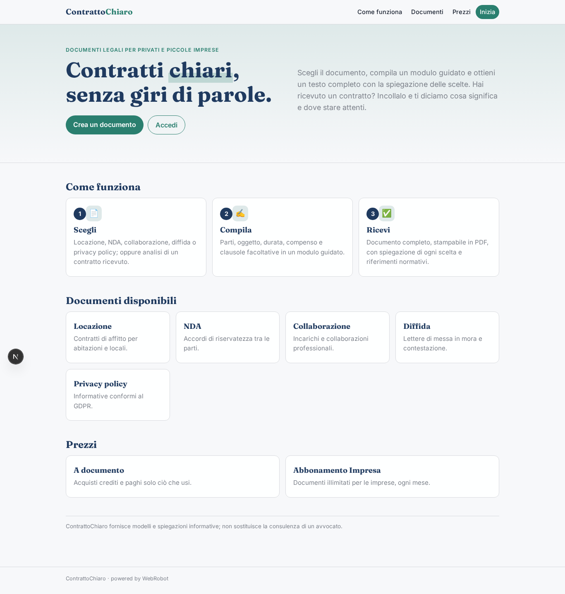
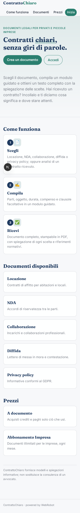
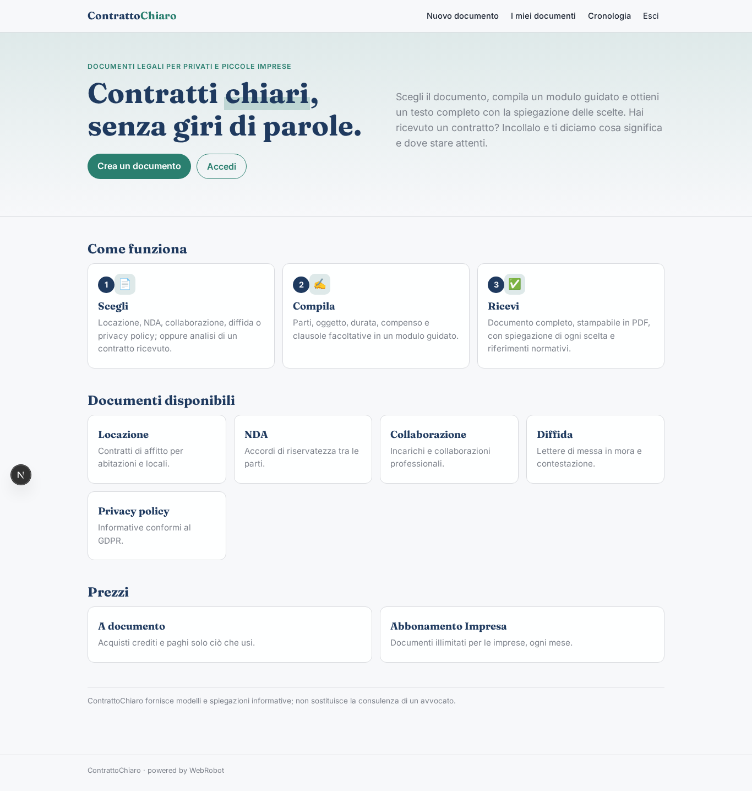
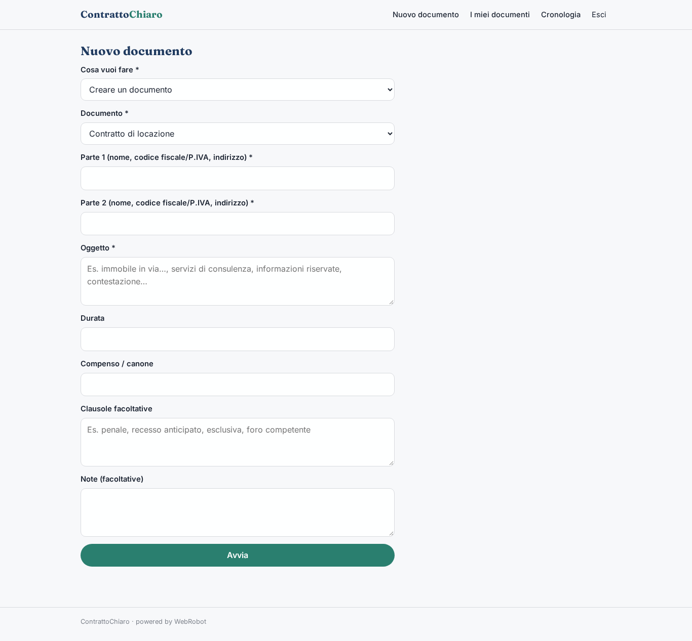
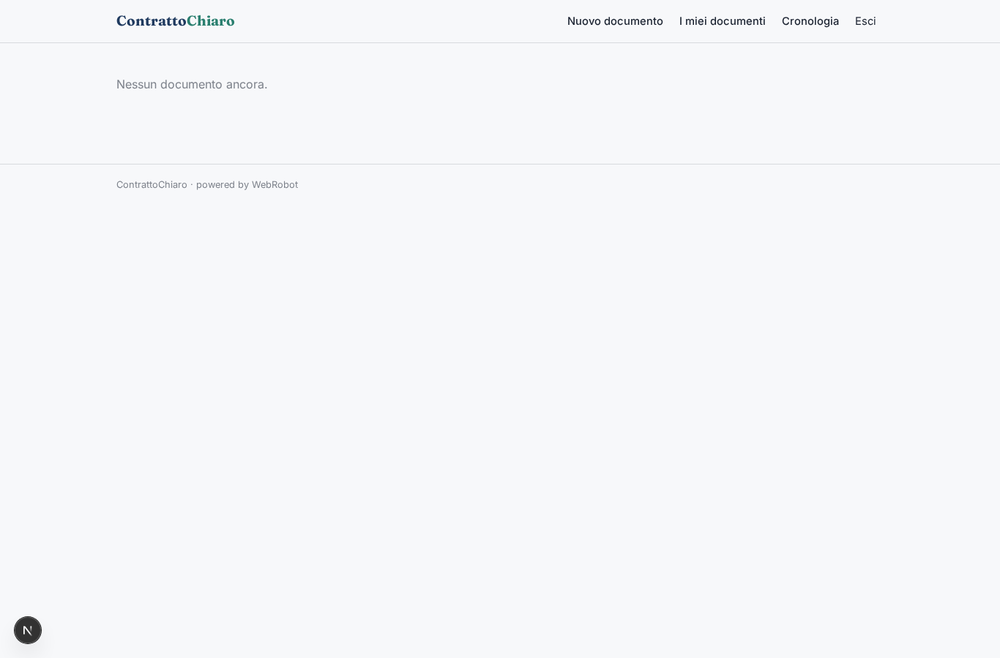

# ContrattoChiaro

_Contratti e documenti legali comuni, chiari e pronti all'uso._

**Stato manifest:** valido (validatore Python + contratto runtime)

## Descrizione data all'app builder

Vorrei un'app, ContrattoChiaro, per privati e piccole imprese che hanno bisogno di documenti legali comuni: contratti di locazione, NDA, contratti di collaborazione, diffide, privacy policy. L'utente sceglie il documento e compila un modulo guidato con le parti, l'oggetto, la durata, il compenso, le clausole facoltative. Può anche caricare un contratto ricevuto in PDF o Word: un agente lo legge, spiega in parole semplici le clausole e segnala quelle sfavorevoli o non conformi alla normativa. Per generare, l'agente usa i testi normativi pubblici indicizzati e modelli approvati, produce il documento in formato Word e PDF e spiega le scelte. Poi le parti devono poterlo firmare elettronicamente dentro l'app con un invito via email alla controparte, e il documento firmato resta archiviato. L'utente vede i propri documenti con stato (bozza, inviato, firmato). Pagamento a documento oppure abbonamento mensile per le imprese con documenti illimitati. Italiano.

## Funzioni non esprimibili oggi (spec.extensions)

- **firma_elettronica**: Non ancora disponibile: firma elettronica dentro l'app, invito via email alla controparte e archiviazione del documento firmato. Per ora lo stato (bozza, inviato, firmato) è gestito a mano.
- **upload_pdf_word**: Non ancora disponibile: caricamento di PDF/Word da analizzare. Per ora l'utente incolla il testo del contratto.
- **export_word**: Non ancora disponibile: esportazione in formato Word. Il PDF si ottiene dalla stampa del report.
- **abbonamento_illimitato**: I documenti illimitati per il piano Impresa richiedono la gestione di un'esenzione dal costo per run, non ancora espressa nel manifesto.
- **notifiche_email**: Non ancora disponibili: email di invito alla controparte e avvisi di firma.

## Screenshot (runtime interpretativo)

### home-anon

### home-mobile

### home

### new_doc

### my_docs

### history

### account

