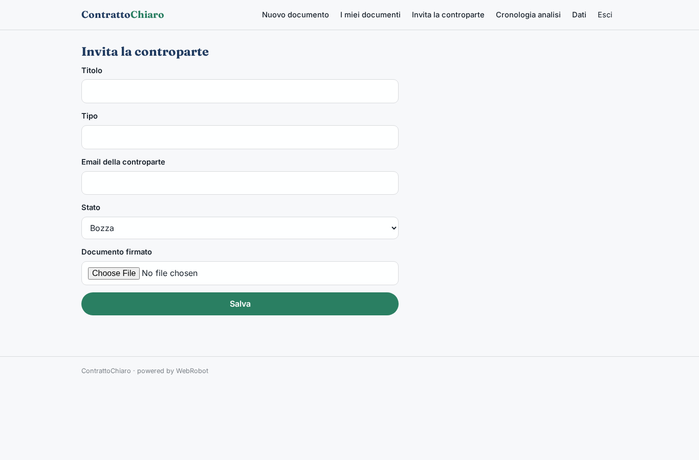
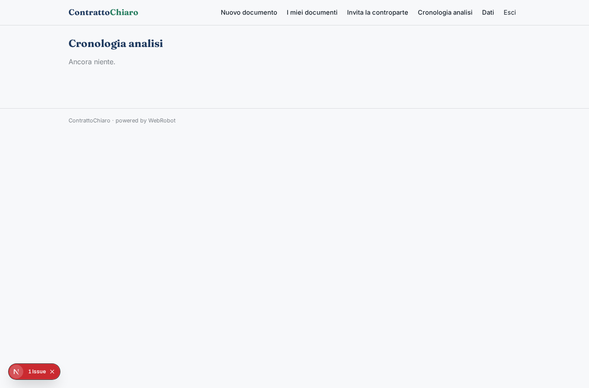
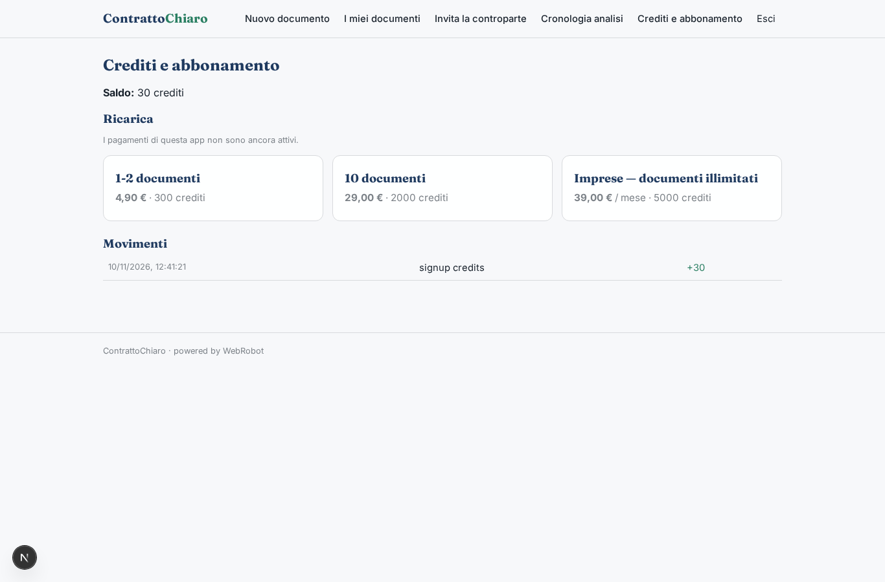

# ContrattoChiaro

_Documenti legali comuni, chiari e spiegati in parole semplici._

**Manifest:** valid (schema + runtime contract) · **Functional test:** passed (11 checks passed)

## Description given to the app builder (Italian)

Vorrei un'app, ContrattoChiaro, per privati e piccole imprese che hanno bisogno di documenti legali comuni: contratti di locazione, NDA, contratti di collaborazione, diffide, privacy policy. L'utente sceglie il documento e compila un modulo guidato con le parti, l'oggetto, la durata, il compenso, le clausole facoltative. Può anche caricare un contratto ricevuto in PDF o Word: un agente lo legge, spiega in parole semplici le clausole e segnala quelle sfavorevoli o non conformi alla normativa. Per generare, l'agente usa i testi normativi pubblici indicizzati e modelli approvati, produce il documento in formato Word e PDF e spiega le scelte. Poi le parti devono poterlo firmare elettronicamente dentro l'app con un invito via email alla controparte, e il documento firmato resta archiviato. L'utente vede i propri documenti con stato (bozza, inviato, firmato). Pagamento a documento oppure abbonamento mensile per le imprese con documenti illimitati. Italiano.

## Features not expressible today (spec.extensions)

- **esignature**: Firma elettronica dentro l'app per la controparte (che non ha un account), con valore legale (FEA/FES), non disponibile: la controparte riceve l'invito via email e lo stato si aggiorna a mano; il file firmato si carica nel documento. Serve un provider di firma esterno.
- **docx_pdf_export**: Generazione di file Word e PDF: oggi il documento è un report stampabile (salvabile in PDF dal browser); l'export Word non è disponibile.
- **unlimited_plan**: Il piano Imprese è approssimato con un'allocazione mensile ampia di crediti; l'esenzione totale dal costo per documento non è esprimibile.
- **legal_corpus**: Gli admin devono caricare testi normativi e modelli approvati in /admin/data (legal_texts, doc_models).

## Screenshots (interpretive runtime, no data)

### home-anon

### home-mobile

### home

### new_doc

### my_docs

### send_doc

### history

### account

