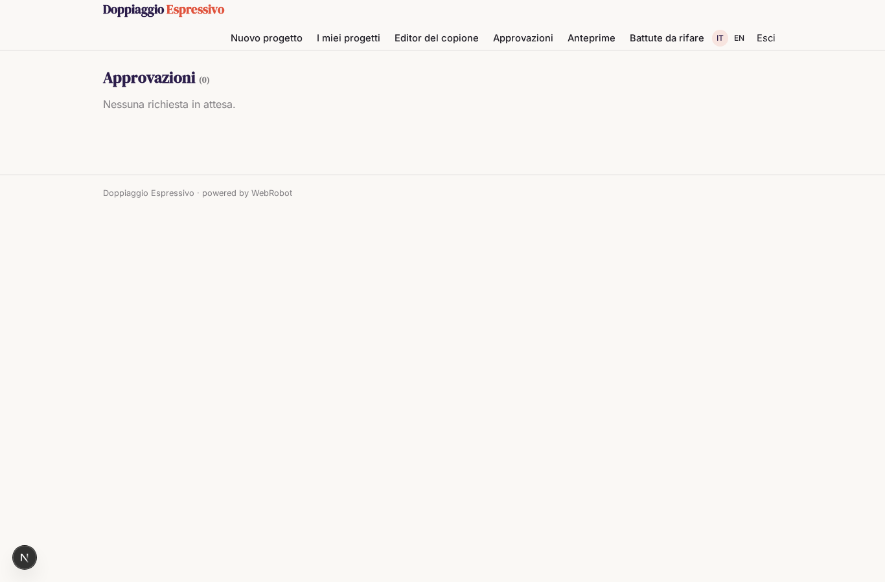

# Doppiaggio Espressivo

_Doppia i tuoi video in altre lingue senza perdere l'emozione._

**Stato manifest:** valido (validatore Python + contratto runtime)

## Descrizione data all'app builder

Ci serve Doppiaggio Espressivo, un'app per studi di post-produzione e creatori di contenuti che vogliono doppiare video in altre lingue mantenendo l'emozione della voce. Descrivo solo lo strato di gestione dei progetti: la sintesi vocale è affidata a un motore esterno specializzato. L'utente carica il video o la traccia audio originale, indica la lingua di partenza e le lingue di arrivo, e i personaggi. Un agente trascrive i dialoghi con i tempi, separa i parlanti, traduce adattando la lunghezza delle frasi al labiale e alle pause, e annota per ogni battuta l'emozione e l'intensità. Il dialoghista dello studio rivede e corregge il copione tradotto in un editor e lo approva. Poi l'agente invia le battute al motore vocale, assegna a ogni personaggio una voce coerente, riassembla la traccia e la rimonta sul video. Il cliente ascolta l'anteprima, segnala le battute da rifare con un commento, e infine scarica il video doppiato. Ogni studio vede solo i suoi progetti; i clienti dello studio vedono solo le anteprime a loro condivise. Pagamento a crediti per minuto doppiato.

## Funzioni non esprimibili oggi (spec.extensions)

- **voice_engine**: The external voice synthesis engine is not connected: needs an API with per-project credentials or a host in egress. Until then the dubber reports voice generation as unavailable.
- **media_processing**: Audio/video transcription, track reassembly and remux on the original video are not available as app features; they depend on the voice/media engine.
- **file_upload**: Uploading video or audio files is not available yet: the form asks for a downloadable link. Final video delivery is a link.
- **per_minute_billing**: Credits per dubbed minute: the estimate is fixed at 10 and settled on real usage; true per-minute pricing needs a rate by duration.
- **notifications**: No emails to the dialogue writer or client when a script or preview is ready.

## Screenshot (runtime interpretativo)

### home-anon

### home-mobile

### home

### new_project

### projects

### script_editor

### approvals

### previews

### revisions

### account

