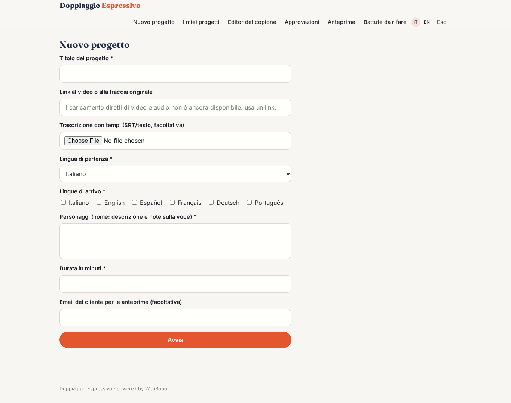
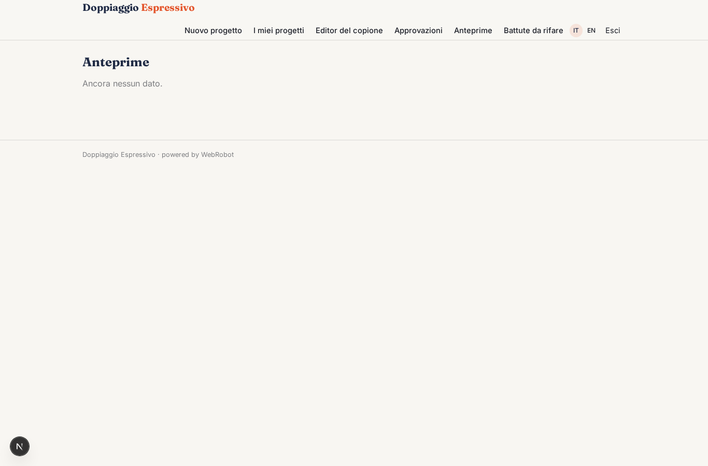
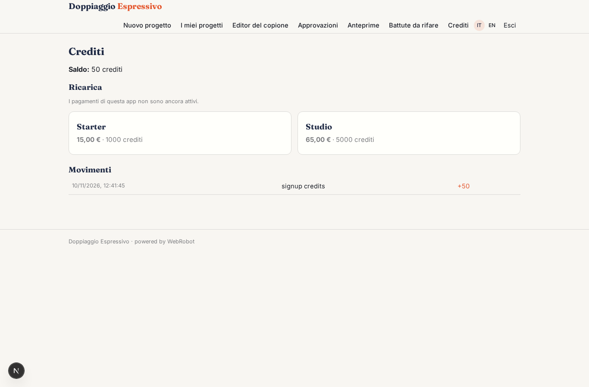

# Doppiaggio Espressivo

_Doppia i tuoi video in altre lingue senza perdere l'emozione._

**Manifest:** valid (schema + runtime contract) · **Functional test:** passed (7 checks passed)

## Description given to the app builder (Italian)

Ci serve Doppiaggio Espressivo, un'app per studi di post-produzione e creatori di contenuti che vogliono doppiare video in altre lingue mantenendo l'emozione della voce. Descrivo solo lo strato di gestione dei progetti: la sintesi vocale è affidata a un motore esterno specializzato. L'utente carica il video o la traccia audio originale, indica la lingua di partenza e le lingue di arrivo, e i personaggi. Un agente trascrive i dialoghi con i tempi, separa i parlanti, traduce adattando la lunghezza delle frasi al labiale e alle pause, e annota per ogni battuta l'emozione e l'intensità. Il dialoghista dello studio rivede e corregge il copione tradotto in un editor e lo approva. Poi l'agente invia le battute al motore vocale, assegna a ogni personaggio una voce coerente, riassembla la traccia e la rimonta sul video. Il cliente ascolta l'anteprima, segnala le battute da rifare con un commento, e infine scarica il video doppiato. Ogni studio vede solo i suoi progetti; i clienti dello studio vedono solo le anteprime a loro condivise. Pagamento a crediti per minuto doppiato.

## Design checks (who fills each collection)

- collection revision_requests: view revisions, tool read_revisions of dubber, trigger redo_requested read it, but nothing writes it — add a form view on it (the users fill their own records), an agent tool that writes or appends to it, or a trigger write; or, for a list the admins keep, make it ownedBy shared (admins fill it on the data page)

## Features not expressible today (spec.extensions)

- **media_upload**: Upload of video and audio files is not available yet (run-form files accept documents only): the project takes a link and an optional timed transcript. Automatic transcription of audio requires an external speech-to-text source.
- **voice_engine**: Connection to the external expressive voice synthesis engine (render per line, voices per character) is not declared: needs the engine's API host and key (set by an admin). Until then the dubber prepares the render jobs and the cast sheet with status pending_engine.
- **video_remux**: Re-assembly of the dubbed track and re-muxing onto the video, plus preview playback and final video download, need a media processing service not available in the manifest.
- **per_minute_credits**: Credits are metered on real usage; a fixed price per dubbed minute needs a cost computed from the 'minutes' field.
- **line_flagging_ui**: Clients flag lines to redo by adding records to revision_requests; a dedicated player-with-comments view is not available.

## Screenshots (interpretive runtime, no data)

### home-anon

### home-mobile

### home

### new_project

### projects

### script_editor

### approve

### previews

### revisions

### account

