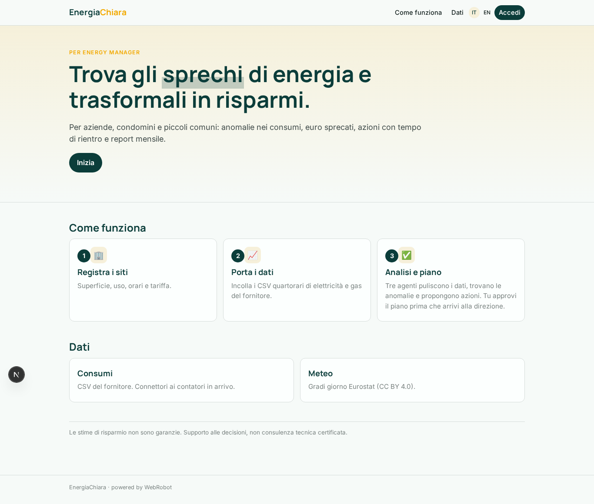
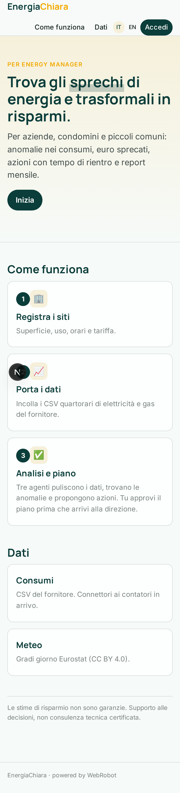
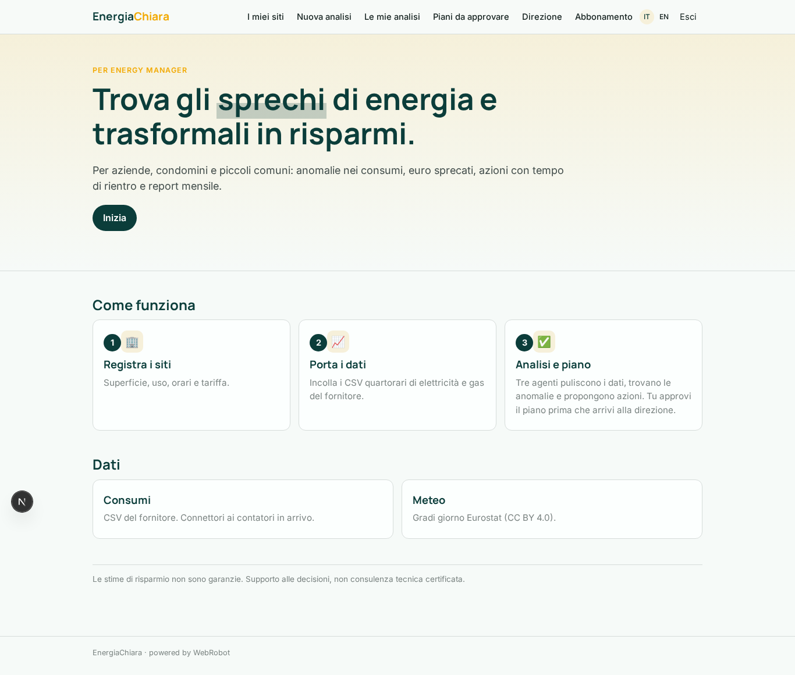
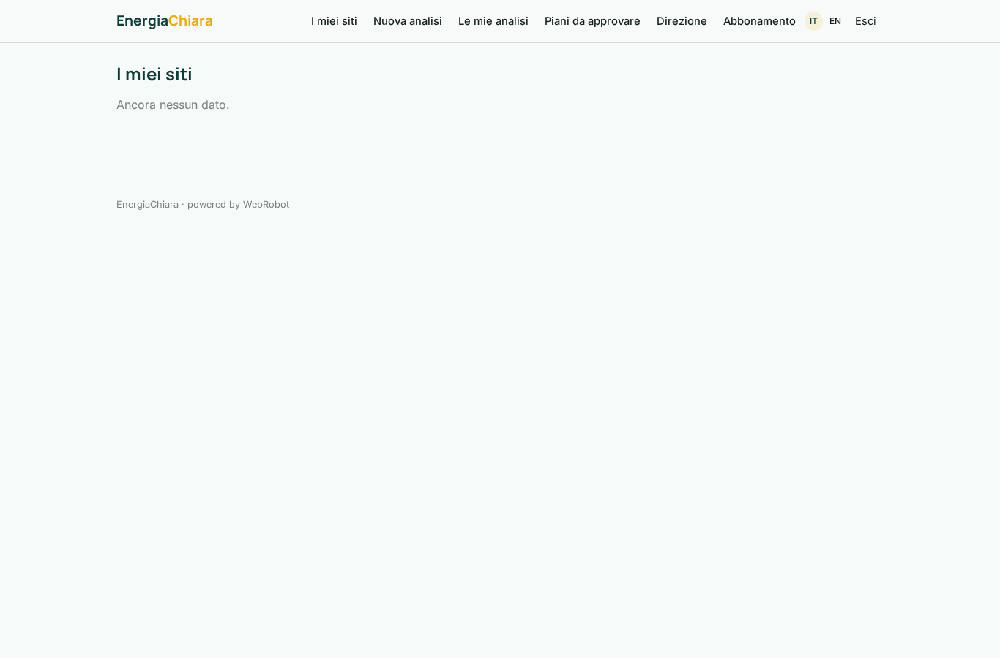
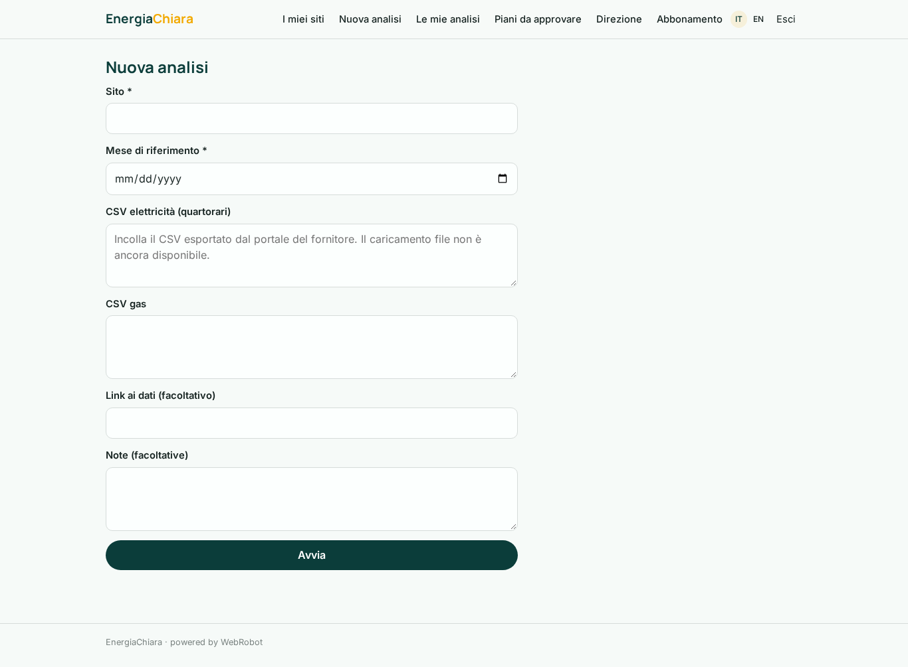
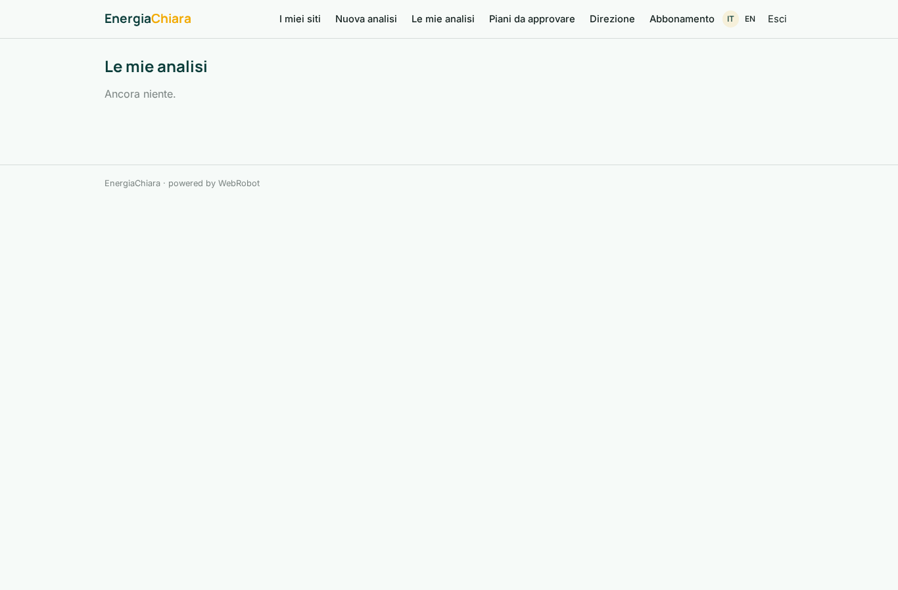
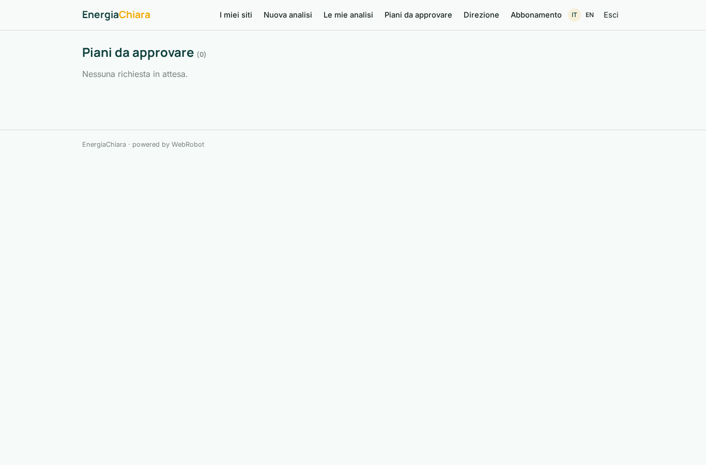
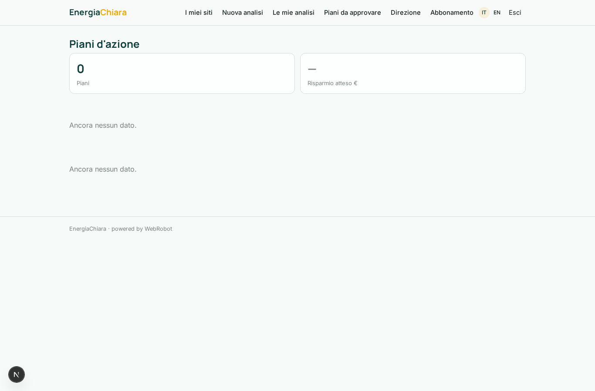
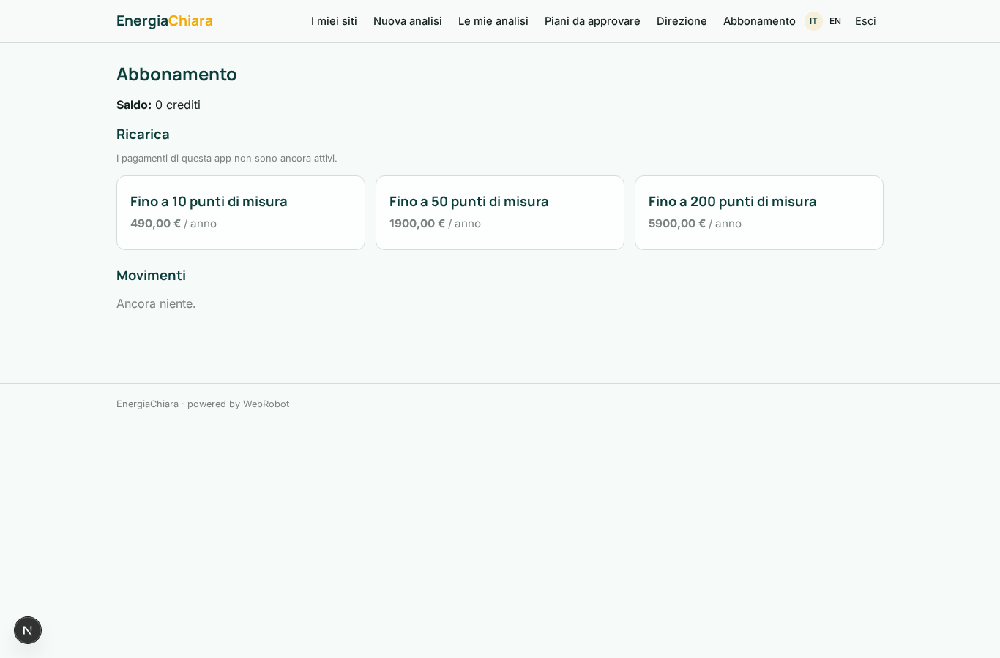

# EnergiaChiara

_Meno sprechi, meno bollette: piani d'azione per energy manager._

**Manifest status:** valid (schema validator + runtime contract)

## Description given to the app builder (Italian)

Voglio EnergiaChiara, piattaforma per energy manager di aziende, condomini e piccoli comuni che vogliono ridurre i consumi energetici. L'admin dell'organizzazione registra i siti (stabilimenti, uffici, edifici) con superficie, destinazione d'uso, orari di attività e tariffa. I dati di consumo arrivano dai contatori e smart meter del cliente tramite connettore o, in alternativa, con upload periodico di CSV quartorari di elettricità e gas esportati dal portale del fornitore; si aggiungono dati meteo open (gradi giorno). Un agente pulisce le serie, colma i buchi e calcola il profilo base per sito; un secondo agente individua anomalie (consumi notturni o nel weekend, picchi rispetto a giorni simili, scostamenti stagionali) e stima gli euro sprecati. Un terzo agente propone azioni concrete con risparmio atteso e tempo di rientro, e prepara un report mensile in PDF con grafici e confronto anno su anno. Gli alert per anomalie gravi arrivano via email entro un'ora dal dato. L'energy manager approva il piano d'azione prima che venga inviato alla direzione. Ogni sito è visibile solo agli utenti assegnati; la direzione vede la dashboard aggregata. Abbonamento annuale per numero di punti di misura. Italiano e inglese.

## Features not expressible today (spec.extensions)

- **file_upload**: Periodic CSV file upload is not available yet: users paste the CSV text or give a link.
- **meter_connectors**: Connectors to meters/smart meters need each customer's credentials and are not available yet.
- **email_alerts**: Email alerts within one hour for severe anomalies are not available yet (no notifications); severe anomalies are flagged in the report.
- **site_assignment_and_aggregate**: Assigning a site to several users and the organisation-wide aggregate dashboard need a shared org scope; for now sites are per user and the management page shows the plans of the signed-in user. Per-point subscription limits are tiered plans, not metered.
- **pdf_export**: The monthly PDF is the printable report view (print to PDF).

## Screenshots (interpretive runtime)

### home-anon

### home-mobile

### home

### sites

### new

### history

### approvals

### management

### account

