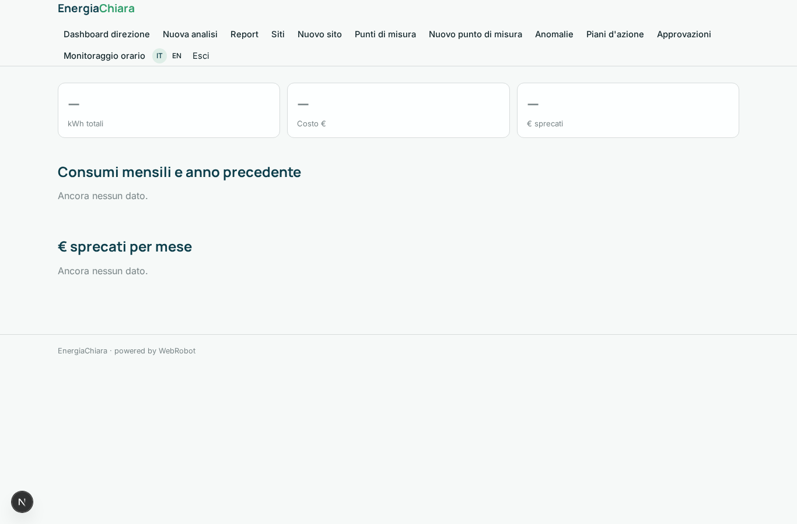
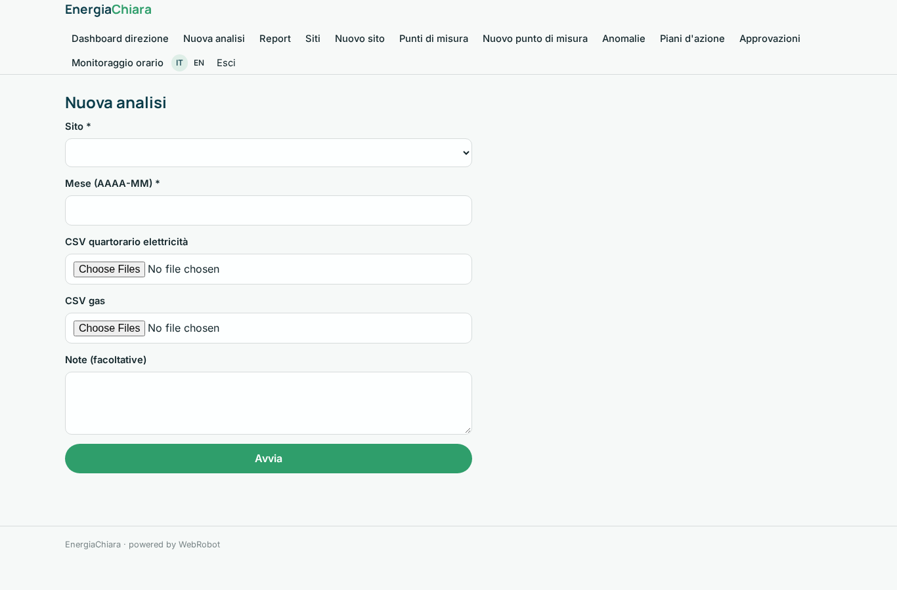
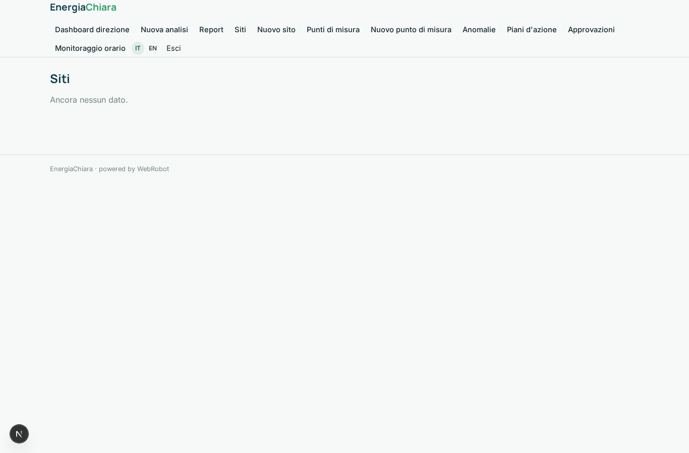
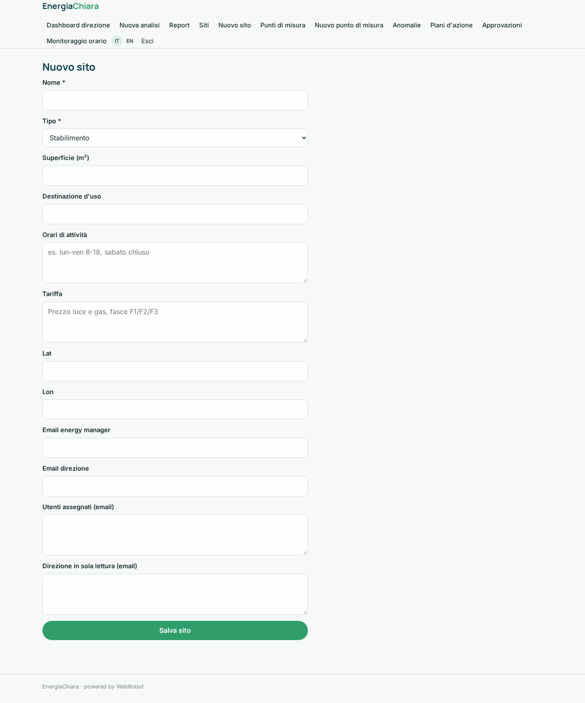
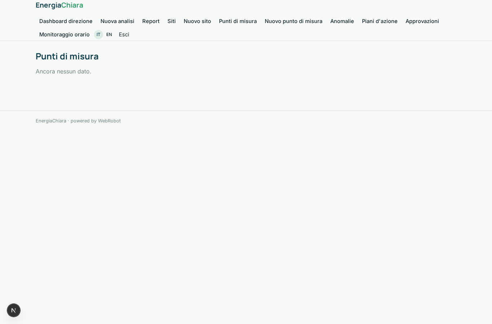
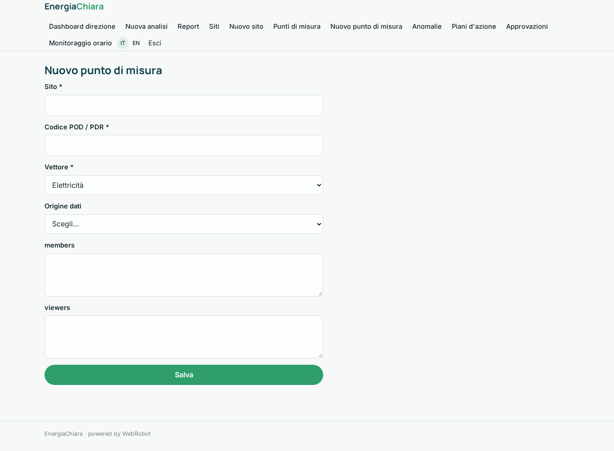
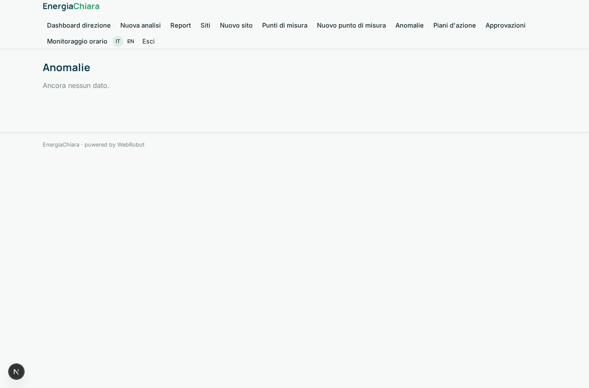
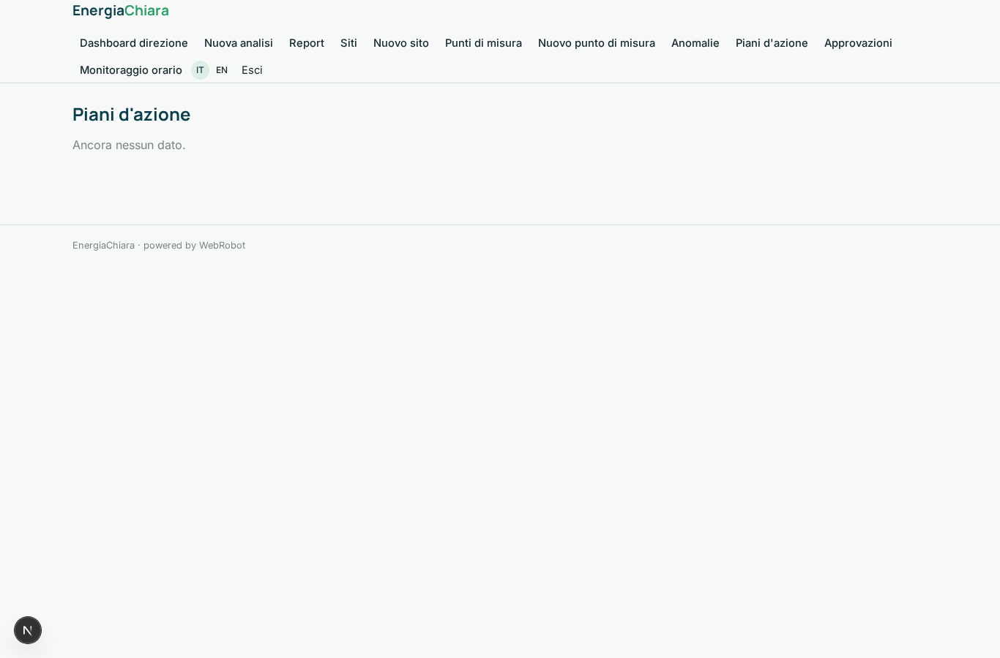
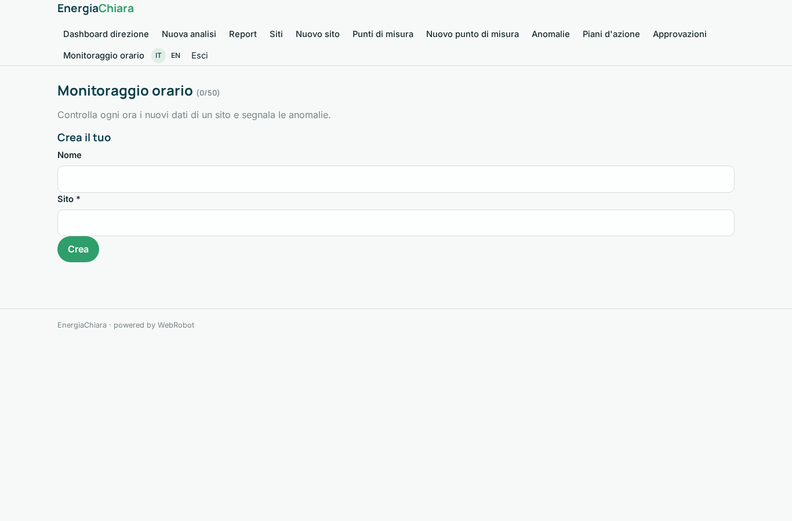
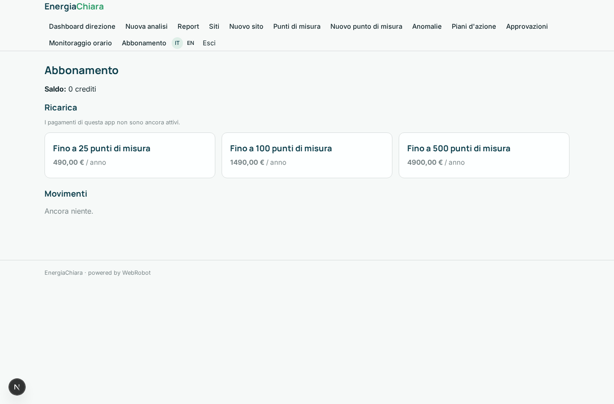

# EnergiaChiara

_Meno sprechi energetici, più risparmi dimostrabili._

**Manifest:** valid (schema + runtime contract) · **Functional test:** passed (17 checks passed)

## Description given to the app builder (Italian)

Voglio EnergiaChiara, piattaforma per energy manager di aziende, condomini e piccoli comuni che vogliono ridurre i consumi energetici. L'admin dell'organizzazione registra i siti (stabilimenti, uffici, edifici) con superficie, destinazione d'uso, orari di attività e tariffa. I dati di consumo arrivano dai contatori e smart meter del cliente tramite connettore o, in alternativa, con upload periodico di CSV quartorari di elettricità e gas esportati dal portale del fornitore; si aggiungono dati meteo open (gradi giorno). Un agente pulisce le serie, colma i buchi e calcola il profilo base per sito; un secondo agente individua anomalie (consumi notturni o nel weekend, picchi rispetto a giorni simili, scostamenti stagionali) e stima gli euro sprecati. Un terzo agente propone azioni concrete con risparmio atteso e tempo di rientro, e prepara un report mensile in PDF con grafici e confronto anno su anno. Gli alert per anomalie gravi arrivano via email entro un'ora dal dato. L'energy manager approva il piano d'azione prima che venga inviato alla direzione. Ogni sito è visibile solo agli utenti assegnati; la direzione vede la dashboard aggregata. Abbonamento annuale per numero di punti di misura. Italiano e inglese.

## Features not expressible today (spec.extensions)

- **supplier_connectors**: Direct connectors to supplier portals and smart-meter vendors are not available yet; the data arrives via CSV upload or the webhook /api/hooks/meter_hook.
- **pdf_report**: The monthly report is the printable report view (save as PDF from the browser); automatic PDF attachments in email are not available.

## Screenshots (interpretive runtime, no data)

### home-anon

### home-mobile

### home

### overview

### new_analysis

### reports

### sites_list

### site_form

### meters_list

### meter_form

### anomalies

### plans

### approvals

### monitors

### account

