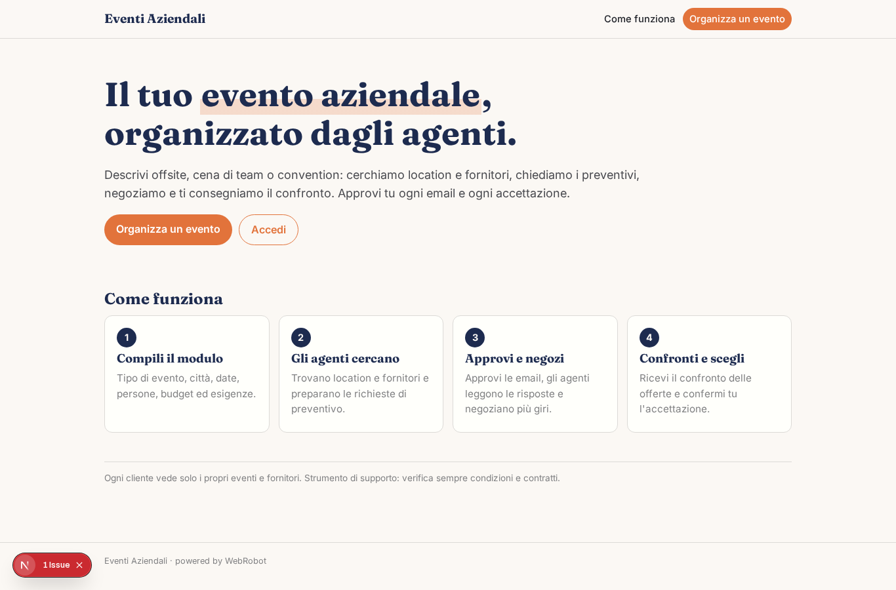
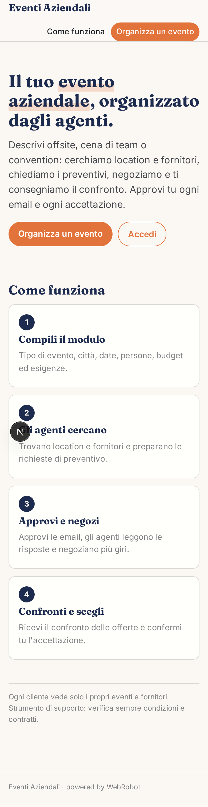
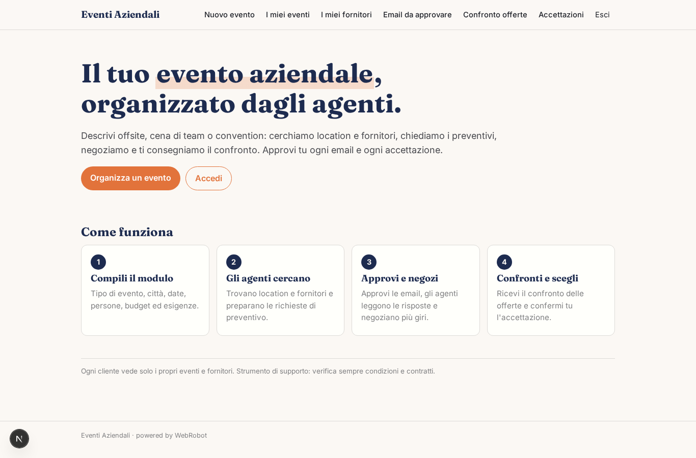
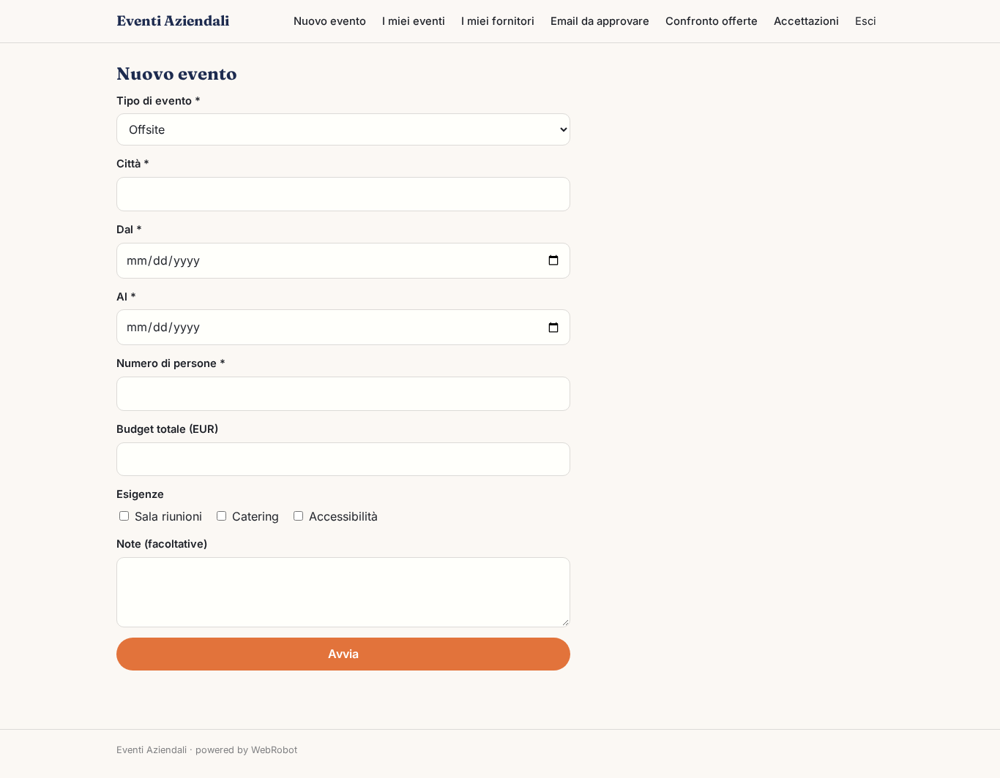
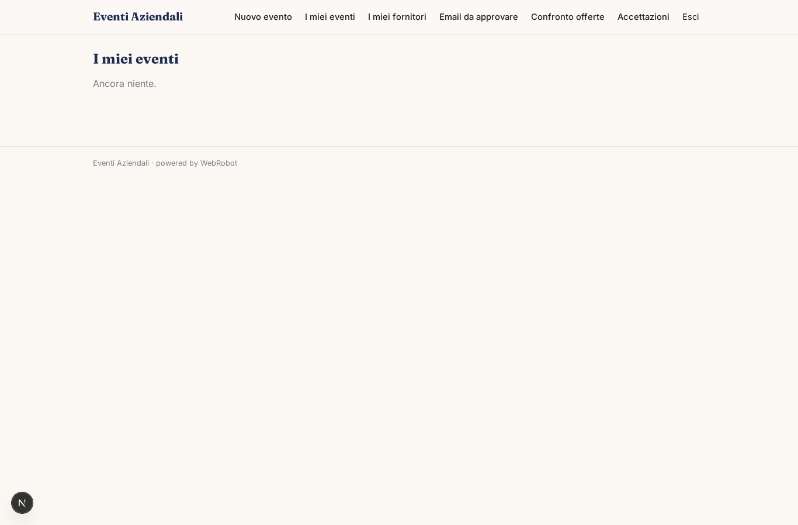
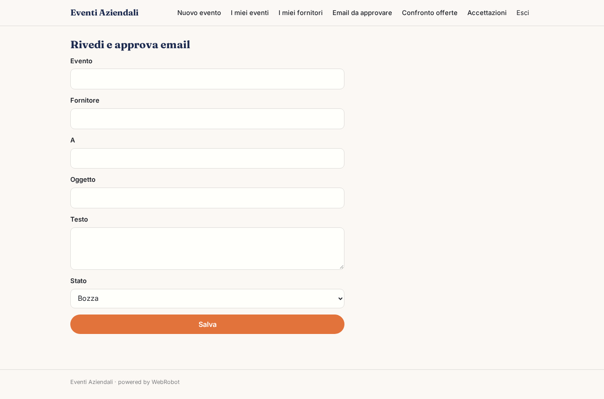
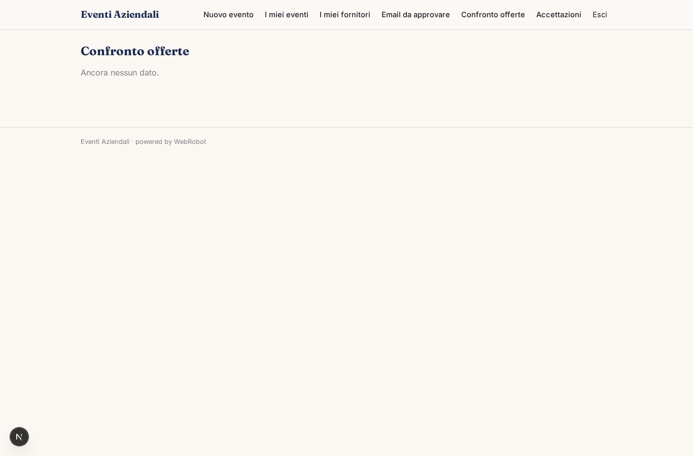
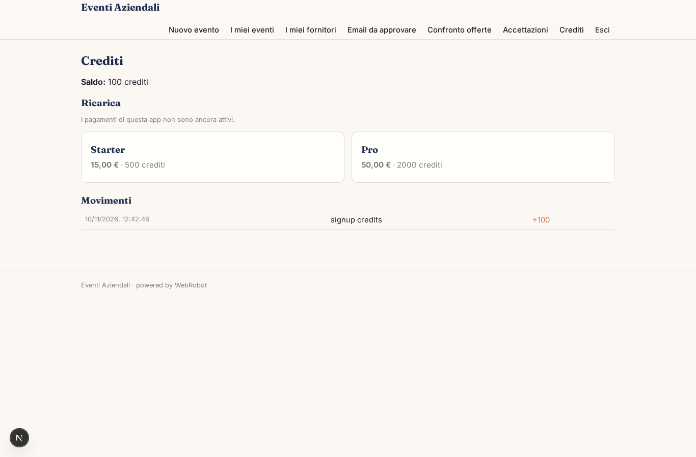

# Eventi Aziendali

_Location e fornitori per il tuo evento, con preventivi negoziati e confrontati._

**Manifest:** valid (schema + runtime contract) · **Functional test:** passed (12 checks passed)

## Description given to the app builder (Italian)

Un'app per chi organizza eventi aziendali (offsite, cene di team, convention). Il cliente compila un modulo: tipo di evento, città, date, numero di persone, budget, esigenze (sala riunioni, catering, accessibilità). Un team di agenti cerca sul web location e fornitori adatti, scrive a ciascun fornitore una richiesta di preventivo via email, legge le risposte che arrivano nella casella dell'app, risponde per negoziare prezzo e condizioni (anche più giri), e prepara un confronto delle offerte. Prima di inviare ogni email e prima di accettare un'offerta il cliente deve approvare. Ogni cliente vede solo i propri eventi e i propri fornitori. Si paga a crediti per evento organizzato. Italiano.

## Features not expressible today (spec.extensions)

- **inbound_routing**: Le risposte arrivano nella casella dell'app (canale email); associare ogni risposta al cliente giusto richiede che il fornitore risponda alla stessa conversazione. L'invio delle email avviene tramite la notifica della piattaforma verso l'indirizzo del fornitore salvato nel record.

## Screenshots (interpretive runtime, no data)

### home-anon

### home-mobile

### home

### new_event

### events

### suppliers_list

### drafts_list

### drafts_edit

### offers_list

### decisions

### account

