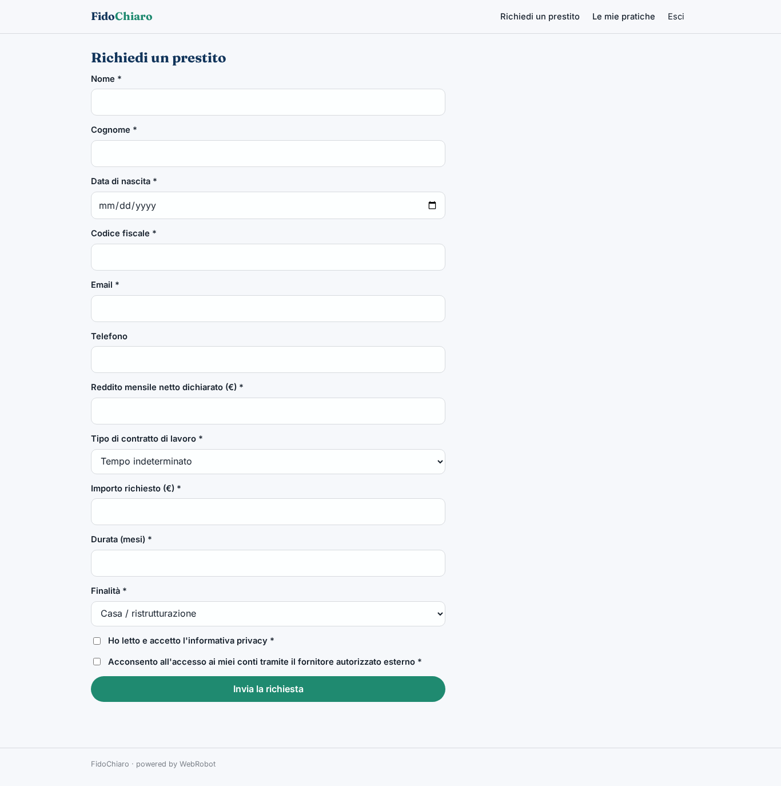
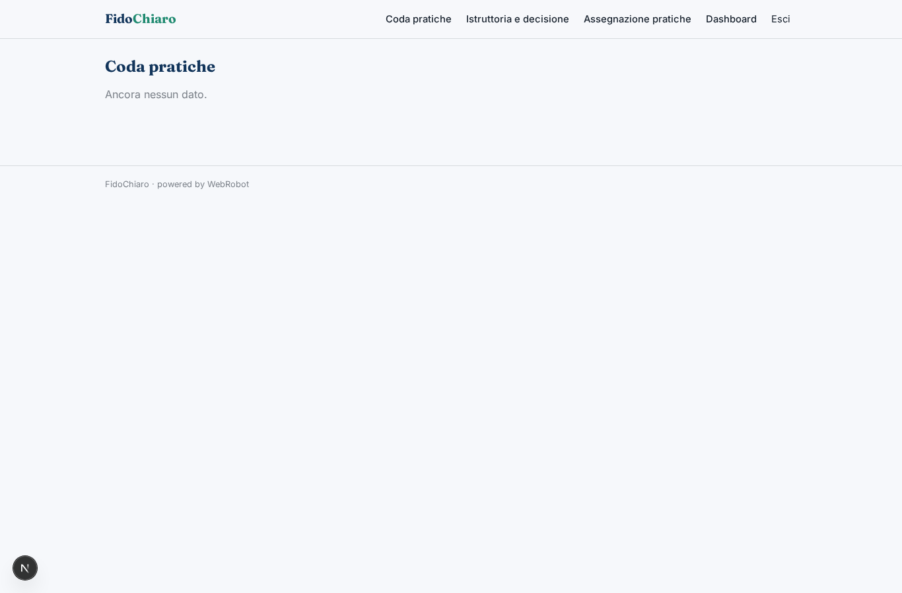
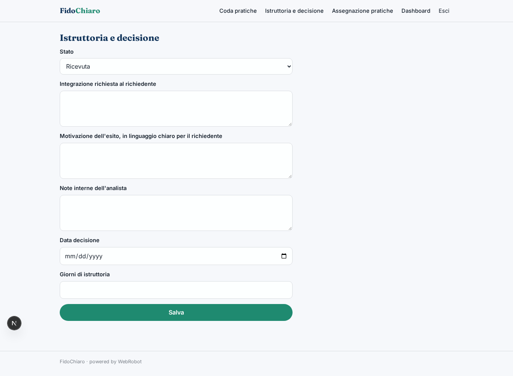
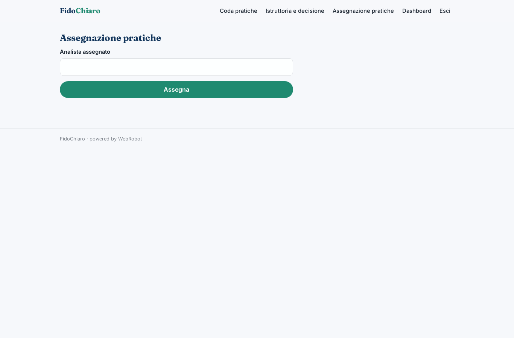
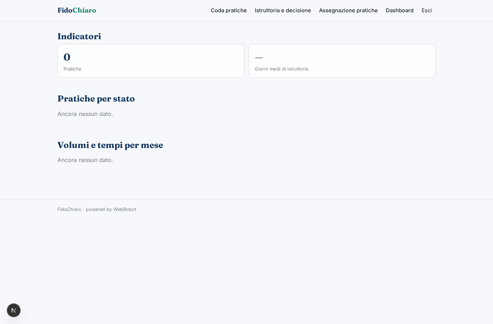

# FidoChiaro

_Pratiche di prestito chiare, istruite con metodo, decise da persone._

**Manifest:** valid (schema + runtime contract) · **Functional test:** passed (19 checks passed)

## Description given to the app builder (Italian)

Descrivo solo lo strato software di FidoChiaro, perché la valutazione del merito creditizio basata sull'accesso ai conti tramite open banking richiede un servizio di informazione sui conti autorizzato che resta fuori dall'app. L'app serve a una società finanziaria per gestire le richieste di prestito. Il richiedente compila online un modulo: dati anagrafici, codice fiscale, reddito dichiarato, tipo di contratto di lavoro, importo e durata richiesti, finalità; accetta l'informativa privacy e presta il consenso all'accesso ai conti, gestito dal fornitore autorizzato esterno che restituisce un riepilogo di entrate e uscite. Un agente controlla la completezza della pratica, calcola indicatori semplici dichiarati (rata su reddito, regolarità delle entrate) e prepara una scheda riassuntiva con i punti da verificare, senza decidere nulla da solo. L'analista crediti vede la coda delle pratiche, approva, rifiuta o chiede integrazioni; il richiedente riceve l'esito via email e segue lo stato in un'area personale. Le motivazioni del rifiuto sono spiegate in modo comprensibile. Il richiedente vede solo la propria pratica, gli analisti quelle assegnate, il responsabile la dashboard con volumi e tempi di istruttoria. Licenza annuale per la finanziaria. Italiano.

## Features not expressible today (spec.extensions)

- **open_banking_provider**: La valutazione tramite open banking richiede un fornitore di servizi di informazione sui conti autorizzato (AISP), esterno all'app: deve chiamare il webhook /api/hooks/aisp_summary con codice fiscale e riepilogo (income_avg, expenses_avg, regularity). Il flusso di consenso presso il fornitore non è nell'app.
- **applicant_internal_fields**: La scheda interna e le note dell'analista sono nella pratica ma nascoste al richiedente solo dalle colonne delle viste; per una separazione rigida servirebbe una collezione dedicata.
- **license_price**: Il prezzo della licenza annuale è indicativo: va fissato dal fornitore; la fatturazione a una sola società finanziaria può essere gestita fuori dall'app.

## Screenshots (interpretive runtime, no data)

### home-anon

### home-mobile

### home

### apply

### my_applications

### queue

### review

### assign

### dashboard

