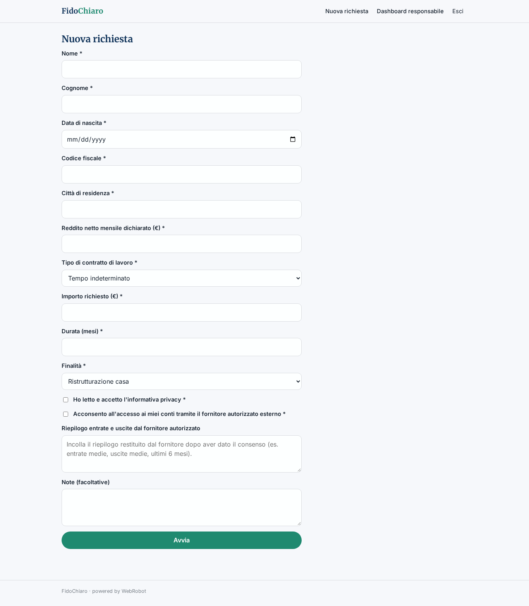
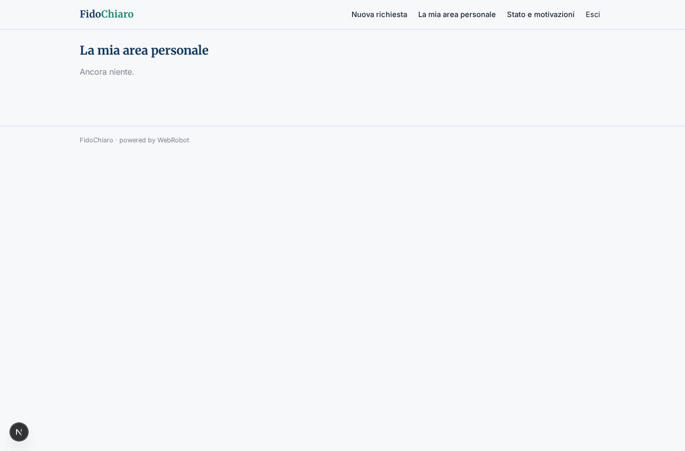
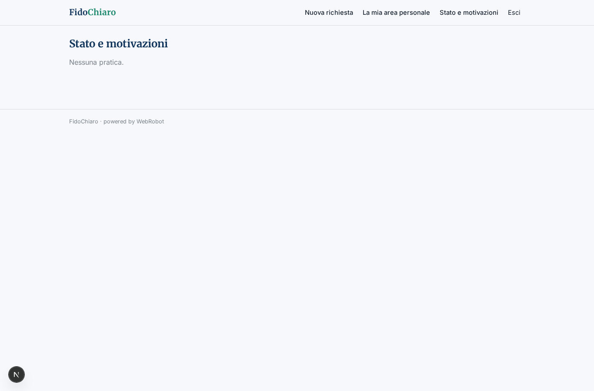
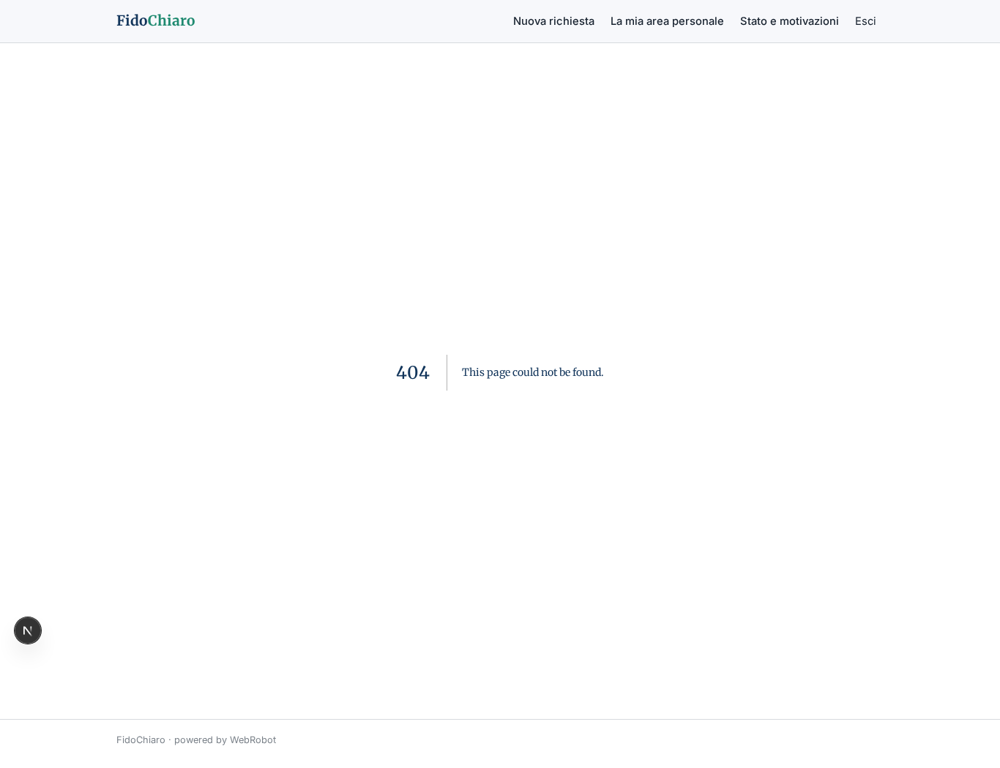
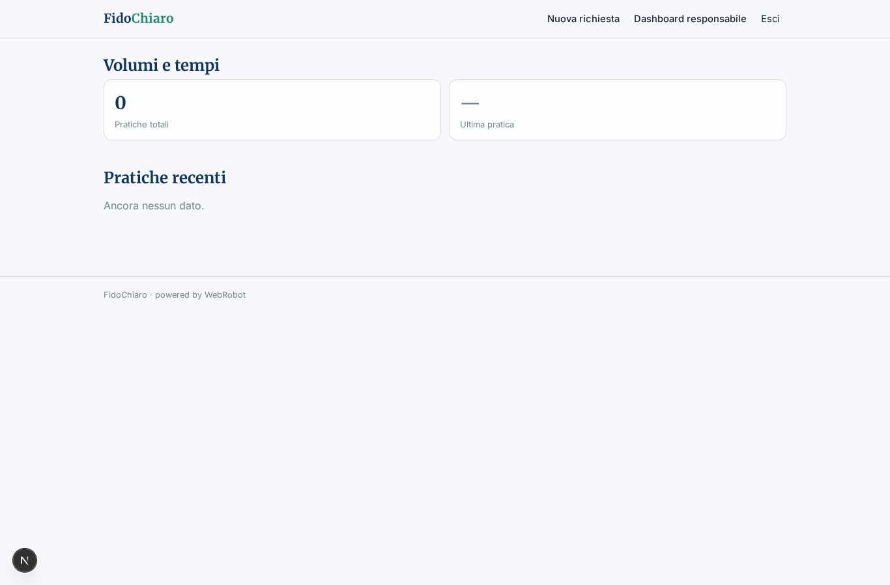

# FidoChiaro

_Richieste di prestito istruite in modo chiaro, con la decisione sempre in mano all'analista._

**Manifest status:** valid (schema validator + runtime contract)

## Description given to the app builder (Italian)

Descrivo solo lo strato software di FidoChiaro, perché la valutazione del merito creditizio basata sull'accesso ai conti tramite open banking richiede un servizio di informazione sui conti autorizzato che resta fuori dall'app. L'app serve a una società finanziaria per gestire le richieste di prestito. Il richiedente compila online un modulo: dati anagrafici, codice fiscale, reddito dichiarato, tipo di contratto di lavoro, importo e durata richiesti, finalità; accetta l'informativa privacy e presta il consenso all'accesso ai conti, gestito dal fornitore autorizzato esterno che restituisce un riepilogo di entrate e uscite. Un agente controlla la completezza della pratica, calcola indicatori semplici dichiarati (rata su reddito, regolarità delle entrate) e prepara una scheda riassuntiva con i punti da verificare, senza decidere nulla da solo. L'analista crediti vede la coda delle pratiche, approva, rifiuta o chiede integrazioni; il richiedente riceve l'esito via email e segue lo stato in un'area personale. Le motivazioni del rifiuto sono spiegate in modo comprensibile. Il richiedente vede solo la propria pratica, gli analisti quelle assegnate, il responsabile la dashboard con volumi e tempi di istruttoria. Licenza annuale per la finanziaria. Italiano.

## Features not expressible today (spec.extensions)

- **open_banking_aisp**: La valutazione basata sull'accesso ai conti richiede un servizio di informazione sui conti (AISP) autorizzato, fuori dall'app: il richiedente incolla il riepilogo entrate/uscite restituito dal fornitore.
- **email_esito**: Invio email al richiedente con l'esito: le notifiche non sono ancora disponibili; l'esito è visibile nell'area personale.
- **assegnazione_analisti**: Assegnazione delle pratiche ai singoli analisti e visibilità limitata a quelle assegnate: oggi tutti gli analisti vedono la coda delle approvazioni; serve logica dedicata.
- **tempi_istruttoria**: Dashboard con tempi medi di istruttoria e volumi per esito: oggi solo conteggi delle esecuzioni.
- **licenza_annuale**: Licenza annuale per la società finanziaria: contratto gestito fuori dall'app, nessun pagamento per singola pratica.
- **upload_documenti**: Caricamento di documenti (non disponibile): richiedere link o testo incollato.

## Screenshots (interpretive runtime)

### home-anon

### home-mobile

### home

### nuova

### mie_pratiche

### stato_pratiche

### coda

### dashboard

