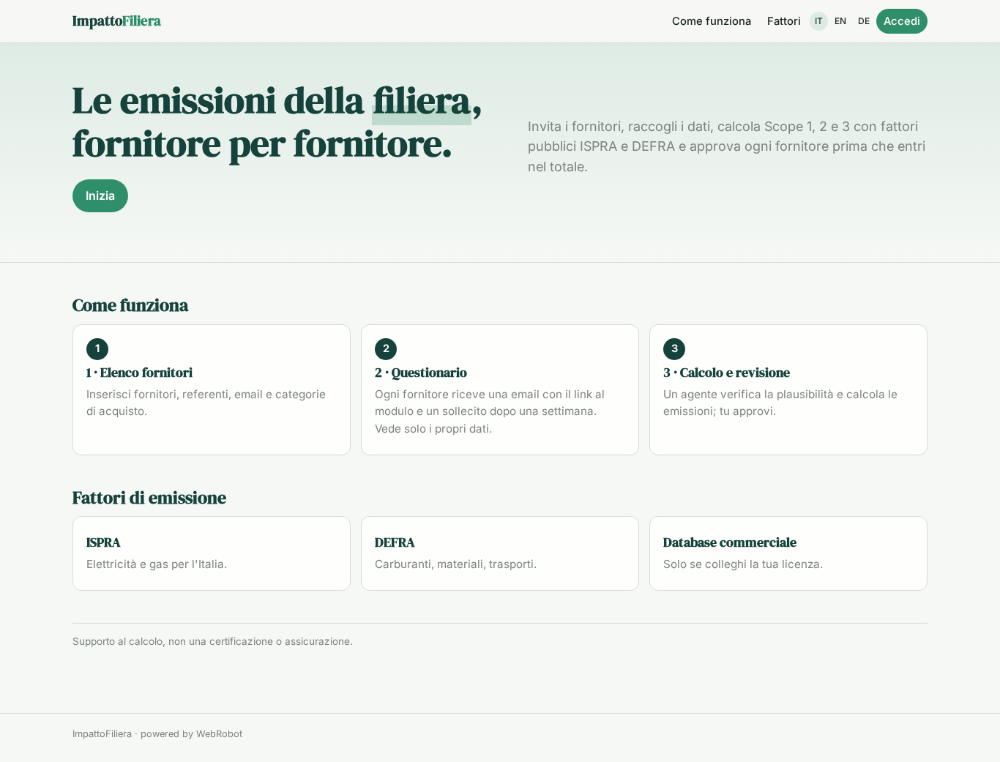
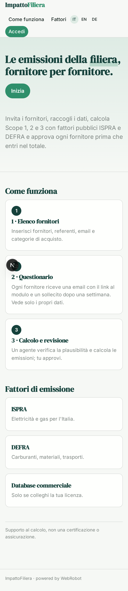
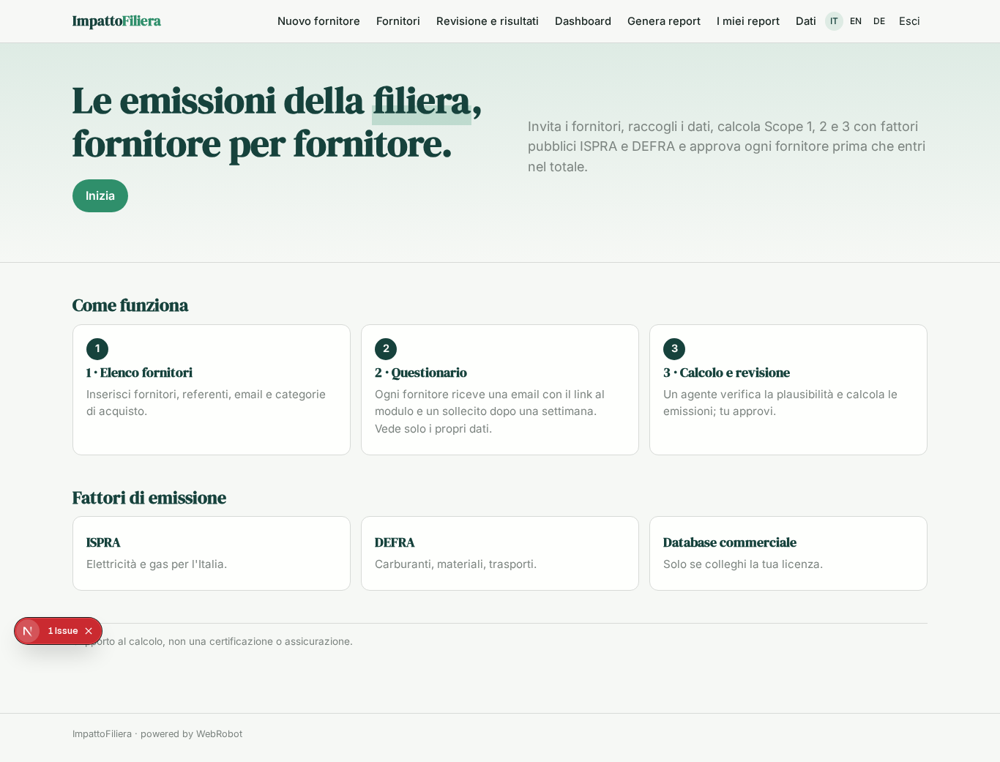
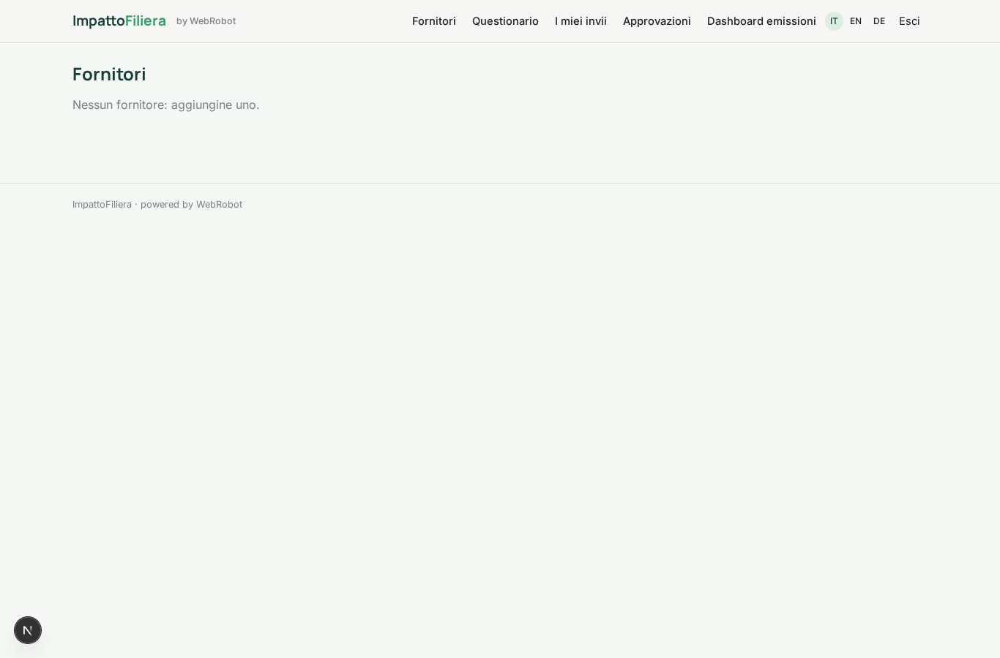
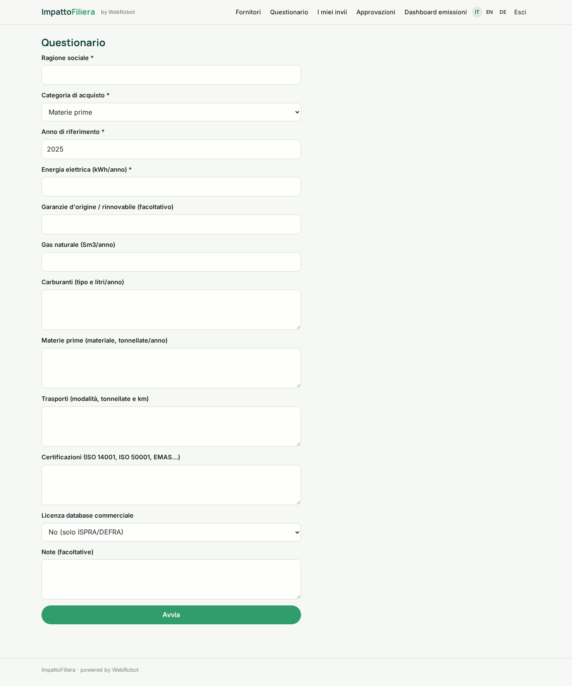
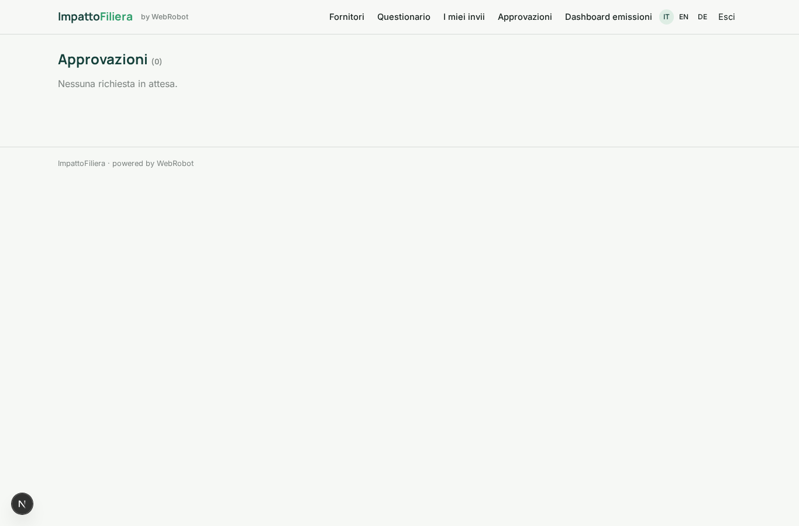
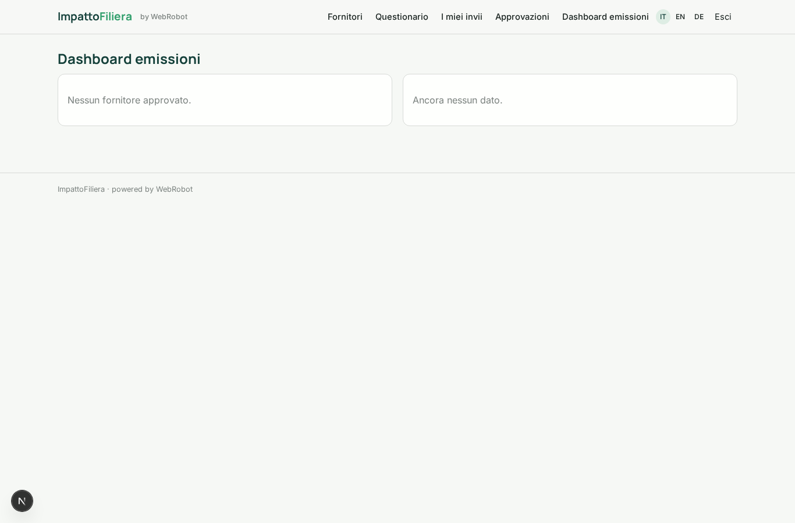
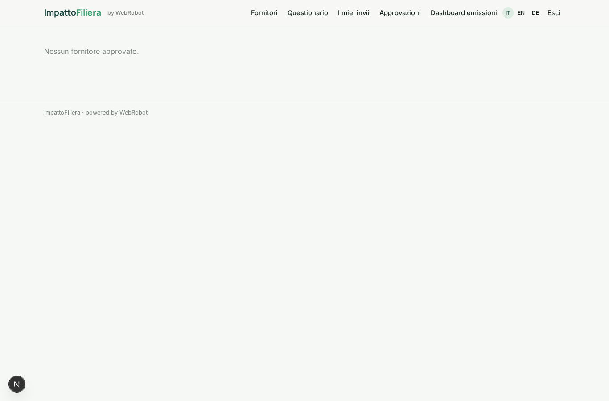
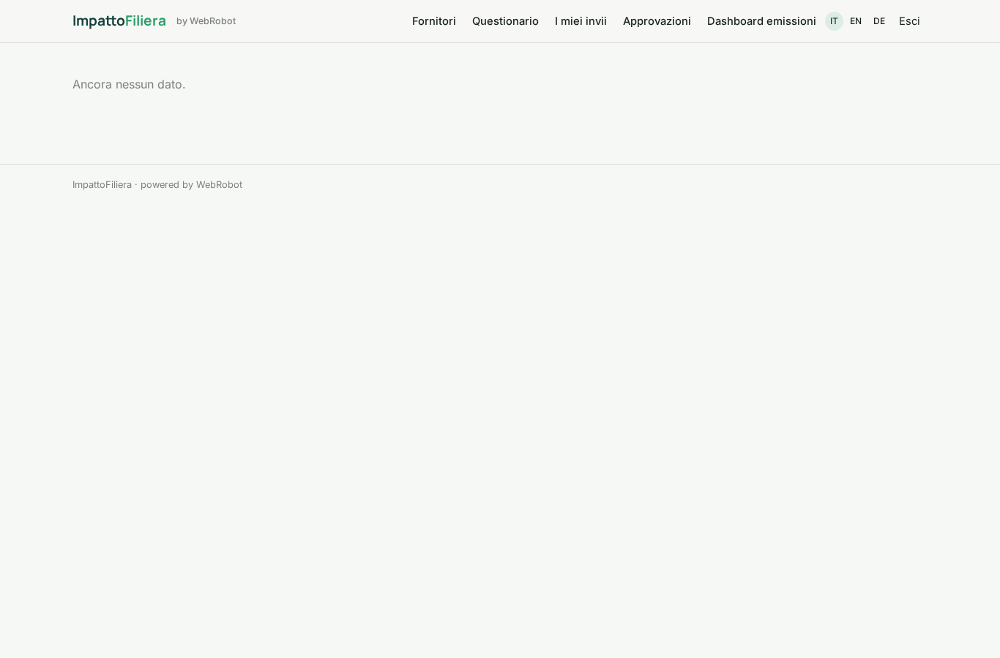
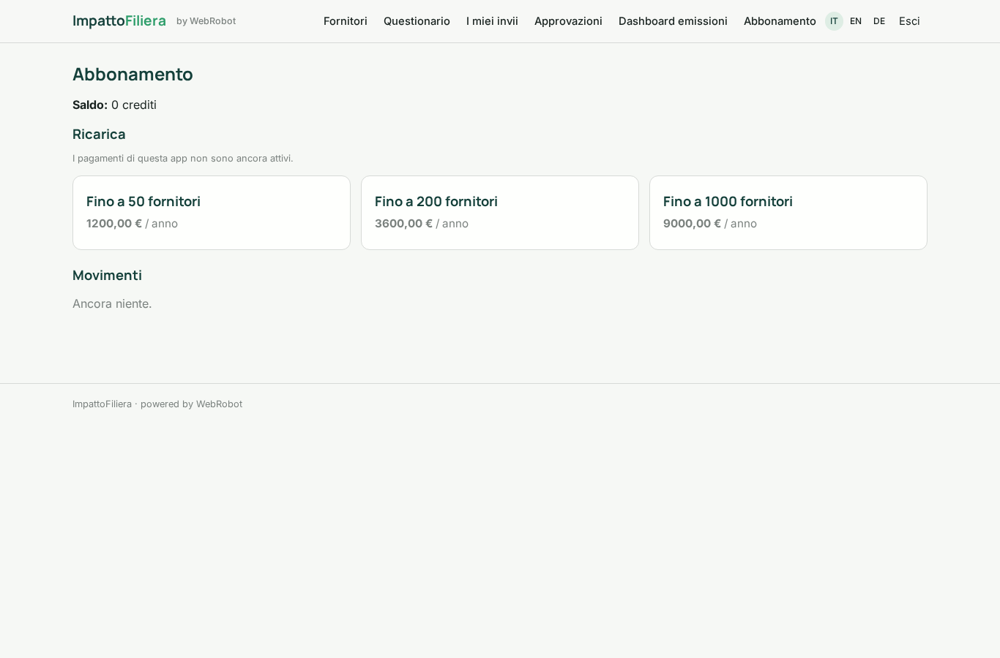

# ImpattoFiliera

_Le emissioni CO2 della tua catena di fornitura, fornitore per fornitore._

**Manifest status:** valid (schema validator + runtime contract)

## Description given to the app builder (Italian)

Ci serve ImpattoFiliera, una piattaforma per calcolare le emissioni di CO2 della catena di fornitura di aziende manifatturiere. L'azienda cliente inserisce l'elenco dei fornitori con referente ed email e le categorie di acquisto. L'app invia via email a ogni fornitore un questionario con un link a un modulo: consumi di energia elettrica e gas, carburanti, materie prime, trasporti, certificazioni; legge anche le risposte che arrivano per email e sollecita chi non risponde dopo una settimana. Un agente controlla la plausibilità dei dati, calcola le emissioni Scope 1, 2 e 3 con i fattori pubblici ISPRA e DEFRA (e con un database commerciale solo se il cliente ha la licenza) e segnala i valori anomali. Il responsabile sostenibilità rivede e approva ogni fornitore prima che entri nel totale. Alla fine vede una dashboard per fornitore e categoria e scarica il report. Ogni fornitore vede solo i propri dati. Abbonamento annuale per azienda in base al numero di fornitori. Italiano, inglese e tedesco.

## Features not expressible today (spec.extensions)

- **email_outbound**: Sending the questionnaire link by email to each supplier is not available yet. The client shares the app link; suppliers sign in with a magic link sent to the email in the supplier list.
- **email_inbound**: Reading supplier answers that arrive by email is not available yet: suppliers answer in the questionnaire form (paste text instead of attaching files).
- **reminders**: Automatic reminders after one week are not available (no notifications). The suppliers list shows status and invitation date so the client can see who is overdue.
- **commercial_db**: Commercial emission-factor database: no connector with client credentials yet; the client declares the licence in the form and the agent is told, but data access needs a later integration.
- **supplier_isolation**: Sharing each supplier's assessment with the client company and keeping suppliers limited to their own records needs per-record invitation wiring to be verified; file uploads are not supported.

## Screenshots (interpretive runtime)

### home-anon

### home-mobile

### home

### suppliers_list

### questionnaire

### my_submissions

### approvals_inbox

### emissions_dashboard

### by_supplier

### by_category

### account

