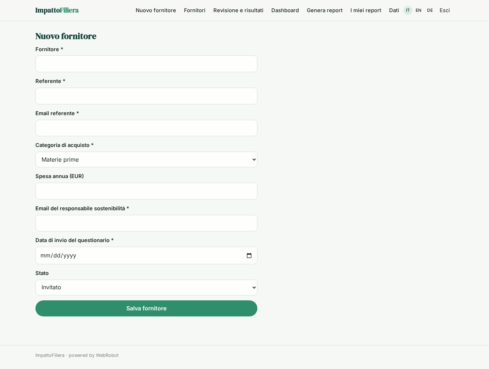
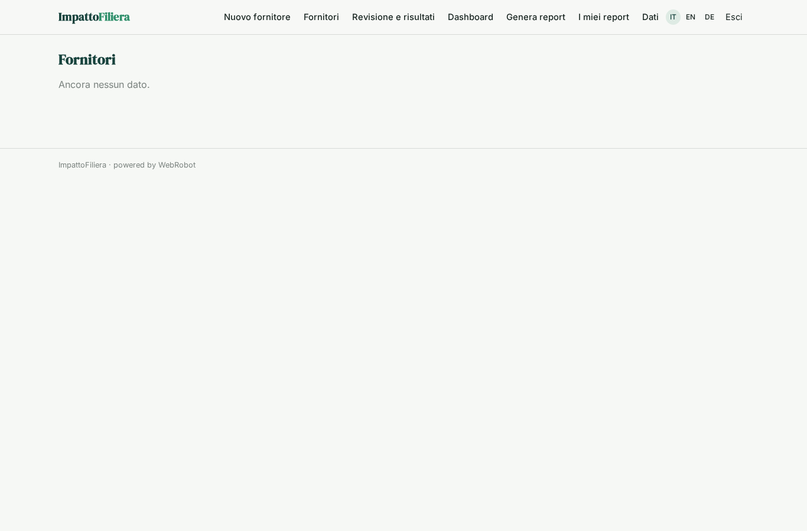
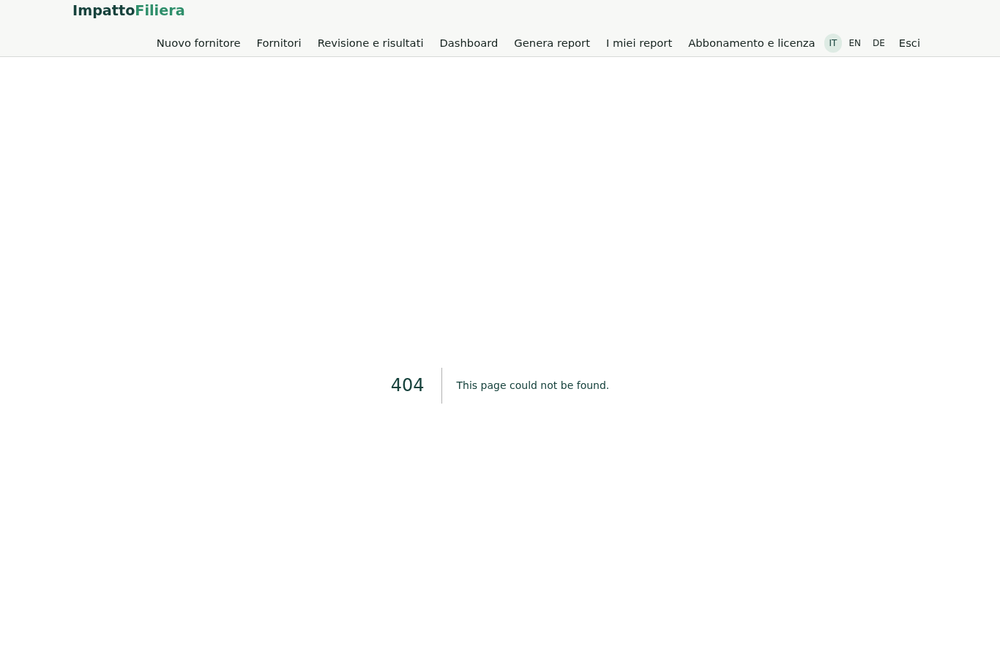
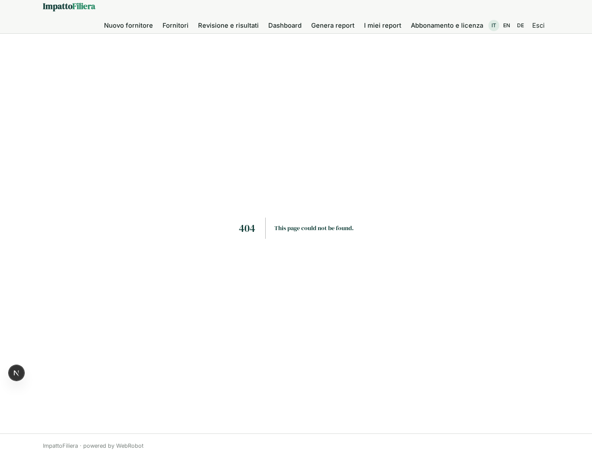
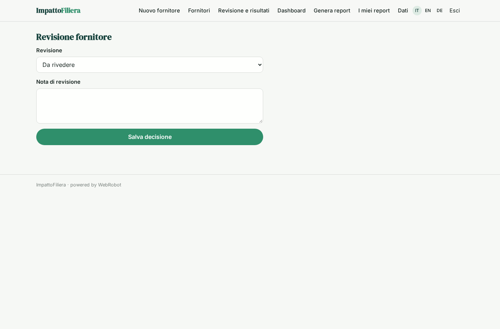
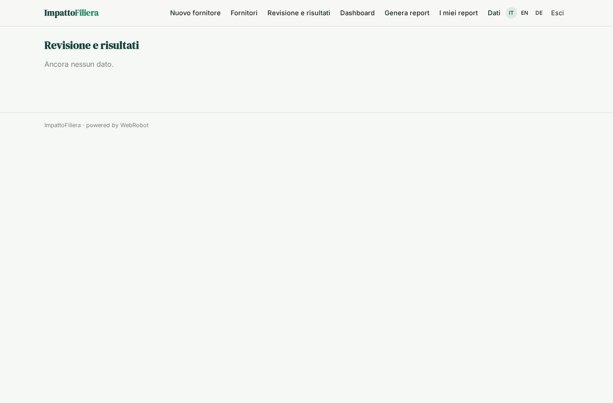
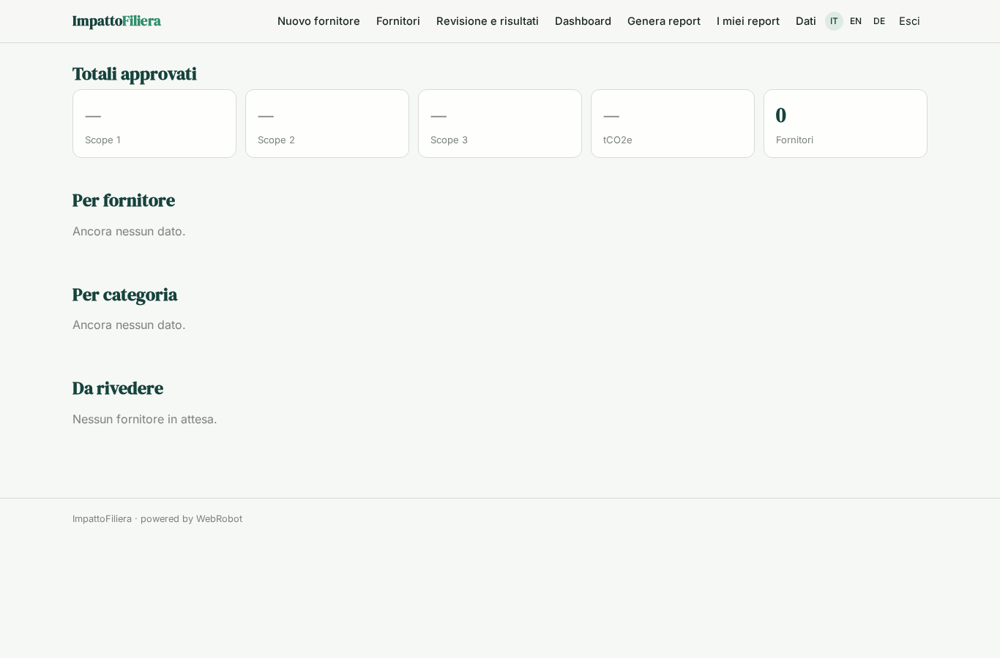
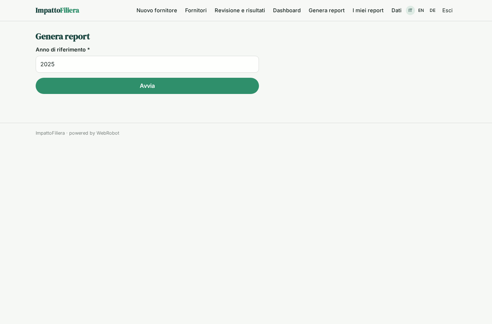
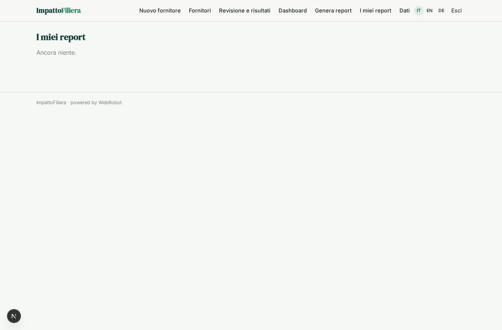
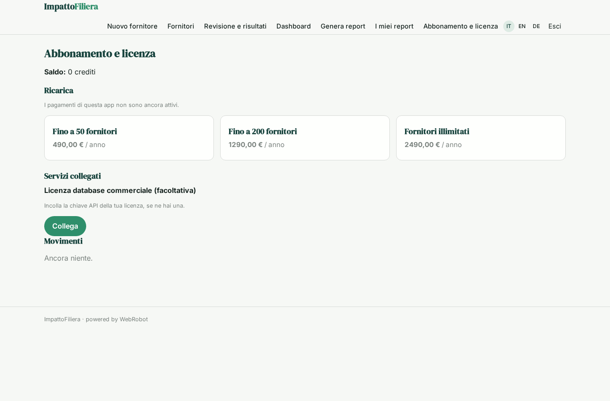

# ImpattoFiliera

_Le emissioni CO2 della tua filiera, fornitore per fornitore._

**Manifest:** valid (schema + runtime contract) · **Functional test:** passed (19 checks passed)

## Description given to the app builder (Italian)

Ci serve ImpattoFiliera, una piattaforma per calcolare le emissioni di CO2 della catena di fornitura di aziende manifatturiere. L'azienda cliente inserisce l'elenco dei fornitori con referente ed email e le categorie di acquisto. L'app invia via email a ogni fornitore un questionario con un link a un modulo: consumi di energia elettrica e gas, carburanti, materie prime, trasporti, certificazioni; legge anche le risposte che arrivano per email e sollecita chi non risponde dopo una settimana. Un agente controlla la plausibilità dei dati, calcola le emissioni Scope 1, 2 e 3 con i fattori pubblici ISPRA e DEFRA (e con un database commerciale solo se il cliente ha la licenza) e segnala i valori anomali. Il responsabile sostenibilità rivede e approva ogni fornitore prima che entri nel totale. Alla fine vede una dashboard per fornitore e categoria e scarica il report. Ogni fornitore vede solo i propri dati. Abbonamento annuale per azienda in base al numero di fornitori. Italiano, inglese e tedesco.

## Functional test: what did not pass

- **form saves a record** (form questionnaire): only role supplier may fill it, and the test cannot hold that role _(warning)_
- **trigger has its effect** (trigger review_needed): email to record.company_email: no such recipient in the test (role nobody holds or empty field) _(warning)_

## Features not expressible today (spec.extensions)

- **inbound_email_replies**: Reading supplier replies that arrive by email and turning them into questionnaire records is not available yet; suppliers answer through the form linked in the email, and the reminder after one week goes to those who have not answered.
- **factor_loading**: The emission_factors collection (ISPRA, DEFRA with source, year, unit and kgCO2e factor) must be loaded by the app admins; the agent never invents factors.
- **review_permissions**: Results are owned by the supplier whose submission triggered the analysis and shared with the company by company_email; a supplier could in principle edit the review status of their own result. A stricter split of write rights per field is not expressible yet.
- **commercial_licence_scope**: The commercial database key is read from the user running the analysis; with supplier-triggered runs it applies only if the key is available to that run (an org-level key may be needed).

## Screenshots (interpretive runtime, no data)

### home-anon

### home-mobile

### home

### add_supplier

### suppliers

### questionnaire

### my_results

### review

### results

### dashboard

### new_report

### reports

### account

