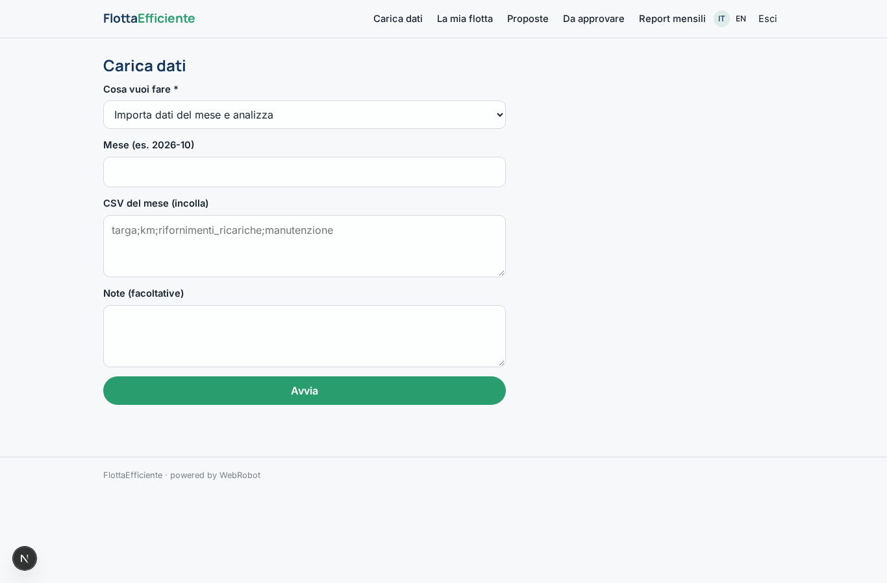
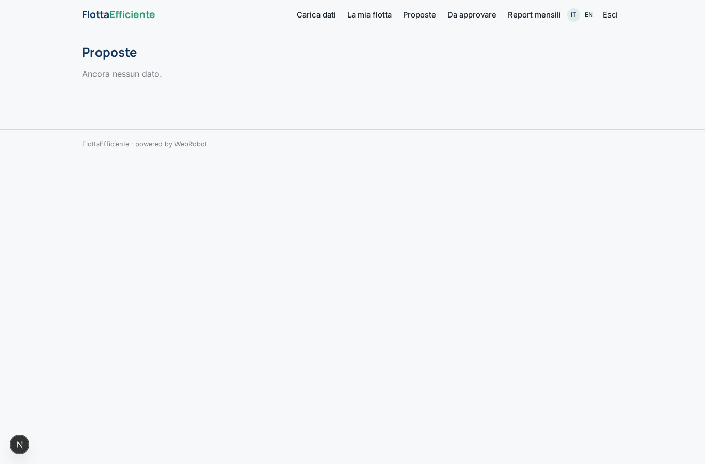
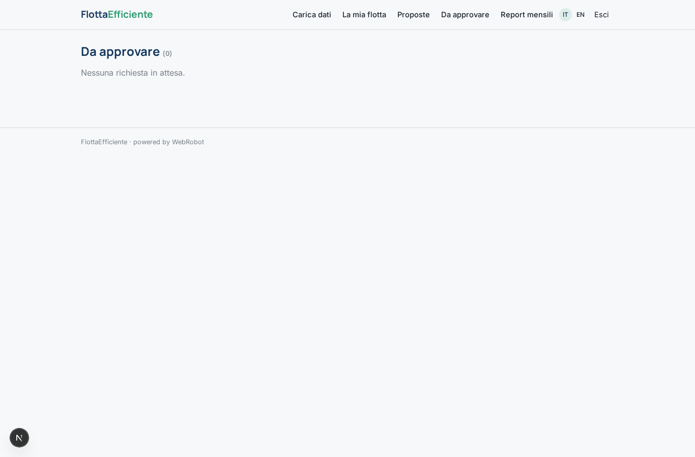
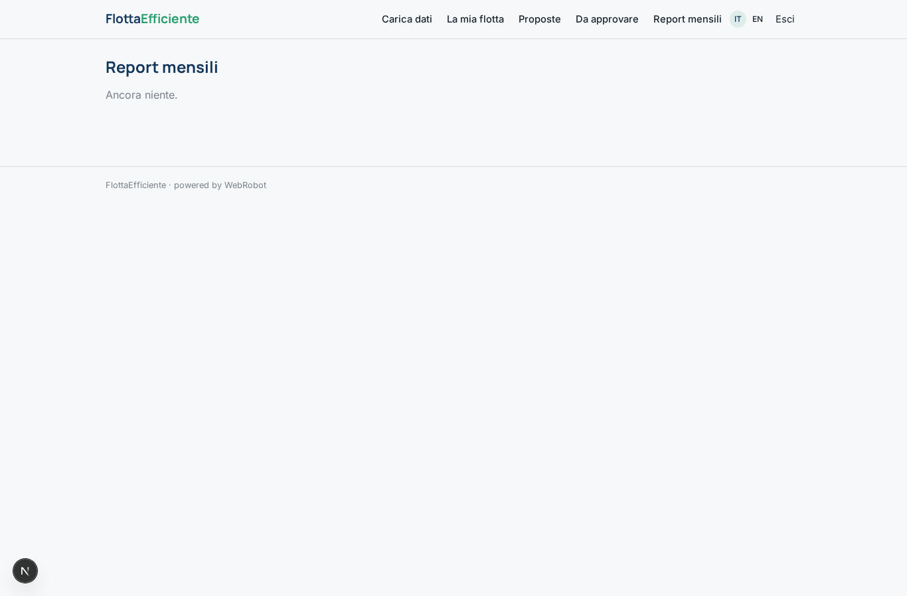
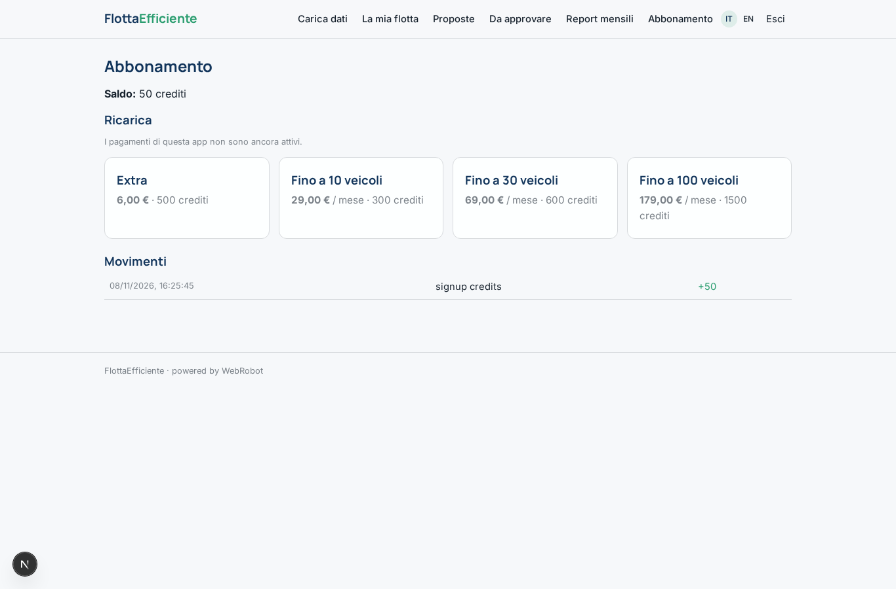

# FlottaEfficiente

_Il costo reale per chilometro di ogni veicolo aziendale, e una flotta più snella._

**Stato manifest:** valido (validatore Python + contratto runtime)

## Descrizione data all'app builder

Vorrei FlottaEfficiente, uno strumento per aziende con flotte di veicoli aziendali. Il fleet manager carica l'elenco dei veicoli (modello, alimentazione, chilometraggio, costo mensile, assegnatario) e importa ogni mese un CSV con chilometri percorsi, rifornimenti o ricariche e manutenzioni. Un agente calcola il costo totale per chilometro di ogni veicolo, individua quelli sottoutilizzati o troppo costosi e propone una flotta ottimizzata: quali mezzi eliminare, quali sostituire con elettrici o condividere tra dipendenti, con il risparmio stimato annuo. Il fleet manager approva o scarta ogni proposta. Ogni mese riceve un report via email con indicatori e anomalie. Ogni azienda vede solo la propria flotta. Abbonamento per numero di veicoli.

## Funzioni non esprimibili oggi (spec.extensions)

- **monthly_email**: Monthly report by email with indicators and anomalies: email notifications are not available yet. The report is produced in the app (Monthly reports) after each import.
- **file_upload**: CSV file upload is not available yet: the vehicle list and the monthly CSV are pasted as text.
- **vehicle_cap**: Enforcing the vehicle limit of each subscription plan (10/30/100) needs custom logic; for now it is a plan description.

## Screenshot (runtime interpretativo)

### home-anon

### home-mobile

### home

### new

### fleet

### proposals_list

### approve

### reports

### account

