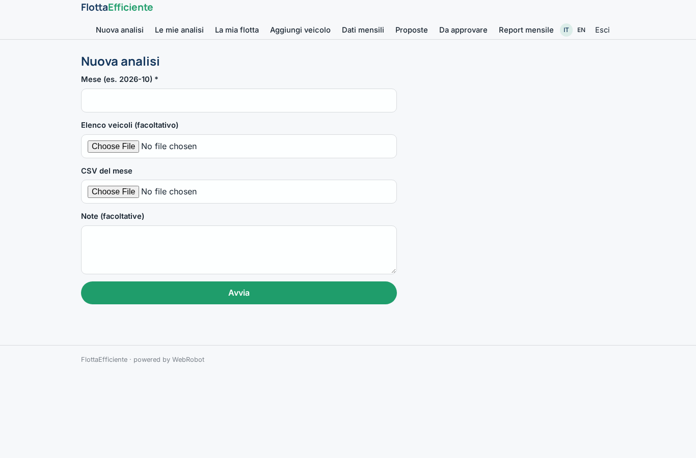
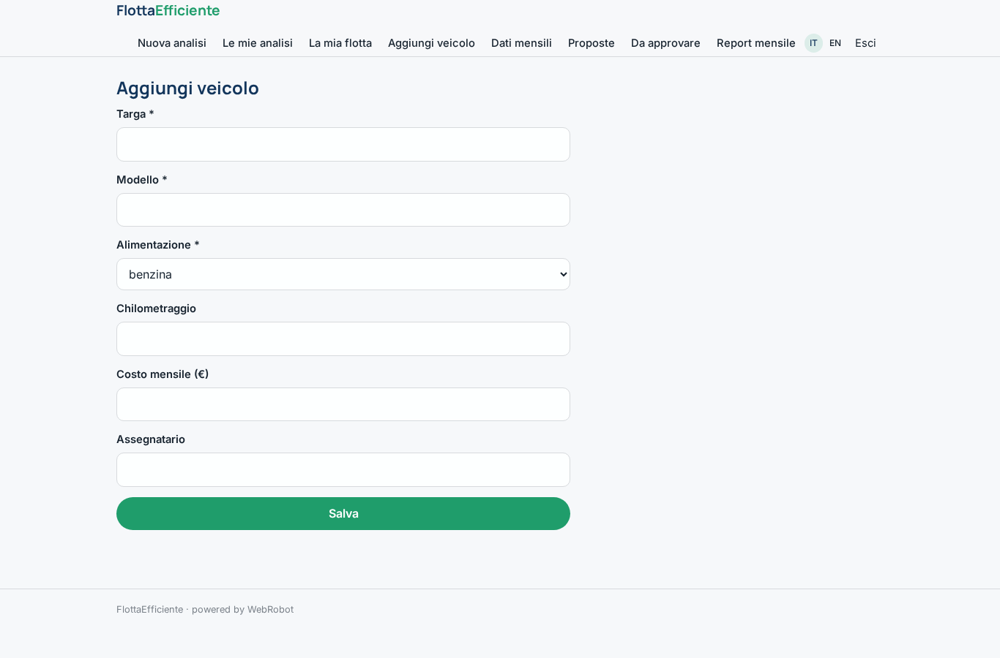
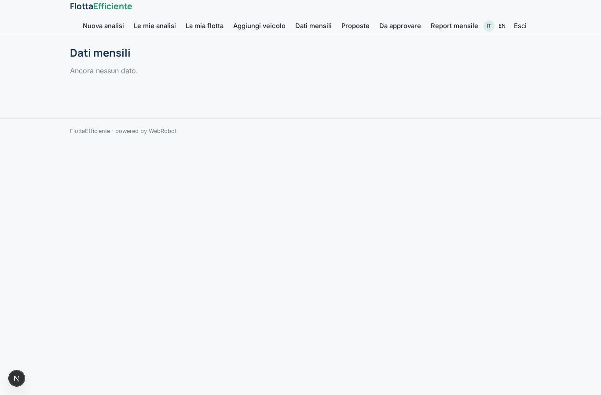
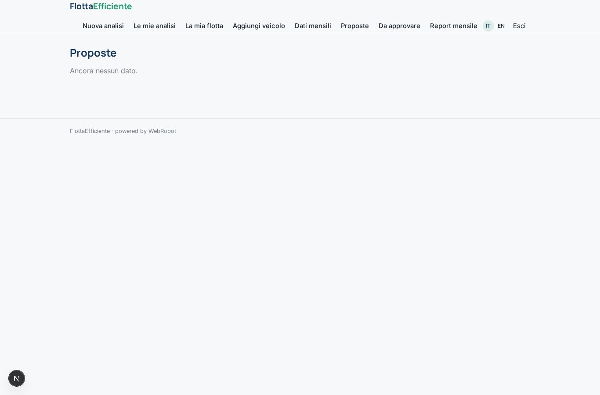
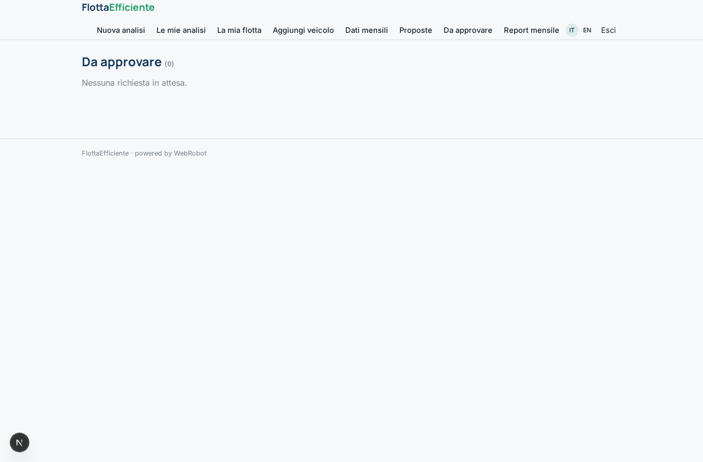
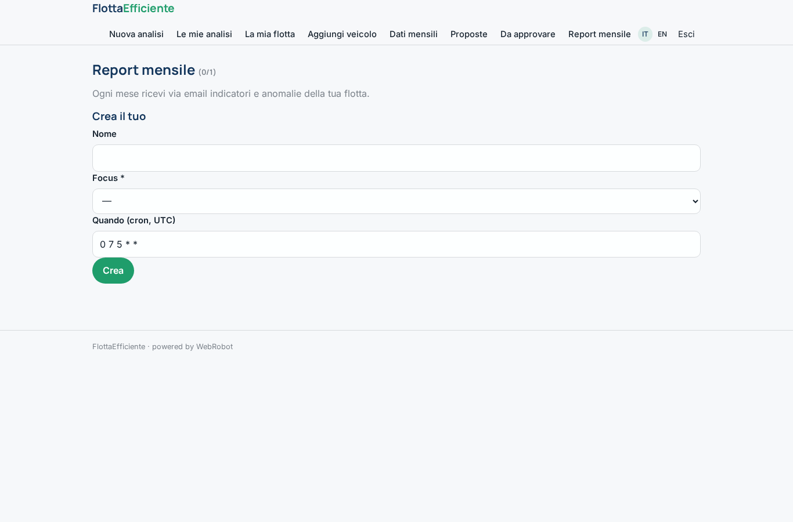
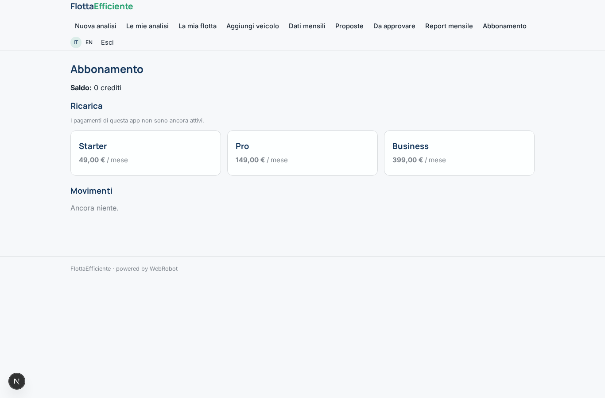

# FlottaEfficiente

_Meno costi per chilometro, una flotta su misura._

**Manifest:** valid (schema + runtime contract) · **Functional test:** passed (15 checks passed)

## Description given to the app builder (Italian)

Vorrei FlottaEfficiente, uno strumento per aziende con flotte di veicoli aziendali. Il fleet manager carica l'elenco dei veicoli (modello, alimentazione, chilometraggio, costo mensile, assegnatario) e importa ogni mese un CSV con chilometri percorsi, rifornimenti o ricariche e manutenzioni. Un agente calcola il costo totale per chilometro di ogni veicolo, individua quelli sottoutilizzati o troppo costosi e propone una flotta ottimizzata: quali mezzi eliminare, quali sostituire con elettrici o condividere tra dipendenti, con il risparmio stimato annuo. Il fleet manager approva o scarta ogni proposta. Ogni mese riceve un report via email con indicatori e anomalie. Ogni azienda vede solo la propria flotta. Abbonamento per numero di veicoli.

## Screenshots (interpretive runtime, no data)

### home-anon

### home-mobile

### home

### new_analysis

### analyses

### fleet

### add_vehicle

### records

### proposals_view

### decisions

### monthly

### account

