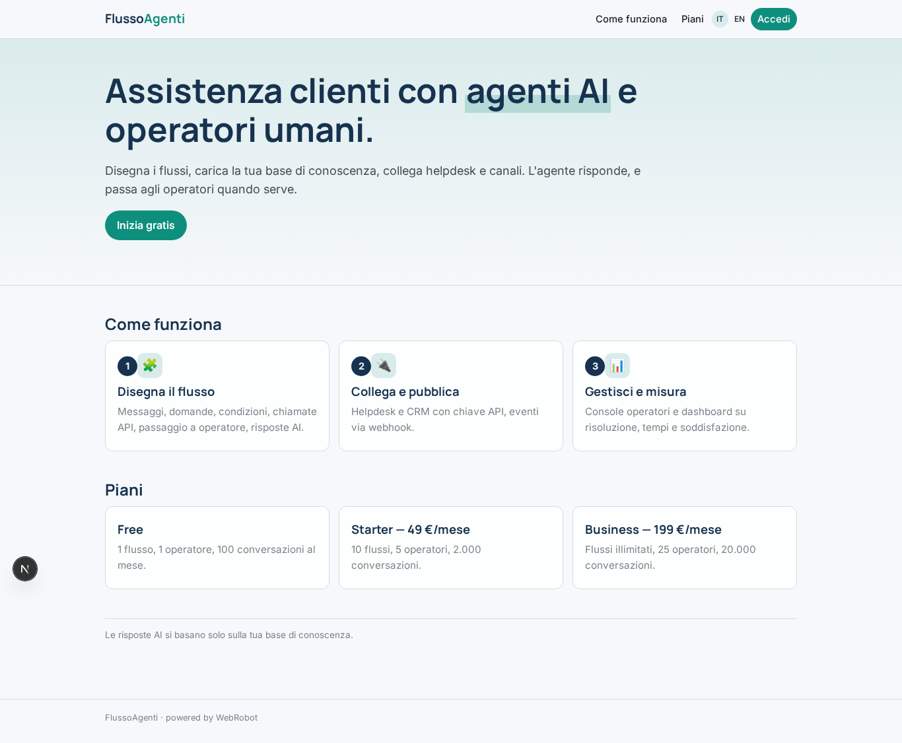
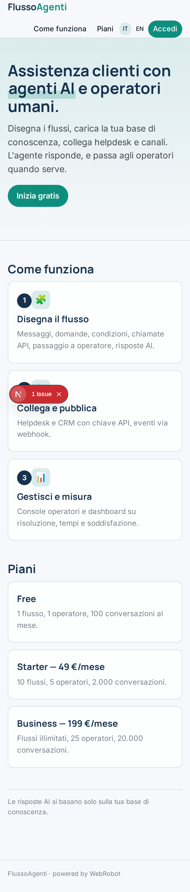
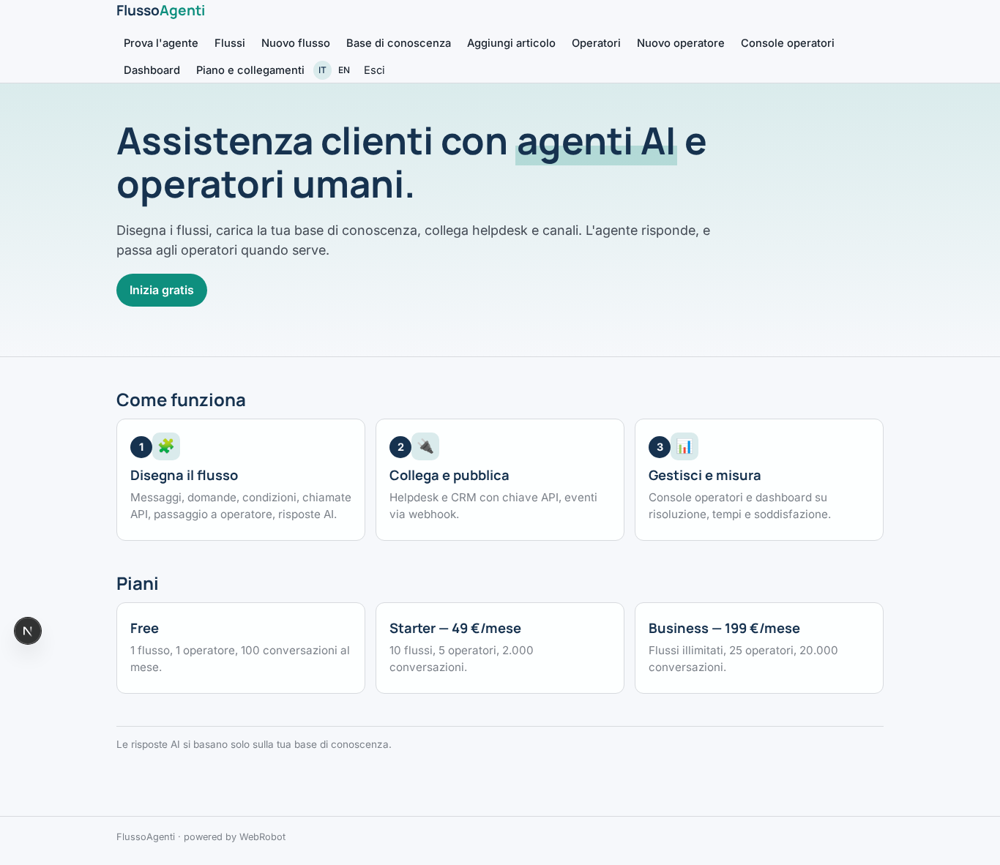
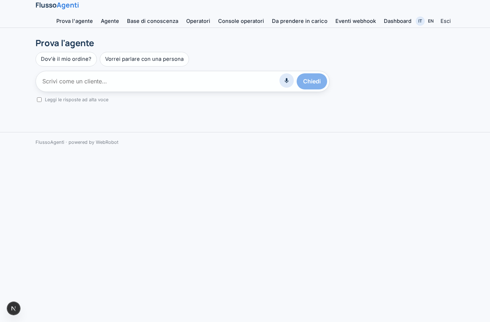
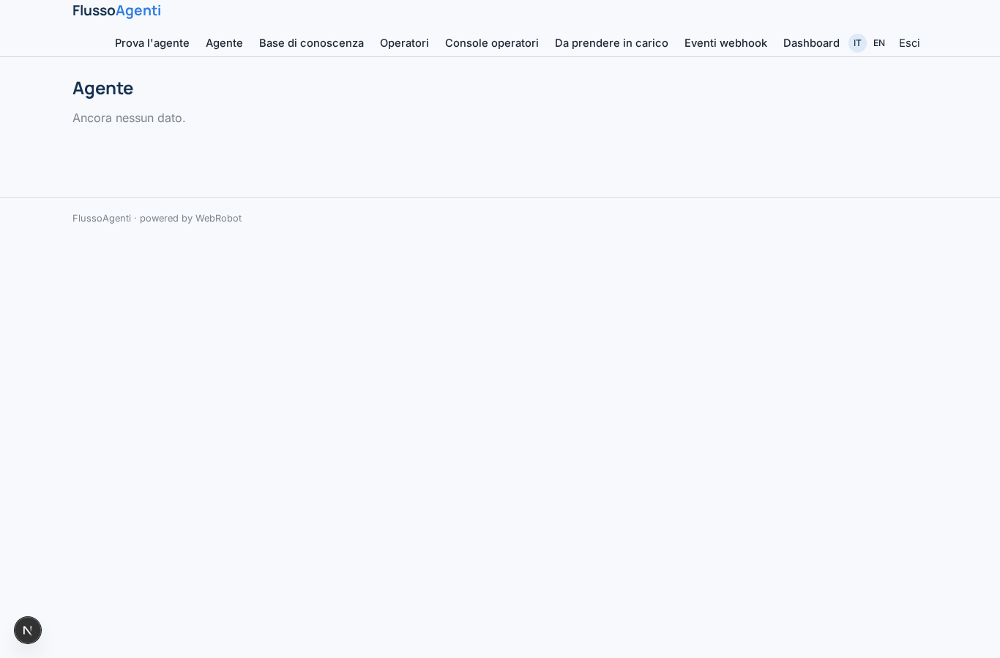
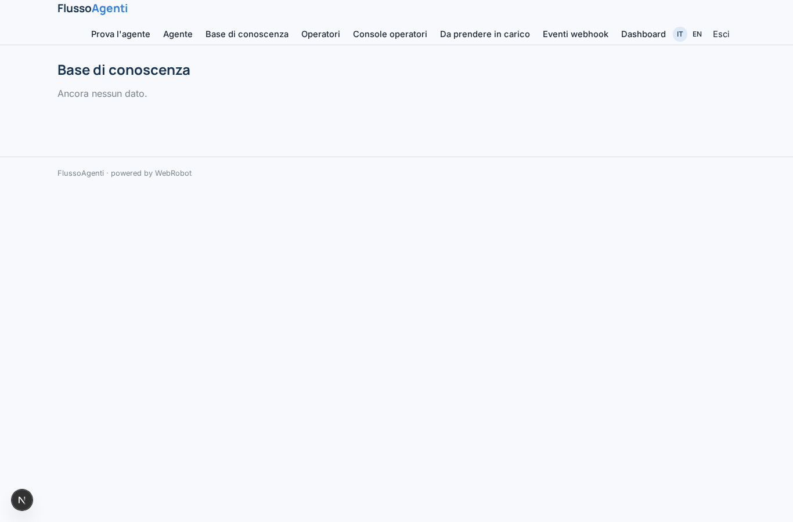
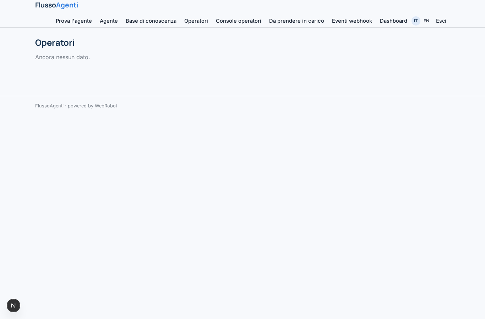
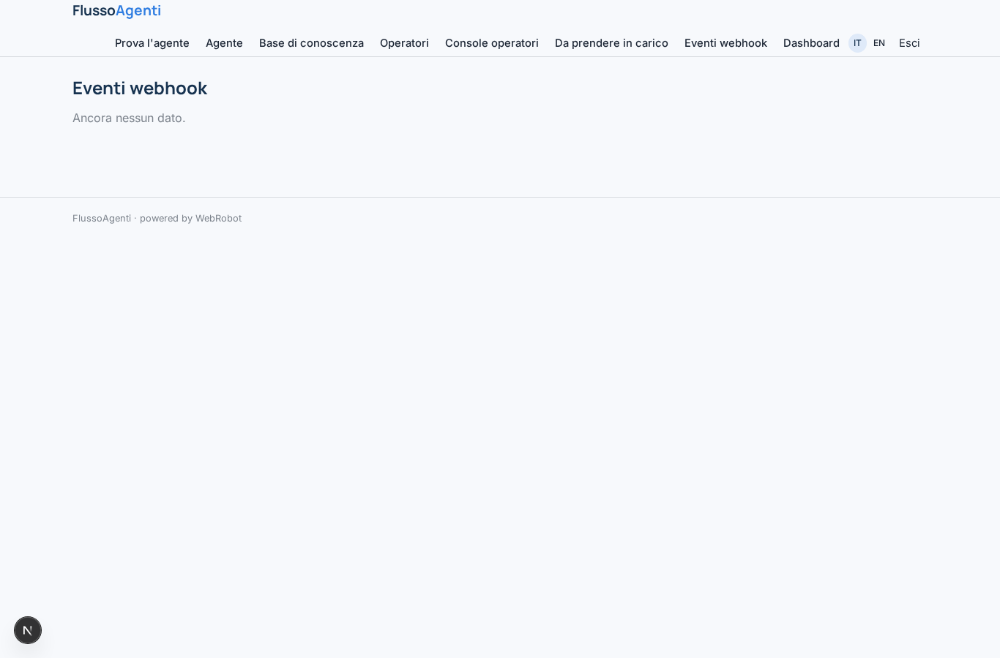
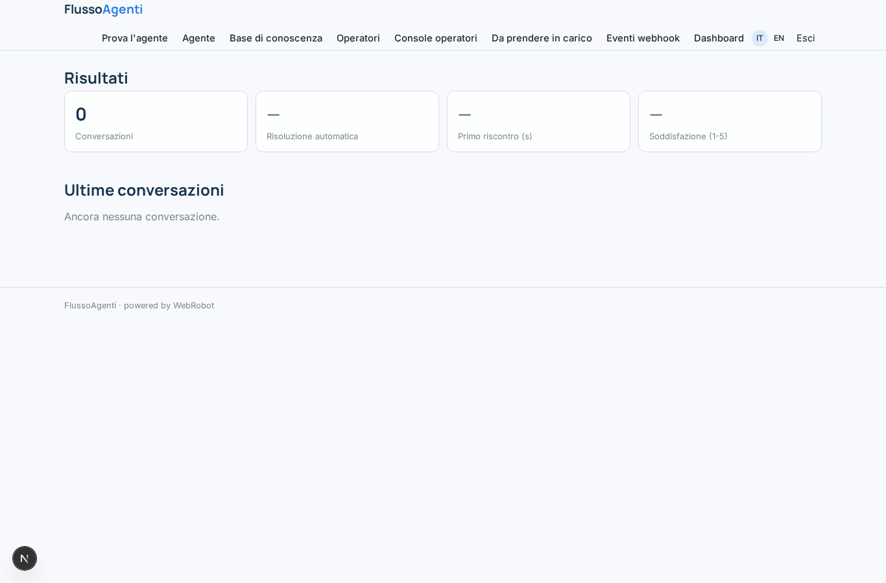
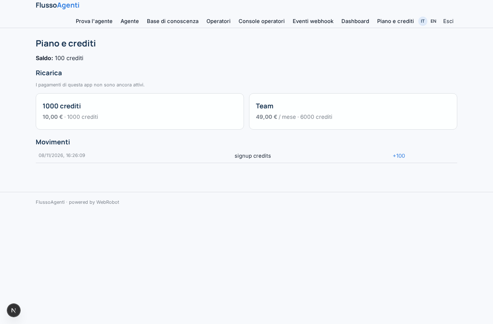

# FlussoAgenti

_Agenti conversazionali per l'assistenza clienti, con passaggio all'operatore._

**Manifest status:** valid (schema validator + runtime contract)

## Description given to the app builder (Italian)

FlussoAgenti è una piattaforma per costruire agenti conversazionali e flussi automatici per l'assistenza clienti. L'admin dell'azienda disegna i flussi in un editor visuale a blocchi: messaggio, domanda, condizione, chiamata HTTP a un'API esterna, passaggio a un operatore umano, risposta generata dall'AI su una base di conoscenza. Ogni agente si pubblica come widget di chat da incollare sul sito, e riceve eventi via webhook da sistemi esterni, per esempio un nuovo ordine. Gli operatori umani hanno una console in cui vedono le conversazioni in corso, prendono in carico quelle passate dall'agente e rispondono. L'admin collega canali e strumenti esterni come WhatsApp, Telegram, email, CRM e helpdesk tramite connessioni autorizzate. Una dashboard mostra numero di conversazioni, tasso di risoluzione automatica, tempi di risposta e soddisfazione. Ogni azienda vede solo i propri agenti e conversazioni; gli operatori solo quelle del loro gruppo. Piano gratuito limitato e abbonamento mensile per numero di conversazioni e operatori. Interfaccia in italiano e inglese.

## Features not expressible today (spec.extensions)

- **visual_flow_editor**: Block-based visual flow editor (message, question, condition, HTTP call, handoff, AI answer). Not available yet: the flow outline is stored as JSON in agent_settings.flow and the agent follows rules written in plain words.
- **chat_widget**: Embeddable website chat widget and public anonymous chat: not available yet. Chat is for signed-in users (testing).
- **channels_and_connections**: WhatsApp, Telegram, email, CRM and helpdesk through authorised per-customer connections need customer credentials: not available yet.
- **customer_http_calls**: HTTP calls to each company's own APIs cannot be declared (egress hosts are fixed per app). Only the webhook intake is supported.
- **operator_reply_console**: Operators see handoffs and conversations and approve takeovers, but live replies in the conversation and group-level isolation of operators are not available yet; conversations are shared per record with editors.

## Screenshots (interpretive runtime)

### home-anon

### home-mobile

### home

### test_chat

### settings

### kb

### team

### console

### handoffs

### events_log

### dashboard

### account

