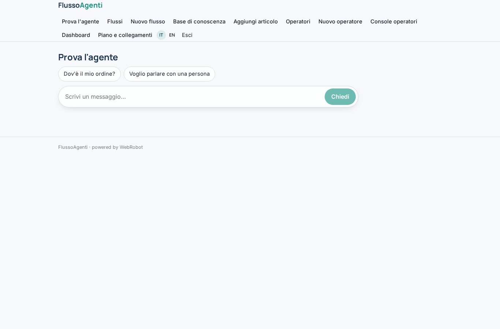
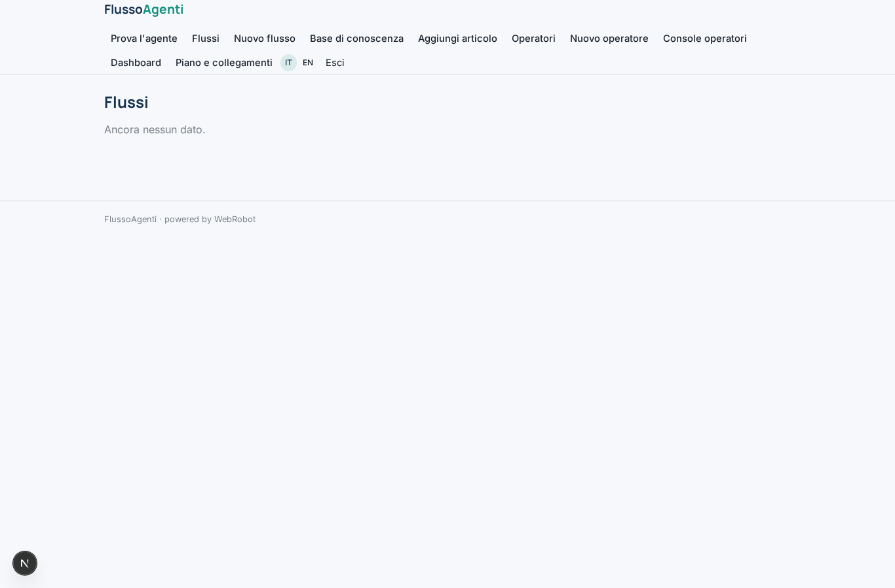
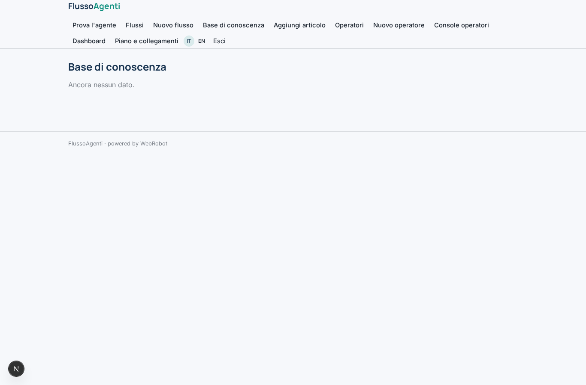
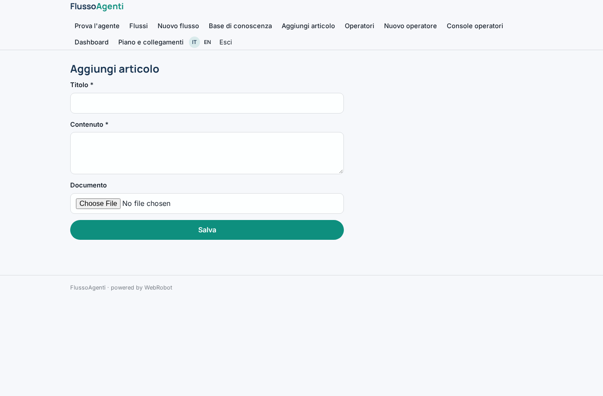
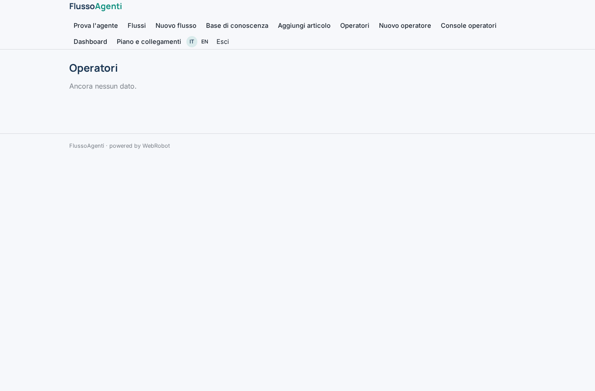
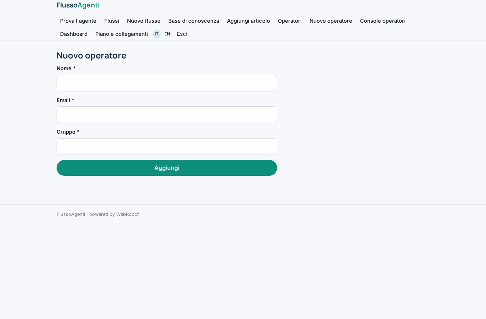
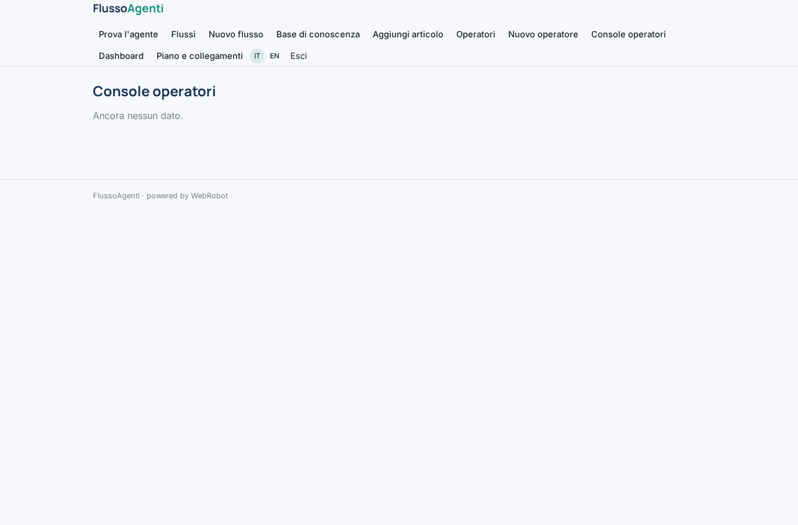
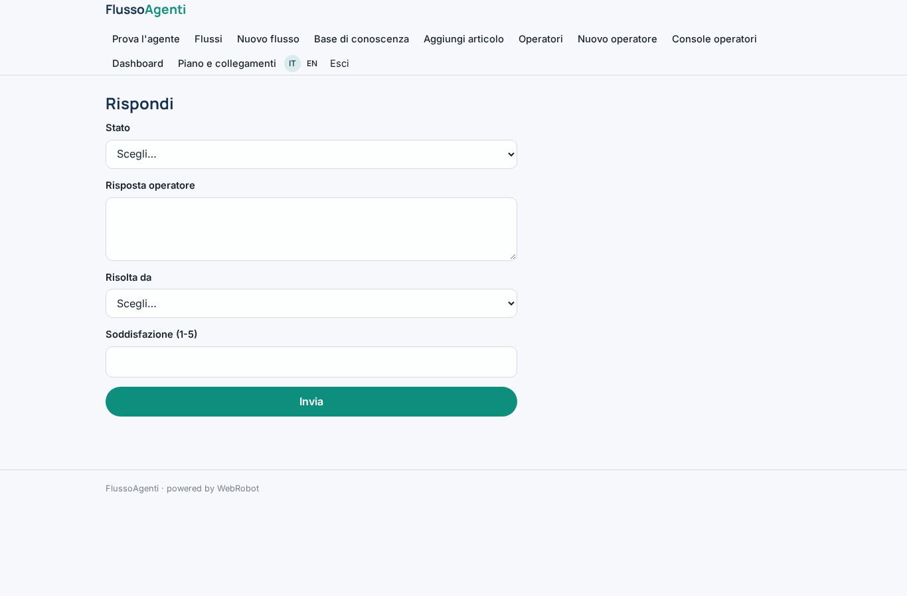
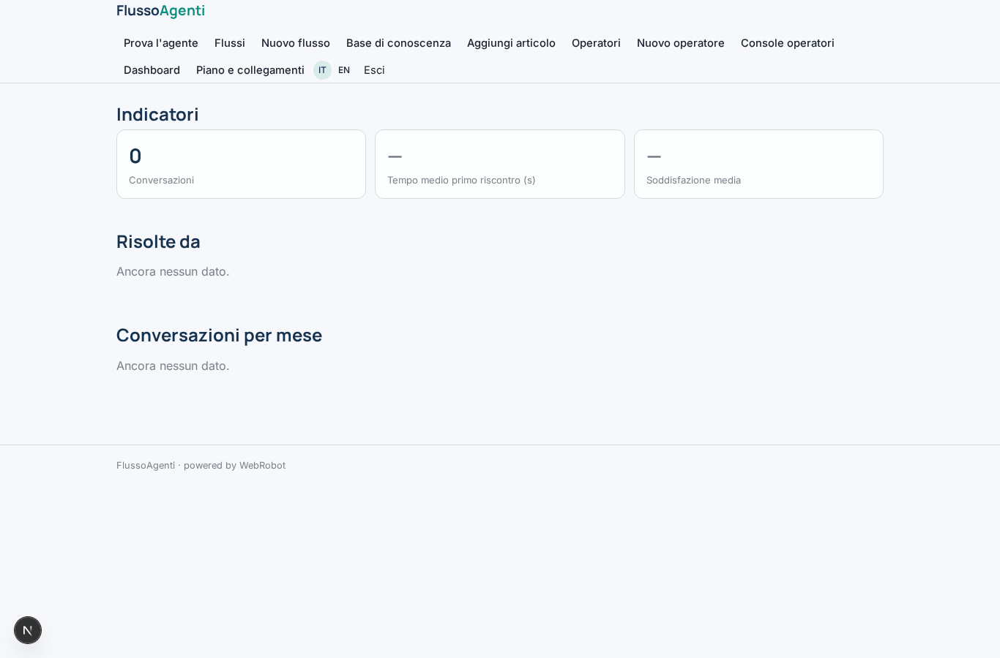
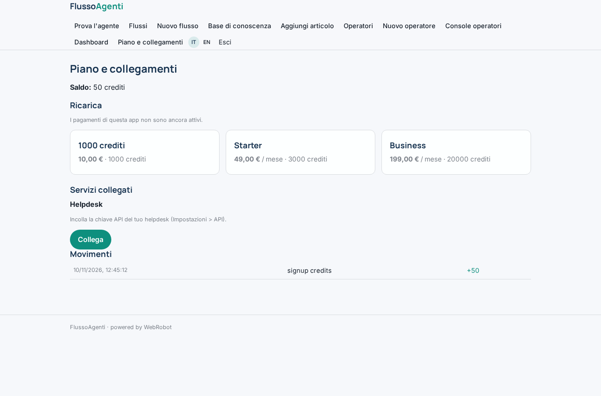

# FlussoAgenti

_Agenti conversazionali e flussi automatici per l'assistenza clienti._

**Manifest:** valid (schema + runtime contract) · **Functional test:** passed (17 checks passed)

## Description given to the app builder (Italian)

FlussoAgenti è una piattaforma per costruire agenti conversazionali e flussi automatici per l'assistenza clienti. L'admin dell'azienda disegna i flussi in un editor visuale a blocchi: messaggio, domanda, condizione, chiamata HTTP a un'API esterna, passaggio a un operatore umano, risposta generata dall'AI su una base di conoscenza. Ogni agente si pubblica come widget di chat da incollare sul sito, e riceve eventi via webhook da sistemi esterni, per esempio un nuovo ordine. Gli operatori umani hanno una console in cui vedono le conversazioni in corso, prendono in carico quelle passate dall'agente e rispondono. L'admin collega canali e strumenti esterni come WhatsApp, Telegram, email, CRM e helpdesk tramite connessioni autorizzate. Una dashboard mostra numero di conversazioni, tasso di risoluzione automatica, tempi di risposta e soddisfazione. Ogni azienda vede solo i propri agenti e conversazioni; gli operatori solo quelle del loro gruppo. Piano gratuito limitato e abbonamento mensile per numero di conversazioni e operatori. Interfaccia in italiano e inglese.

## Functional test: what did not pass

- **saved record shown where its collection is read** (view console): a record was saved in conversations (by user) but the page does not show it (as operator) _(warning)_

## Features not expressible today (spec.extensions)

- **visual_flow_editor**: Drag-and-drop block editor: flows are stored as a JSON list of blocks edited in a form; a visual canvas is not available yet.
- **chat_widget**: Embeddable chat widget to paste on the company's website: not available yet (chat is inside the app; widget for a tenant's own anonymous visitors needs company-scoped public data).
- **channels**: WhatsApp, Telegram, email channels and OAuth connections (CRM, Google, Meta): not available yet; only API-key connections (helpdesk) work.
- **operator_groups**: Group visibility is realised by storing the group's operator emails on each conversation (members); automatic assignment by group is done by the agent.
- **multi_company**: Company-level separation is per signed-up admin account; sharing one company among several admins is not modelled.

## Screenshots (interpretive runtime, no data)

### home-anon

### home-mobile

### home

### assistant

### flows_view

### flow_form

### kb_view

### kb_form

### operators_view

### operator_form

### console

### reply

### dashboard

### account

