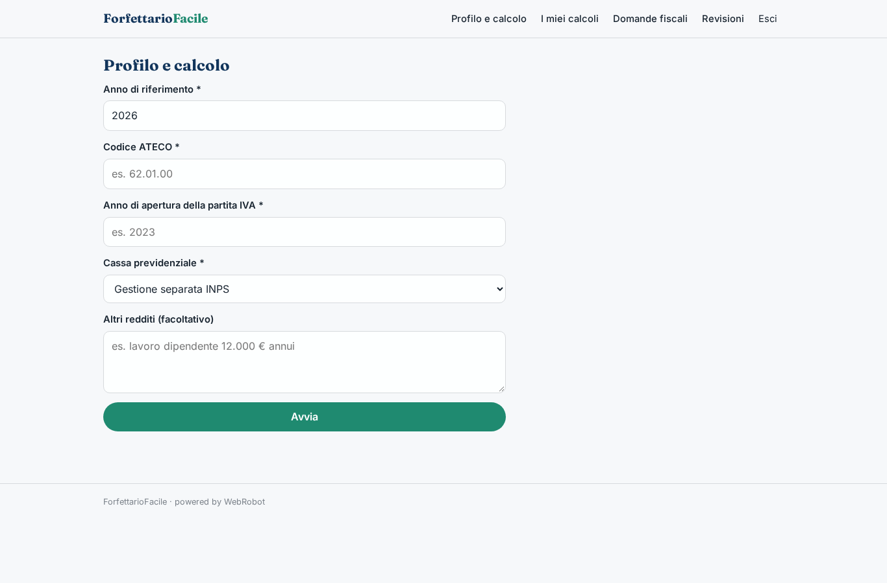
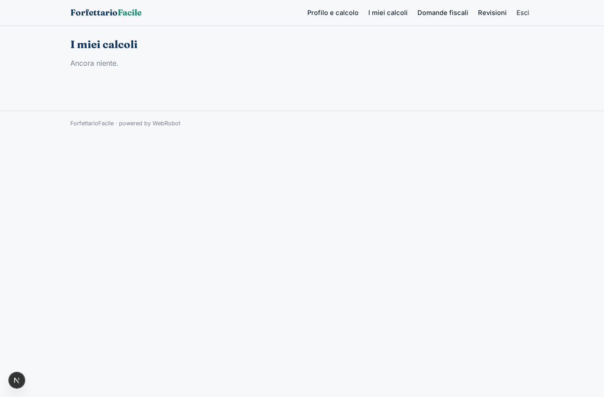
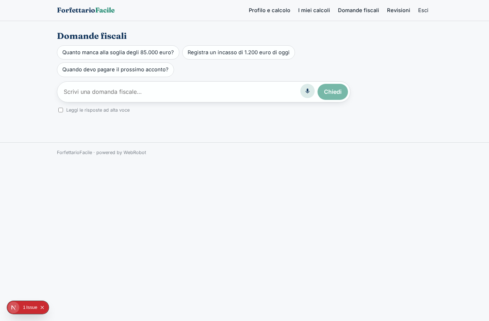
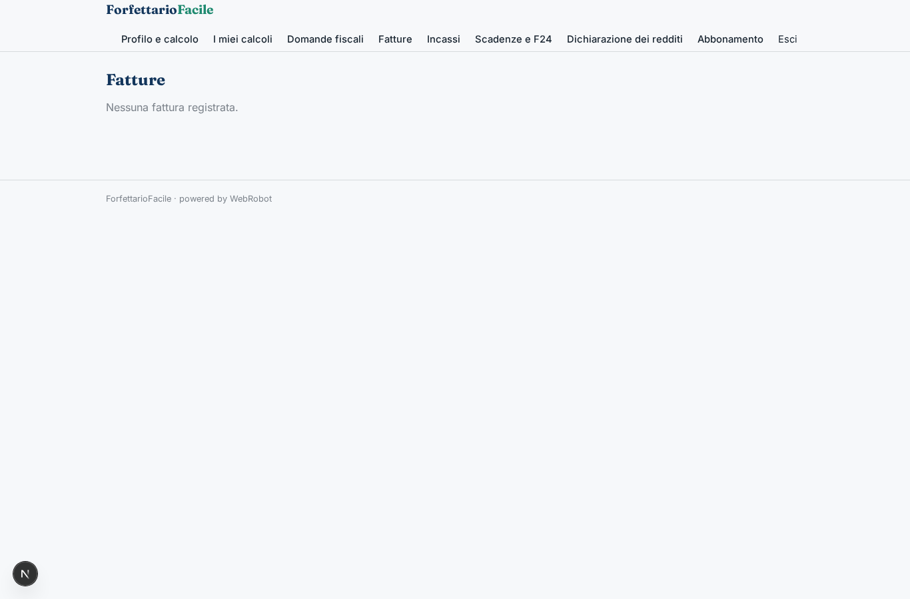
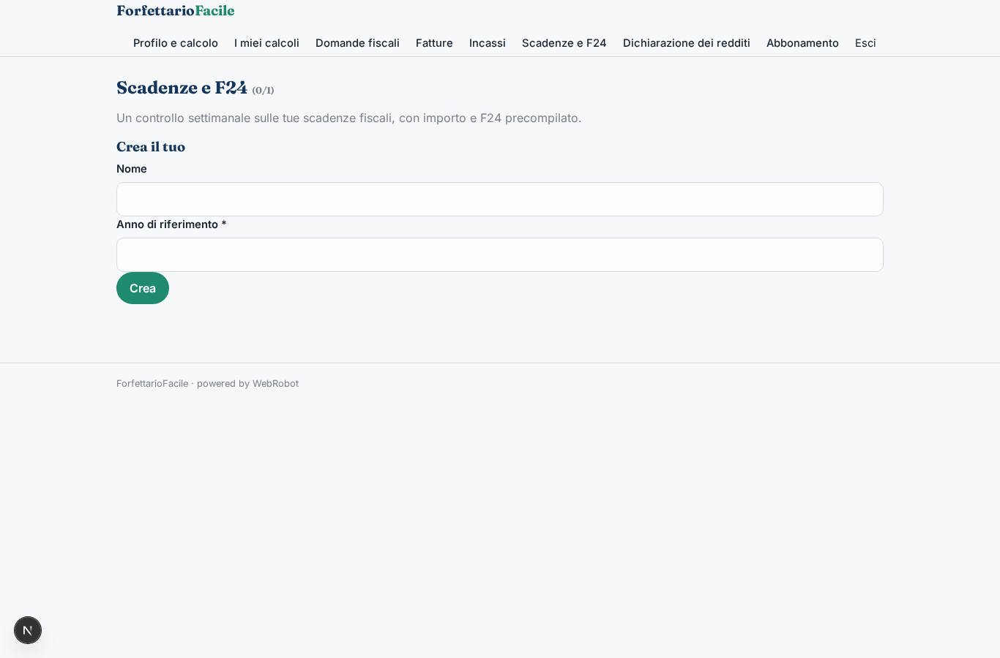
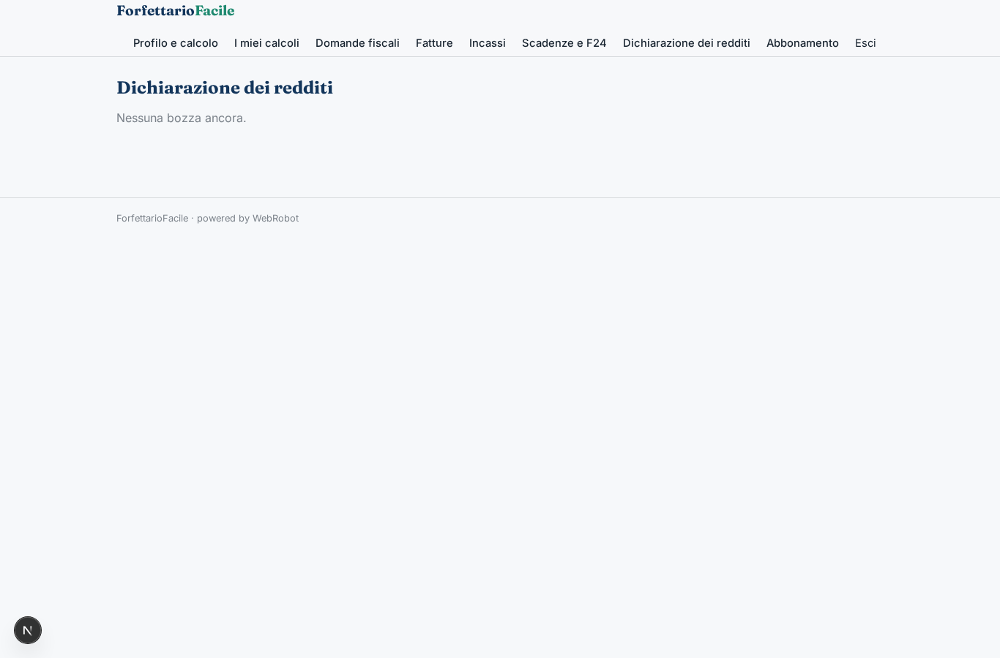
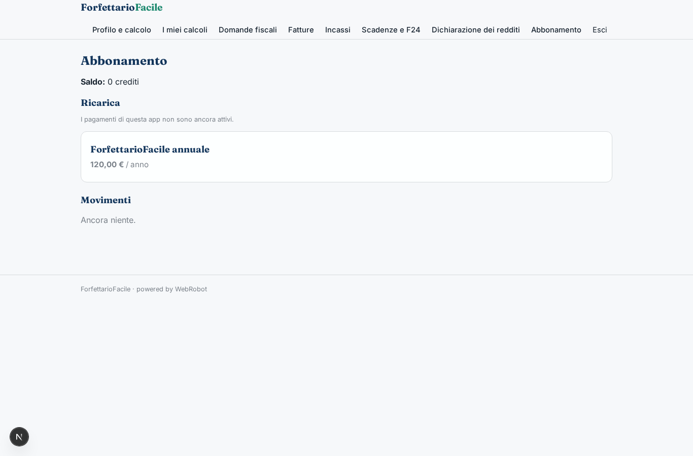

# ForfettarioFacile

_Il regime forfettario sotto controllo: imposte, contributi e scadenze sempre aggiornati._

**Stato manifest:** valido (validatore Python + contratto runtime)

## Descrizione data all'app builder

ForfettarioFacile è per liberi professionisti in regime forfettario. Al primo accesso l'utente compila un modulo con codice ATECO, anno di apertura della partita IVA, cassa previdenziale o gestione separata, eventuali altri redditi. Durante l'anno emette le fatture elettroniche dall'app, che le invia al Sistema di Interscambio tramite un intermediario abilitato, e registra gli incassi. Un agente calcola in ogni momento l'imposta sostitutiva, i contributi dovuti, gli acconti e il saldo, applicando il coefficiente di redditività e le regole aggiornate del regime, e avvisa se ci si avvicina alla soglia degli 85.000 euro. Prima di ogni scadenza fiscale l'utente riceve un'email con l'importo da pagare e il modello F24 precompilato. A fine anno l'agente prepara la bozza della dichiarazione dei redditi, che un commercialista della piattaforma controlla e trasmette. L'utente può fare domande fiscali in chat. Ogni utente vede solo i propri dati. Abbonamento annuale pagato con carta, in italiano.

## Funzioni non esprimibili oggi (spec.extensions)

- **fatturazione_sdi**: Emissione e invio delle fatture elettroniche al Sistema di Interscambio tramite intermediario abilitato: richiede un connettore con credenziali dell'intermediario, non ancora disponibile. Per ora fatture e incassi si registrano a mano o dalla chat.
- **email_scadenze**: Email prima di ogni scadenza con importo e F24: le notifiche email non sono ancora disponibili. I promemoria appaiono nella vista Scadenze e F24.
- **trasmissione_dichiarazione**: Trasmissione telematica della dichiarazione da parte del commercialista: la revisione è nell'app (approvazione), l'invio all'Agenzia delle Entrate avviene fuori dall'app.
- **pdf_f24**: Il modello F24 precompilato è fornito come tabella di dati (codici tributo, importi), non come file PDF.

## Screenshot (runtime interpretativo)

### home-anon

### home-mobile

### home

### nuovo_calcolo

### storico

### chat

### fatture_view

### incassi_view

### scadenze_view

### dichiarazioni_view

### revisioni

### account

