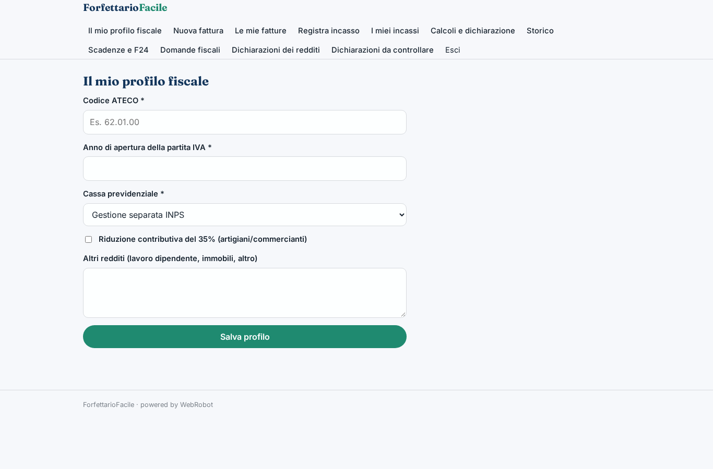
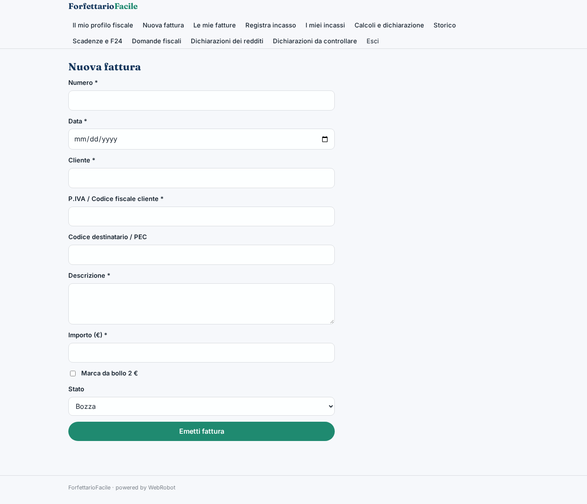
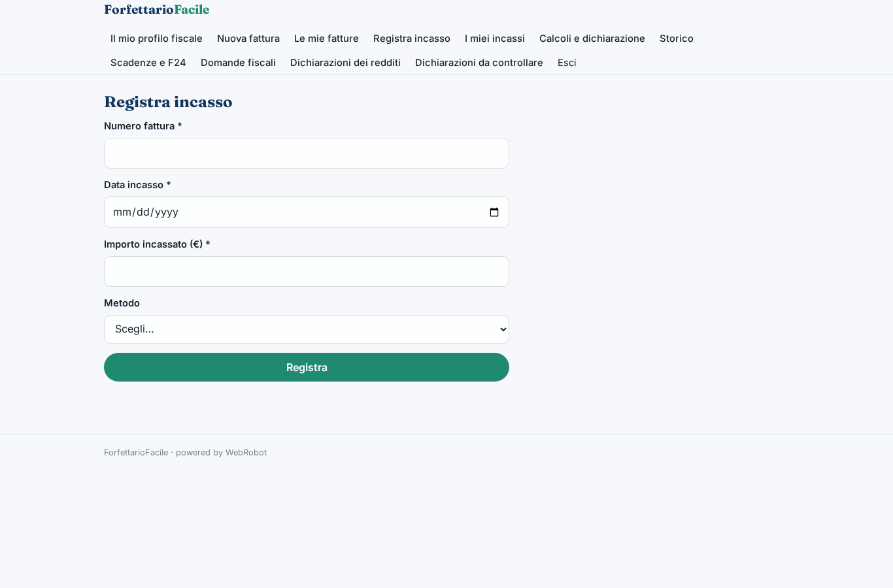
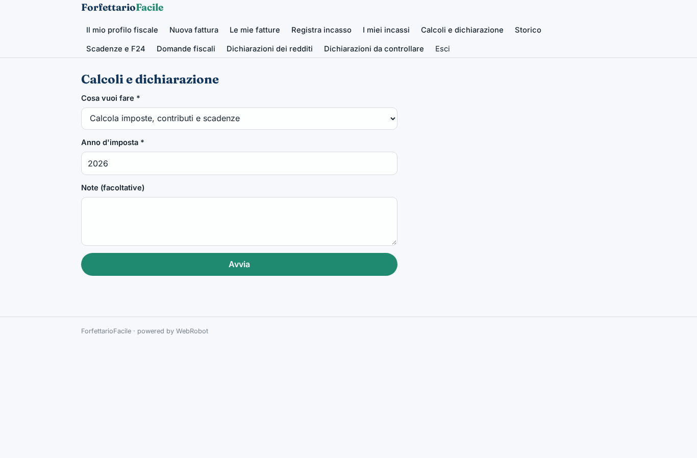
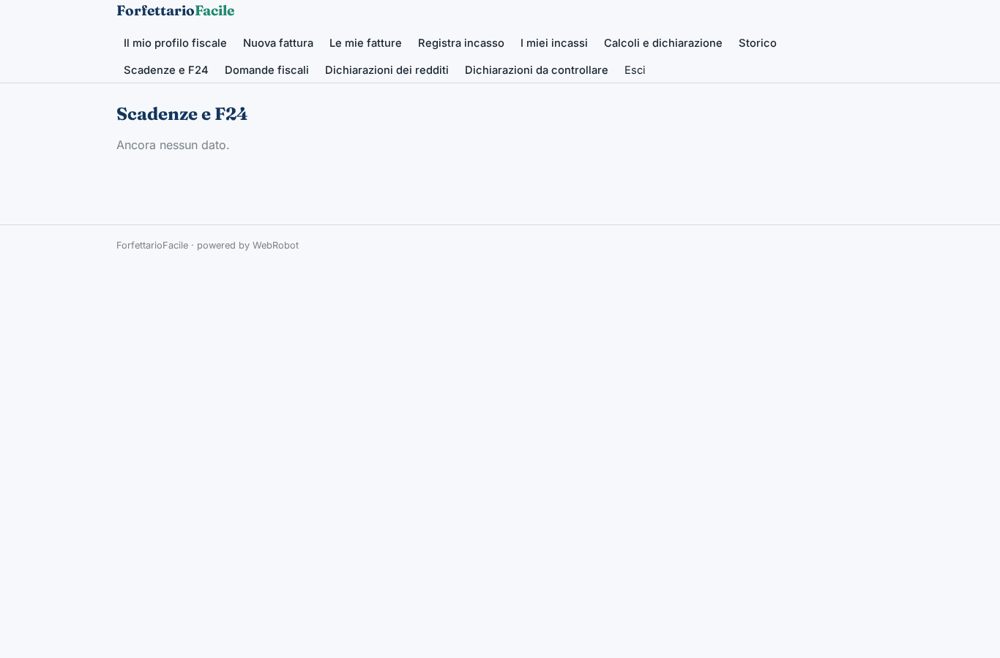
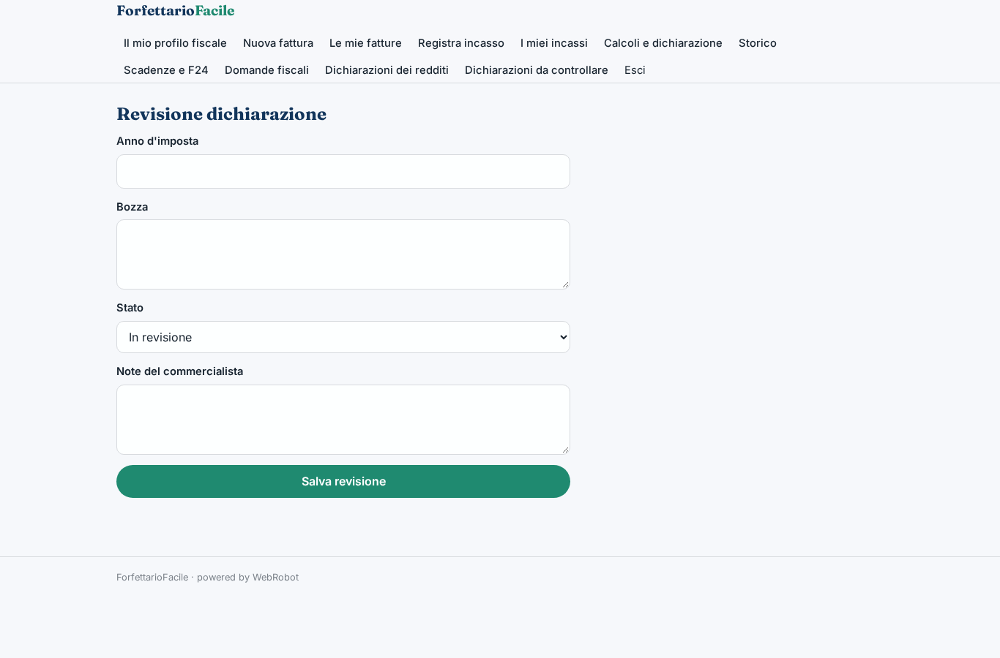
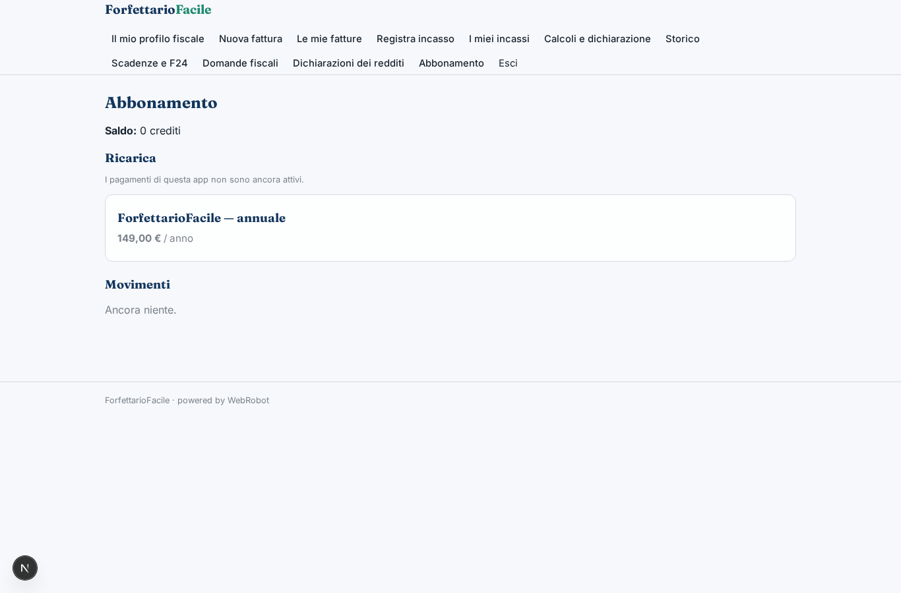

# ForfettarioFacile

_Il regime forfettario sotto controllo: fatture, imposte, scadenze e dichiarazione._

**Manifest:** valid (schema + runtime contract) · **Functional test:** passed (23 checks passed)

## Description given to the app builder (Italian)

ForfettarioFacile è per liberi professionisti in regime forfettario. Al primo accesso l'utente compila un modulo con codice ATECO, anno di apertura della partita IVA, cassa previdenziale o gestione separata, eventuali altri redditi. Durante l'anno emette le fatture elettroniche dall'app, che le invia al Sistema di Interscambio tramite un intermediario abilitato, e registra gli incassi. Un agente calcola in ogni momento l'imposta sostitutiva, i contributi dovuti, gli acconti e il saldo, applicando il coefficiente di redditività e le regole aggiornate del regime, e avvisa se ci si avvicina alla soglia degli 85.000 euro. Prima di ogni scadenza fiscale l'utente riceve un'email con l'importo da pagare e il modello F24 precompilato. A fine anno l'agente prepara la bozza della dichiarazione dei redditi, che un commercialista della piattaforma controlla e trasmette. L'utente può fare domande fiscali in chat. Ogni utente vede solo i propri dati. Abbonamento annuale pagato con carta, in italiano.

## Functional test: what did not pass

- **saved record shown where its collection is read** (view dichiarazioni): a record was saved in declarations (by admin) but the page does not show it (as user) _(warning)_

## Features not expressible today (spec.extensions)

- **sdi_intermediario**: Invio delle fatture elettroniche al Sistema di Interscambio tramite un intermediario abilitato: non ancora disponibile. Oggi le fatture si salvano e se ne traccia lo stato; serve un'integrazione con un intermediario (generazione XML FatturaPA e invio) con una chiave API.
- **f24_pdf**: Il modello F24 in formato PDF precompilato non è ancora generabile: le email contengono importo, codice tributo e righe da riportare nel modello.
- **trasmissione_dichiarazione**: La trasmissione telematica all'Agenzia delle Entrate resta un'azione manuale del commercialista, che aggiorna lo stato della dichiarazione a 'trasmessa'.

## Screenshots (interpretive runtime, no data)

### home-anon

### home-mobile

### home

### profilo

### nuova_fattura

### fatture

### nuovo_incasso

### incassi_elenco

### calcolo

### storico

### scadenze

### assistente

### dichiarazioni

### revisione

### revisioni

### account

