# Fornitori AI

_Trova, verifica e confronta i fornitori giusti, dalla richiesta all'offerta._

**Manifest:** valid (schema + runtime contract) · **Functional test:** passed (13 checks passed)

## Description given to the app builder (Italian)

Voglio un'app per gli uffici acquisti delle aziende. Il buyer descrive cosa deve comprare (categoria, specifiche tecniche, quantità, area geografica, certificazioni richieste come ISO 9001 o ISO 14001, scadenza). Un agente cerca nuovi fornitori sul web e nei siti aziendali, verifica partita IVA (VIES) e certificazioni dichiarate, e propone una shortlist con il perché di ogni fornitore. Il buyer approva la shortlist e il testo della richiesta di offerta. Poi l'app manda la richiesta di offerta via email ai fornitori approvati, a nome del buyer, con solleciti automatici dopo 3 e 7 giorni a chi non risponde, e un link per non ricevere più email. Le risposte arrivano in una casella: un agente le legge, estrae prezzo, tempi di consegna, condizioni e allegati, e compila una tabella comparativa delle offerte, segnalando i dati mancanti. Il database dei fornitori cresce con ogni richiesta. Nome: Fornitori AI. Lingua italiana. Piano mensile per azienda con un numero di richieste incluse.

## Features not expressible today (spec.extensions)

- **optout_enforcement**: Il link di disiscrizione registra l'email in una lista; i nuovi invii la rispettano, ma i solleciti già programmati non la controllano automaticamente. Servirebbe una regola che escluda gli indirizzi in lista dai solleciti.
- **reply_to_buyer**: Le email partono dalla piattaforma a nome del buyer (nome e azienda nel testo); il Reply-To personalizzato con l'indirizzo del buyer e l'inoltro automatico alla casella dell'app non sono configurabili nel manifest.
- **attachment_reading**: Gli allegati delle email di risposta non sono leggibili dall'agente (la lettura file funziona solo per i file caricati dai moduli): i dati presenti solo negli allegati sono segnalati come mancanti.

## Screenshots (interpretive runtime, no data)

### home-anon
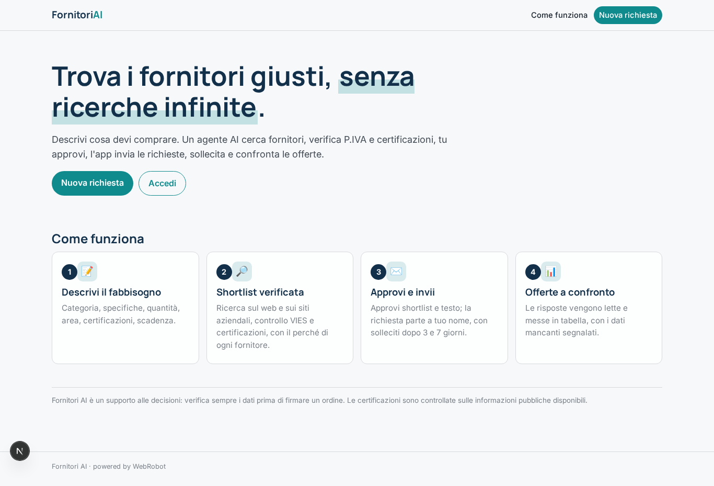

### home-mobile
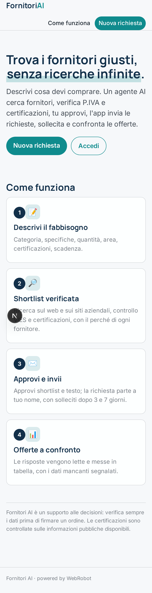

### home
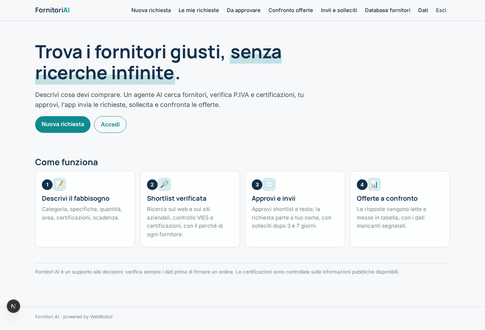

### new_request
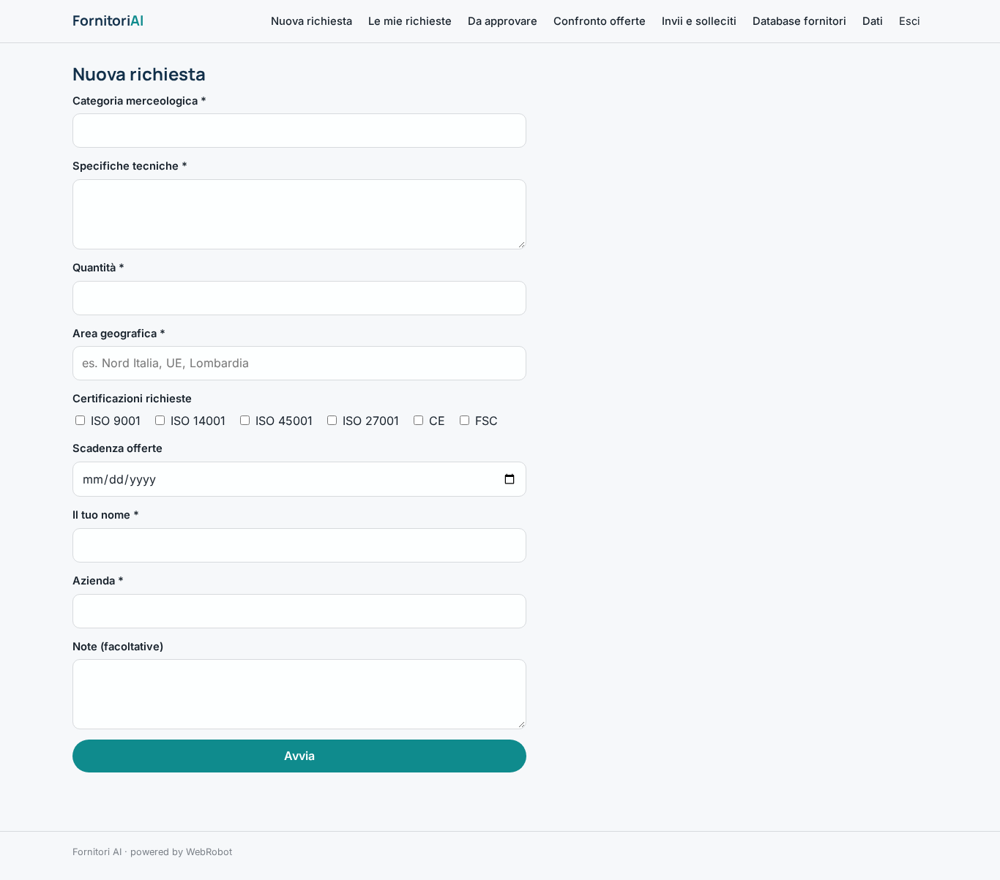

### requests
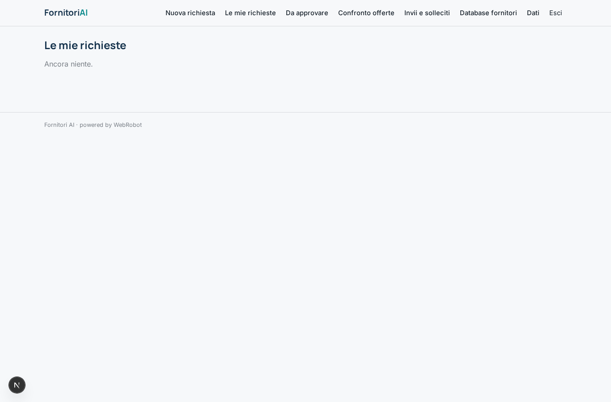

### approvals
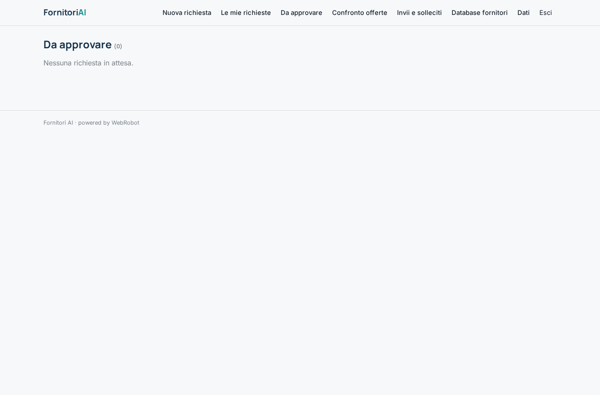

### offers_table
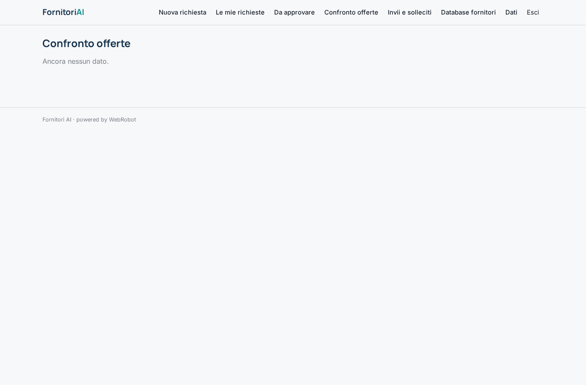

### recipients
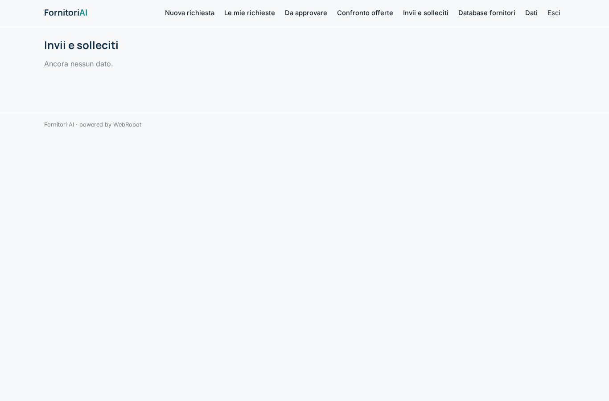

### suppliers_table
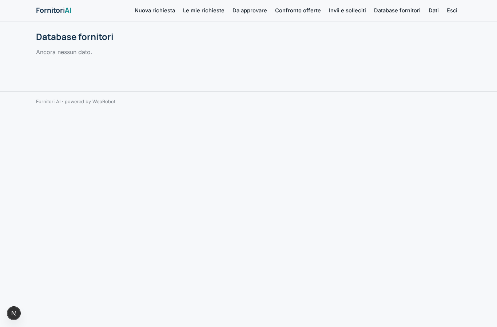

### optout
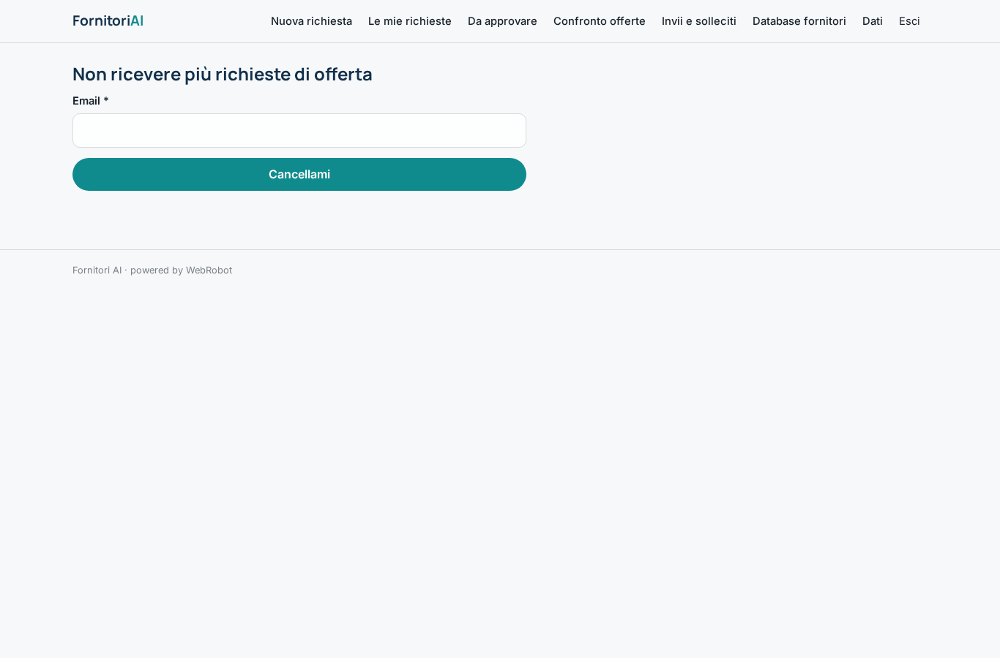

### account
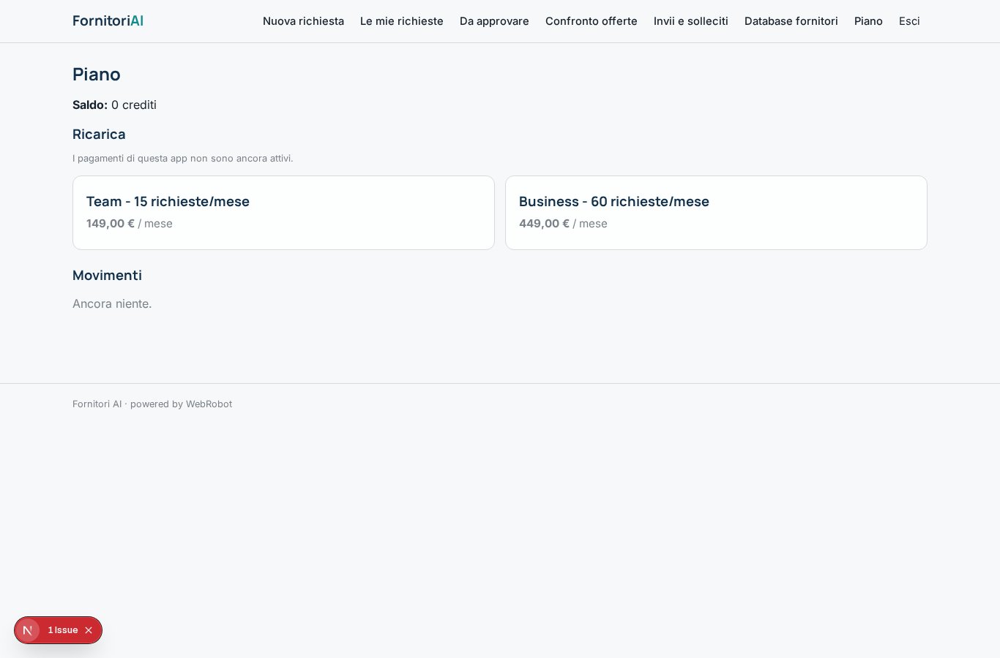
