# Fornitura Fresca

_Il portale di ordinazione tra ristoratori e produttori di prodotti freschi._

**Manifest:** valid (schema + runtime contract) · **Functional test:** passed (23 checks passed)

## Description given to the app builder (Italian)

Descrivo solo lo strato software di un servizio di forniture per la ristorazione: il portale di ordinazione e gestione tra ristoranti e produttori, non la logistica ne la consegna fisica delle merci. Il ristoratore sfoglia un catalogo di prodotti freschi caricati dai produttori, con disponibilita e prezzi, e compone l'ordine indicando quantita e data di consegna desiderata; un agente suggerisce prodotti ricorrenti in base allo storico e avvisa se qualcosa e fuori stagione o non disponibile. L'ordine viene inviato ai produttori interessati, che lo confermano e indicano cosa possono evadere. Un modello periodico ricorda al ristoratore di riordinare i prodotti che consuma di frequente. Il ristoratore vede i propri ordini e lo storico di spesa, il produttore gli ordini ricevuti e i propri prodotti, l'admin tutto. Fatture e documenti di consegna sono consultabili nell'area personale e inviati via email. Monetizzazione: commissione sugli ordini transati. In italiano.

## Functional test: what did not pass

- **form saves a record** (form producer_profile): only role producer may fill it, and the test cannot hold that role _(warning)_
- **trigger has its effect** (trigger order_to_producer): email to record.producer_email: no such recipient in the test (role nobody holds or empty field) _(warning)_
- **saved record shown where its collection is read** (view my_orders): a record was saved in orders (by admin) but the page does not show it (as user) _(warning)_
- **saved record shown where its collection is read** (view received): a record was saved in orders (by admin) but the page does not show it (as admin) _(warning)_
- **page opened by a role allowed to** (view producer_profile): only role producer may open it, the test cannot hold it _(warning)_

## Design checks (who fills each collection)

- view add_product: roles producer cannot add to products, a shared collection only the admins fill — keep roles: [admin], or own the records by user

## Features not expressible today (spec.extensions)

- **pdf_documents**: Fatture e documenti sono testo nell'app e nell'email; PDF fiscali e fatturazione elettronica (SDI) non sono disponibili.
- **payment_flow**: Il pagamento dell'ordine tra ristorante e produttore con commissione richiede che ogni produttore colleghi il proprio account Stripe.

## Screenshots (interpretive runtime, no data)

### home-anon
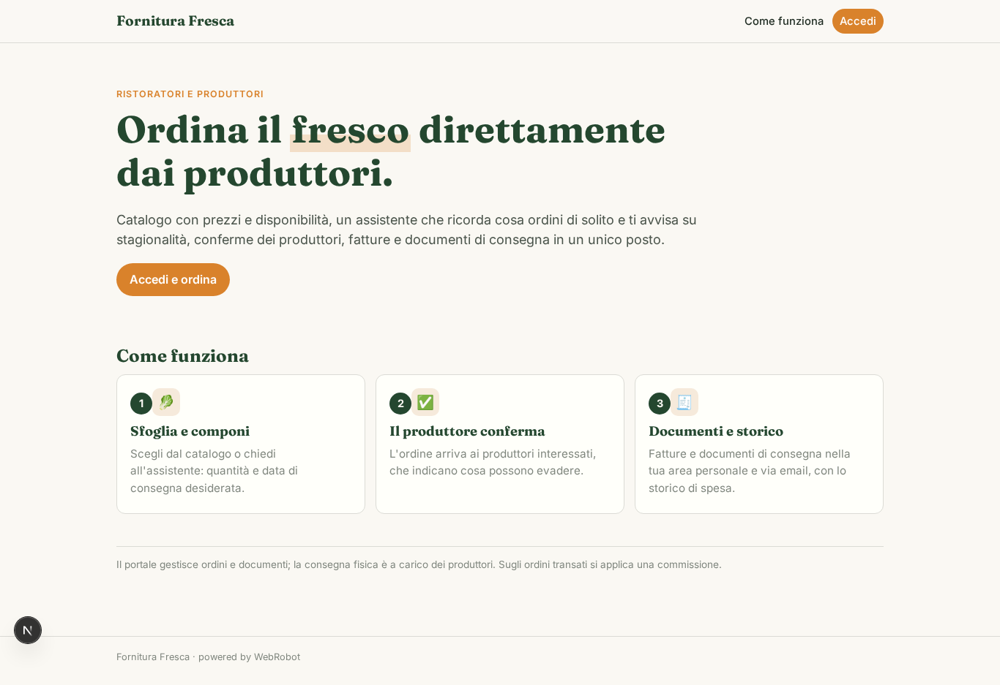

### home-mobile
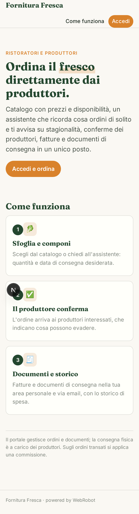

### home
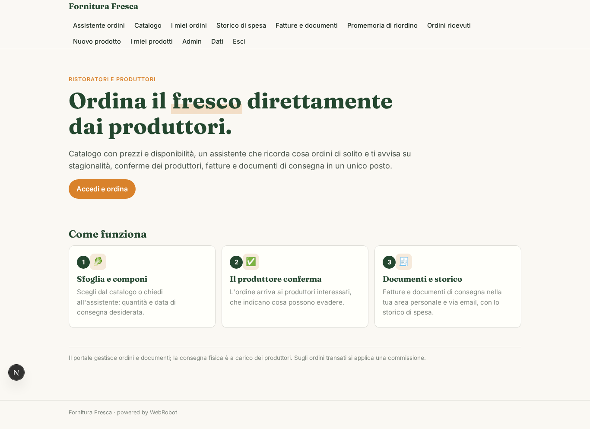

### shop
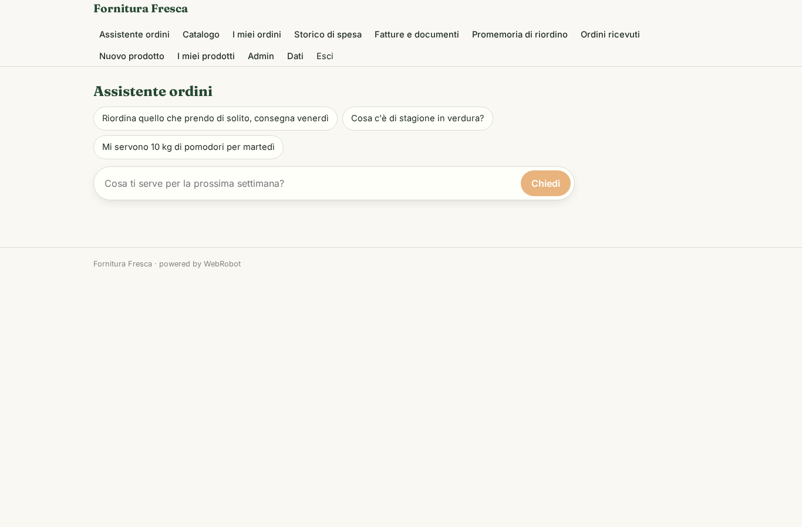

### catalog
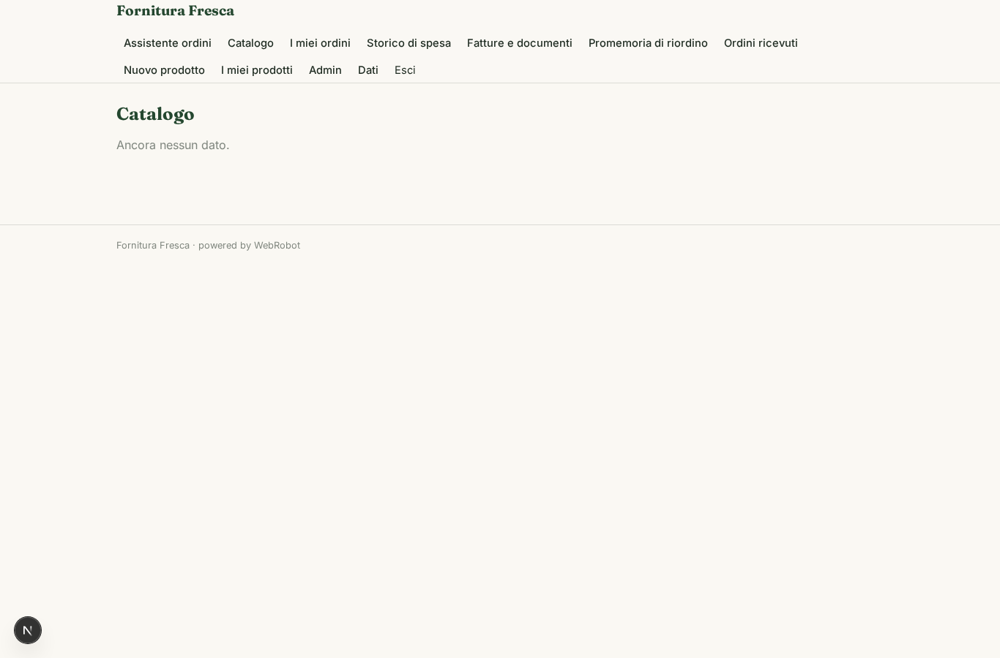

### my_orders
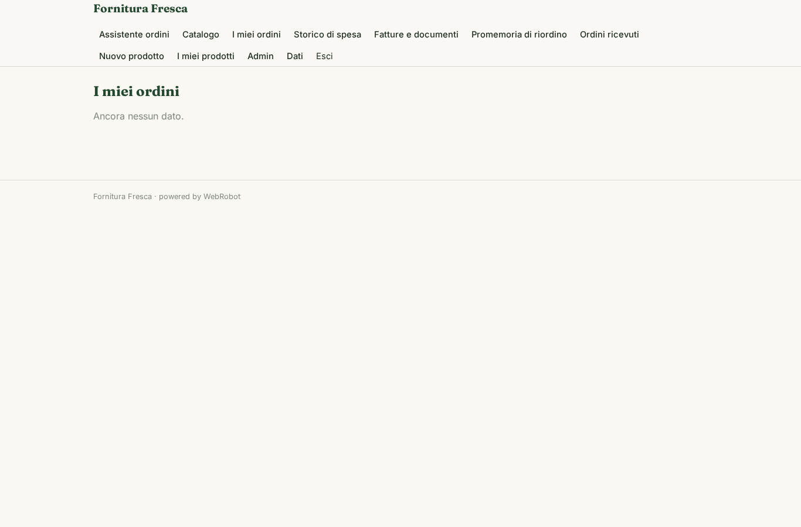

### spend
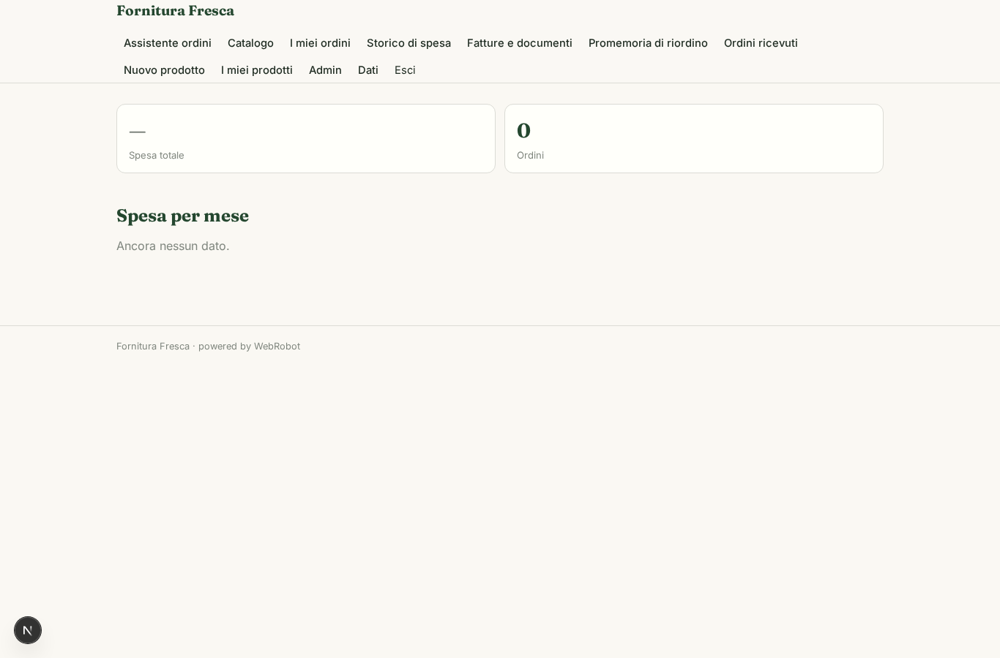

### invoices_view
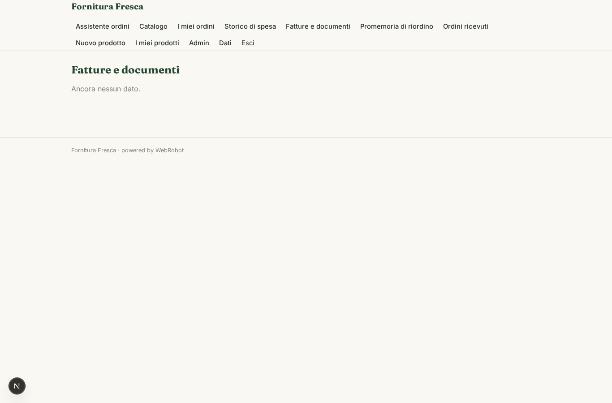

### reorders
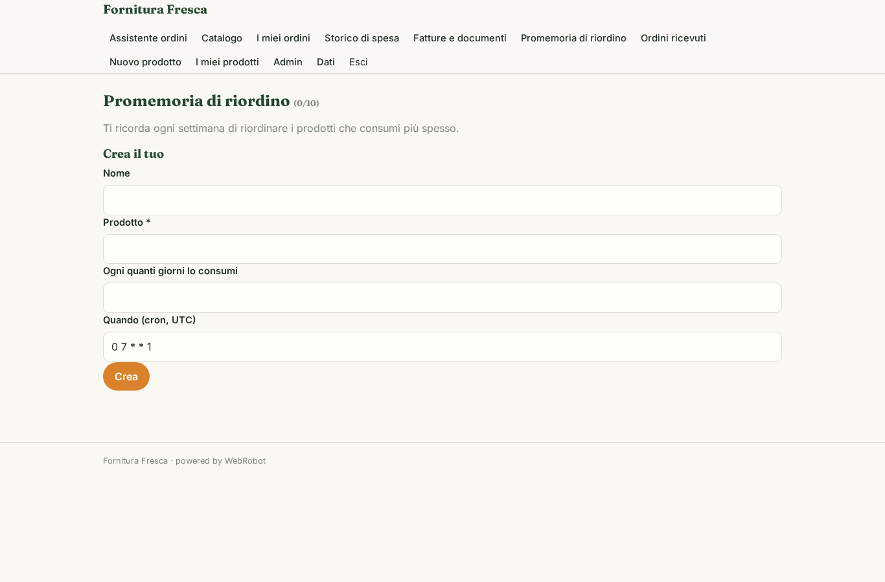

### received
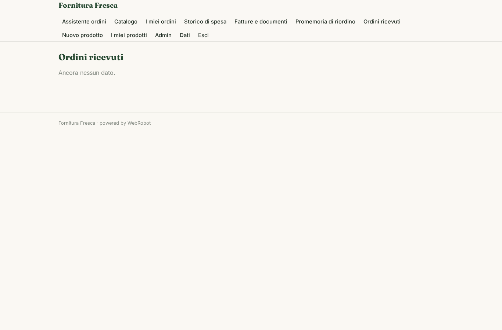

### confirm
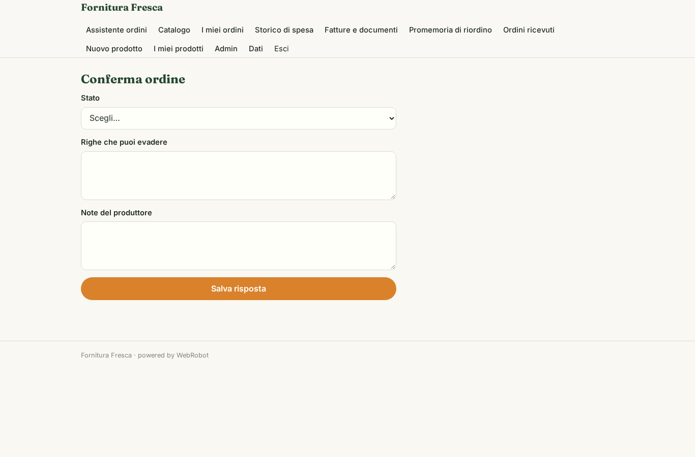

### add_product
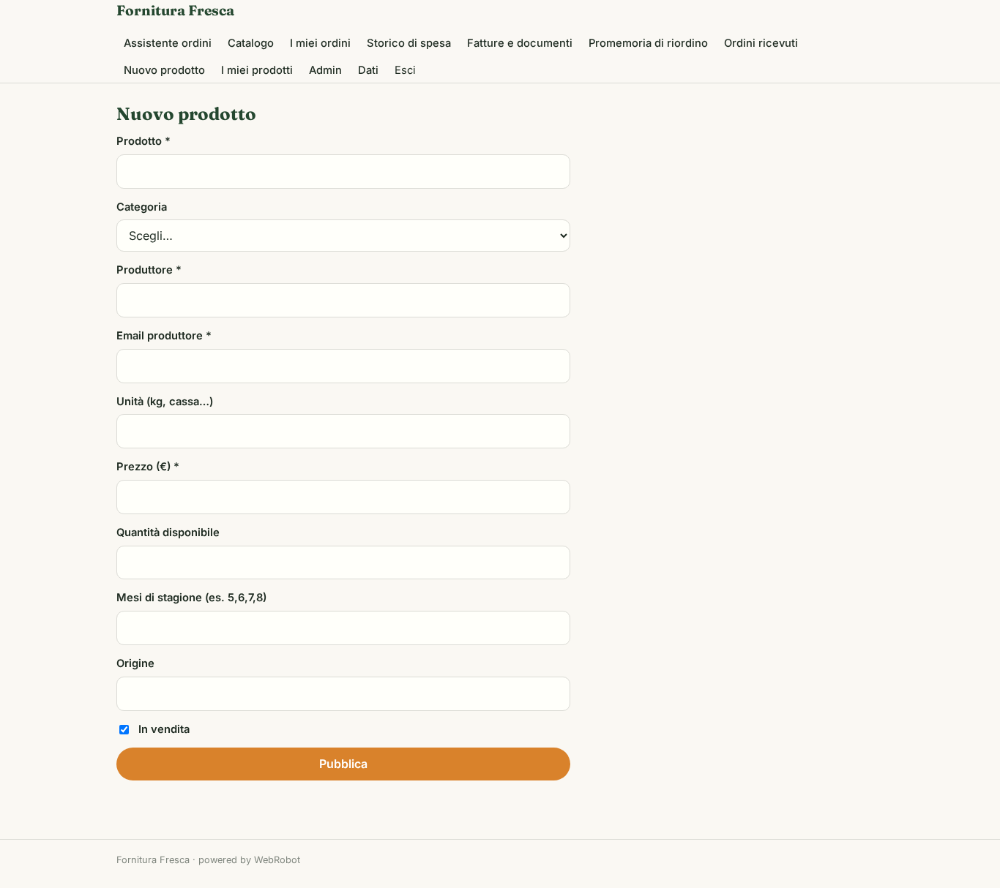

### my_products
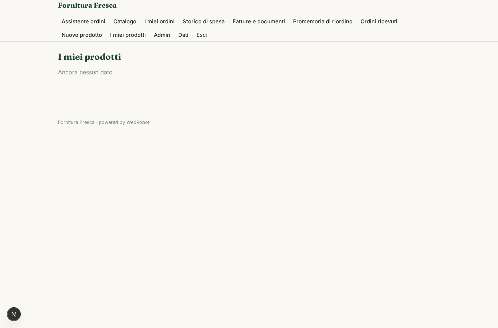

### producer_profile
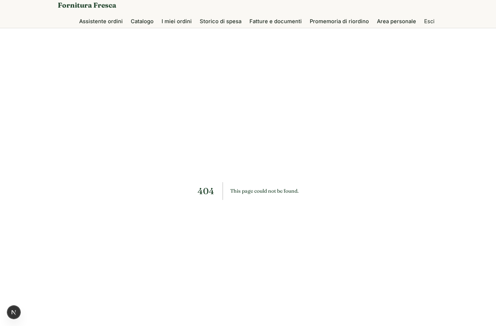

### account
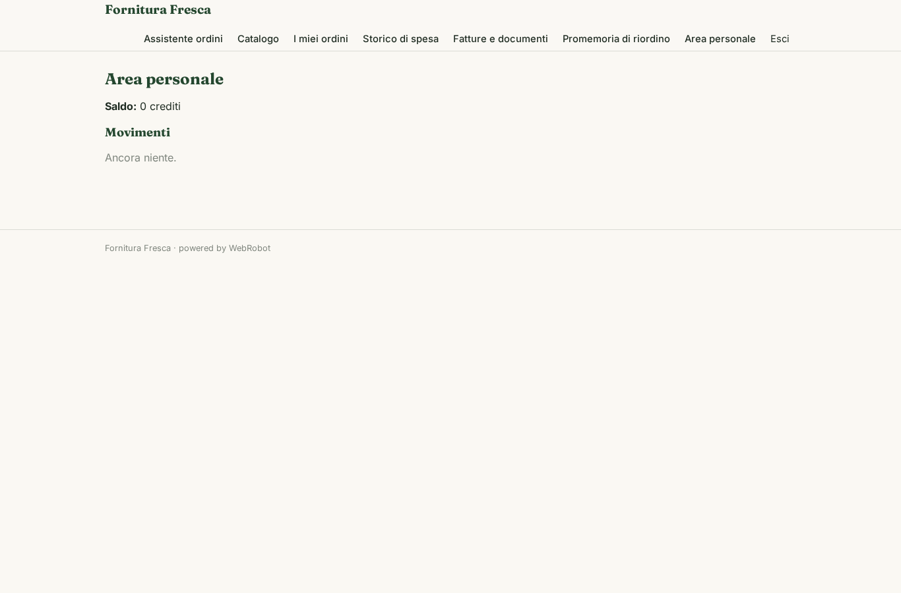

### admin
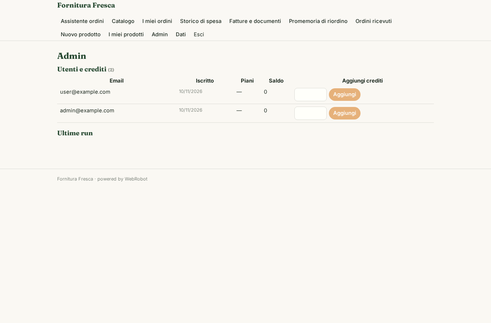
