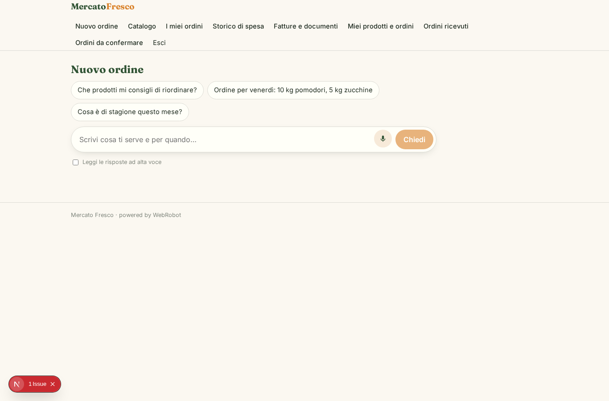
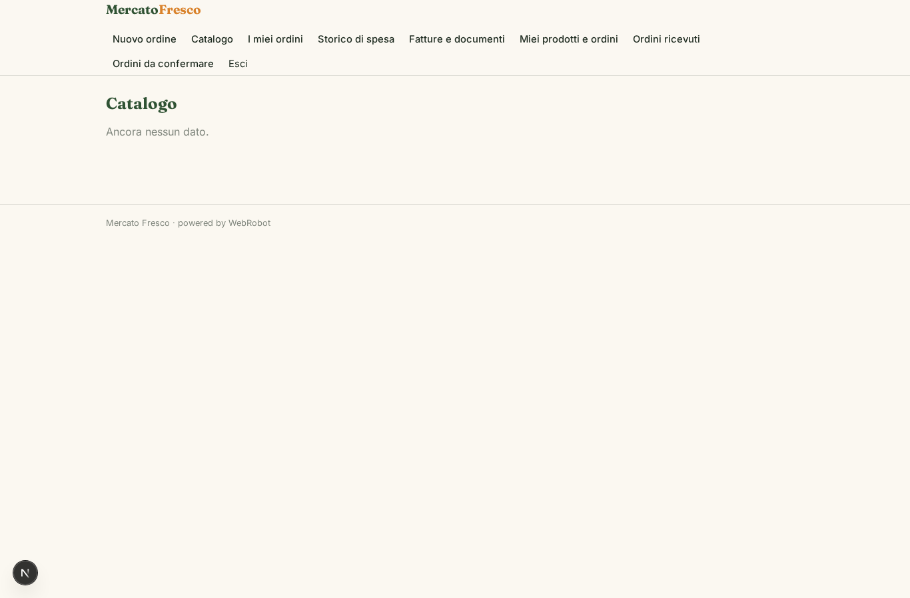
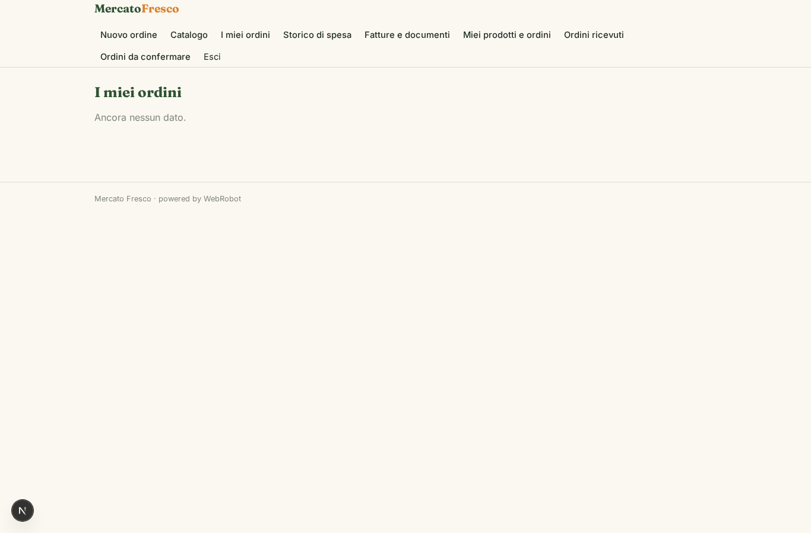
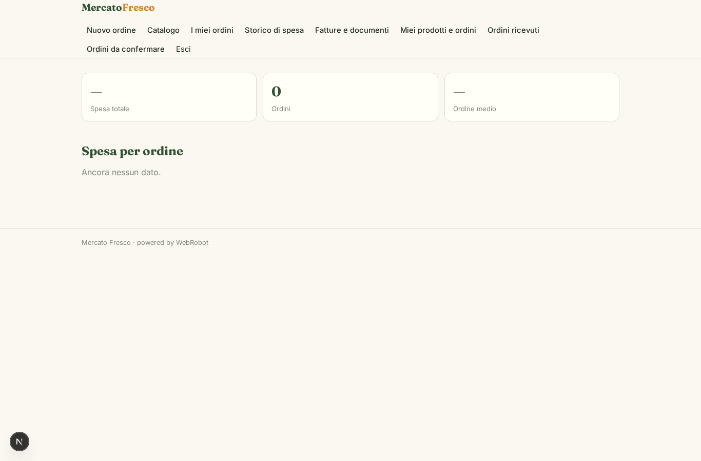
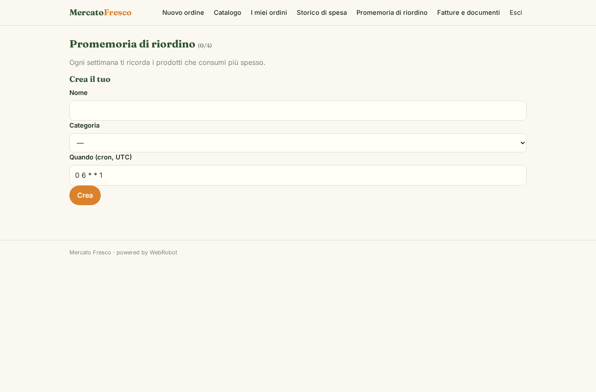
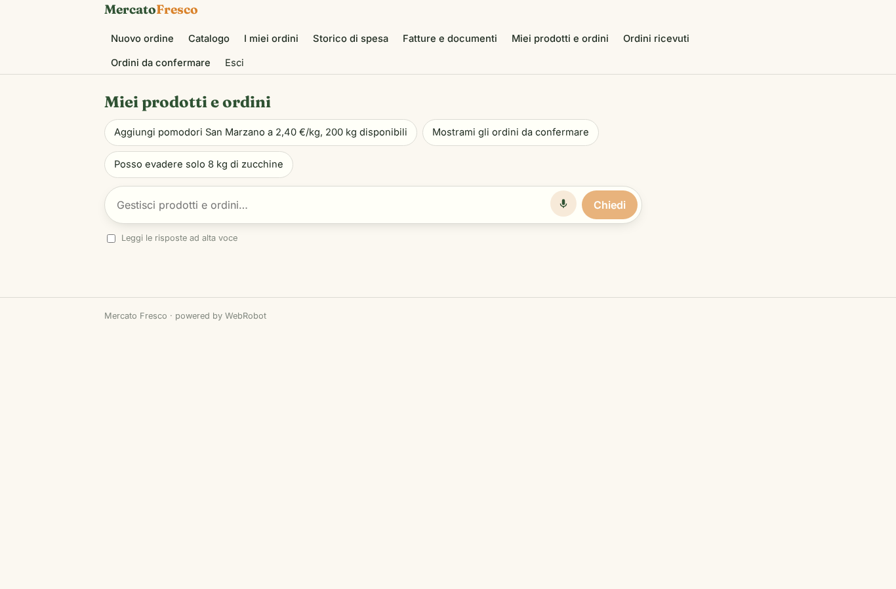
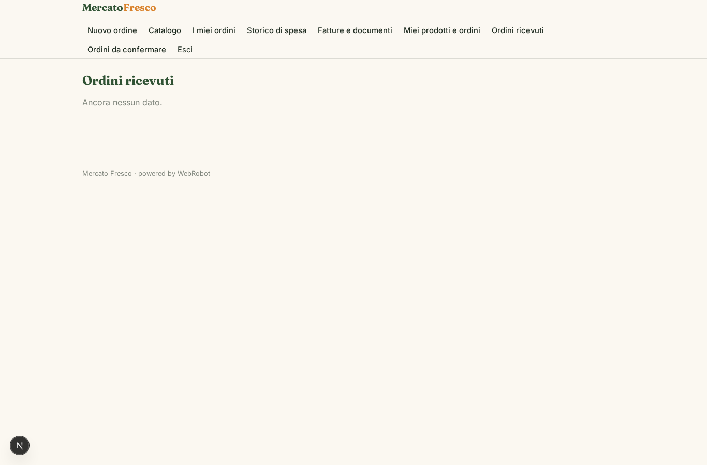
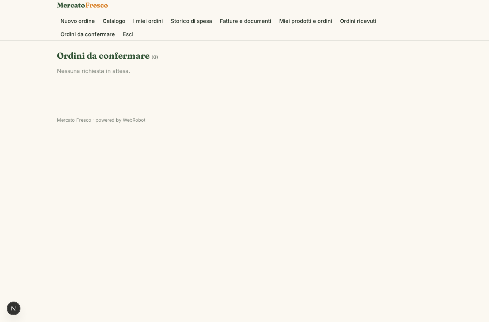

# Mercato Fresco

_Il portale di ordini tra ristoranti e produttori di prodotti freschi._

**Manifest status:** valid (schema validator + runtime contract)

## Description given to the app builder (Italian)

Descrivo solo lo strato software di un servizio di forniture per la ristorazione: il portale di ordinazione e gestione tra ristoranti e produttori, non la logistica ne la consegna fisica delle merci. Il ristoratore sfoglia un catalogo di prodotti freschi caricati dai produttori, con disponibilita e prezzi, e compone l'ordine indicando quantita e data di consegna desiderata; un agente suggerisce prodotti ricorrenti in base allo storico e avvisa se qualcosa e fuori stagione o non disponibile. L'ordine viene inviato ai produttori interessati, che lo confermano e indicano cosa possono evadere. Un modello periodico ricorda al ristoratore di riordinare i prodotti che consuma di frequente. Il ristoratore vede i propri ordini e lo storico di spesa, il produttore gli ordini ricevuti e i propri prodotti, l'admin tutto. Fatture e documenti di consegna sono consultabili nell'area personale e inviati via email. Monetizzazione: commissione sugli ordini transati. In italiano.

## Features not expressible today (spec.extensions)

- **record_visibility_produttori**: Gli ordini sono dei ristoratori (ownedBy user): il produttore li vede tramite l'agente e le viste con ruolo, non c'è ancora un filtro per produttore a livello di record. Da restringere quando disponibile.
- **email_documenti**: Invio email di fatture e DDT non disponibile: i documenti si consultano nell'area personale come link inseriti in 'documenti'.
- **upload_file**: Il caricamento di file (fatture, DDT, immagini prodotto) non è disponibile: si usano link.
- **notifiche_ordini**: Notifiche email ai produttori per nuovi ordini non disponibili: vedono gli ordini in 'Ordini da confermare'.

## Screenshots (interpretive runtime)

### home-anon

### home-mobile

### home

### nuovo_ordine

### catalogo

### ordini

### spesa

### promemoria

### documenti

### area_produttore

### ordini_ricevuti

### conferme

