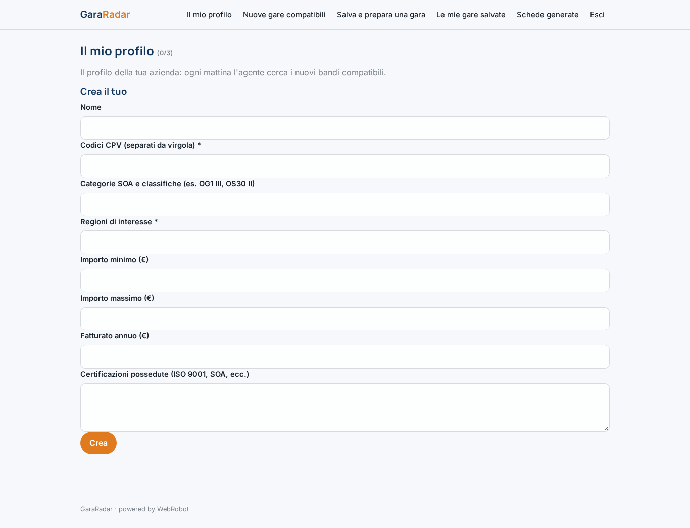
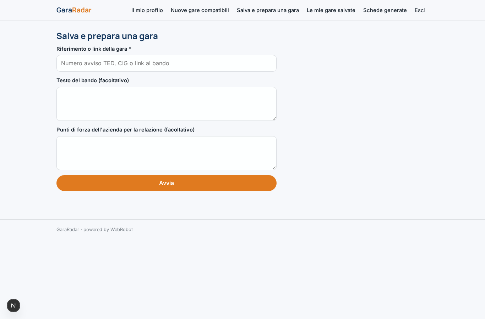
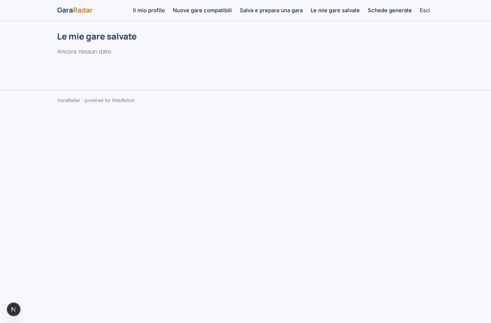
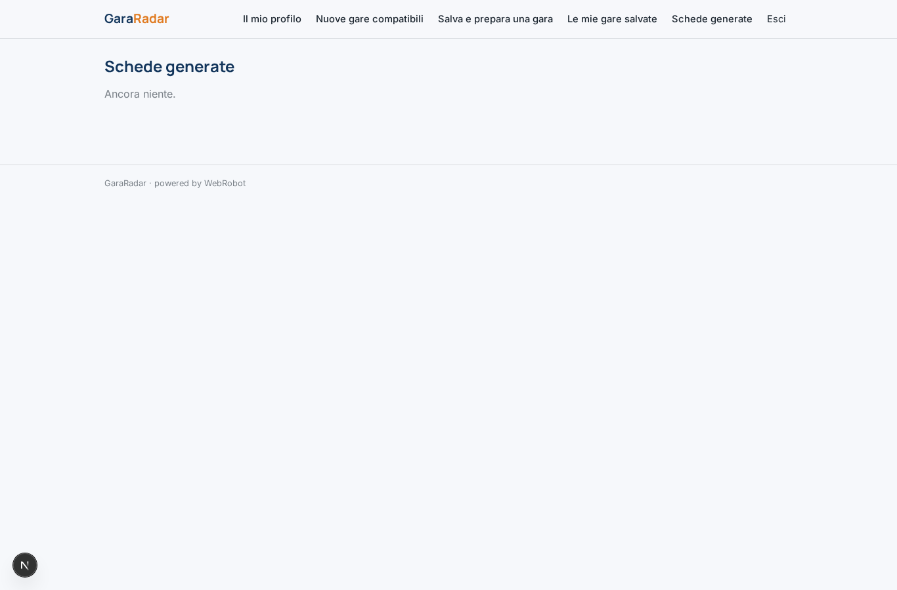
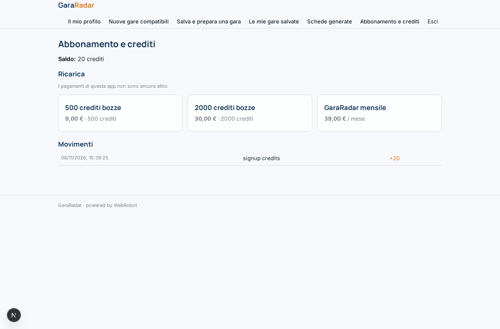

# GaraRadar

_Le gare pubbliche giuste per la tua impresa, ogni mattina._

**Manifest status:** valid (schema validator + runtime contract)

## Description given to the app builder (Italian)

GaraRadar serve a imprese edili, di servizi e consulenti che partecipano a gare pubbliche. Dopo la registrazione l'utente compila il profilo aziendale: codici CPV e categorie SOA, regioni di interesse, importo minimo e massimo, fatturato e certificazioni possedute. Ogni mattina un agente legge i nuovi bandi dai dati aperti ANAC e da TED (licenza CC BY 4.0), li filtra sul profilo e assegna a ciascuno un punteggio di compatibilità spiegando i requisiti mancanti. Per le gare che l'utente salva, un secondo agente prepara una scheda di sintesi con scadenze, criteri di aggiudicazione, documenti richiesti e una checklist di preparazione, più una bozza della relazione tecnica che l'utente può modificare. Alle 8 arriva un'email con le nuove gare compatibili, e un promemoria tre giorni prima di ogni scadenza. L'utente vede solo le proprie gare salvate; un account aziendale può invitare colleghi con ruolo editor o sola lettura. Si paga con abbonamento mensile, con crediti extra per ogni bozza di relazione generata. Lingua italiana.

## Features not expressible today (spec.extensions)

- **email_alerts**: Email alle 8:00 con le nuove gare compatibili e promemoria 3 giorni prima di ogni scadenza: le notifiche non sono ancora disponibili. Per ora le gare si leggono nella vista 'Nuove gare compatibili'.
- **team_invites**: Inviti di colleghi con ruolo editor o sola lettura: la condivisione per singola gara (viewer/editor) è attiva su saved_tenders; un account aziendale con più utenti e ruoli a livello di organizzazione richiede lavoro dedicato.
- **draft_editing**: Modifica in-app della bozza della relazione tecnica: oggi la bozza è nel report stampabile/copiabile; un editor sul record richiede un'estensione.
- **save_from_radar**: Il pulsante 'Salva gara' direttamente dalla lista dei match non è espresso dal manifesto: l'utente inserisce il riferimento nel modulo 'Salva e prepara una gara'.

## Screenshots (interpretive runtime)

### home-anon

### home-mobile

### home

### watches

### radar

### new

### saved

### history

### account

