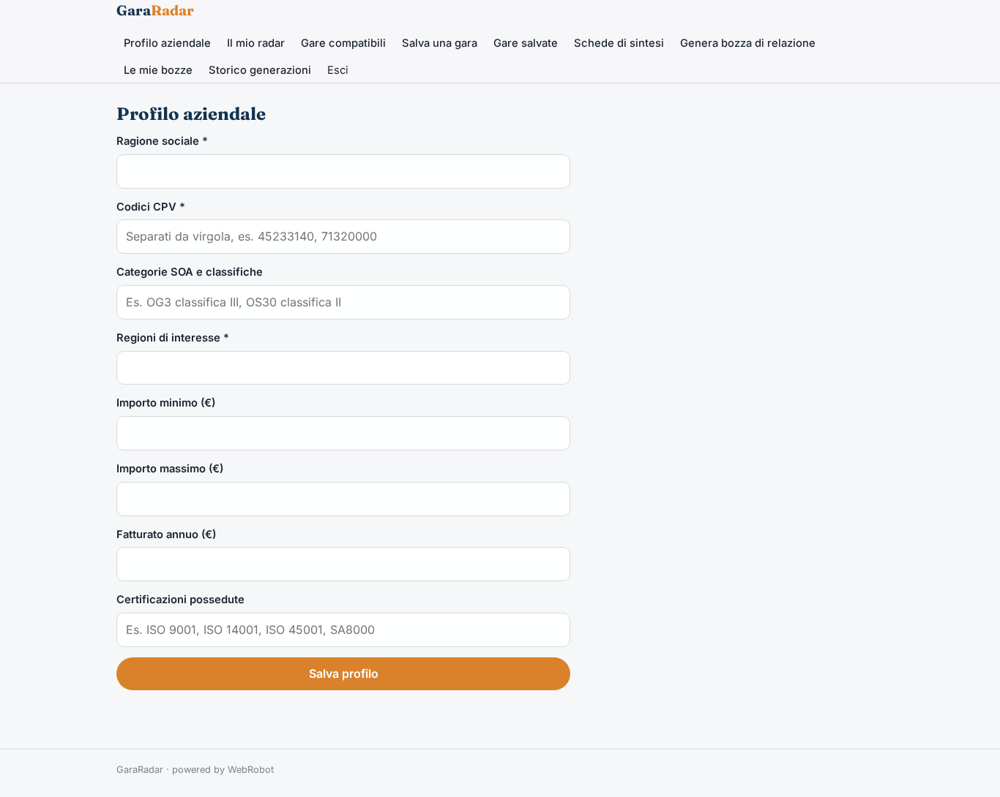
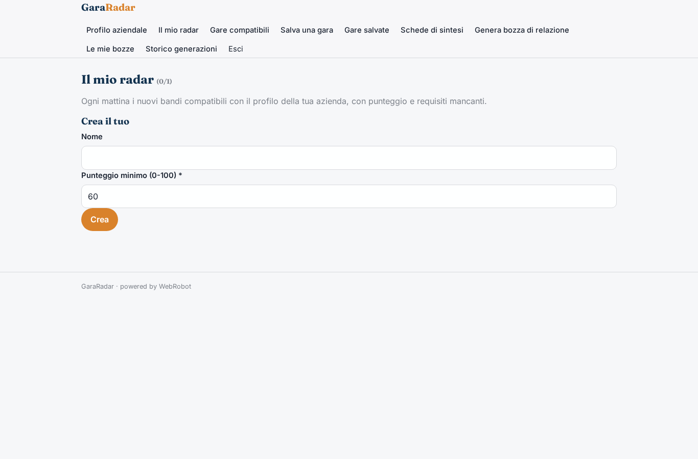
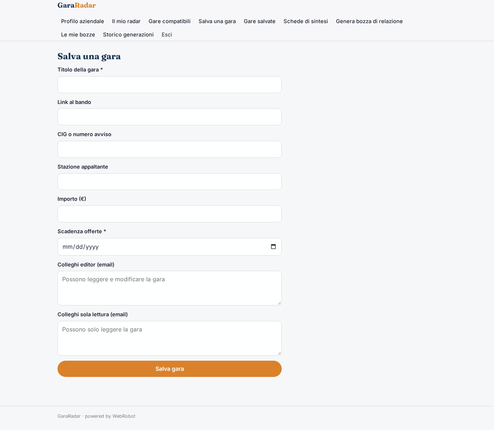
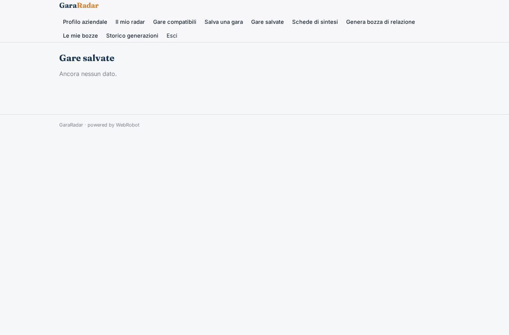
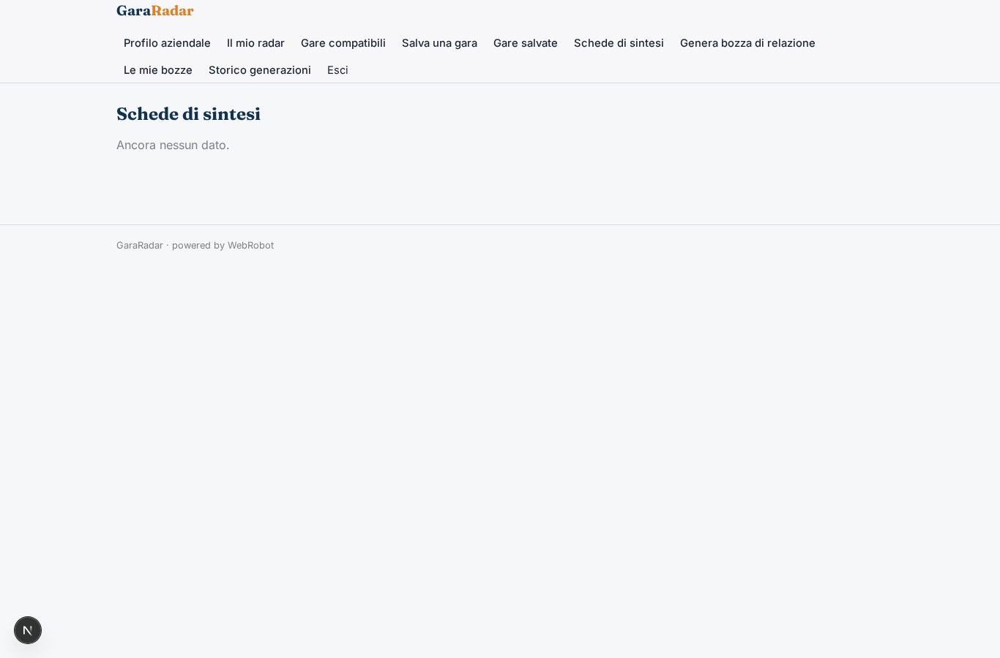
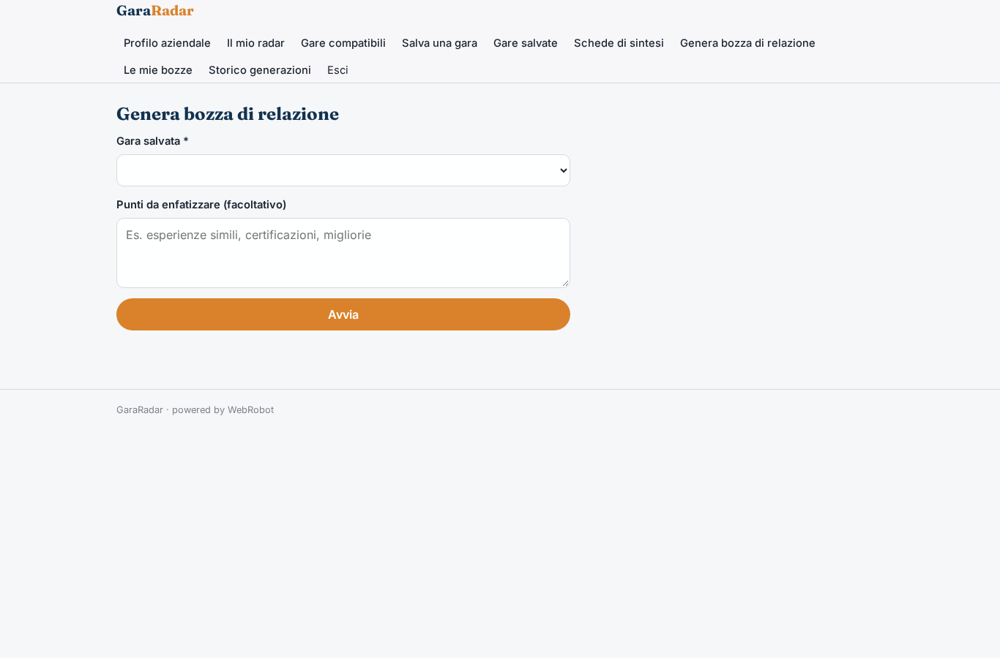
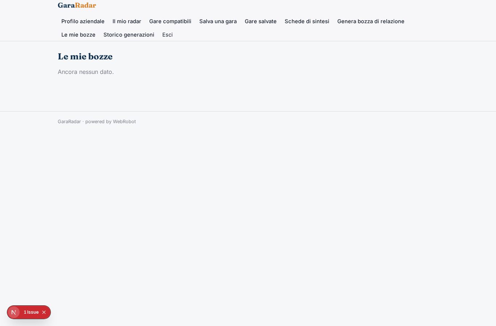
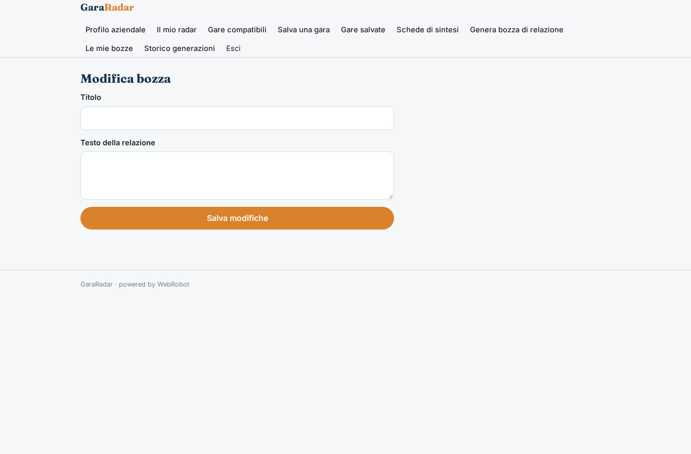
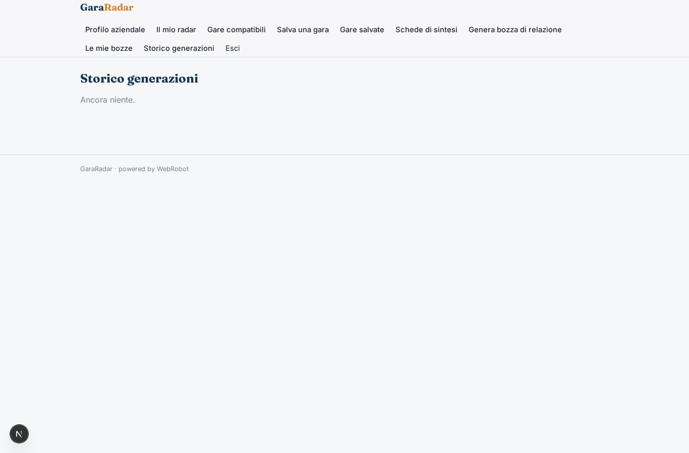
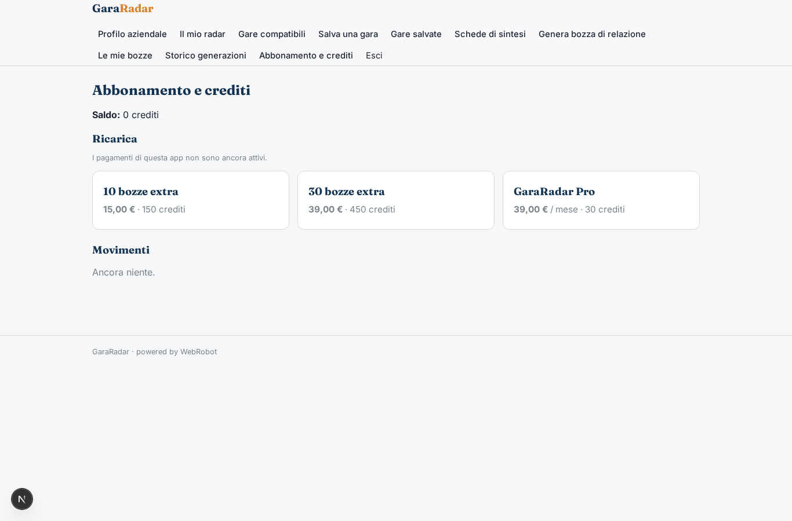

# GaraRadar

_Le gare pubbliche giuste per la tua impresa, ogni mattina._

**Manifest:** valid (schema + runtime contract) · **Functional test:** passed (18 checks passed)

## Description given to the app builder (Italian)

GaraRadar serve a imprese edili, di servizi e consulenti che partecipano a gare pubbliche. Dopo la registrazione l'utente compila il profilo aziendale: codici CPV e categorie SOA, regioni di interesse, importo minimo e massimo, fatturato e certificazioni possedute. Ogni mattina un agente legge i nuovi bandi dai dati aperti ANAC e da TED (licenza CC BY 4.0), li filtra sul profilo e assegna a ciascuno un punteggio di compatibilità spiegando i requisiti mancanti. Per le gare che l'utente salva, un secondo agente prepara una scheda di sintesi con scadenze, criteri di aggiudicazione, documenti richiesti e una checklist di preparazione, più una bozza della relazione tecnica che l'utente può modificare. Alle 8 arriva un'email con le nuove gare compatibili, e un promemoria tre giorni prima di ogni scadenza. L'utente vede solo le proprie gare salvate; un account aziendale può invitare colleghi con ruolo editor o sola lettura. Si paga con abbonamento mensile, con crediti extra per ogni bozza di relazione generata. Lingua italiana.

## Screenshots (interpretive runtime, no data)

### home-anon

### home-mobile

### home

### profile

### radar

### matches

### save_tender

### saved

### briefs

### new_draft

### drafts_list

### edit_draft

### runs

### account

