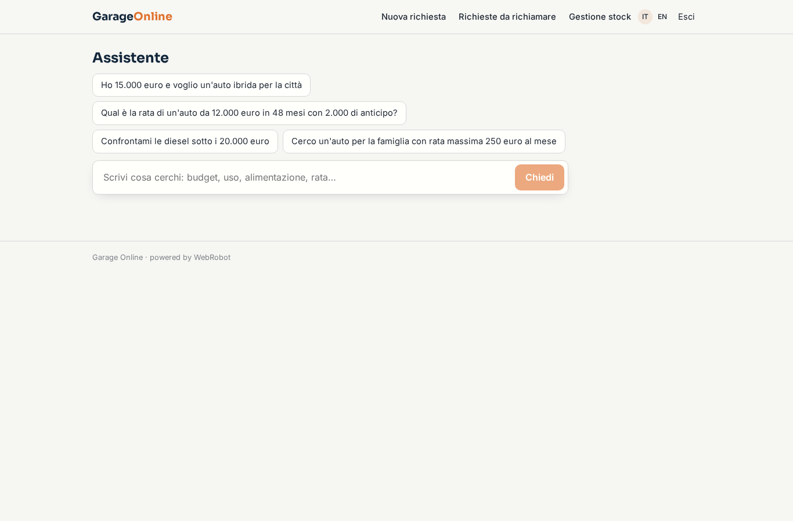
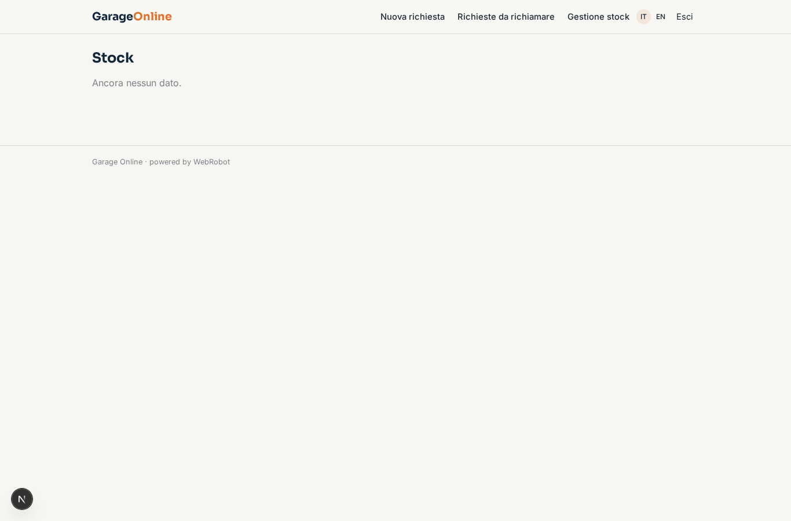
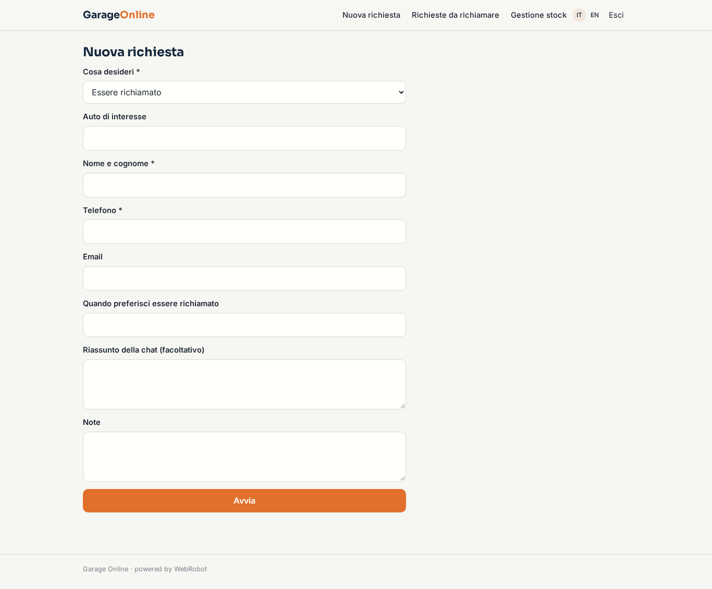
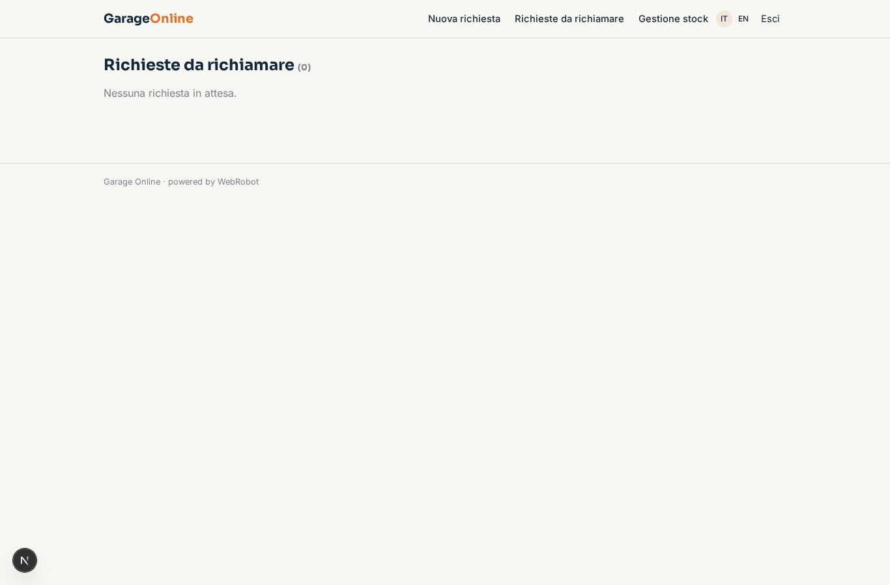
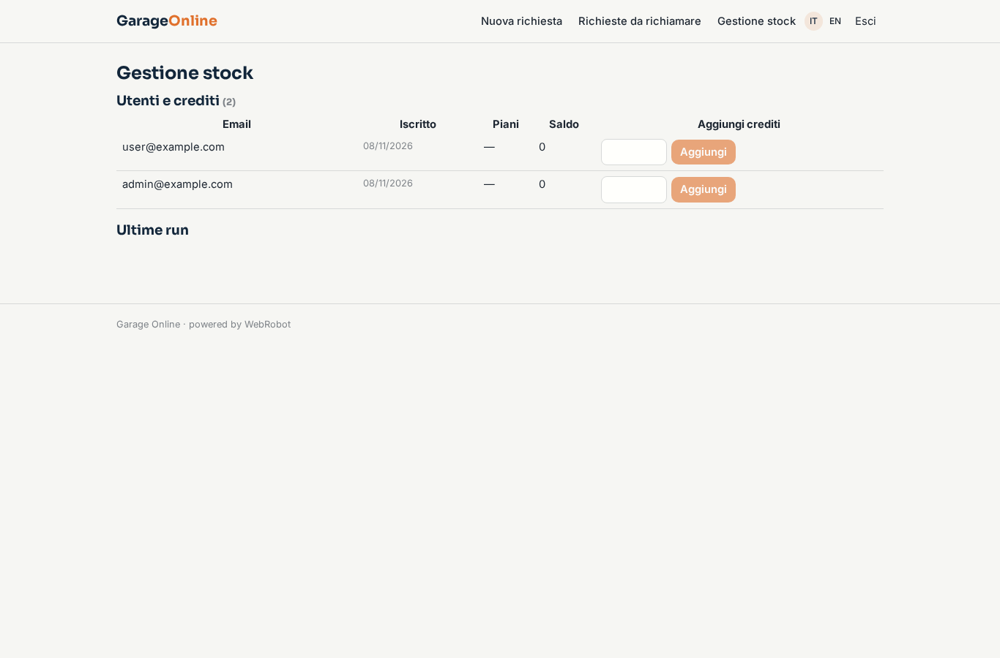
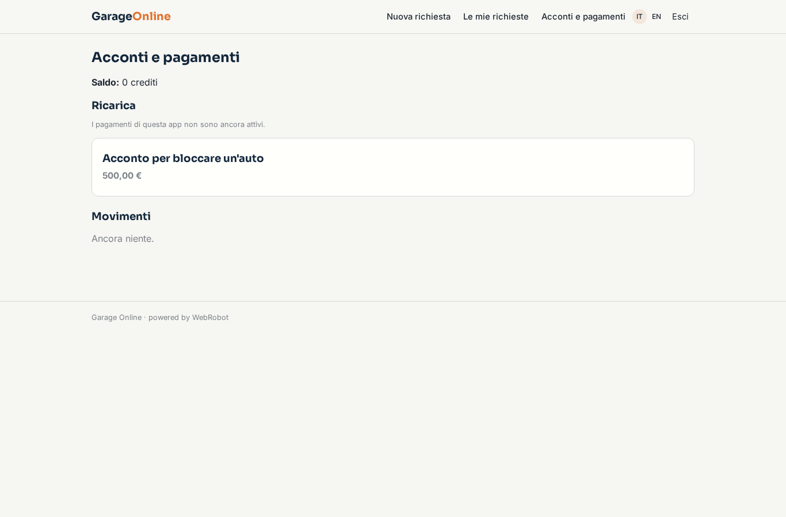

# Garage Online

_Il tuo showroom online, con un assistente AI e consulenti veri._

**Manifest status:** valid (schema validator + runtime contract)

## Description given to the app builder (Italian)

Vorrei Garage Online, un'app per concessionarie di auto usate che vogliono vendere online con un assistente e consulenti umani. La concessionaria carica il suo stock: modello, anno, chilometri, prezzo, foto, optional, garanzia. Il visitatore anonimo del sito chatta con un assistente che lo aiuta a scegliere in base a budget, uso, tipo di alimentazione e rata mensile desiderata, confronta le auto disponibili solo nello stock del concessionario e calcola una simulazione di rata a titolo indicativo. Il cliente interessato lascia contatti, chiede una prova su strada o la valutazione della propria auto, e un consulente riceve la richiesta con il riassunto della conversazione, la approva e richiama; vorremmo anche che l'assistente risponda al telefono e che il consulente possa chiamare dalla piattaforma. Per bloccare un'auto il cliente paga un acconto con carta, rimborsabile secondo regole chiare. La richiesta di finanziamento vera va girata alla finanziaria partner. Non usiamo dati dei portali di annunci. Ogni concessionaria vede solo il suo stock e i suoi clienti. Abbonamento mensile più una commissione per auto venduta.

## Features not expressible today (spec.extensions)

- **dealer_isolation**: One app deployment per dealership: the stock is a shared catalogue so anonymous visitors can read it, which is only safe if each dealership has its own app. A multi-dealer marketplace in one app would need per-dealer stock visible to anonymous visitors, not available yet.
- **consultant_calling**: Outbound calls by the advisor from the platform (click-to-call, call logging) are not available yet: the approval shows name and phone and the advisor calls from their own phone. The phone channel for the assistant is declared but the number must be activated in the studio.
- **stock_photos**: Uploading photos is not available yet: the dealer pastes links to the photos in the stock records. Bulk stock import (CSV) also not available: records are entered one by one in the stock management view.
- **deposit_payment**: The deposit is a fixed-price pack (EUR 500 by default, to be set by the dealer); per-car amounts, partial refunds and refund rules are applied manually by the dealer in Stripe. The text of the rules on the home is a proposal that the dealer must confirm.
- **finance_partner**: The real financing application is forwarded by the advisor to the partner lender; no automatic integration, as it needs the lender's credentials and APIs.
- **subscription_commission**: The dealer's monthly subscription to the platform is a commercial agreement outside this manifest; transactionFeePct (2%) is a placeholder for the per-car-sold commission to be confirmed. Email notification to advisors when a request arrives is not available yet: they read the approvals view.

## Screenshots (interpretive runtime)

### home-anon

### home-mobile

### home

### chat

### stock

### new_request

### my_requests

### review

### stock_admin

### account

