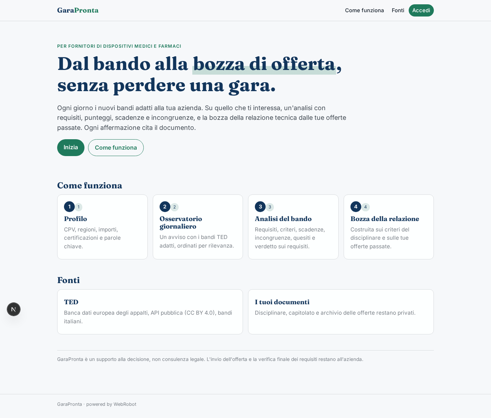
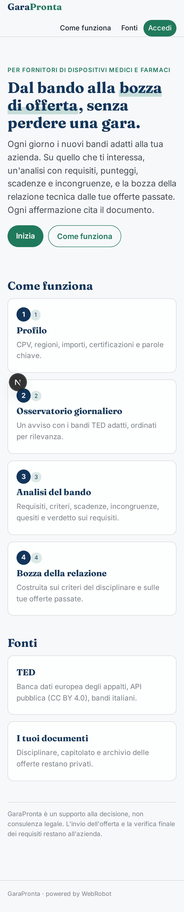
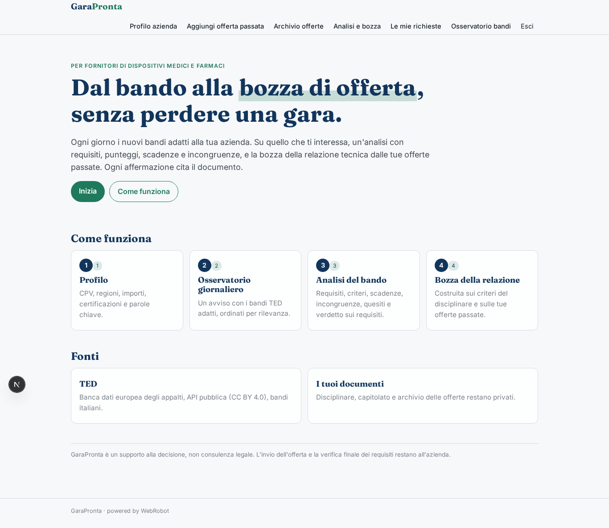
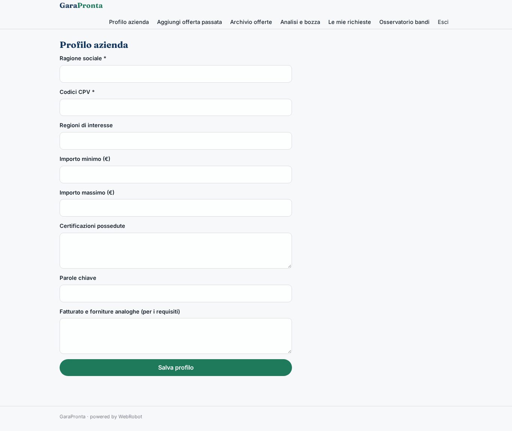
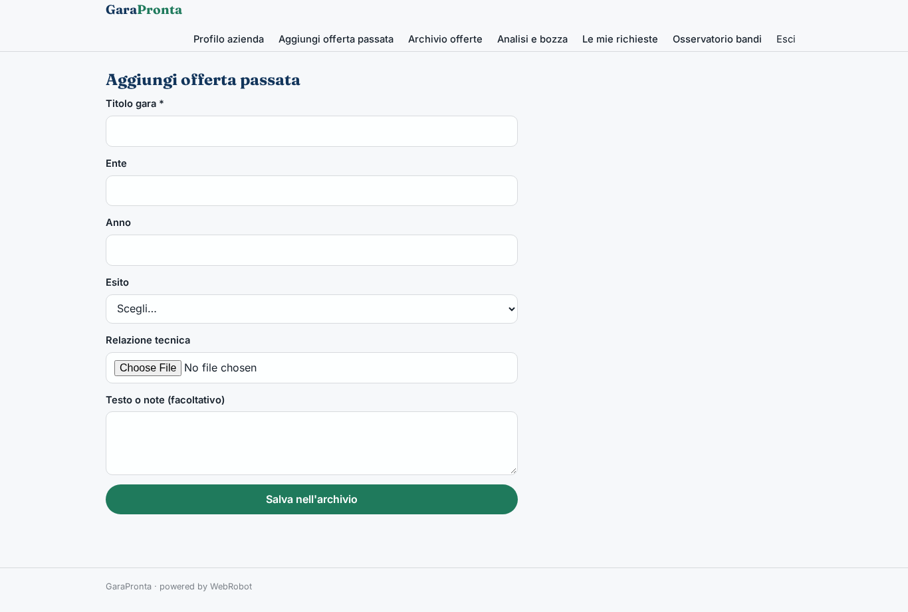
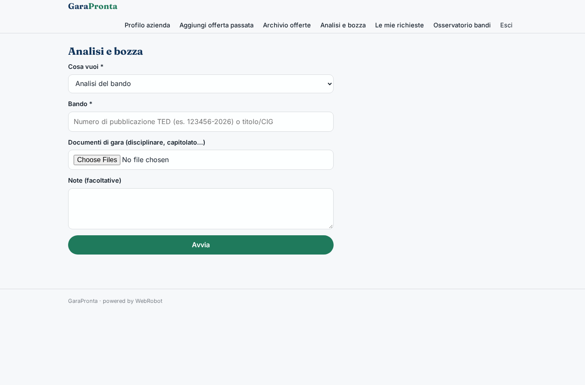
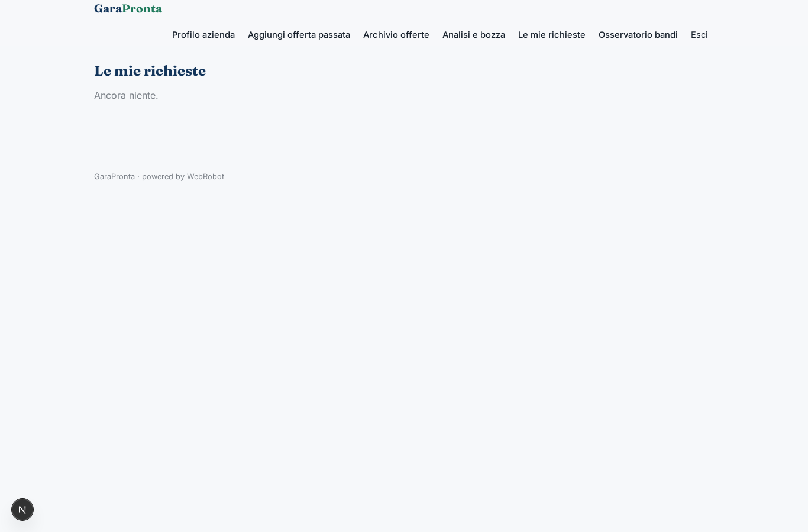
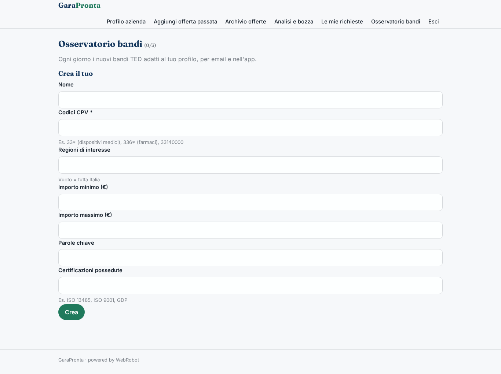
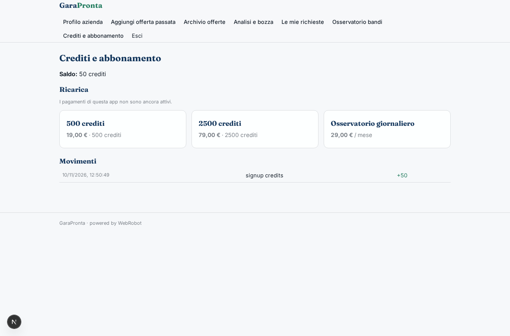

# GaraPronta

_Dal bando alla bozza di offerta, con ogni affermazione citata._

**Manifest:** valid (schema + runtime contract) · **Functional test:** passed (13 checks passed)

## Description given to the app builder (Italian)

Voglio un'app per le aziende italiane che partecipano alle gare d'appalto pubbliche (all'inizio fornitori di dispositivi medici e farmaci per ospedali e ASL). L'azienda inserisce il suo profilo: settori (codici CPV), regioni di interesse, importo minimo e massimo, certificazioni possedute, parole chiave. Ogni giorno un agente cerca i nuovi bandi pubblicati sulle fonti ufficiali (TED, la banca dati europea degli appalti, ha un'API pubblica gratuita: POST https://api.ted.europa.eu/v3/notices/search, filtro buyer-country=ITA) e manda un avviso con i bandi adatti al profilo, ordinati per rilevanza, con ente, importo, lotti e scadenza. Su un bando scelto l'utente chiede un'analisi: l'agente legge il bando e i documenti di gara (disciplinare e capitolato, che l'utente può caricare), estrae requisiti di partecipazione, criteri di punteggio, scadenze, segnala incongruenze tra i documenti e quesiti da fare alla stazione appaltante, e dice se l'azienda ha i requisiti. Poi prepara una bozza della relazione tecnica riusando le offerte passate dell'azienda che l'utente ha caricato in un archivio. Ogni affermazione deve citare il documento da cui viene. L'invio dell'offerta resta all'azienda. Lingua italiana. Si paga a crediti: analisi e bozza costano crediti, l'osservatorio giornaliero ha un abbonamento. Nome dell'app: GaraPronta.

## Screenshots (interpretive runtime, no data)

### home-anon

### home-mobile

### home

### profilo

### archivio_nuovo

### archivio

### new_analysis

### richieste

### osservatori

### account

