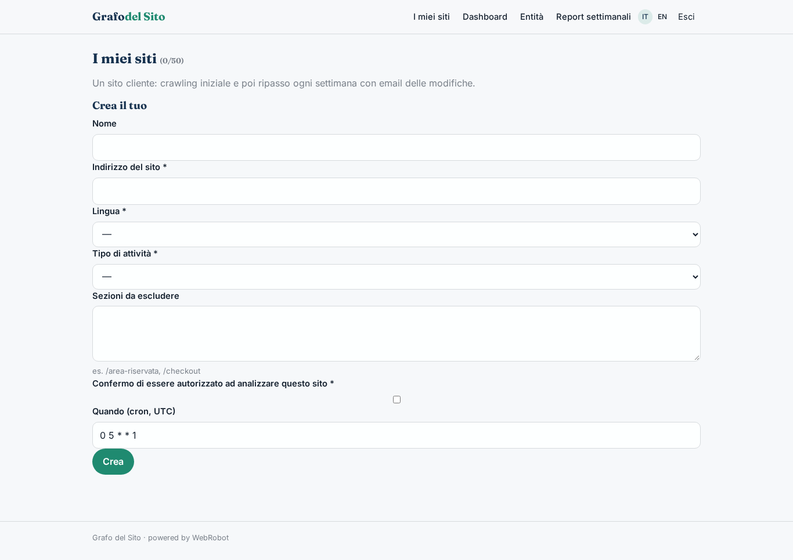
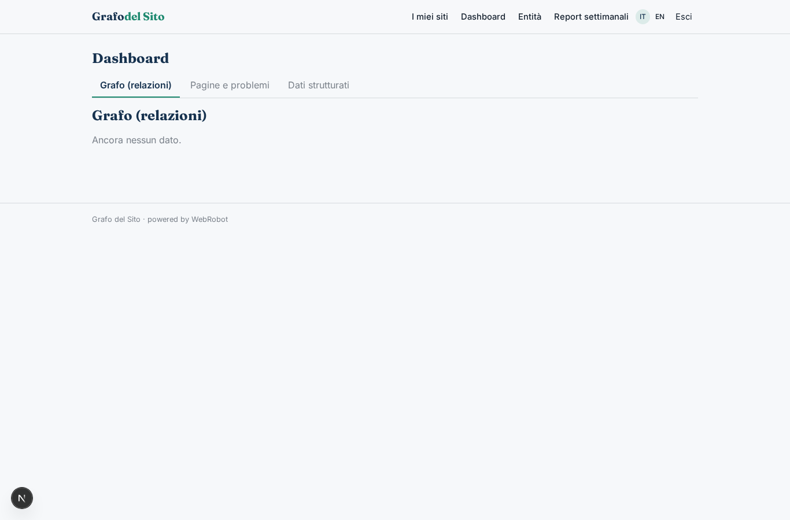
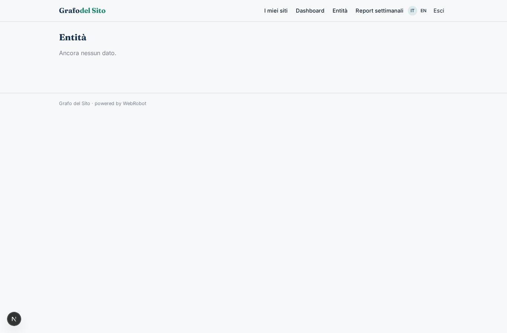
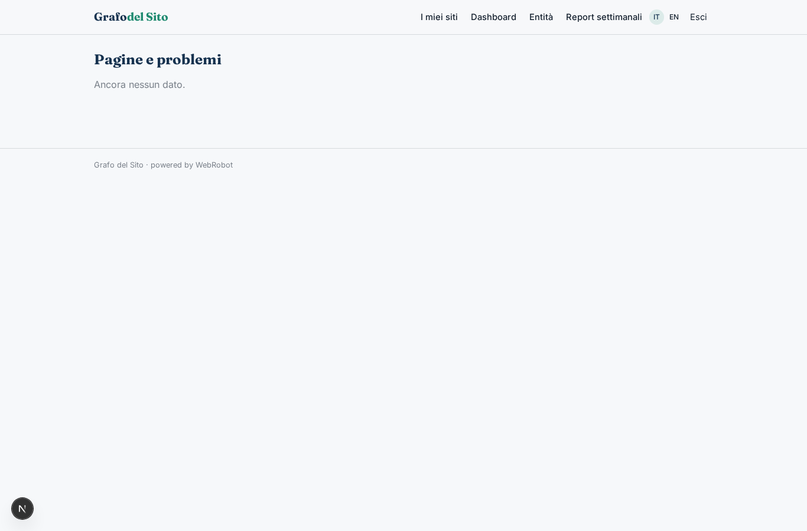
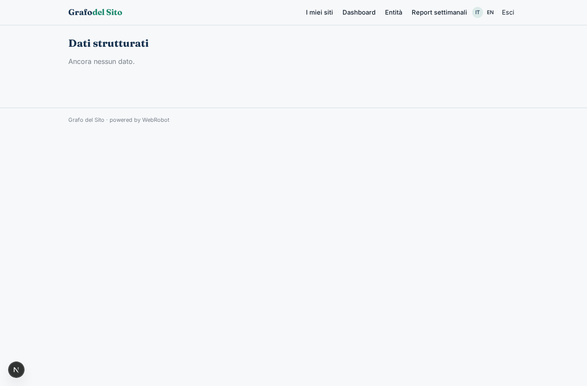
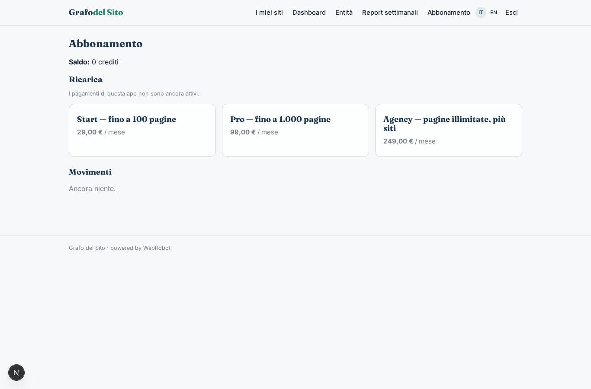

# Grafo del Sito

_Il knowledge graph del tuo sito, con JSON-LD pronto da pubblicare._

**Manifest:** valid (schema + runtime contract) · **Functional test:** passed (10 checks passed)

## Description given to the app builder (Italian)

Mi serve un'app chiamata Grafo del Sito per migliorare la SEO semantica di siti editoriali ed e-commerce. Il cliente inserisce l'indirizzo del sito, la lingua, il tipo di attività e le sezioni da escludere. Un agente fa il crawling del sito del cliente con il suo permesso, legge ogni pagina, riconosce le entità citate (persone, luoghi, prodotti, organizzazioni, concetti) e le collega agli identificativi di Wikidata, costruendo un knowledge graph dell'intero sito. Per ogni pagina genera il markup JSON-LD di schema.org adatto, FAQ suggerite e collegamenti interni da aggiungere. Il cliente vede una dashboard con il grafo navigabile, l'elenco delle pagine con i problemi trovati e una tabella di dati strutturati pronti. Vogliamo che il markup venga poi inserito automaticamente nel sito, tramite plugin WordPress o uno snippet JavaScript da incollare una volta. Ogni settimana l'agente ripassa il sito, aggiorna il grafo con le pagine nuove e manda un'email con le modifiche. Il consulente SEO dell'agenzia può gestire più siti clienti, ognuno visibile solo ai propri utenti. Abbonamento mensile per numero di pagine.

## Features not expressible today (spec.extensions)

- **wordpress_plugin**: Plugin WordPress that fetches the JSON-LD from the signed export and injects it in each page: not available yet.
- **js_snippet**: One-time JavaScript snippet that loads the page's JSON-LD from the signed export: not available yet.
- **graph_view**: Interactive navigable graph visualisation: for now the relations table; a node-link view is not available.
- **client_sharing**: Sharing a site's data with the client's own users while the consultant manages many sites: sites are owned by the consultant's account; per-site client access is not expressed yet.

## Screenshots (interpretive runtime, no data)

### home-anon

### home-mobile

### home

### sites

### dashboard

### graph

### entities_list

### pages_issues

### structured_data

### reports

### account

