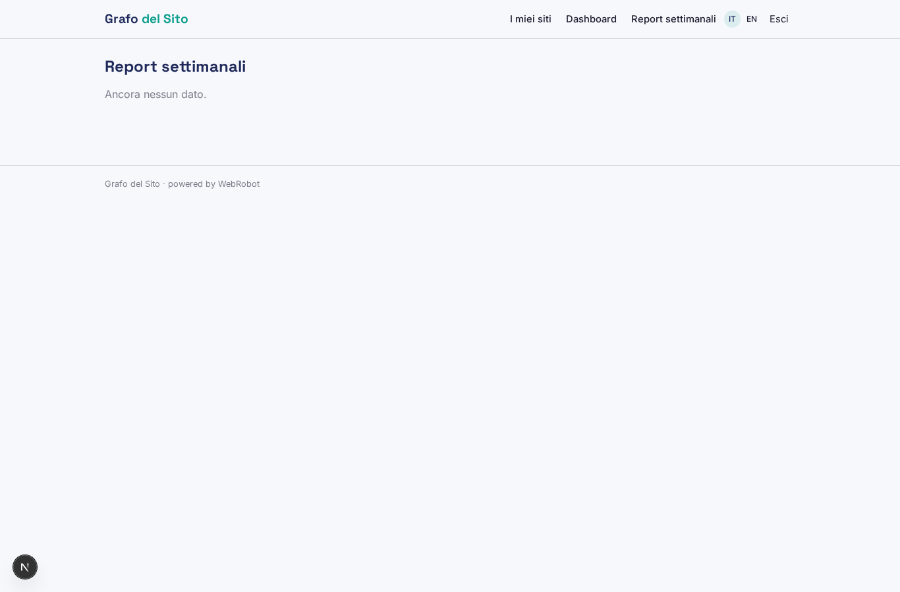
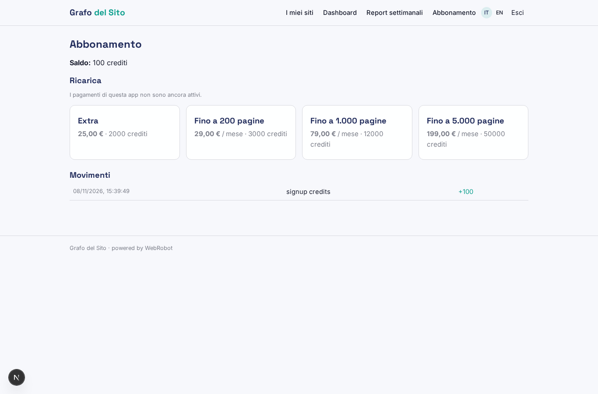

# Grafo del Sito

_Il knowledge graph del tuo sito, con JSON-LD pronto per la SEO semantica._

**Stato manifest:** valido (validatore Python + contratto runtime)

## Descrizione data all'app builder

Mi serve un'app chiamata Grafo del Sito per migliorare la SEO semantica di siti editoriali ed e-commerce. Il cliente inserisce l'indirizzo del sito, la lingua, il tipo di attività e le sezioni da escludere. Un agente fa il crawling del sito del cliente con il suo permesso, legge ogni pagina, riconosce le entità citate (persone, luoghi, prodotti, organizzazioni, concetti) e le collega agli identificativi di Wikidata, costruendo un knowledge graph dell'intero sito. Per ogni pagina genera il markup JSON-LD di schema.org adatto, FAQ suggerite e collegamenti interni da aggiungere. Il cliente vede una dashboard con il grafo navigabile, l'elenco delle pagine con i problemi trovati e una tabella di dati strutturati pronti. Vogliamo che il markup venga poi inserito automaticamente nel sito, tramite plugin WordPress o uno snippet JavaScript da incollare una volta. Ogni settimana l'agente ripassa il sito, aggiorna il grafo con le pagine nuove e manda un'email con le modifiche. Il consulente SEO dell'agenzia può gestire più siti clienti, ognuno visibile solo ai propri utenti. Abbonamento mensile per numero di pagine.

## Funzioni non esprimibili oggi (spec.extensions)

- **auto_install**: Automatic insertion of the markup into the site (WordPress plugin or one-time JavaScript snippet) is not available yet: for now the JSON-LD is shown ready to copy. The plugin/snippet would need a public export endpoint and a hosted script.
- **email_digest**: Weekly email with the changes is not available yet: changes are in the weekly report in the app.
- **interactive_graph**: A visual navigable graph (nodes and edges) is not available yet: entities and pages are shown as tables and charts.
- **agency_workspace**: Agency workspace where a consultant manages several client sites and each client user sees only their own site (shared sites, per-site invitations) is not available yet: each user sees only the sites they created.
- **page_limit_by_plan**: The per-plan page limit is stated in the plan and in the agent's goal but not enforced by the runtime.

## Screenshot (runtime interpretativo)

### home-anon

### home-mobile

### home

### sites

### dashboard

### reports

### account

