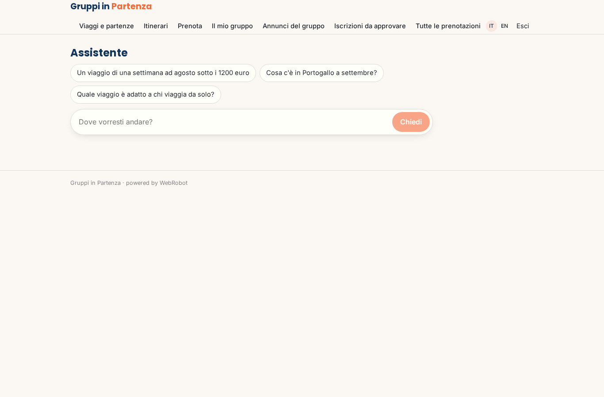
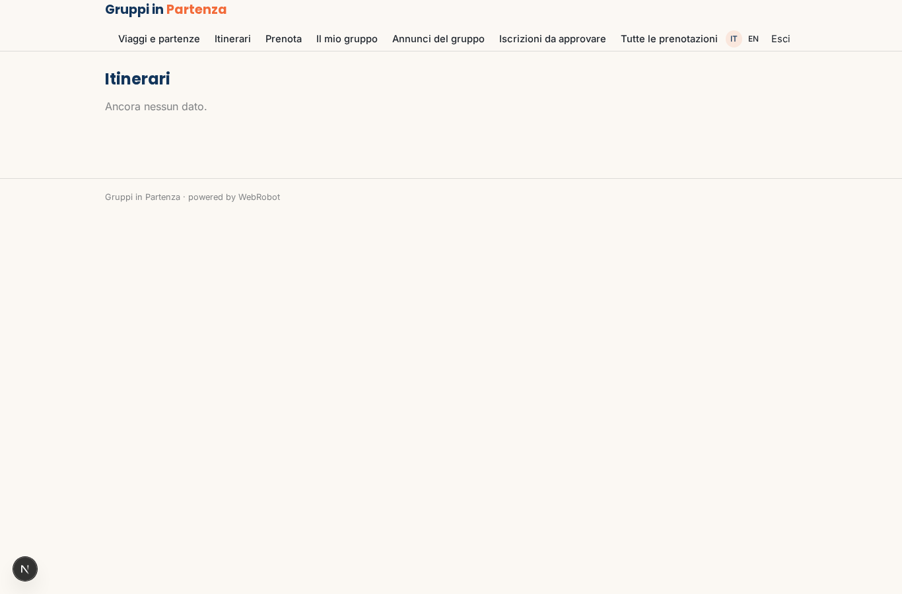
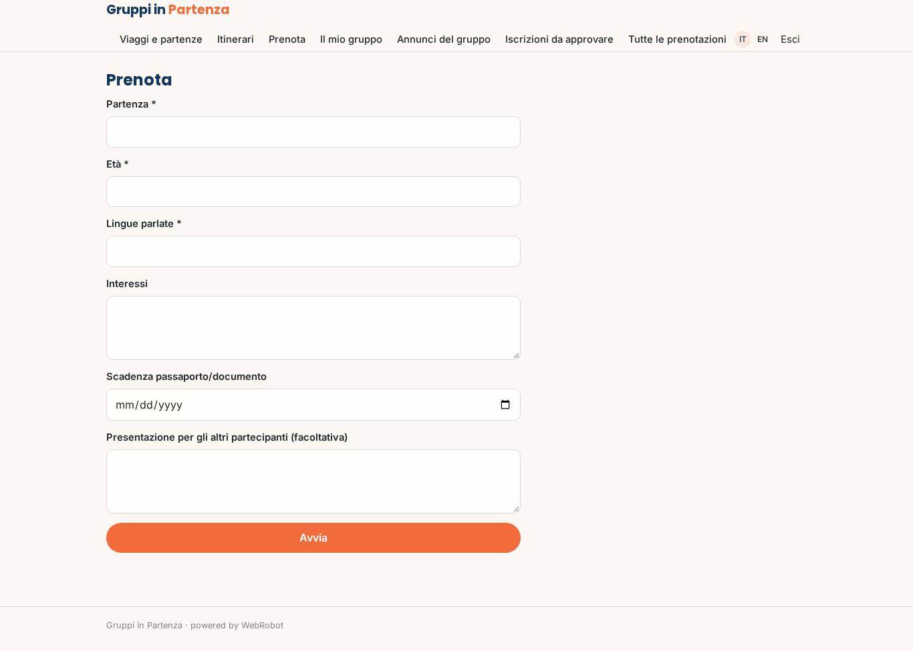
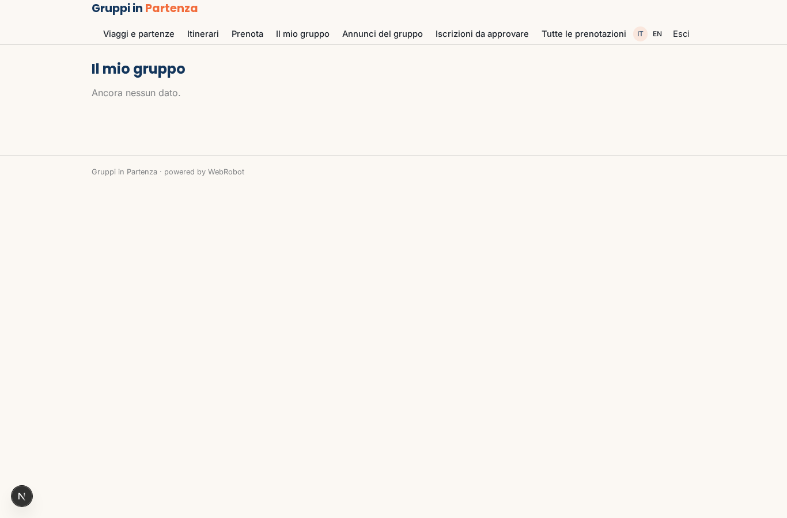
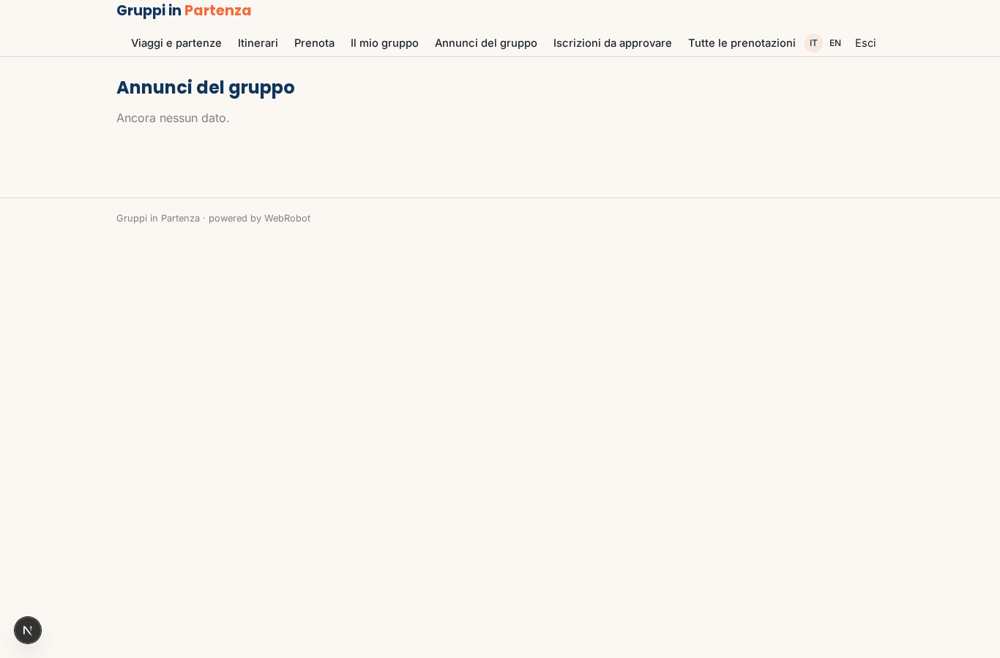
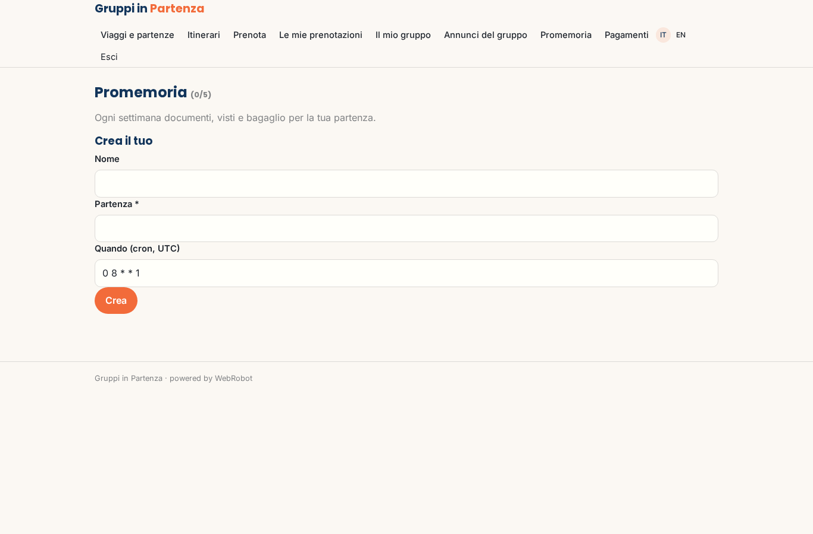
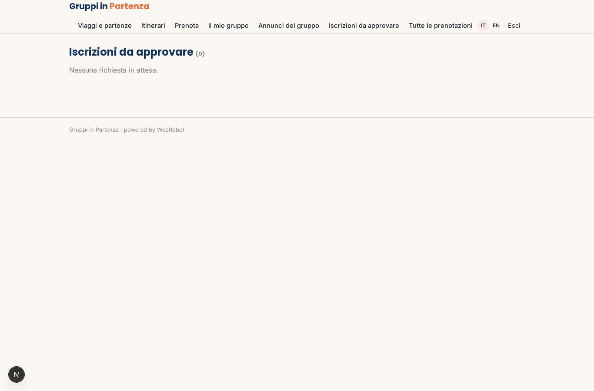
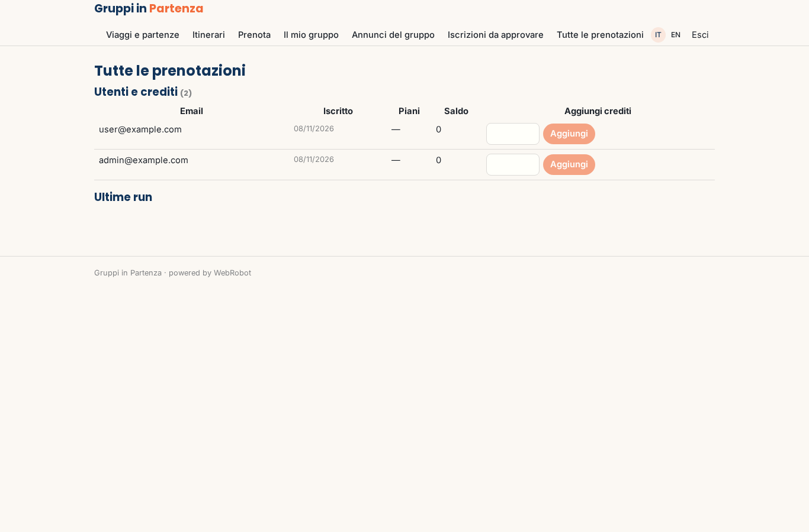

# Gruppi in Partenza

_Viaggi di gruppo per giovani adulti: scegli, prenota, parti con persone nuove._

**Manifest status:** valid (schema validator + runtime contract)

## Description given to the app builder (Italian)

Vorrei Gruppi in Partenza, il sito di prenotazione per un tour operator che organizza viaggi di gruppo per giovani adulti. Descrivo solo la parte software: l'organizzazione dei viaggi, le assicurazioni e le guide sul posto restano al tour operator. Il catalogo contiene viaggi con itinerario giorno per giorno, date di partenza, prezzo, posti disponibili e coordinatore. Il visitatore cerca per destinazione, mese, durata e budget, e un assistente in chat lo aiuta a scegliere. Il viaggiatore si registra, compila il profilo (età, lingue, interessi, documenti di viaggio), prenota un posto pagando un acconto con carta e il saldo trenta giorni prima. Quando la partenza raggiunge il numero minimo, un agente avvisa tutti che il viaggio è confermato e crea il gruppo; i viaggiatori vedono il profilo pubblico degli altri partecipanti e una chat di gruppo. Il coordinatore approva le iscrizioni e gestisce il gruppo. Promemoria automatici per documenti, visti e bagaglio. Vorremmo un'app mobile per l'itinerario offline. L'admin vede tutte le prenotazioni. Il tour operator incassa il prezzo del viaggio.

## Features not expressible today (spec.extensions)

- **group_chat**: A real-time chat among the participants of a departure: the manifest only has agent chats. For now the group sees the participants' profiles and the announcements.
- **deposit_balance_schedule**: Card payment of the deposit at booking and automatic collection of the balance 30 days before departure, with the full trip price going to the tour operator through Stripe Connect: payment amounts per booking and the balance schedule need custom logic; dates are recorded on the booking.
- **offline_itinerary**: Offline itinerary in the mobile app: the Capacitor shell is declared, but offline caching of the itinerary is not available yet.
- **notifications**: Emails/push to announce confirmation and send reminders are not available yet: users see announcements and reminders inside the app.
- **document_upload**: Travel documents cannot be uploaded: only the expiry date is collected; passport numbers are never stored.

## Screenshots (interpretive runtime)

### home-anon

### home-mobile

### home

### assistant

### departures

### itineraries

### book

### my_bookings

### group

### news

### watches

### approvals

### admin

### account

