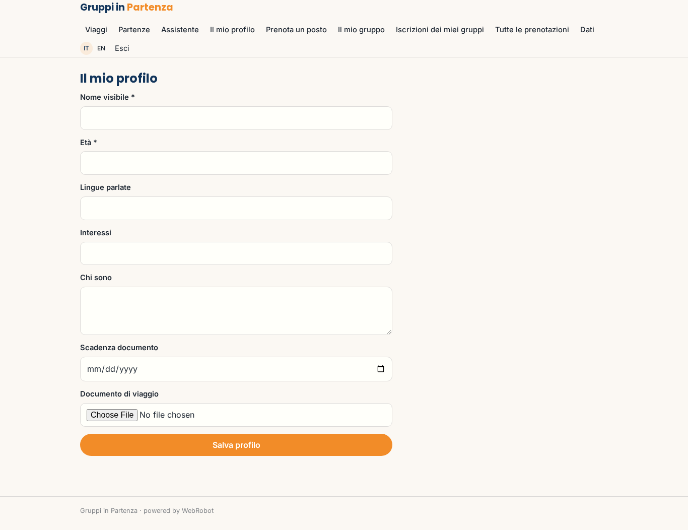
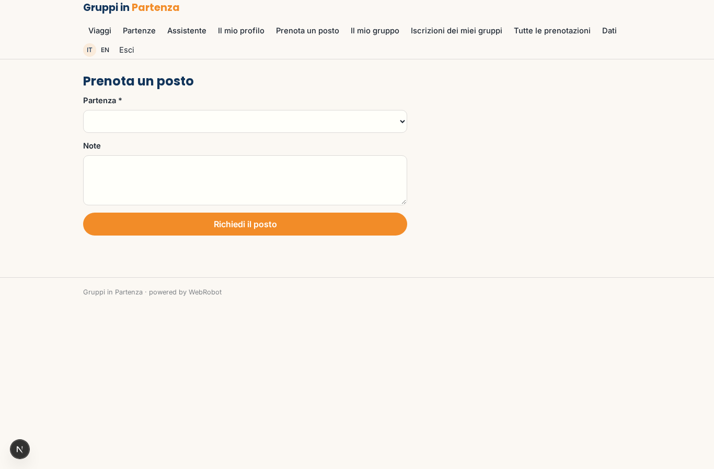
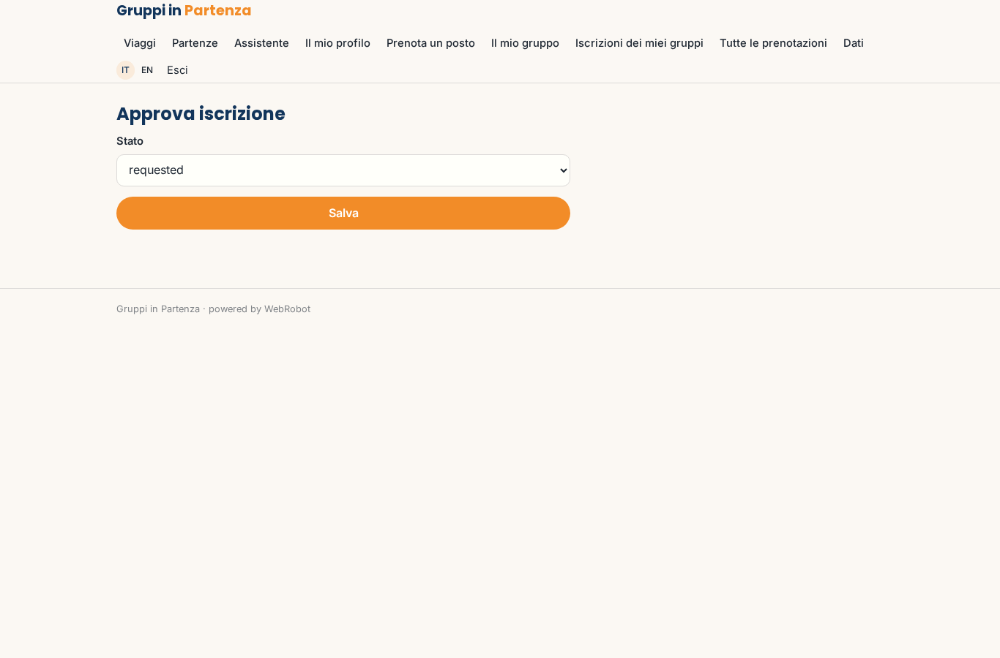

# Gruppi in Partenza

_Viaggi di gruppo per giovani adulti: scegli, prenota, parti con persone nuove._

**Manifest:** valid (schema + runtime contract) · **Functional test:** passed (19 checks passed)

## Description given to the app builder (Italian)

Vorrei Gruppi in Partenza, il sito di prenotazione per un tour operator che organizza viaggi di gruppo per giovani adulti. Descrivo solo la parte software: l'organizzazione dei viaggi, le assicurazioni e le guide sul posto restano al tour operator. Il catalogo contiene viaggi con itinerario giorno per giorno, date di partenza, prezzo, posti disponibili e coordinatore. Il visitatore cerca per destinazione, mese, durata e budget, e un assistente in chat lo aiuta a scegliere. Il viaggiatore si registra, compila il profilo (età, lingue, interessi, documenti di viaggio), prenota un posto pagando un acconto con carta e il saldo trenta giorni prima. Quando la partenza raggiunge il numero minimo, un agente avvisa tutti che il viaggio è confermato e crea il gruppo; i viaggiatori vedono il profilo pubblico degli altri partecipanti e una chat di gruppo. Il coordinatore approva le iscrizioni e gestisce il gruppo. Promemoria automatici per documenti, visti e bagaglio. Vorremmo un'app mobile per l'itinerario offline. L'admin vede tutte le prenotazioni. Il tour operator incassa il prezzo del viaggio.

## Functional test: what did not pass

- **saved record shown where its collection is read** (view my_bookings): a record was saved in bookings (by user, admin) but the page does not show it (as user) _(warning)_
- **saved record shown where its collection is read** (view coordinator_bookings): a record was saved in bookings (by user, admin) but the page does not show it (as coordinator) _(warning)_

## Features not expressible today (spec.extensions)

- **trip_payments**: Acconto e saldo calcolati sul prezzo del singolo viaggio, con addebito automatico a 30 giorni dalla partenza, non sono ancora disponibili: per ora i pagamenti usano pacchetti Stripe Connect (incassati dal tour operator) e il coordinatore/admin riconcilia la prenotazione.
- **group_chat**: Chat di gruppo tra viaggiatori in tempo reale non disponibile; per ora il gruppo vede i profili dei partecipanti.
- **offline_itinerary**: L'app mobile con itinerario offline (cache locale) richiede la shell nativa Capacitor e una funzione di sincronizzazione offline non ancora disponibile; è dichiarato solo l'appId.
- **waiting_list**: Verifica automatica del minimo partecipanti legata all'approvazione del coordinatore; nessuna lista d'attesa e nessun rimborso automatico se la partenza viene annullata.

## Screenshots (interpretive runtime, no data)

### home-anon

### home-mobile

### home

### trips

### departures

### assistant

### profile

### book

### my_bookings

### group

### coordinator_review

### coordinator_bookings

### admin_bookings

### account

