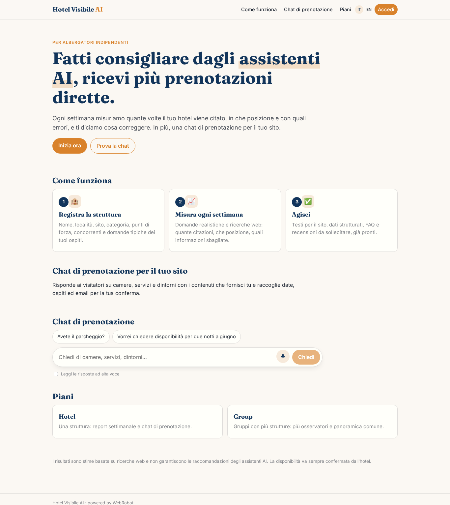
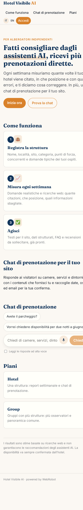
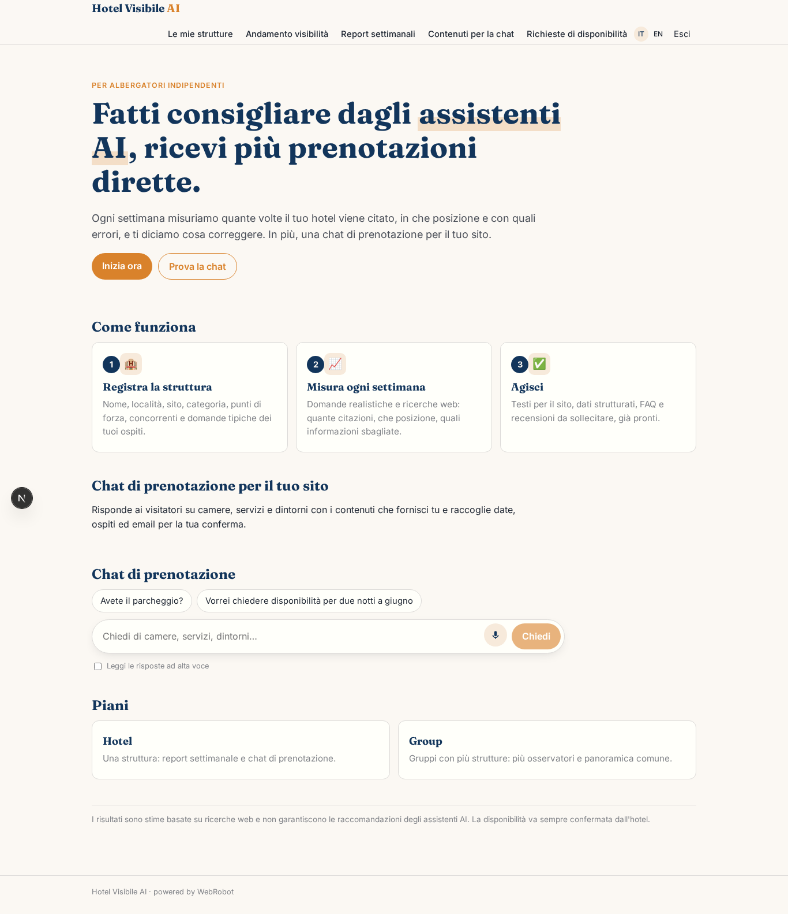
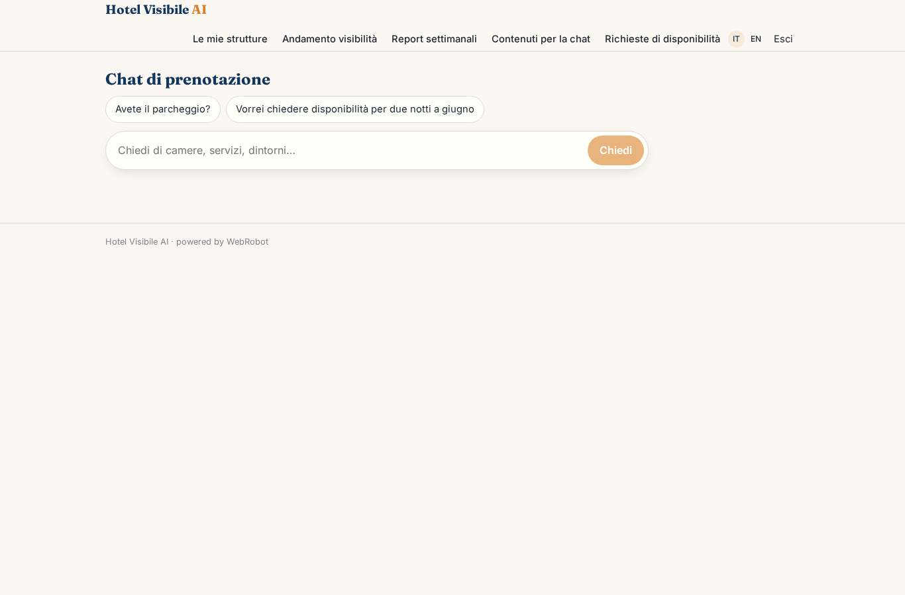
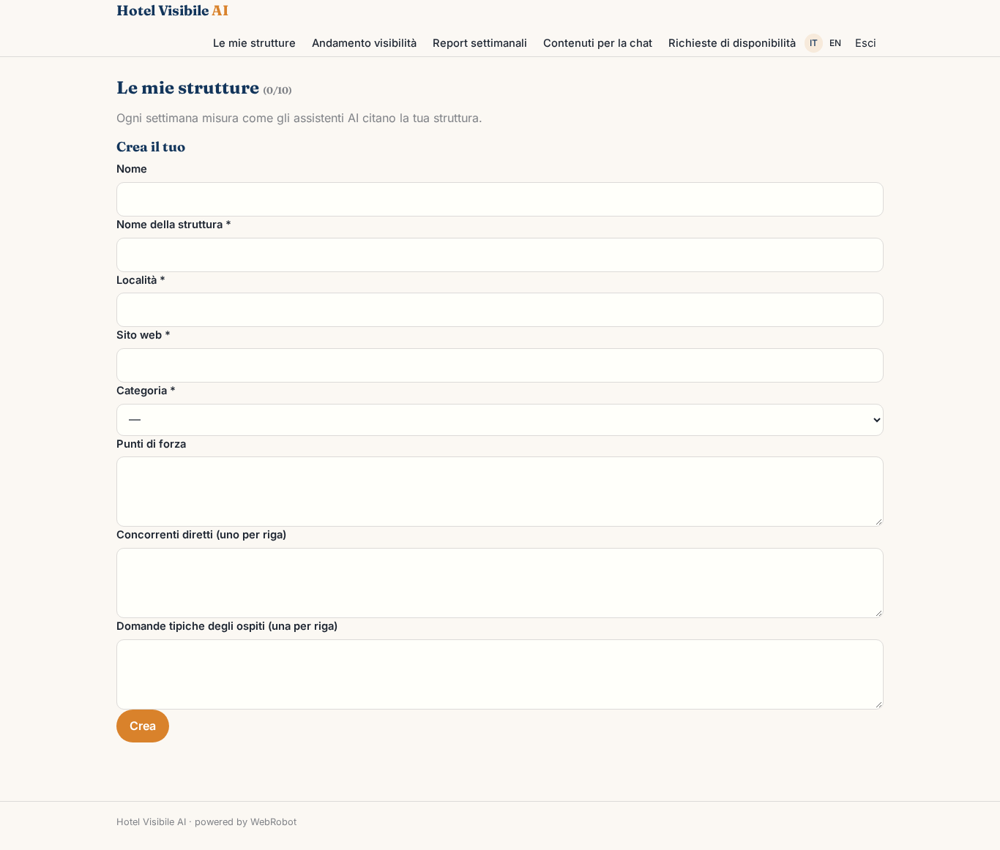
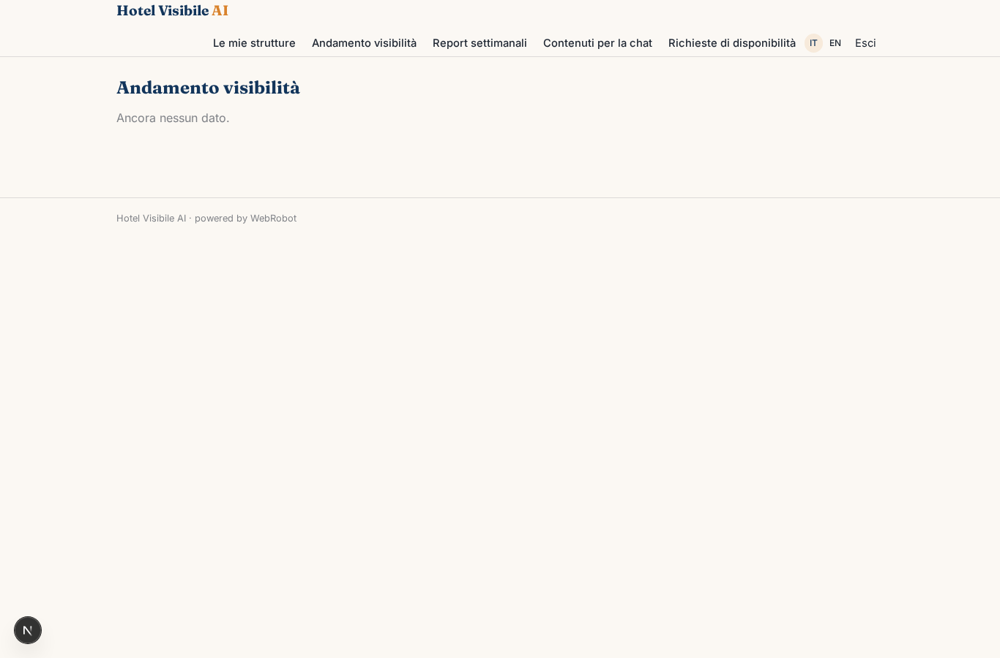
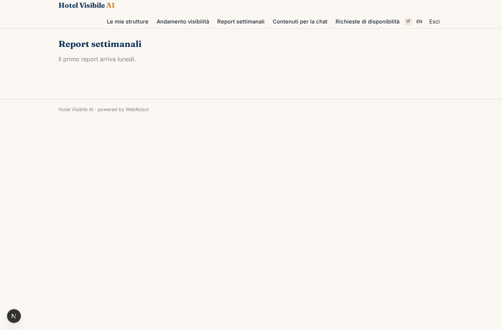
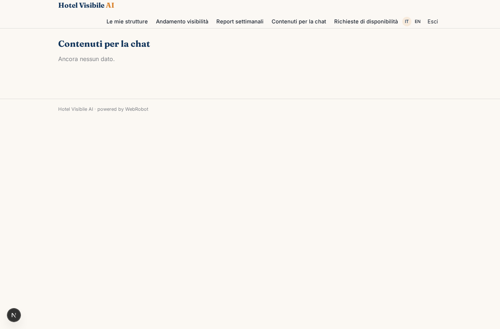
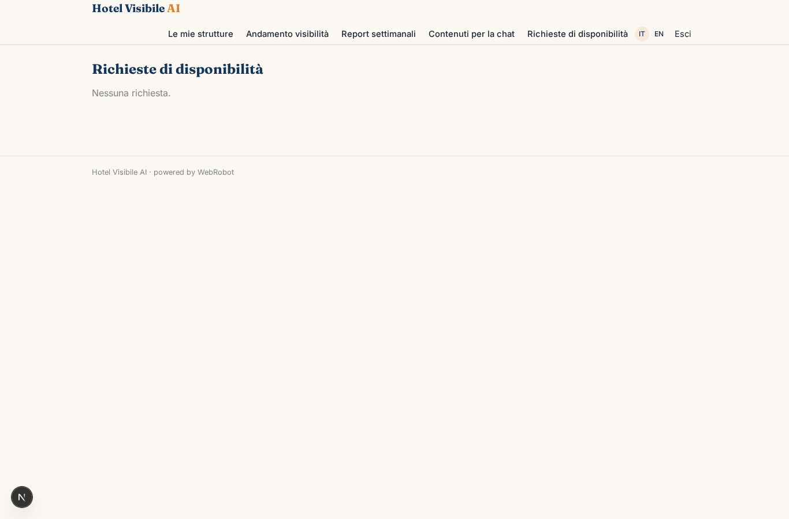
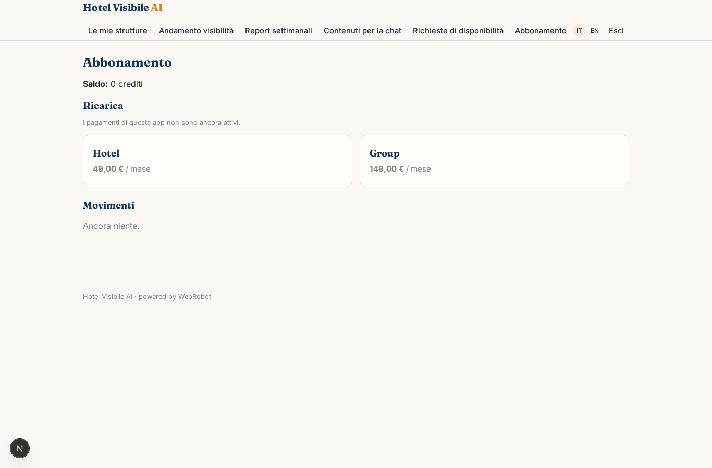

# Hotel Visibile AI

_Fatti consigliare dagli assistenti AI e ricevi più prenotazioni dirette._

**Stato manifest:** valido (validatore Python + contratto runtime)

## Descrizione data all'app builder

Voglio costruire Hotel Visibile AI per albergatori indipendenti che vogliono essere consigliati dagli assistenti AI e aumentare le prenotazioni dirette. L'albergatore si registra e inserisce nome della struttura, località, sito web, categoria, punti di forza, concorrenti diretti e le domande tipiche dei suoi ospiti. Ogni settimana un agente interroga diversi modelli linguistici tramite API con domande realistiche tipo hotel romantico vicino a Taormina con parcheggio, e fa ricerche web per capire quali strutture vengono citate e perché. Misura quante volte il suo hotel compare, in che posizione e con quali informazioni sbagliate, e produce un report con andamento nel tempo e azioni consigliate: testi da aggiungere al sito, dati strutturati, FAQ, recensioni da sollecitare. La seconda parte è una chat di prenotazione da incorporare nel sito dell'hotel: risponde ai visitatori anonimi su camere, servizi e dintorni usando i contenuti forniti dall'albergatore e raccoglie la richiesta di disponibilità con date, ospiti ed email, che arriva all'albergatore per conferma. Ogni hotel vede solo i propri dati. Abbonamento mensile, con piano superiore per gruppi con più strutture.

## Funzioni non esprimibili oggi (spec.extensions)

- **multi_llm_api**: Querying several language models through their APIs needs vendor API keys, which the platform cannot hold in an app. v1 measures visibility from web research (WebRobot MCP) and the analyst's own reasoning; direct per-model queries are a later addition.
- **request_routing_and_email**: Availability requests land in the hotelier's inbox view, but routing an anonymous visitor's request to the right hotel owner and the email alert to the hotelier are not available yet (no notifications). The hotelier must open the Requests view; chat content in the shared hotel_content collection is looked up by hotel slug passed in the page.
- **plan_limits**: The Group plan's higher number of properties (10 vs 1) is not enforced per plan; maxPerUser is a single value for the template.

## Screenshot (runtime interpretativo)

### home-anon

### home-mobile

### home

### concierge_chat

### watches

### trend

### reports

### content

### requests

### account

