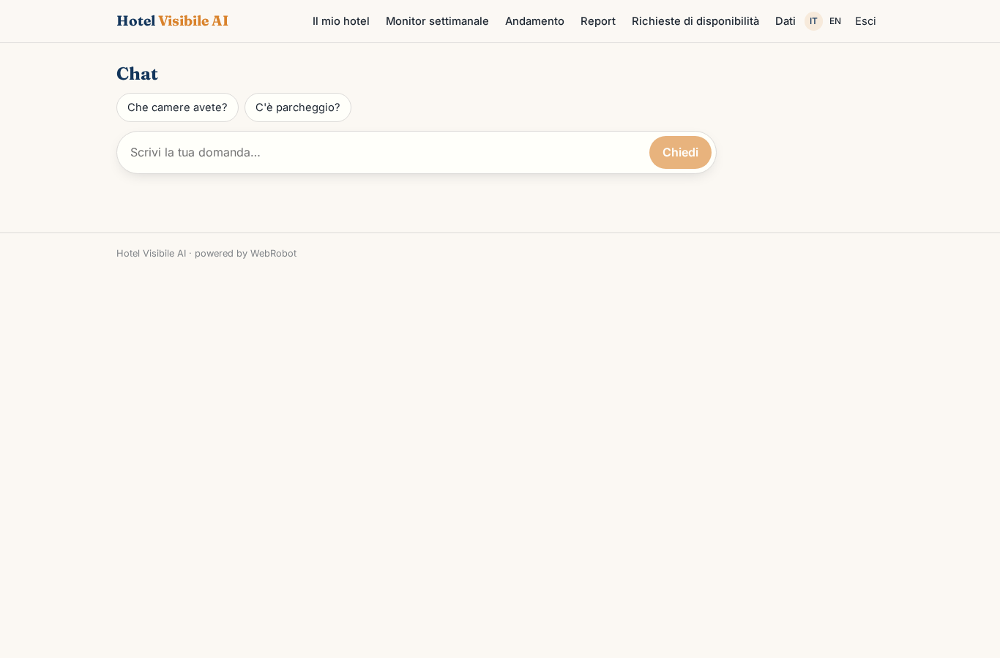
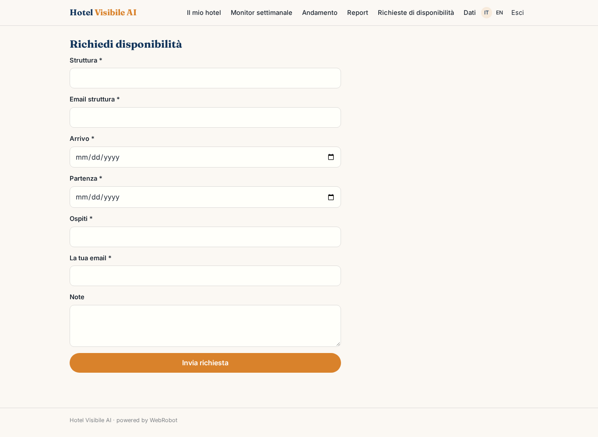
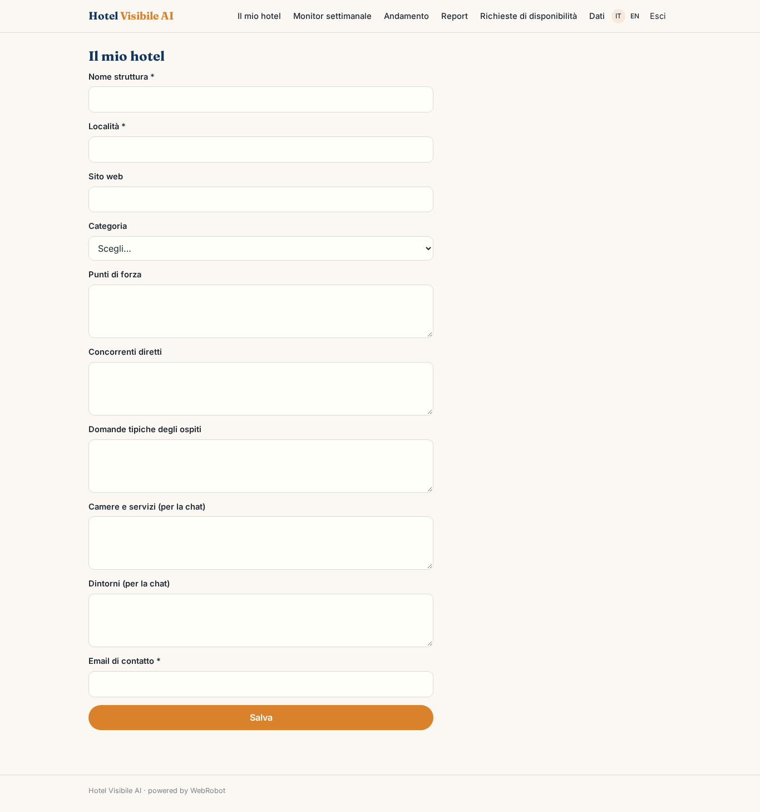
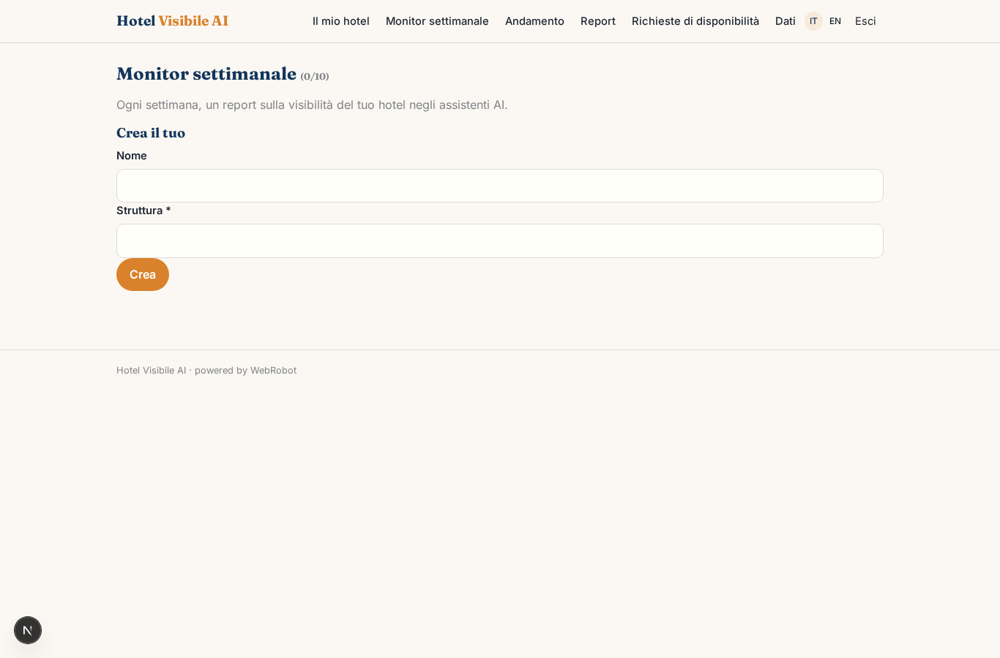
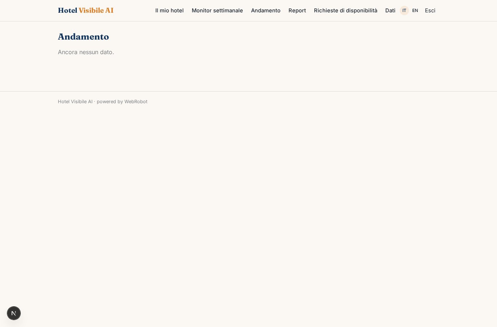
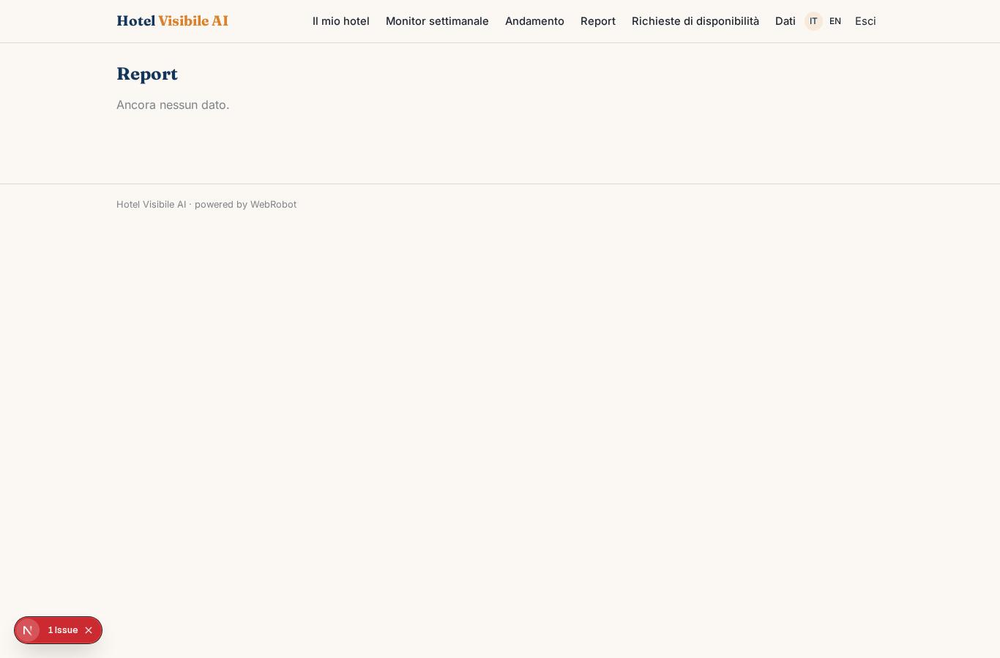
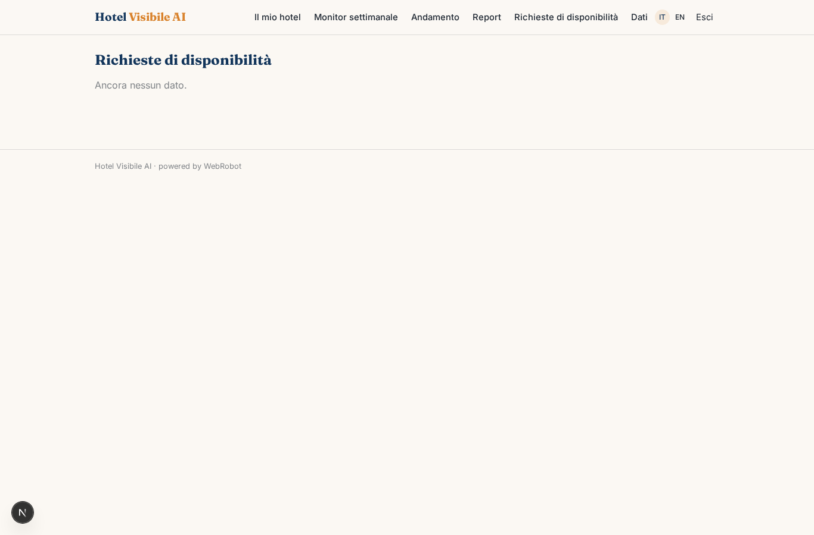
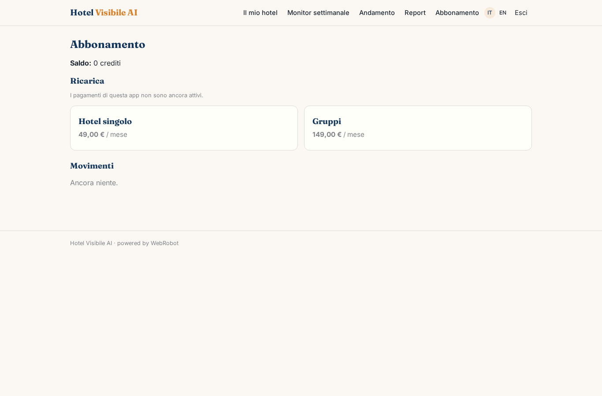

# Hotel Visibile AI

_Fatti consigliare dagli assistenti AI e ricevi più prenotazioni dirette._

**Manifest:** valid (schema + runtime contract) · **Functional test:** passed (16 checks passed)

## Description given to the app builder (Italian)

Voglio costruire Hotel Visibile AI per albergatori indipendenti che vogliono essere consigliati dagli assistenti AI e aumentare le prenotazioni dirette. L'albergatore si registra e inserisce nome della struttura, località, sito web, categoria, punti di forza, concorrenti diretti e le domande tipiche dei suoi ospiti. Ogni settimana un agente interroga diversi modelli linguistici tramite API con domande realistiche tipo hotel romantico vicino a Taormina con parcheggio, e fa ricerche web per capire quali strutture vengono citate e perché. Misura quante volte il suo hotel compare, in che posizione e con quali informazioni sbagliate, e produce un report con andamento nel tempo e azioni consigliate: testi da aggiungere al sito, dati strutturati, FAQ, recensioni da sollecitare. La seconda parte è una chat di prenotazione da incorporare nel sito dell'hotel: risponde ai visitatori anonimi su camere, servizi e dintorni usando i contenuti forniti dall'albergatore e raccoglie la richiesta di disponibilità con date, ospiti ed email, che arriva all'albergatore per conferma. Ogni hotel vede solo i propri dati. Abbonamento mensile, con piano superiore per gruppi con più strutture.

## Functional test: what did not pass

- **saved record shown where its collection is read** (view requests): a record was saved in availability_requests (by admin-data, admin-data, user) but the page does not show it (as hotelier) _(warning)_

## Features not expressible today (spec.extensions)

- **hotel_prefill**: The embed code should prefill hotel_slug and hotel_email in the availability form and pass the hotel to the chat; the embeddable widget is not yet available as a view.

## Screenshots (interpretive runtime, no data)

### home-anon

### home-mobile

### home

### booking_chat

### availability_request

### profile

### watches

### trend

### reports

### requests

### account

