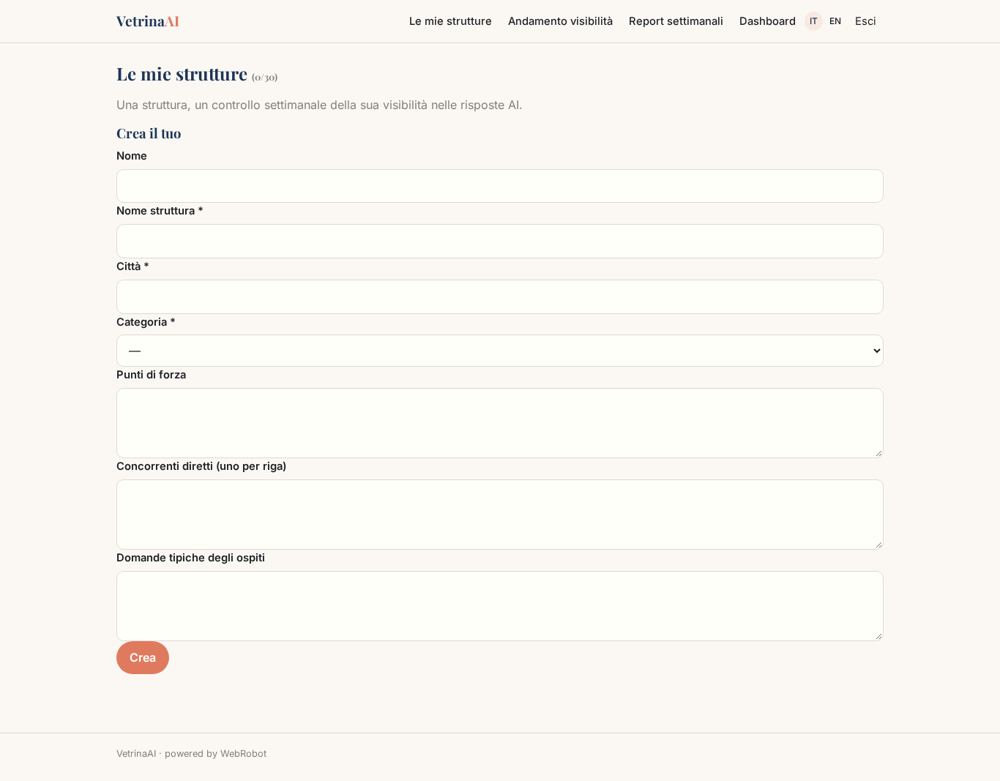
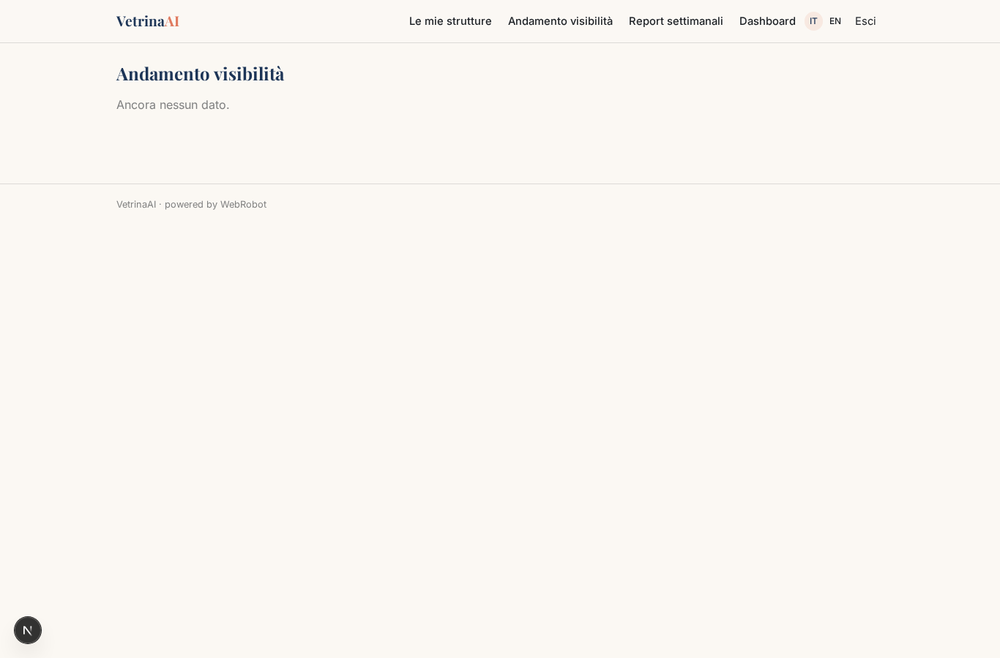
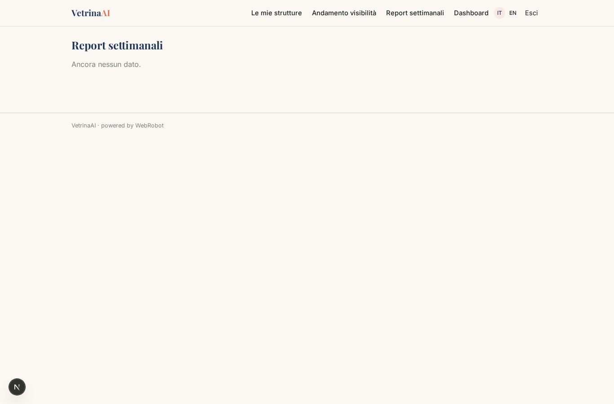
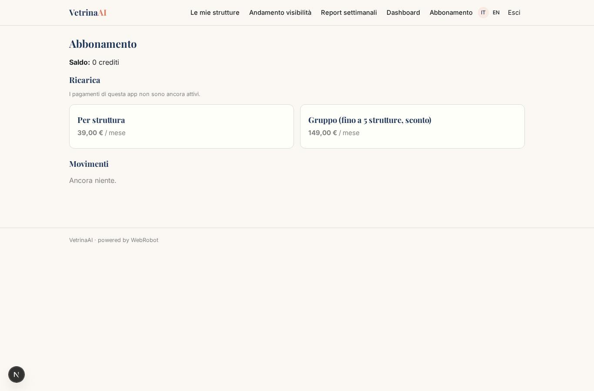

# VetrinaAI

_Scopri come gli assistenti AI raccontano il tuo hotel._

**Manifest status:** valid (schema validator + runtime contract)

## Description given to the app builder (Italian)

Vorrei costruire VetrinaAI, un servizio in abbonamento per hotel che vogliono sapere come vengono raccontati dagli assistenti di intelligenza artificiale. L'albergatore registra la struttura: nome, città, categoria, punti di forza, concorrenti diretti e le domande tipiche dei suoi ospiti. Ogni settimana un agente interroga i principali modelli linguistici tramite le loro API ufficiali con una batteria di domande realistiche ("miglior hotel per famiglie a Rimini", "hotel con spa vicino al centro di Firenze"), registra se l'hotel viene citato, in che posizione, con quali aggettivi e accanto a quali concorrenti. Poi un secondo agente confronta i risultati con la settimana precedente, calcola un indice di visibilità e scrive raccomandazioni concrete: testi da migliorare sul sito, informazioni mancanti, recensioni da stimolare. L'albergatore vede una dashboard con l'andamento, la tabella delle risposte e il report settimanale che arriva anche via email. Le catene vedono tutte le loro strutture, ogni direttore solo la propria. Abbonamento mensile per struttura, con sconto per gruppi. Italiano e inglese.

## Features not expressible today (spec.extensions)

- **official_llm_apis**: Querying several third-party LLMs through their official APIs needs a provider API key, which the manifest cannot hold. For now the check uses a single model and says so in the report; multi-model probing needs platform-side credentials.
- **weekly_email**: Emailing the weekly report is not available yet: reports are read in the dashboard.
- **group_managers**: Chains and per-property managers: the chain owner creates all properties and per-record sharing (viewer) invites each manager to their own; a dedicated invite role is not modelled yet.

## Screenshots (interpretive runtime)

### home-anon

### home-mobile

### home

### watches

### trend

### answers

### dashboard

### account

