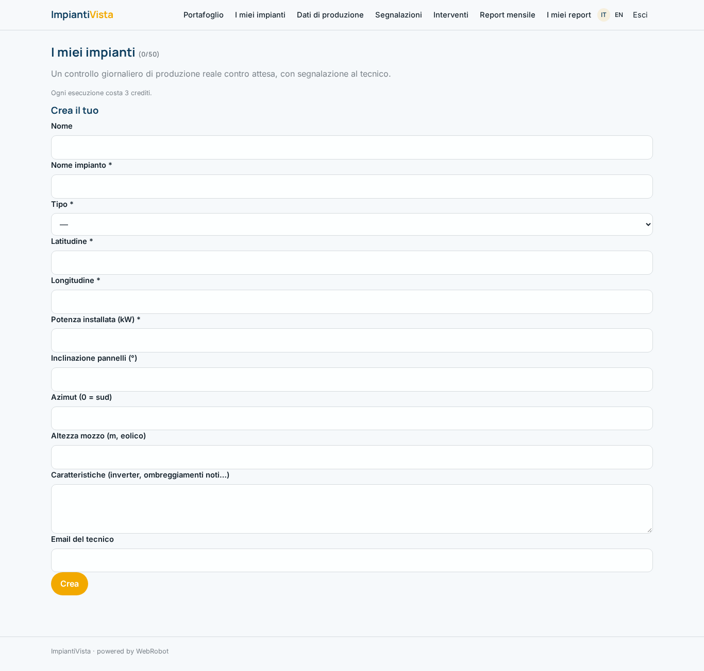
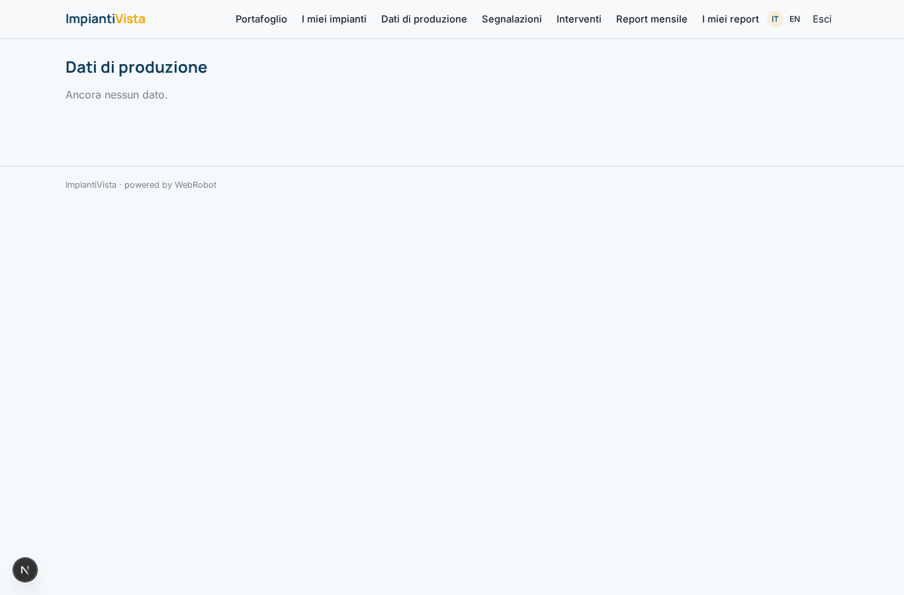
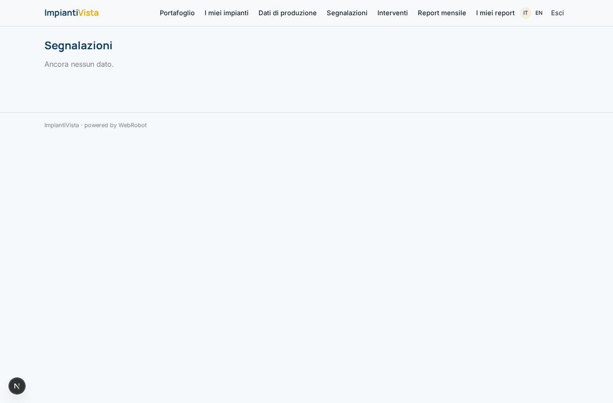
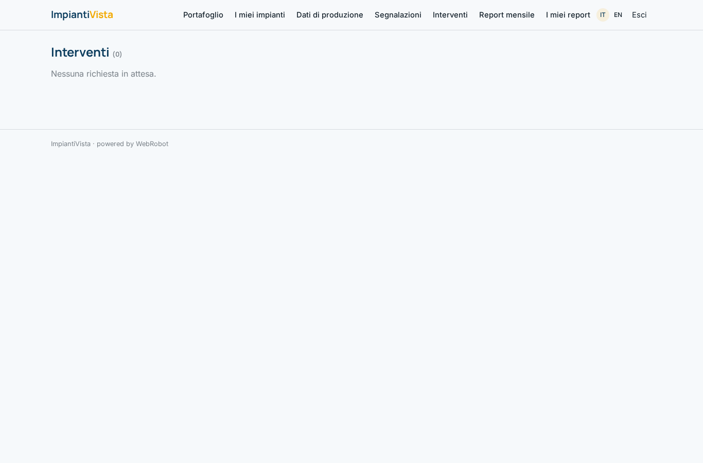
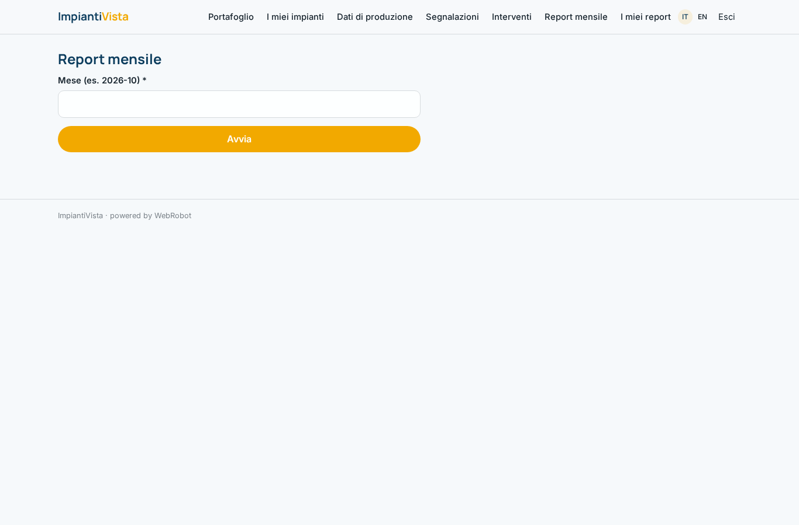
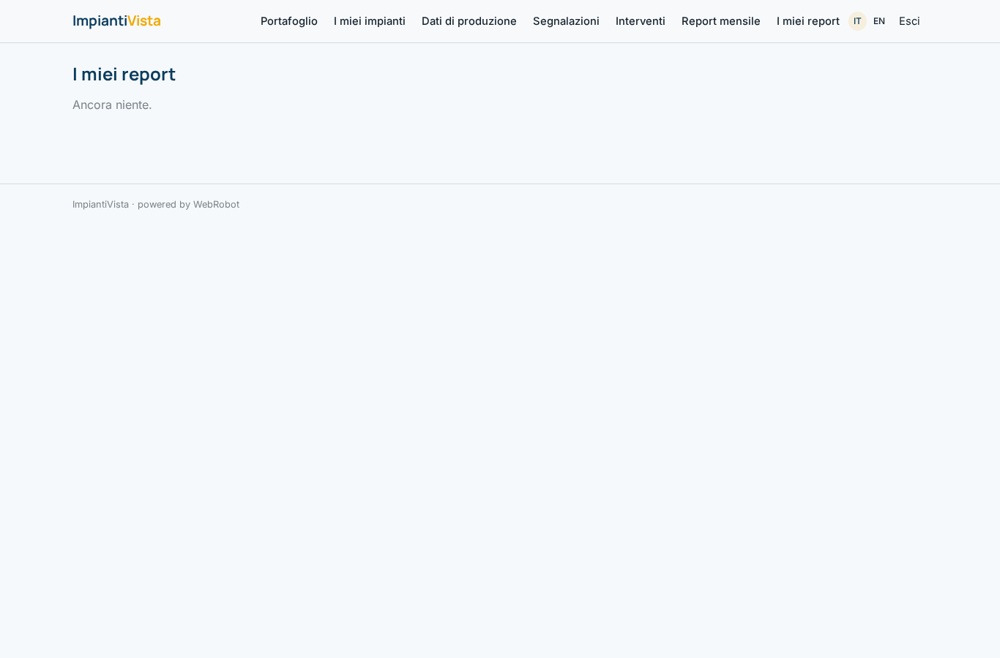
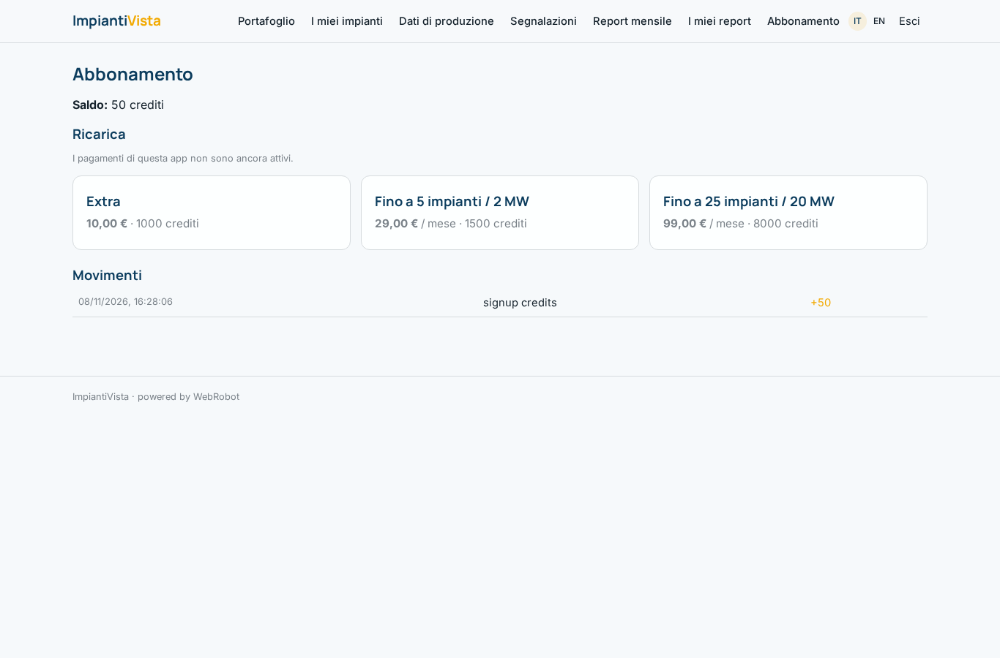

# ImpiantiVista

_Gli agenti che vegliano sui tuoi impianti fotovoltaici ed eolici._

**Manifest status:** valid (schema validator + runtime contract)

## Description given to the app builder (Italian)

ImpiantiVista mette agenti a lavorare sui dati degli impianti rinnovabili per chi li gestisce. Il gestore registra i propri impianti fotovoltaici o eolici con ubicazione, potenza installata e caratteristiche, e collega la fonte dei dati di produzione (il sistema di monitoraggio o SCADA dell'impianto) tramite accesso autorizzato, oppure invia i dati via webhook. Un team di agenti confronta la produzione reale con quella attesa stimata da Open-Meteo e PVGIS in base a irraggiamento e vento, individua cali anomali di rendimento e ne ipotizza la causa (sporcizia, ombreggiamento, guasto di un inverter, autoconsumo). Quando rileva uno scostamento significativo apre una segnalazione e la invia al tecnico, che la prende in carico e conferma l'intervento. Il gestore vede una dashboard di portafoglio con produzione, performance ratio e allarmi per impianto, e un report mensile via email. Ogni gestore vede solo i propri impianti, i tecnici quelli assegnati. Abbonamento mensile per numero o potenza degli impianti. In italiano e inglese.

## Features not expressible today (spec.extensions)

- **scada_connector**: Authorised access to the SCADA/monitoring system needs per-customer credentials: not available yet. For now production arrives by webhook or is entered in production_readings.
- **monthly_email**: Monthly report by email is not available yet: the operator generates the report in the app. Email alerts to the technician are also pending: the technician sees tickets and interventions in the app.
- **plan_limits**: Plan limits on number/power of plants are described in the plans but enforced by the owner for now (maxPerUser on the template is 50).

## Screenshots (interpretive runtime)

### home-anon

### home-mobile

### home

### portfolio

### plants

### readings

### tickets

### interventions

### new_report

### reports

### account

