# ImpiantiVista

_Agenti AI che controllano la resa dei tuoi impianti rinnovabili._

**Manifest:** valid (schema + runtime contract) · **Functional test:** passed (19 checks passed)

## Description given to the app builder (Italian)

ImpiantiVista mette agenti a lavorare sui dati degli impianti rinnovabili per chi li gestisce. Il gestore registra i propri impianti fotovoltaici o eolici con ubicazione, potenza installata e caratteristiche, e collega la fonte dei dati di produzione (il sistema di monitoraggio o SCADA dell'impianto) tramite accesso autorizzato, oppure invia i dati via webhook. Un team di agenti confronta la produzione reale con quella attesa stimata da Open-Meteo e PVGIS in base a irraggiamento e vento, individua cali anomali di rendimento e ne ipotizza la causa (sporcizia, ombreggiamento, guasto di un inverter, autoconsumo). Quando rileva uno scostamento significativo apre una segnalazione e la invia al tecnico, che la prende in carico e conferma l'intervento. Il gestore vede una dashboard di portafoglio con produzione, performance ratio e allarmi per impianto, e un report mensile via email. Ogni gestore vede solo i propri impianti, i tecnici quelli assegnati. Abbonamento mensile per numero o potenza degli impianti. In italiano e inglese.

## Features not expressible today (spec.extensions)

- **scada_connectors**: Direct pull from arbitrary SCADA/monitoring hosts and OAuth sign-in to vendor portals is not available yet: data arrives by webhook (POST /api/hooks/readings_hook), manual entry or a SolarEdge API key. Webhook records are not yet bound to a specific user; the hook secret should be issued per operator.
- **pricing_by_power**: Plans are tiered by number of plants (quota); pricing by installed kW is not expressible yet.

## Screenshots (interpretive runtime, no data)

### home-anon
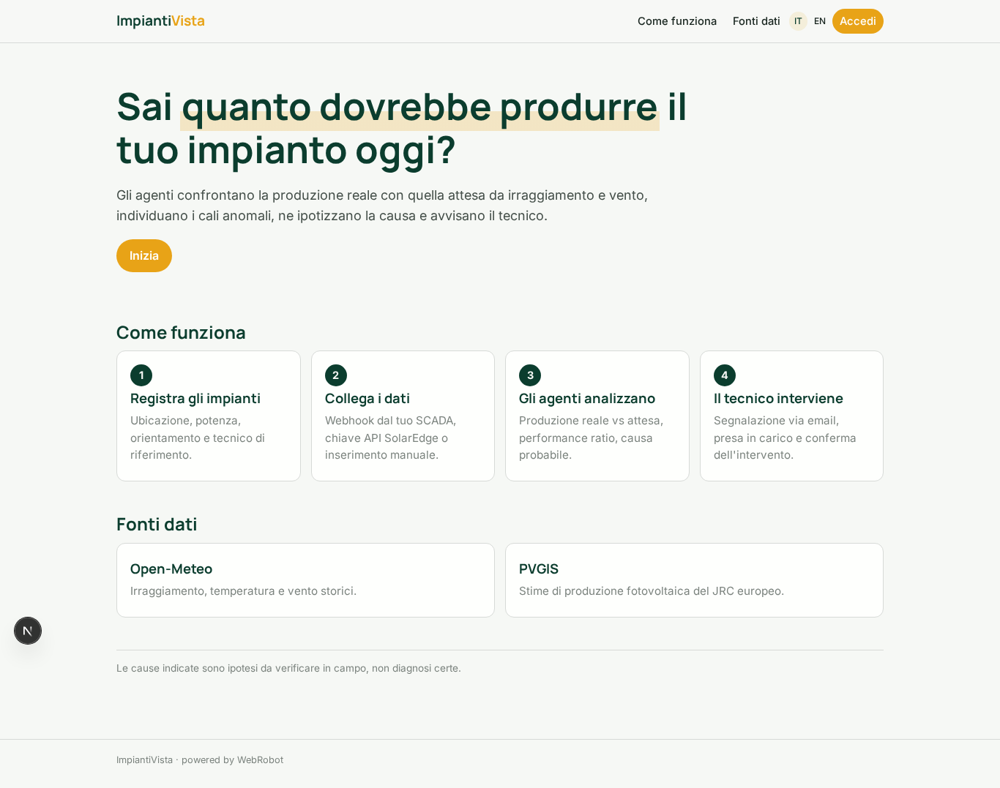

### home-mobile
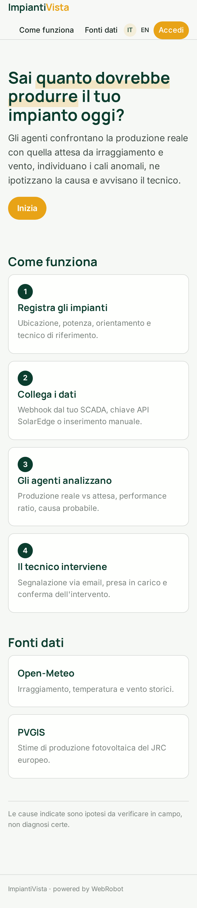

### home
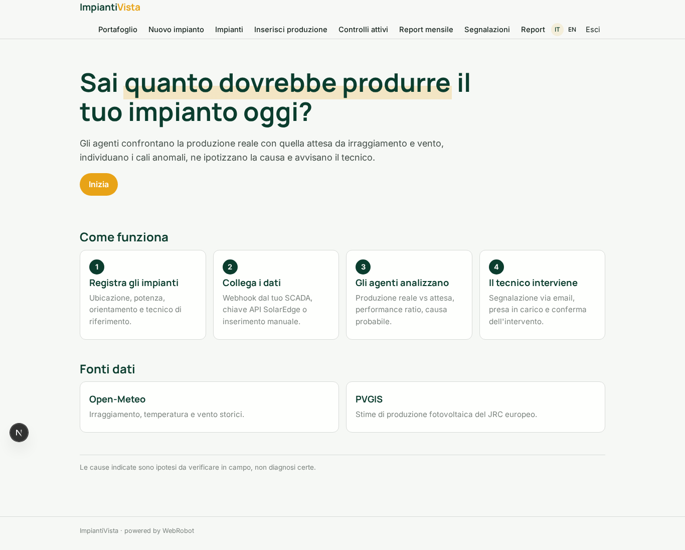

### portfolio
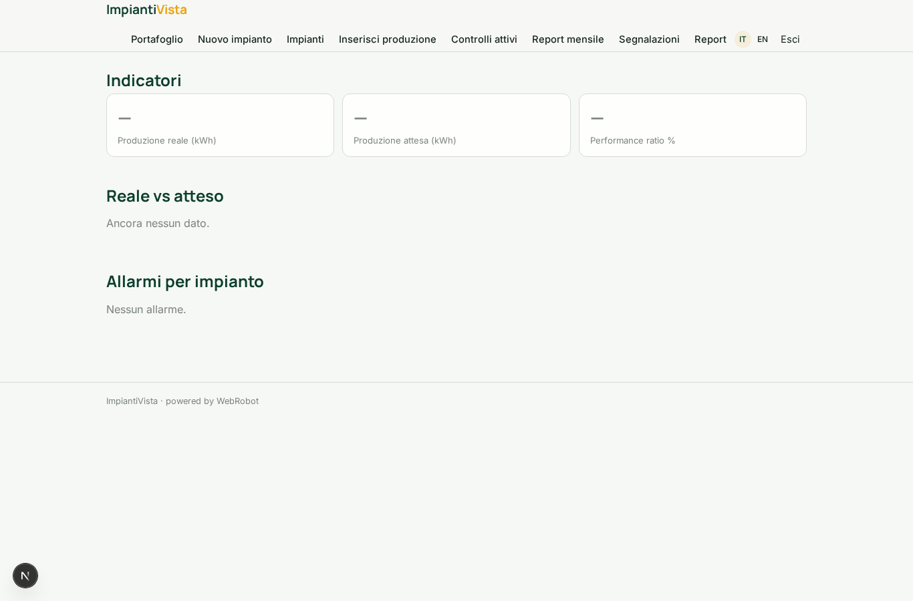

### plants_new
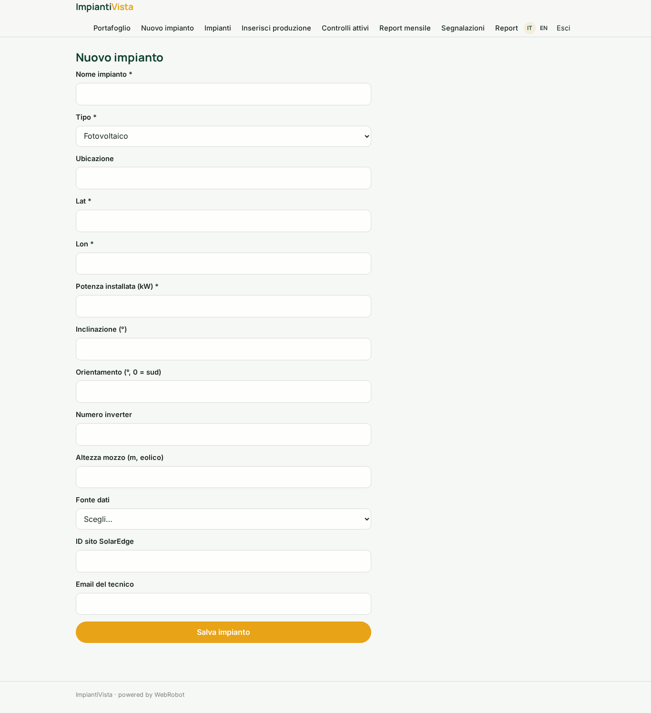

### plants
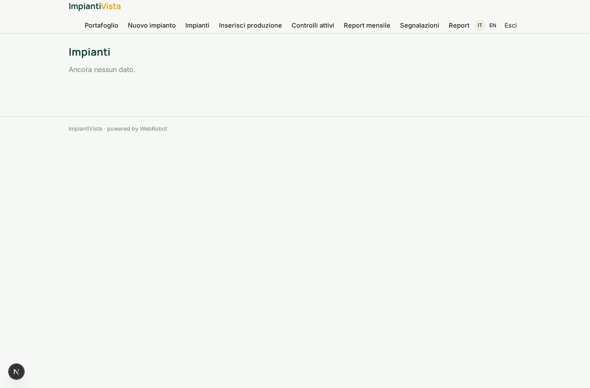

### readings_new
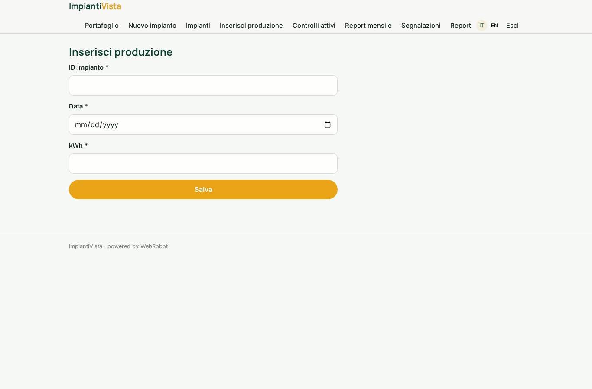

### watches
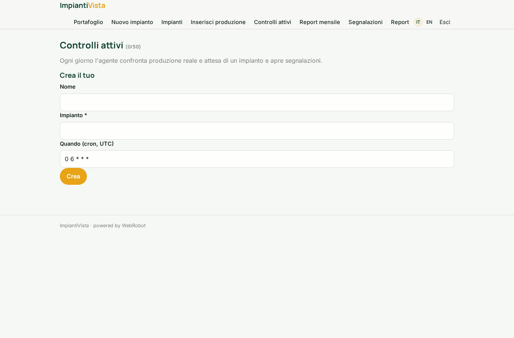

### monthly
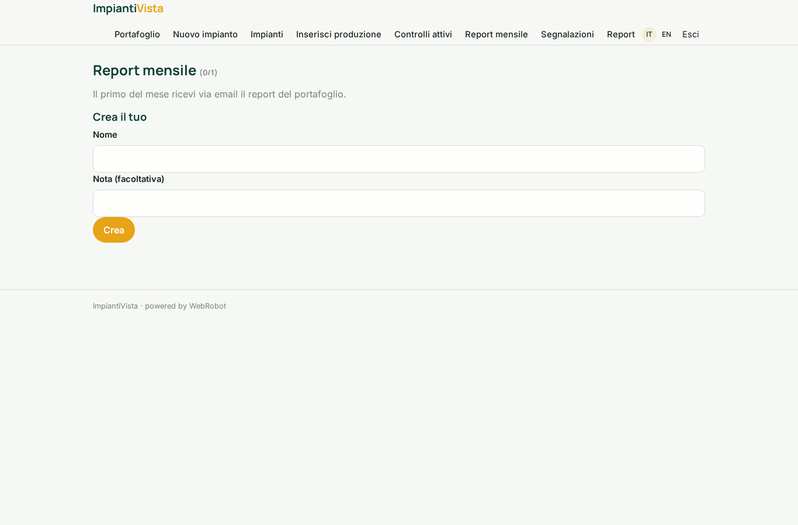

### tickets
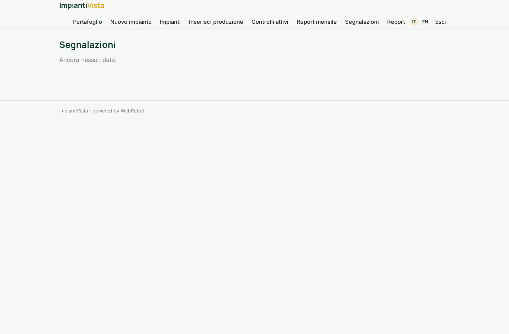

### ticket_edit
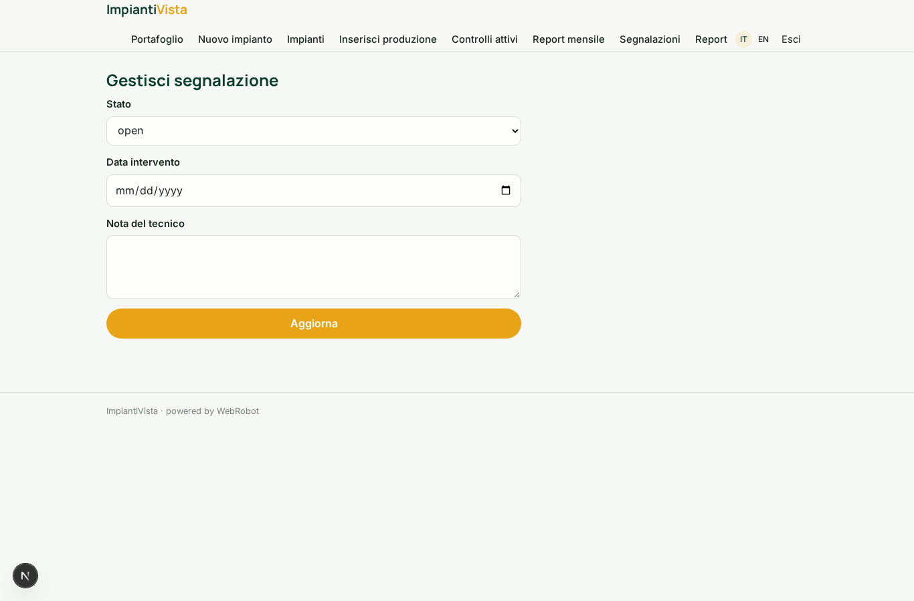

### history

### account
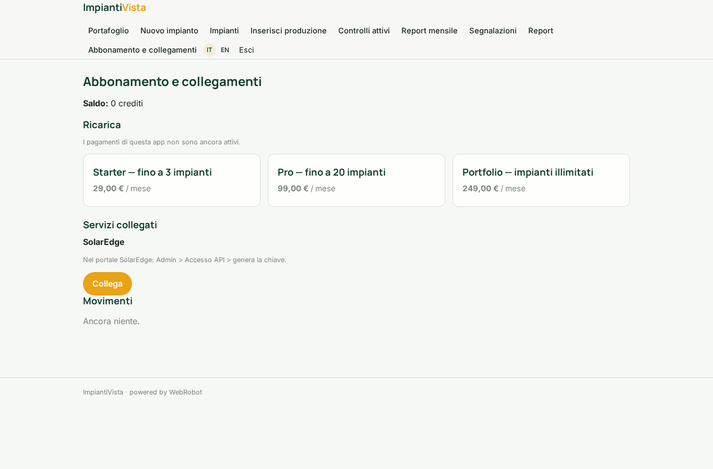
