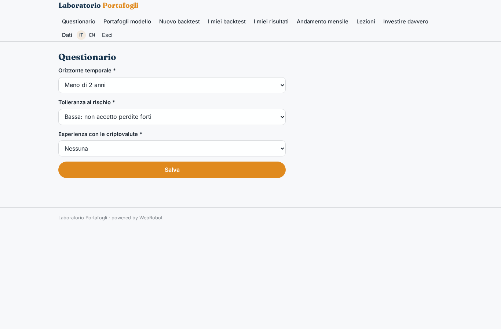
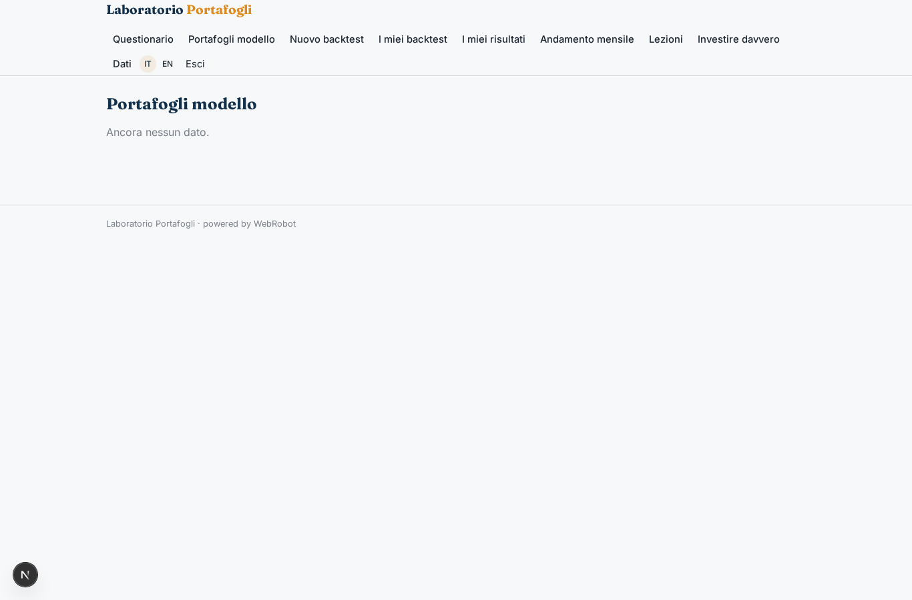
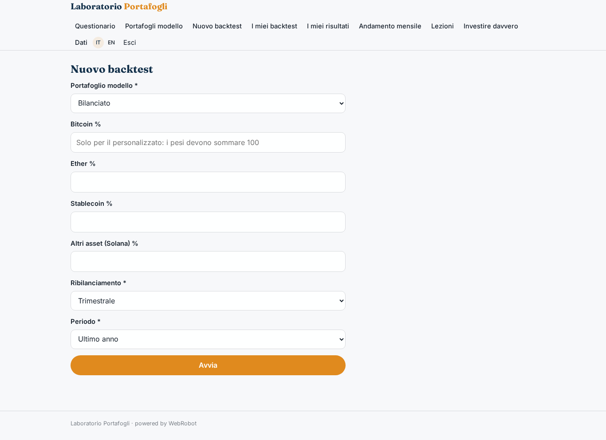
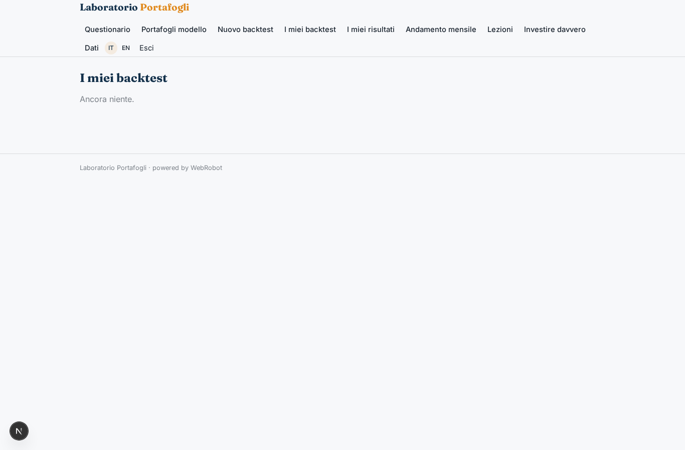
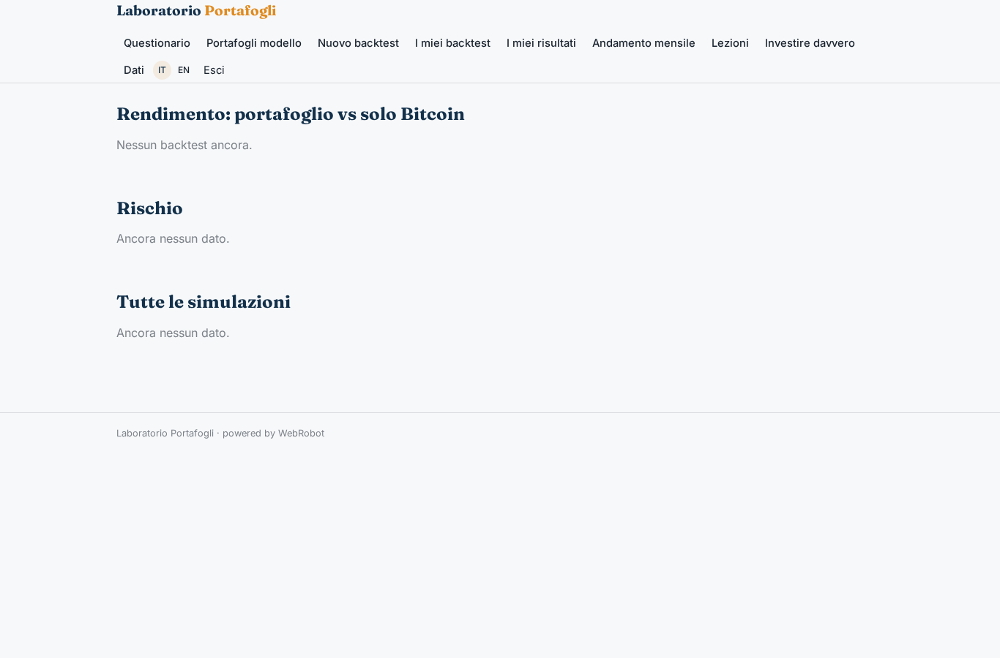
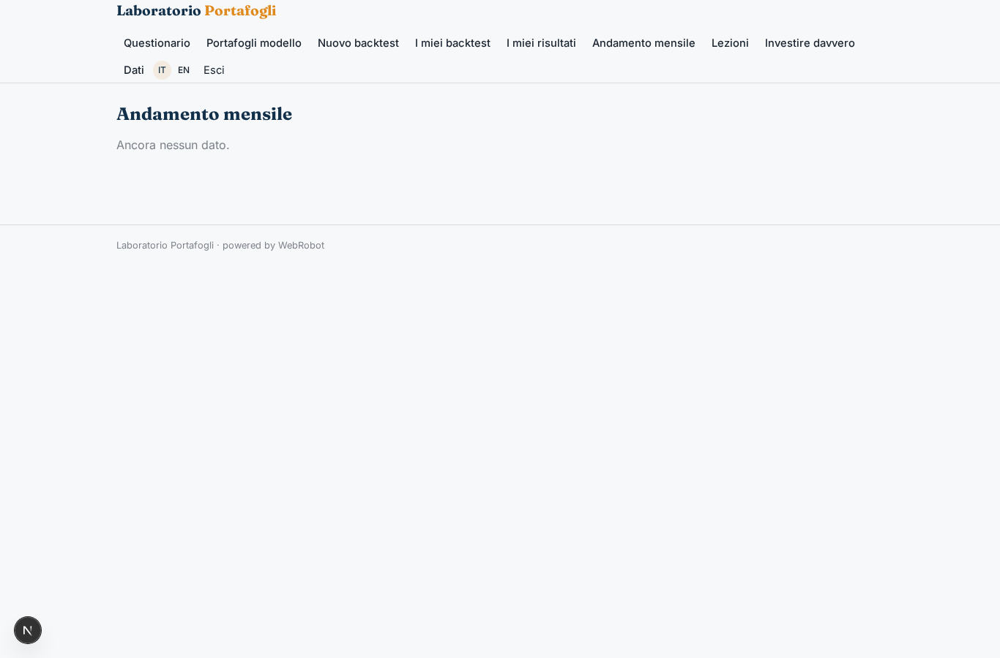
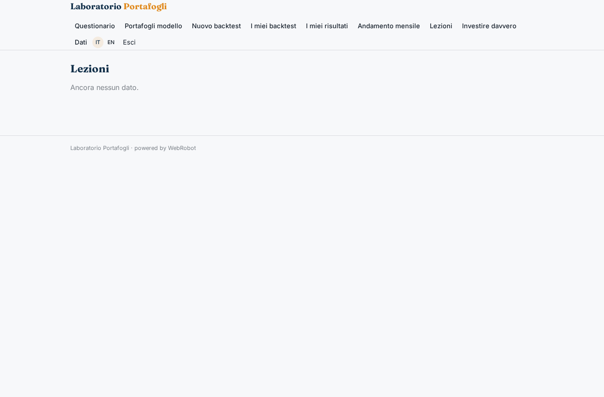
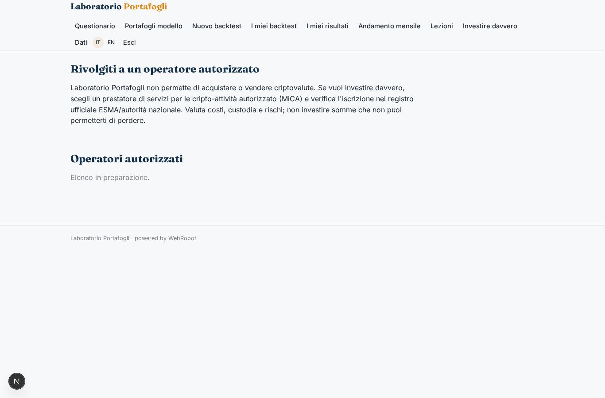
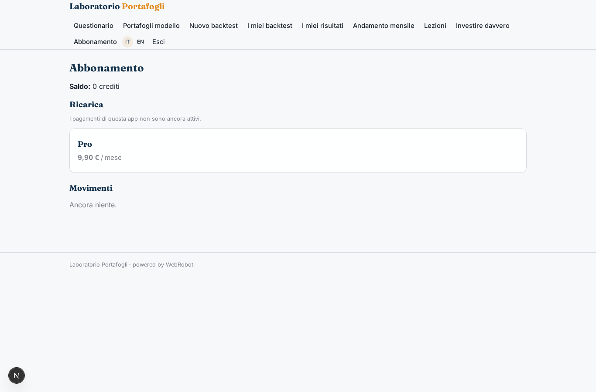

# Laboratorio Portafogli

_Impara le criptovalute simulando portafogli modello. Solo didattica._

**Manifest:** valid (schema + runtime contract) · **Functional test:** passed (13 checks passed)

## Description given to the app builder (Italian)

Ci serve Laboratorio Portafogli, un'app didattica sulle criptovalute. Descrivo solo la parte software informativa: non gestiamo patrimoni, non custodiamo fondi e non eseguiamo ordini, attività che richiedono l'autorizzazione come prestatore di servizi crypto. L'utente si registra e compila un questionario su orizzonte temporale, tolleranza al rischio ed esperienza. L'app propone alcuni portafogli modello, per esempio prudente, bilanciato e dinamico, con pesi tra Bitcoin, Ether, stablecoin e altri asset, e regole di ribilanciamento. Un agente scarica i prezzi storici giornalieri da fonti pubbliche via API e calcola un backtest di ogni portafoglio: rendimento, volatilità, massima perdita, confronto con il solo Bitcoin. L'utente può modificare i pesi e rifare il backtest, e vede i risultati in grafici. Ogni mese riceve un'email con l'andamento dei portafogli modello e una spiegazione semplice di cosa è successo sul mercato. Chi vuole investire davvero viene indirizzato a un operatore autorizzato. Ogni utente vede solo le sue simulazioni. Abbonamento mensile per backtest illimitati e lezioni.

## Functional test: what did not pass

- **saved record shown where its collection is read** (view digest_view): a record was saved in market_digest (by admin-data, admin-data) but the page does not show it (as user) _(warning)_

## Features not expressible today (spec.extensions)

- **authorisation_notice**: The app is informational/educational only. Legal review of texts (MiCA, no advice, no custody, no order execution) is recommended before launch.

## Screenshots (interpretive runtime, no data)

### home-anon

### home-mobile

### home

### questionnaire

### models

### new_backtest

### history

### results

### digest_view

### lessons_view

### invest

### account

