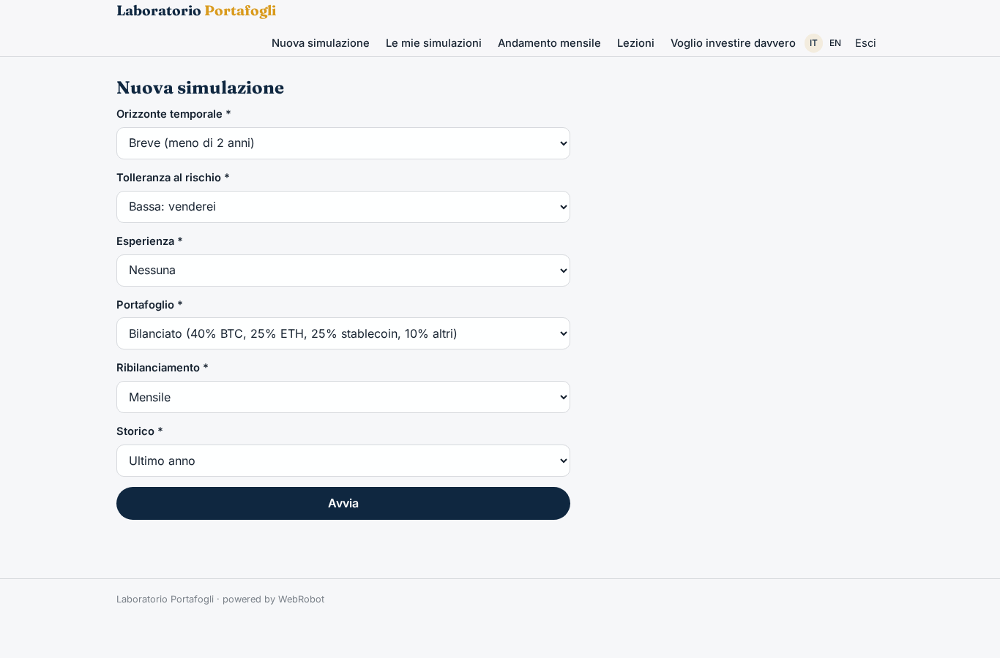
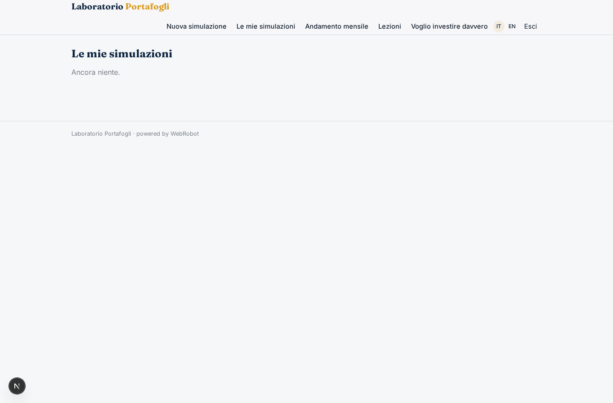
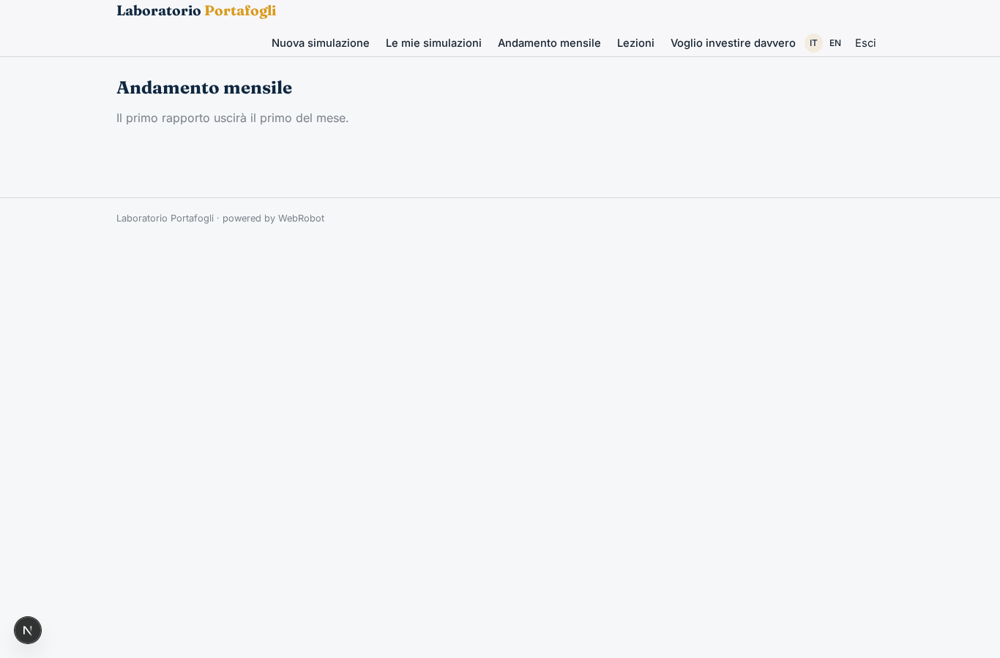
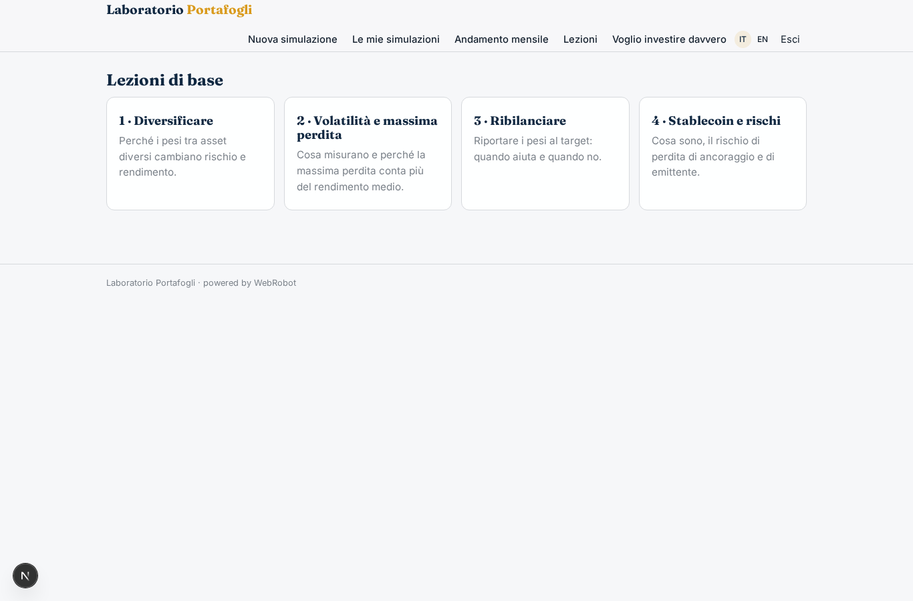
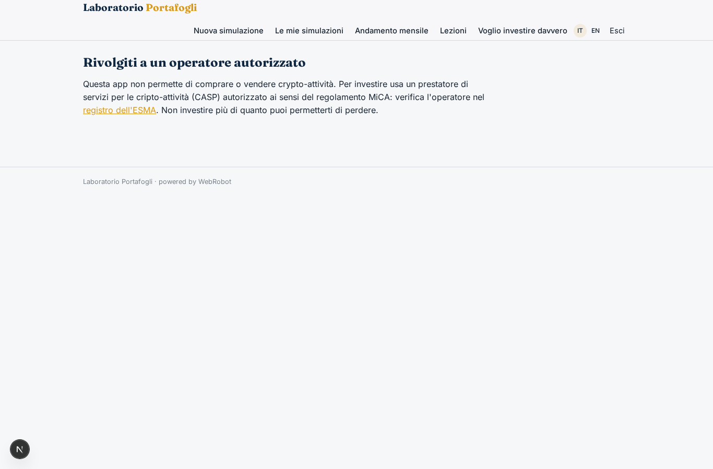
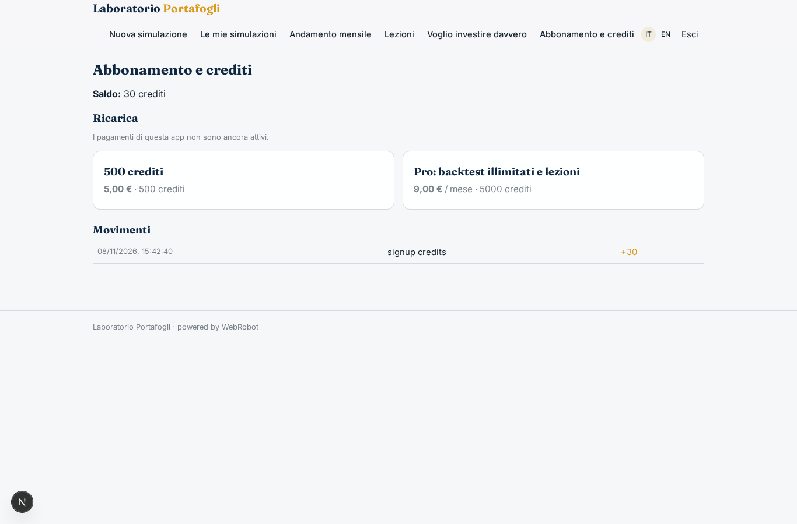

# Laboratorio Portafogli

_Impara le criptovalute simulando portafogli modello, senza rischiare un euro._

**Manifest status:** valid (schema validator + runtime contract)

## Description given to the app builder (Italian)

Ci serve Laboratorio Portafogli, un'app didattica sulle criptovalute. Descrivo solo la parte software informativa: non gestiamo patrimoni, non custodiamo fondi e non eseguiamo ordini, attività che richiedono l'autorizzazione come prestatore di servizi crypto. L'utente si registra e compila un questionario su orizzonte temporale, tolleranza al rischio ed esperienza. L'app propone alcuni portafogli modello, per esempio prudente, bilanciato e dinamico, con pesi tra Bitcoin, Ether, stablecoin e altri asset, e regole di ribilanciamento. Un agente scarica i prezzi storici giornalieri da fonti pubbliche via API e calcola un backtest di ogni portafoglio: rendimento, volatilità, massima perdita, confronto con il solo Bitcoin. L'utente può modificare i pesi e rifare il backtest, e vede i risultati in grafici. Ogni mese riceve un'email con l'andamento dei portafogli modello e una spiegazione semplice di cosa è successo sul mercato. Chi vuole investire davvero viene indirizzato a un operatore autorizzato. Ogni utente vede solo le sue simulazioni. Abbonamento mensile per backtest illimitati e lezioni.

## Features not expressible today (spec.extensions)

- **monthly_email**: Email notifications are not available yet: the monthly outlook is published in the 'Andamento mensile' view; the email digest with the same content must be added when notifications exist.
- **lessons_gating**: Restricting the lessons to Pro subscribers is not expressible in the manifest yet; today the lessons page is open to every signed-in user and the Pro plan unlocks unlimited backtests through credits.
- **price_source_terms**: Check that the Kraken public API terms allow this reuse before publishing; a different public source can replace it by editing the egress host and the kraken_ohlc tool.
- **regulatory_review**: The app must stay informational: before launch have the texts, the questionnaire and the operator referral reviewed by a legal advisor to confirm they do not amount to personalised advice or a referral service under MiCA.

## Screenshots (interpretive runtime)

### home-anon

### home-mobile

### home

### new

### history

### outlook

### lessons

### operators

### account

