# LegamiKYC

_Adeguata verifica e antiriciclaggio, con il grafo dei legami e un audit completo._

**Manifest:** valid (schema + runtime contract) · **Functional test:** passed (14 checks passed)

## Description given to the app builder (Italian)

LegamiKYC e uno strumento di adeguata verifica e antiriciclaggio per studi professionali e intermediari. L'operatore apre una pratica su un soggetto (persona o azienda) inserendo i dati anagrafici, oppure caricando i documenti di identita e visure del cliente da cui estrarre i dati. Un agente costruisce un grafo dei legami tra persone e societa (titolari effettivi, cariche, partecipazioni) e cerca riscontri con tolleranza agli errori di trascrizione nelle liste pubbliche di sanzioni UE, ONU e OFAC e nelle notizie negative (adverse media) da fonti aperte. Per le persone politicamente esposte serve l'integrazione di liste in licenza. Ogni riscontro potenziale viene presentato all'operatore con il livello di somiglianza e la fonte; l'operatore conferma o scarta, e la decisione resta tracciata per l'audit. Il sistema produce un fascicolo di verifica esportabile e rifa i controlli periodicamente, avvisando via webhook se compare un nuovo riscontro. Ogni studio vede solo le proprie pratiche. Abbonamento mensile piu crediti per verifica. In italiano e inglese.

## Features not expressible today (spec.extensions)

- **pep_lists**: PEP screening needs licensed lists (not connected). Add a licensed provider with an API key as a credential later.
- **outbound_webhook**: Alerts for new hits during periodic re-checks go by email to the firm; an outbound webhook to the firm's systems is not available yet.
- **pdf_dossier**: The file is printable (PDF) from the report view; hits, links and audit log export as CSV.

## Screenshots (interpretive runtime, no data)

### home-anon
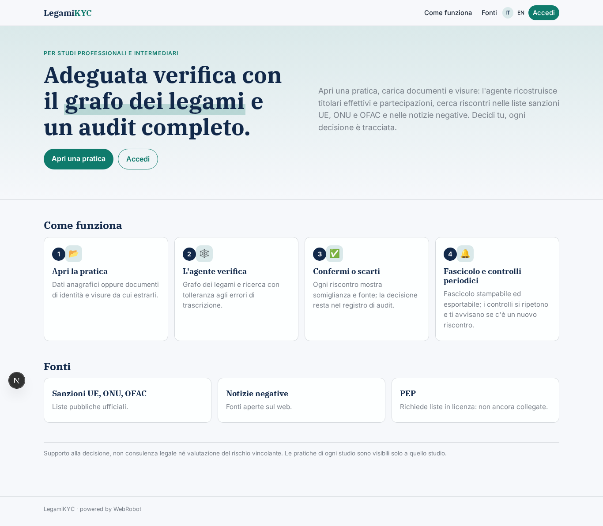

### home-mobile
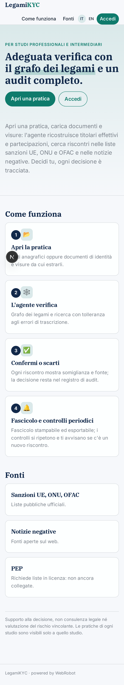

### home
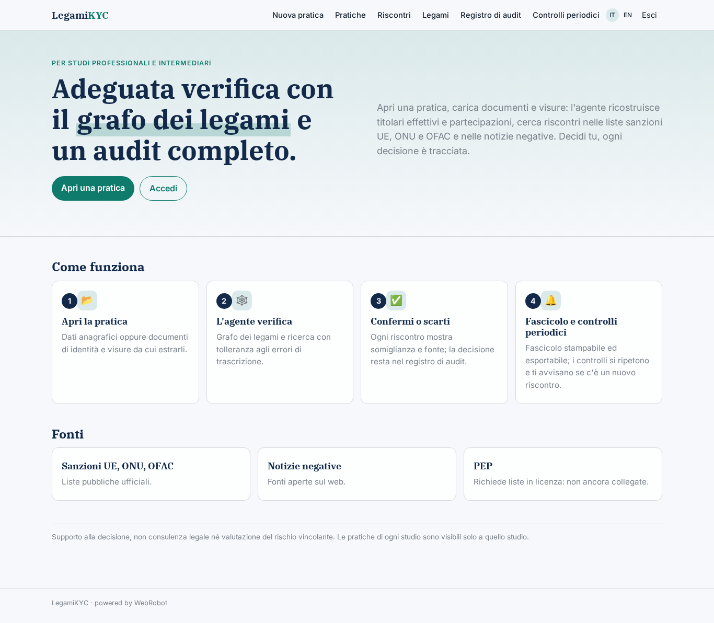

### new_case
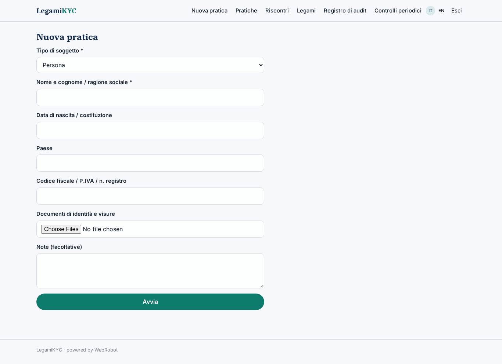

### cases
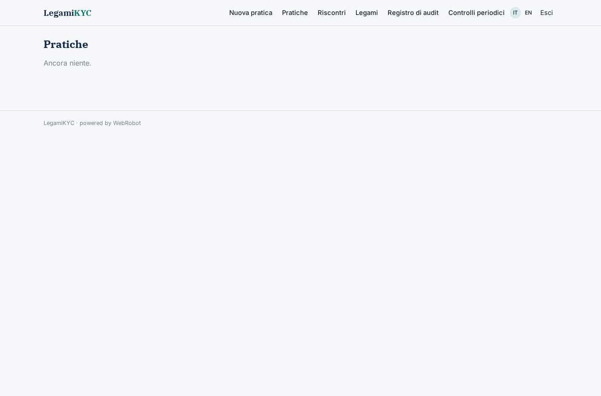

### hits
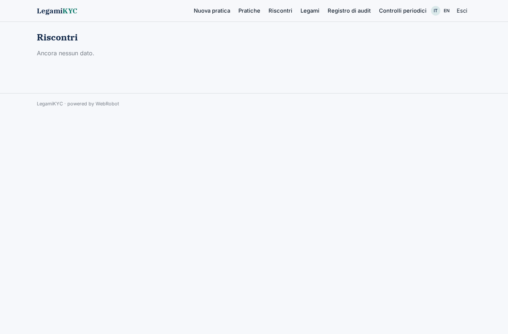

### review_hit
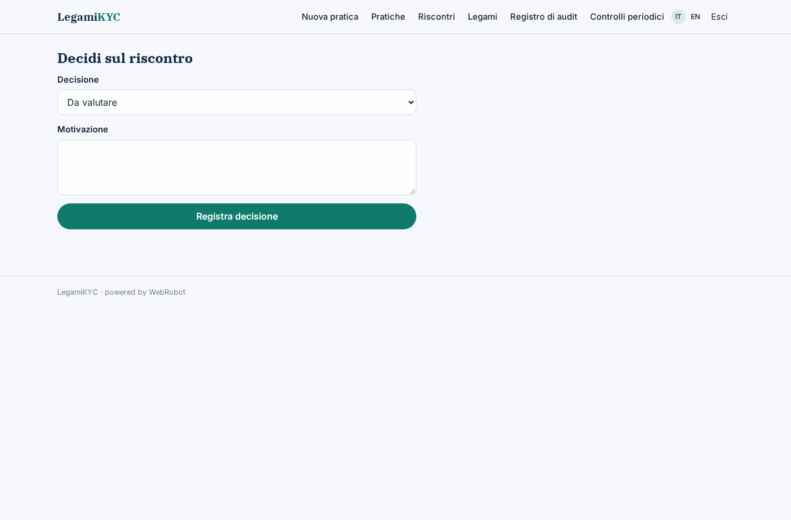

### links_view
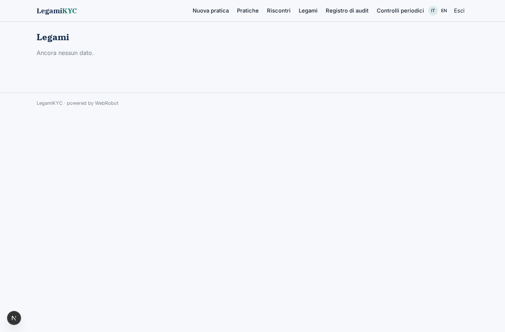

### audit
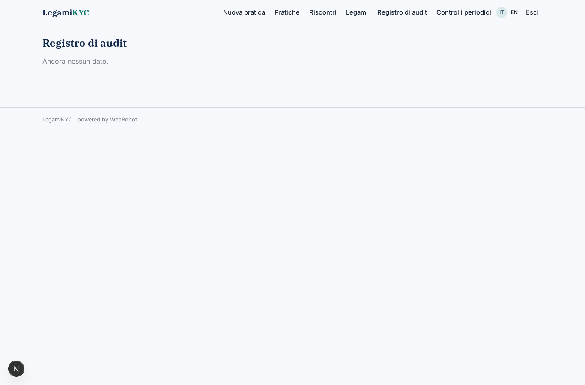

### watches
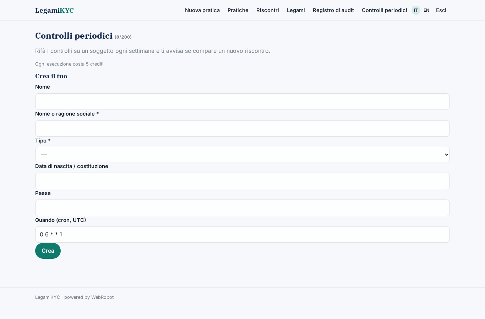

### account
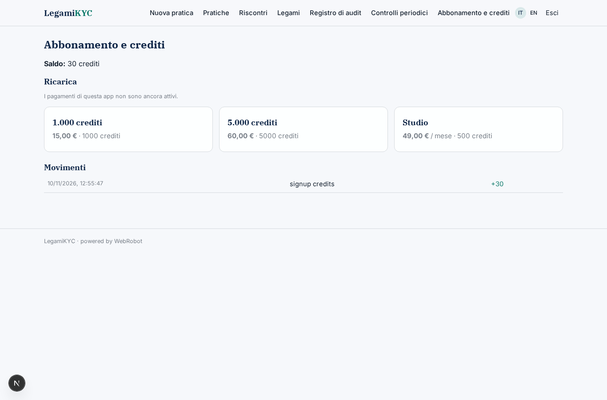
