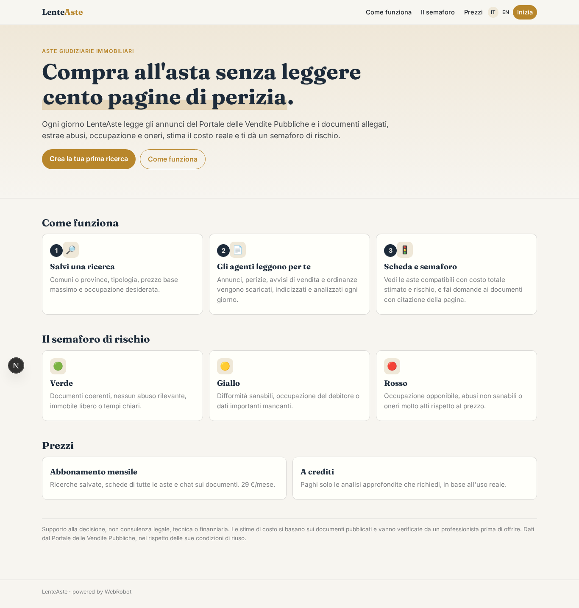
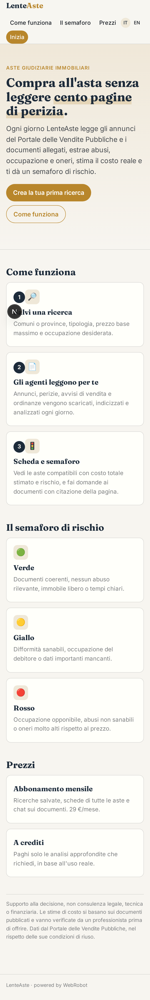
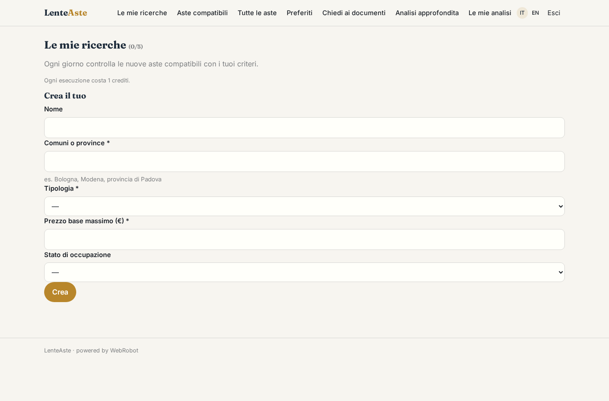
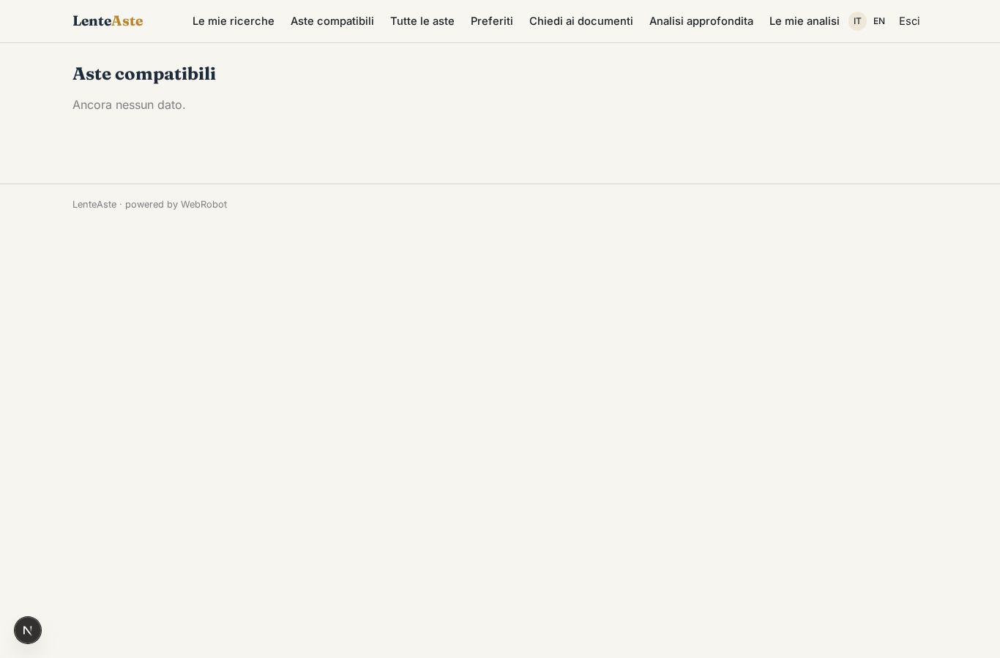
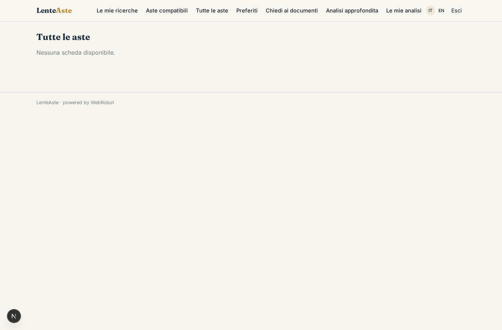
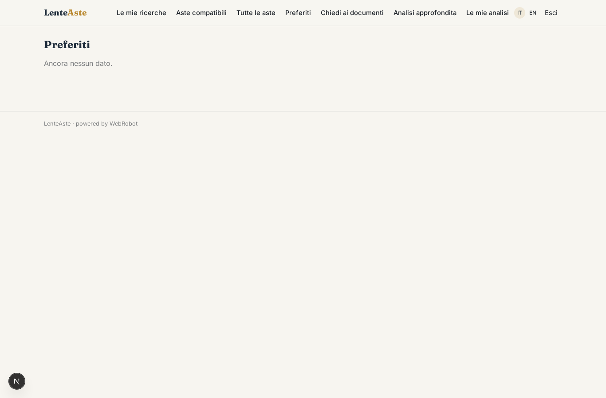
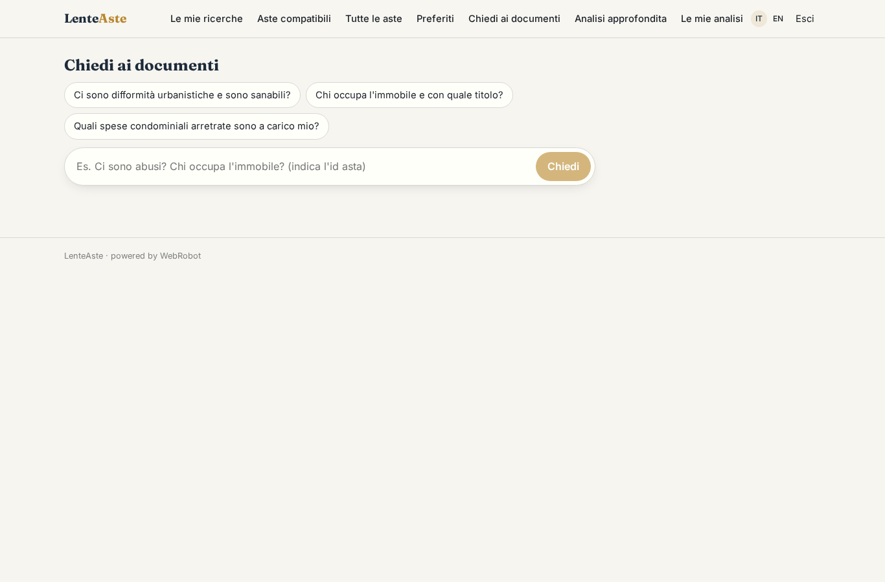
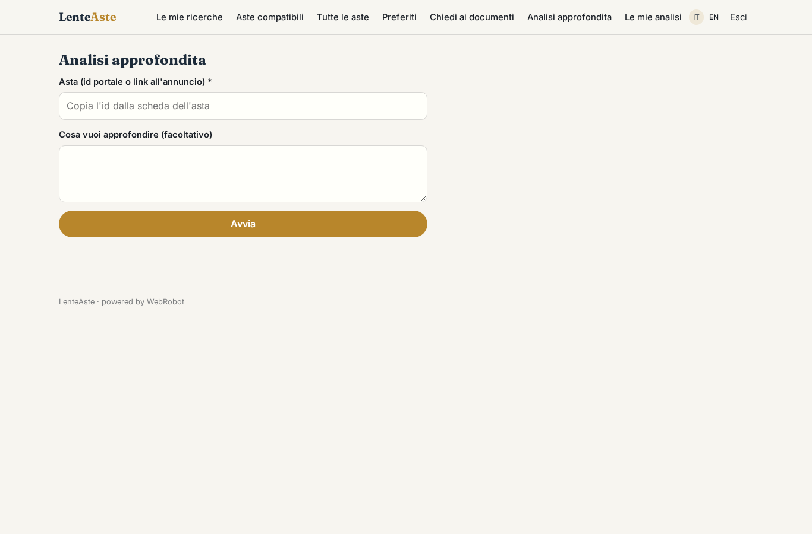
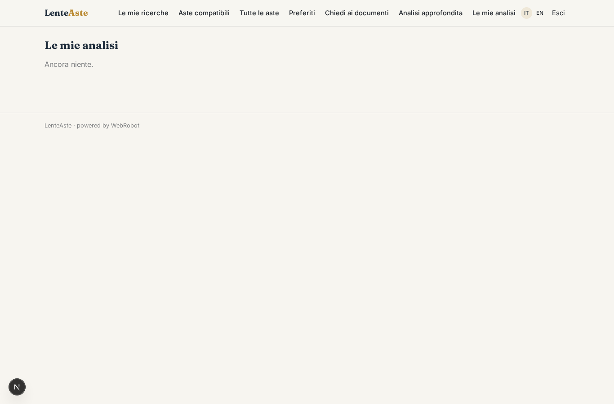
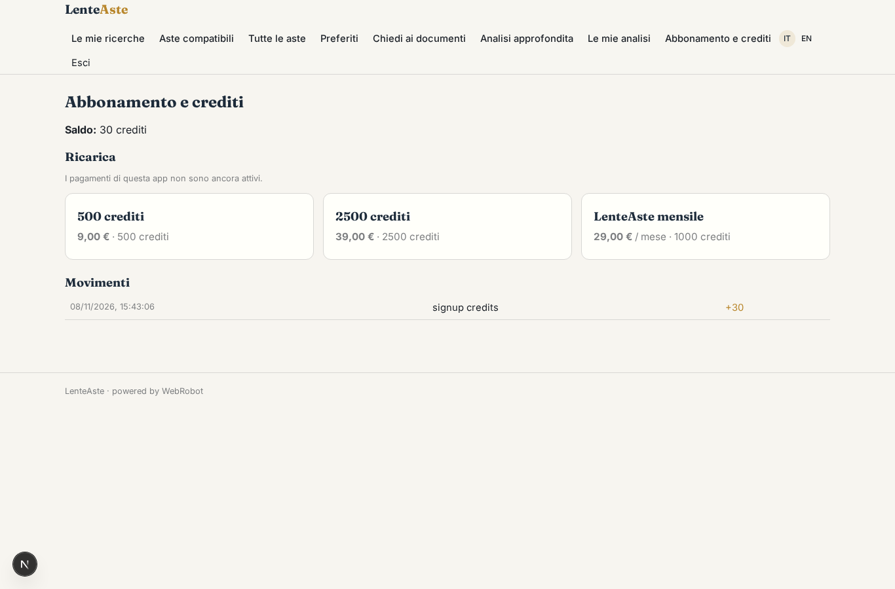

# LenteAste

_Le aste giudiziarie, lette per te: rischi e costo reale prima di offrire._

**Stato manifest:** valido (validatore Python + contratto runtime)

## Descrizione data all'app builder

Mi serve LenteAste, un'app per investitori e privati che vogliono comprare immobili alle aste giudiziarie senza leggersi cento pagine di perizia. L'utente si registra e salva una o più ricerche: comuni o province, tipologia (appartamento, box, terreno, capannone), prezzo base massimo, stato di occupazione desiderato. Un agente consulta ogni giorno il Portale delle Vendite Pubbliche, rispettandone le condizioni di riuso, e per ogni nuovo annuncio scarica anche i PDF allegati: perizia, avviso di vendita, ordinanza. I documenti vengono indicizzati e un agente legge la perizia ed estrae superficie, difformità urbanistiche, abusi, spese condominiali arretrate, se l'immobile è occupato, oneri a carico dell'aggiudicatario, e stima un costo totale reale dell'operazione. Quando compare un'asta compatibile con una ricerca salvata, l'utente riceve un'email con la scheda sintetica e un semaforo di rischio. Nella scheda può fare domande in chat sui documenti di quell'asta, con citazione della pagina. Ogni utente vede le proprie ricerche e i preferiti; i dati delle aste sono comuni. Si paga con abbonamento mensile, oppure a crediti per singola analisi approfondita.

## Funzioni non esprimibili oggi (spec.extensions)

- **email_alerts**: Le email con scheda e semaforo quando compare un'asta compatibile non sono ancora disponibili: per ora le aste compatibili compaiono nella vista 'Aste compatibili' aggiornata ogni mattina.
- **pvp_terms**: Prima della pubblicazione verificare le condizioni di riuso del Portale delle Vendite Pubbliche e se esiste un'API ufficiale; il collettore lavora con pochi accessi e si ferma se non consentito.
- **favorites_button**: Il pulsante 'aggiungi ai preferiti' sulla scheda non è espresso dal manifest: i preferiti si salvano per ora tramite la collezione favorites.

## Screenshot (runtime interpretativo)

### home-anon

### home-mobile

### home

### searches

### matches

### auctions_list

### favorites_list

### chat

### new

### analyses

### account

