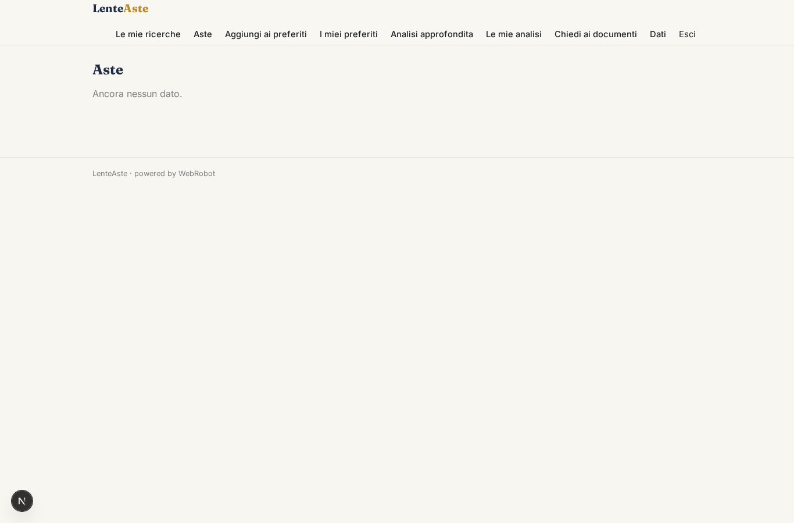
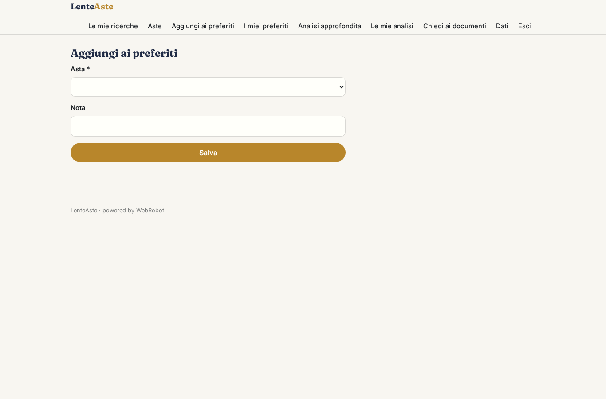
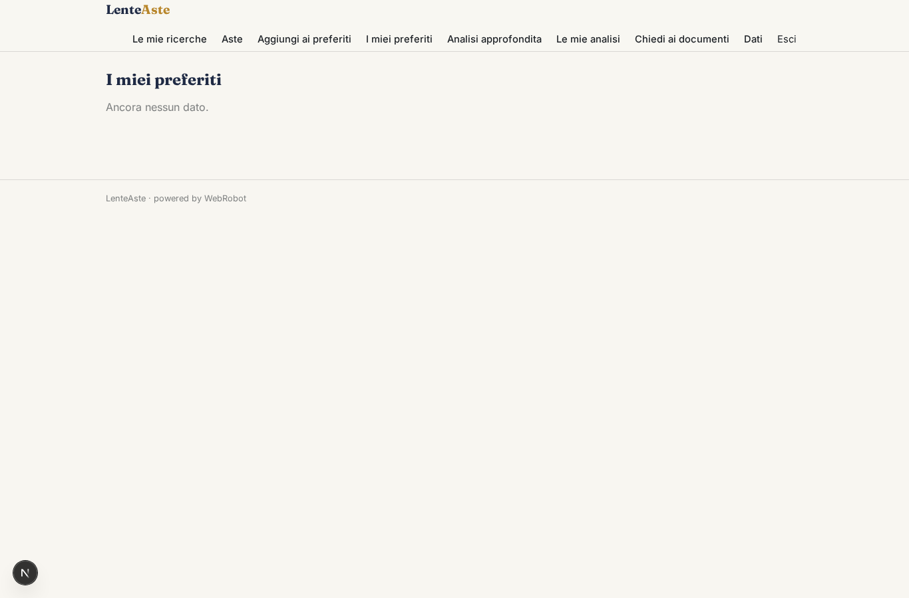
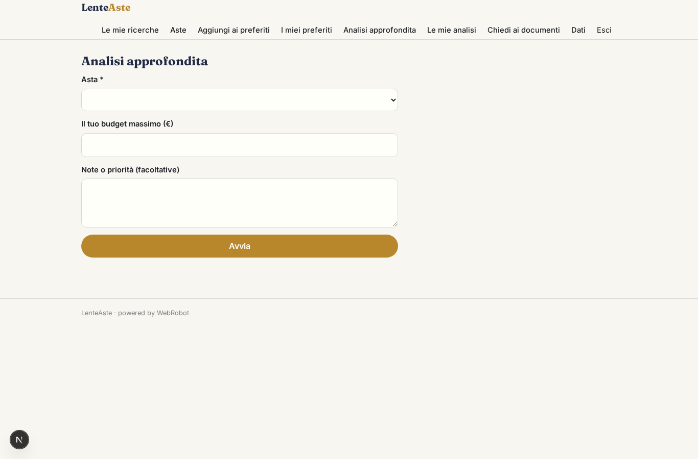
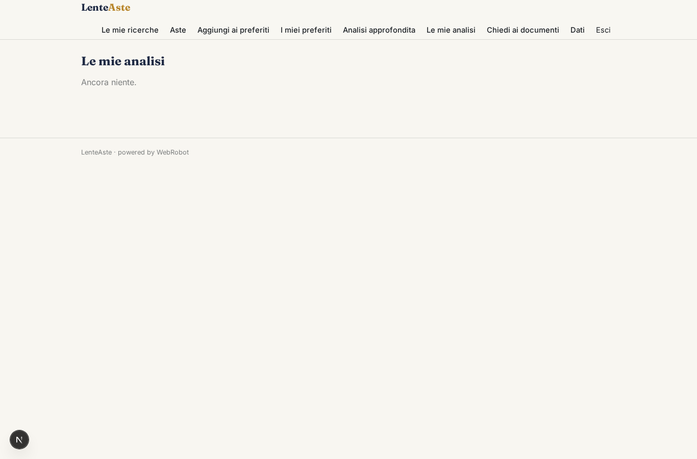
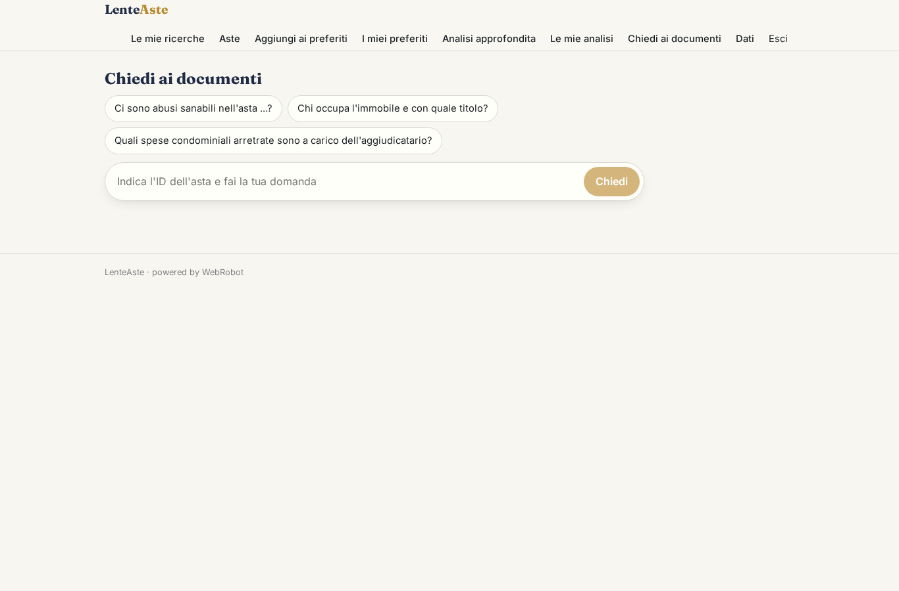

# LenteAste

_Aste giudiziarie immobiliari, senza leggere cento pagine di perizia._

**Manifest:** valid (schema + runtime contract) · **Functional test:** passed (16 checks passed)

## Description given to the app builder (Italian)

Mi serve LenteAste, un'app per investitori e privati che vogliono comprare immobili alle aste giudiziarie senza leggersi cento pagine di perizia. L'utente si registra e salva una o più ricerche: comuni o province, tipologia (appartamento, box, terreno, capannone), prezzo base massimo, stato di occupazione desiderato. Un agente consulta ogni giorno il Portale delle Vendite Pubbliche, rispettandone le condizioni di riuso, e per ogni nuovo annuncio scarica anche i PDF allegati: perizia, avviso di vendita, ordinanza. I documenti vengono indicizzati e un agente legge la perizia ed estrae superficie, difformità urbanistiche, abusi, spese condominiali arretrate, se l'immobile è occupato, oneri a carico dell'aggiudicatario, e stima un costo totale reale dell'operazione. Quando compare un'asta compatibile con una ricerca salvata, l'utente riceve un'email con la scheda sintetica e un semaforo di rischio. Nella scheda può fare domande in chat sui documenti di quell'asta, con citazione della pagina. Ogni utente vede le proprie ricerche e i preferiti; i dati delle aste sono comuni. Si paga con abbonamento mensile, oppure a crediti per singola analisi approfondita.

## Features not expressible today (spec.extensions)

- **pvp_reuse_terms**: Verificare e documentare le condizioni di riuso dei dati del Portale delle Vendite Pubbliche prima della pubblicazione; il collector è limitato a un passaggio giornaliero con richieste contenute.

## Screenshots (interpretive runtime, no data)

### home-anon

### home-mobile

### home

### searches

### auctions_list

### fav_add

### favorites

### new_deep

### reports

### chat

### account

