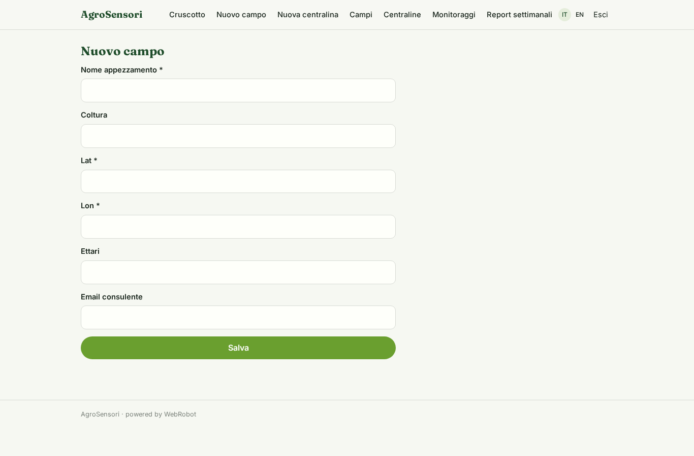
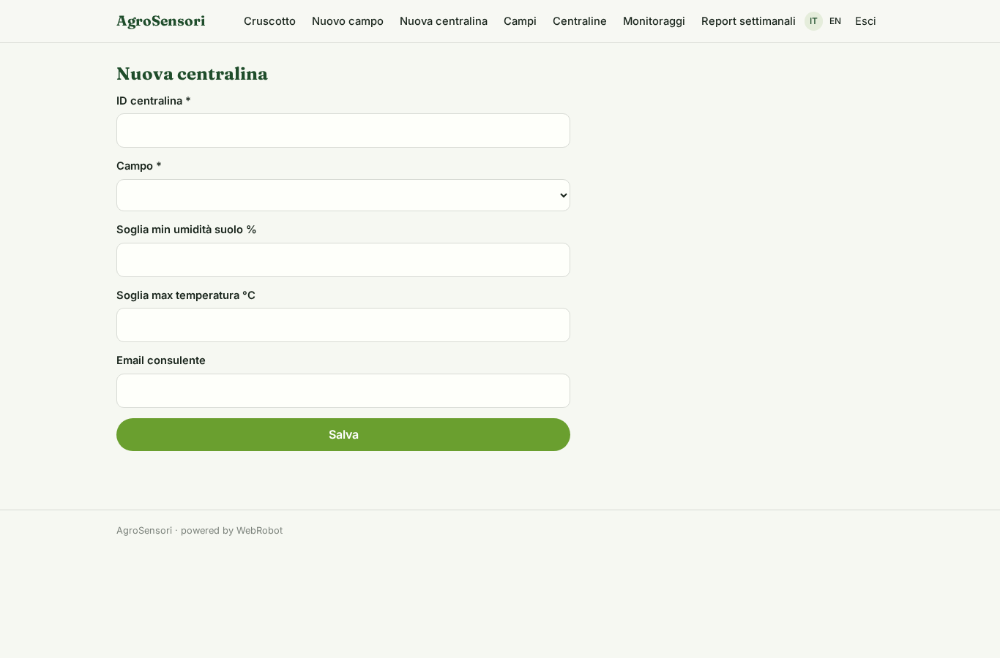
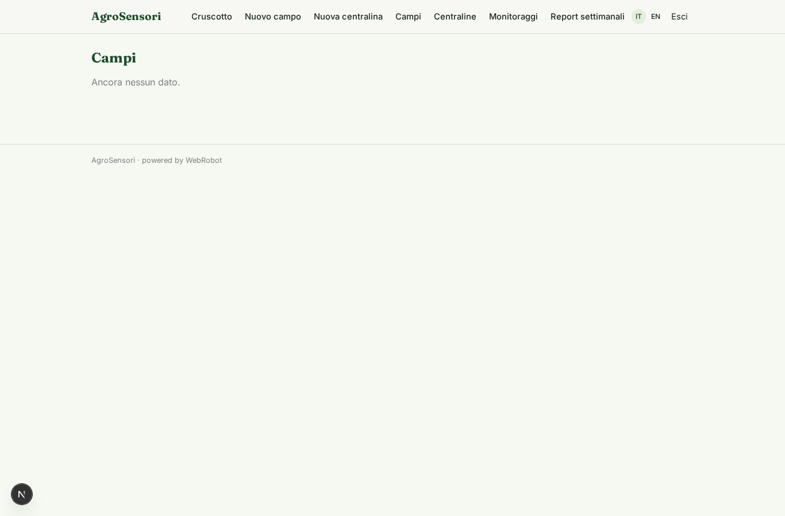
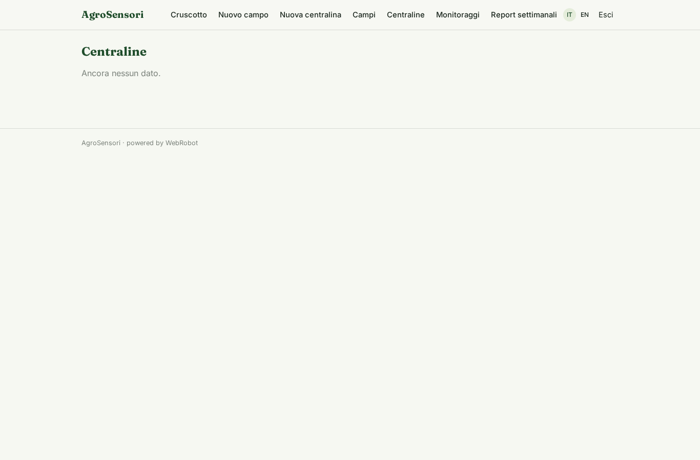
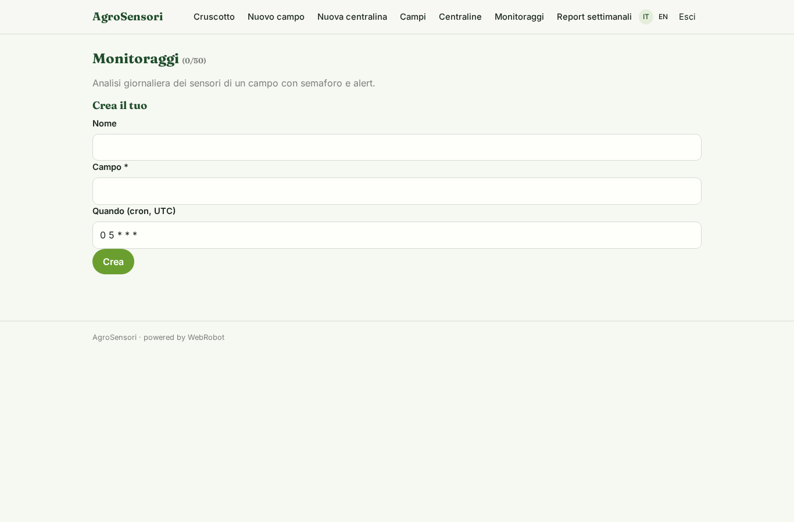
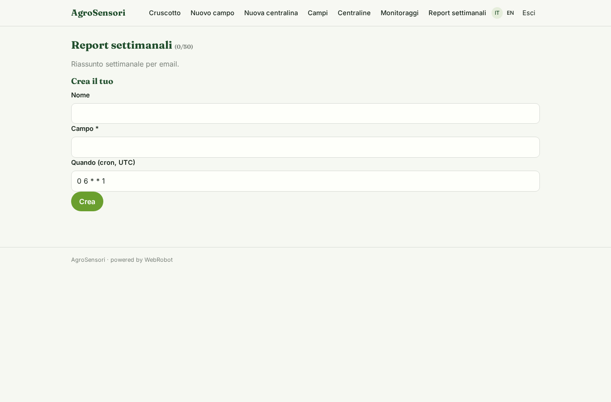
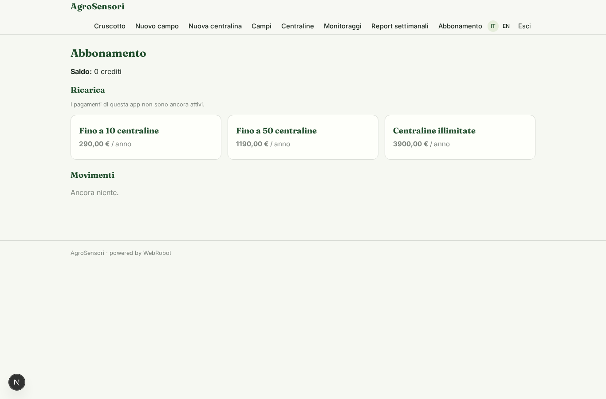

# AgroSensori

_Lo stato delle tue piante, letto dai sensori e anticipato dal meteo._

**Manifest:** valid (schema + runtime contract) · **Functional test:** passed (15 checks passed)

## Description given to the app builder (Italian)

Descrivo solo lo strato software di un servizio di monitoraggio delle piante basato su sensori: il cruscotto che mostra e interpreta i dati, non i sensori hardware ne la loro installazione, che sono un prodotto a parte. L'agronomo registra i propri appezzamenti e le centraline, e i dati misurati dai sensori arrivano alla piattaforma via webhook. Un agente analizza le serie temporali (stato idrico della pianta, temperatura, umidita), rileva condizioni di stress e cali anomali, e li incrocia con le previsioni meteo da Open-Meteo per anticipare i problemi. L'utente vede una dashboard per campo e per centralina con grafici e un semaforo dello stato delle piante, e riceve un alert via email quando un parametro esce dalla soglia, con il consiglio sull'irrigazione o sull'intervento. Un report settimanale riassume l'andamento. L'azienda agricola vede solo i propri campi, il consulente quelli dei clienti seguiti, l'admin tutto. Abbonamento annuale in base al numero di centraline collegate. In italiano e inglese.

## Features not expressible today (spec.extensions)

- **consultant_assessments**: Consultants read fields, stations and readings of followed clients; the per-instance analysis reports remain with the farm owner.

## Screenshots (interpretive runtime, no data)

### home-anon

### home-mobile

### home

### dashboard

### new_field

### new_station

### fields_list

### stations_list

### watches

### weekly_watches

### account

