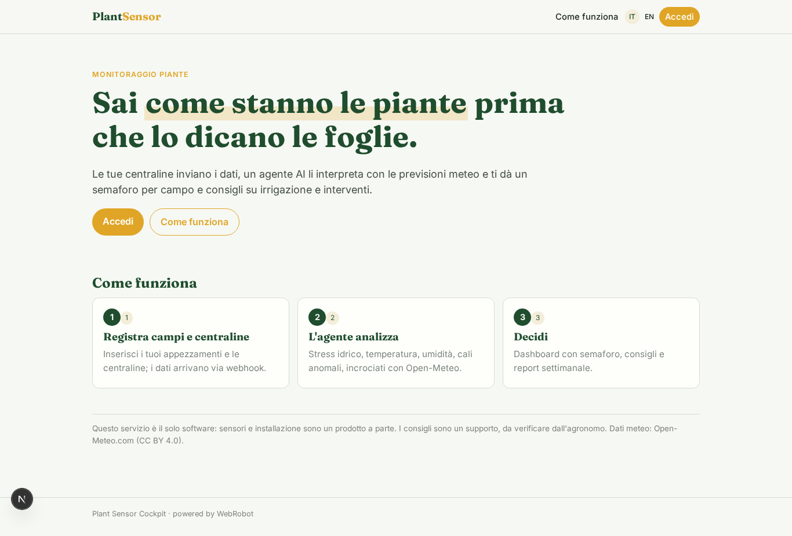
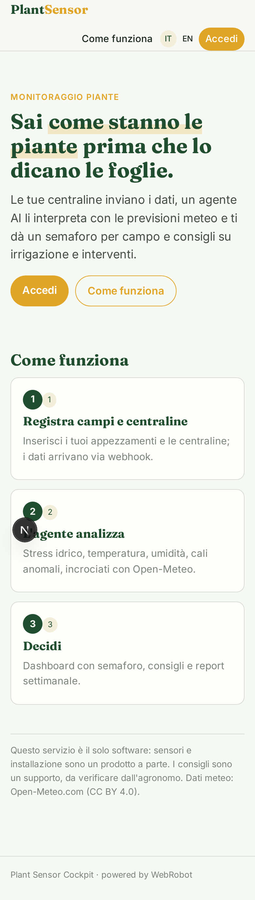
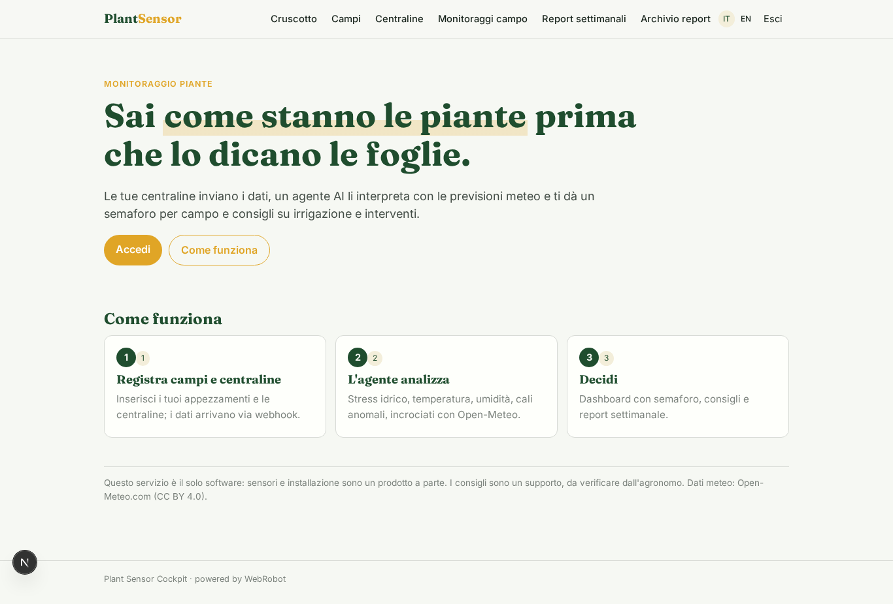
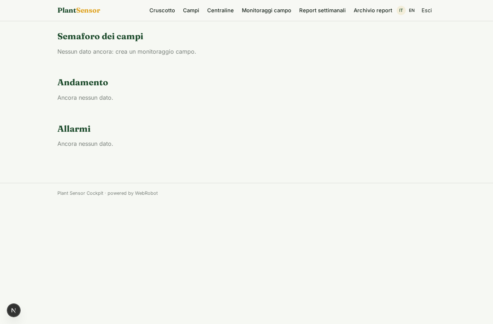
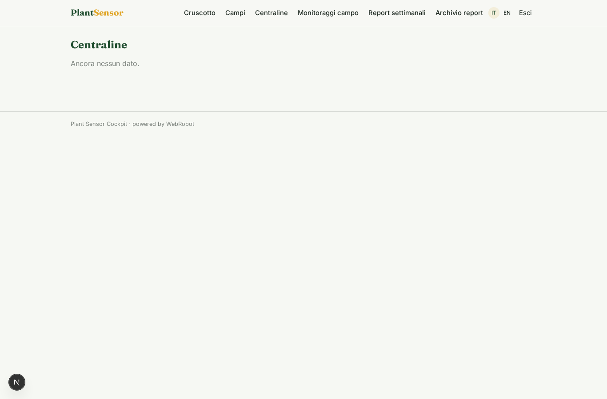
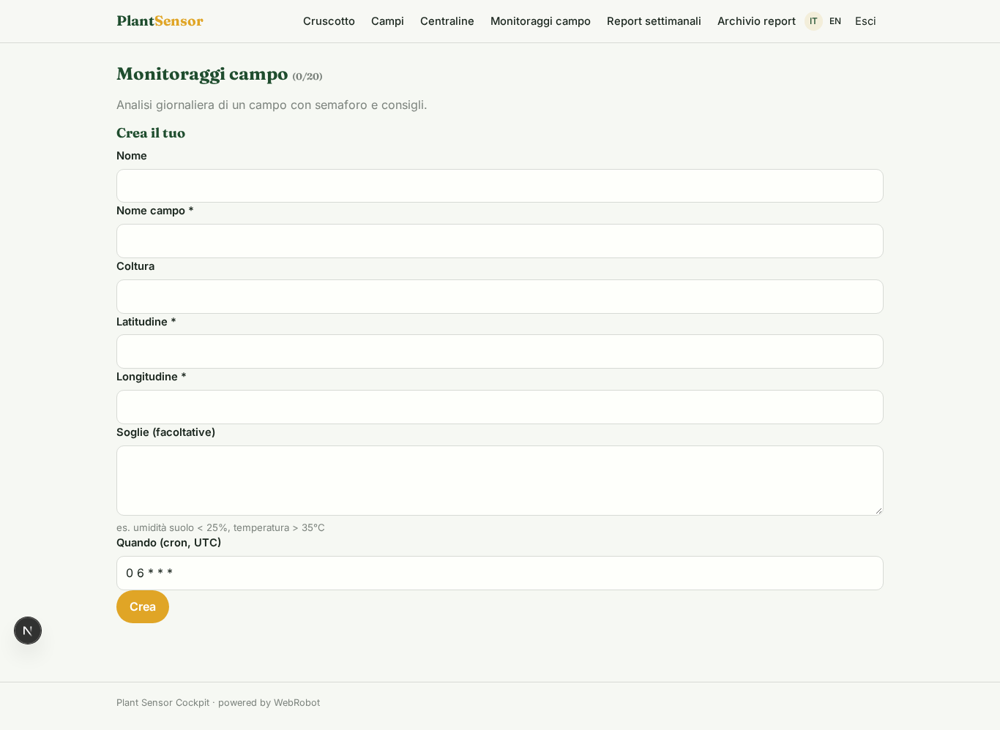
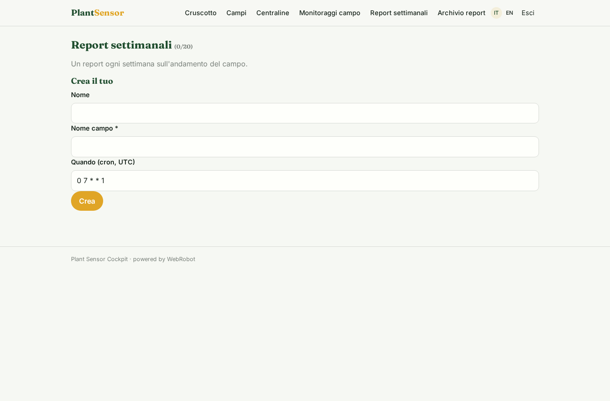
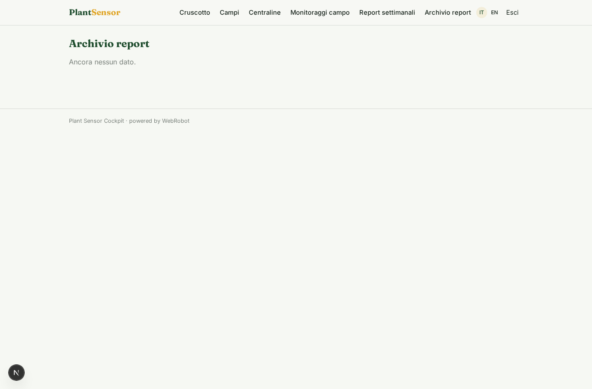
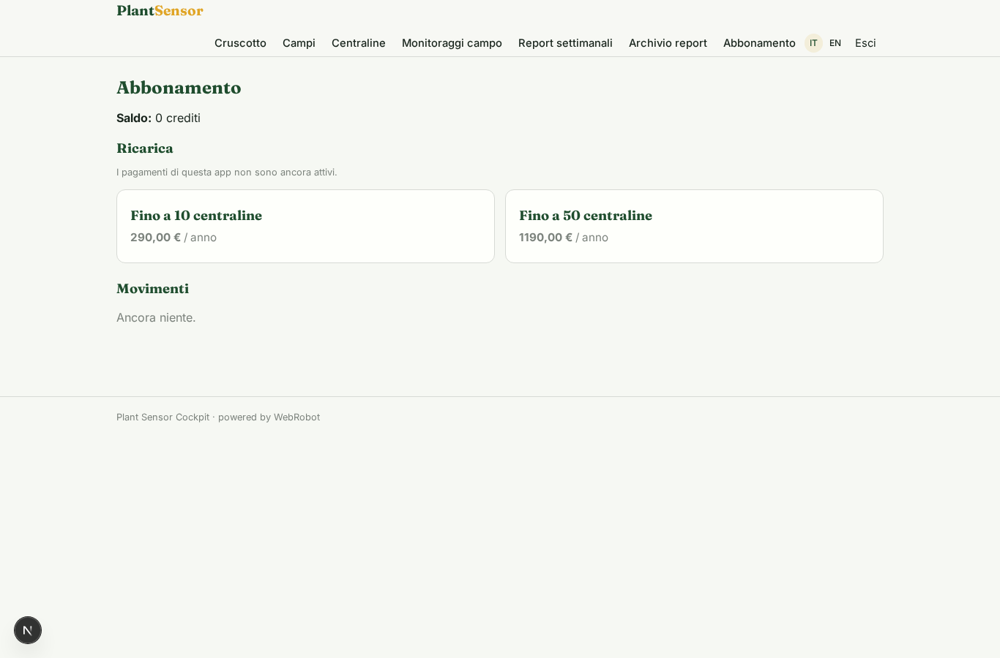

# Plant Sensor Cockpit

_I dati dei tuoi sensori, interpretati: semaforo per campo e consigli sull'irrigazione._

**Manifest status:** valid (schema validator + runtime contract)

## Description given to the app builder (Italian)

Descrivo solo lo strato software di un servizio di monitoraggio delle piante basato su sensori: il cruscotto che mostra e interpreta i dati, non i sensori hardware ne la loro installazione, che sono un prodotto a parte. L'agronomo registra i propri appezzamenti e le centraline, e i dati misurati dai sensori arrivano alla piattaforma via webhook. Un agente analizza le serie temporali (stato idrico della pianta, temperatura, umidita), rileva condizioni di stress e cali anomali, e li incrocia con le previsioni meteo da Open-Meteo per anticipare i problemi. L'utente vede una dashboard per campo e per centralina con grafici e un semaforo dello stato delle piante, e riceve un alert via email quando un parametro esce dalla soglia, con il consiglio sull'irrigazione o sull'intervento. Un report settimanale riassume l'andamento. L'azienda agricola vede solo i propri campi, il consulente quelli dei clienti seguiti, l'admin tutto. Abbonamento annuale in base al numero di centraline collegate. In italiano e inglese.

## Features not expressible today (spec.extensions)

- **sensor_webhook**: Ingestion of sensor measurements: a webhook per station (token mapped to the owner user) that writes records into readings without an agent run. Not expressible in the manifest yet.
- **email_alerts**: Email alert when a parameter exceeds the threshold: notifications are not available yet. For now alerts appear in the dashboard (alert flag).
- **per_station_pricing**: Annual subscription priced per connected station: modelled as tiers (10 / 50 stations); per-unit quantity billing and the station limit enforcement are not available yet.
- **consultant_clients**: The consultant sees clients' fields through per-record viewer invitations on fields and stations; automatic aggregation across followed clients is not available yet.

## Screenshots (interpretive runtime)

### home-anon

### home-mobile

### home

### dashboard

### fields

### stations

### watches

### weekly

### weekly_list

### account

