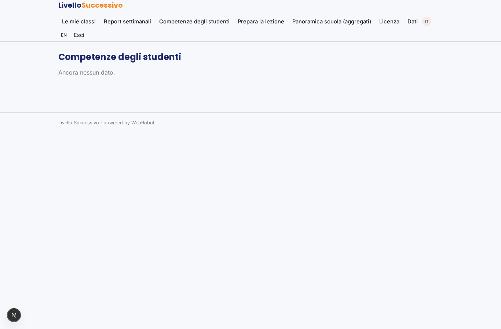
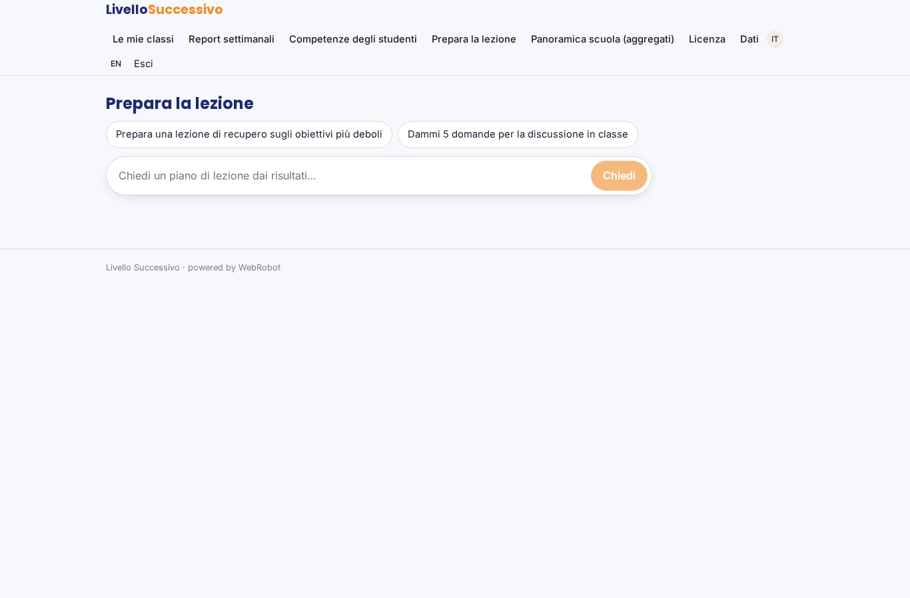
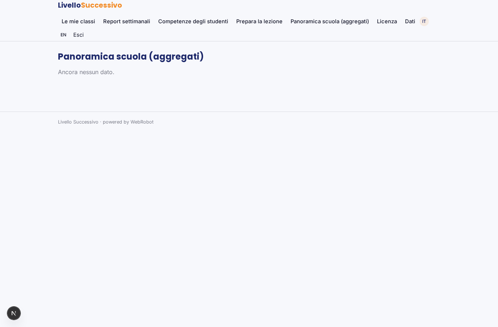
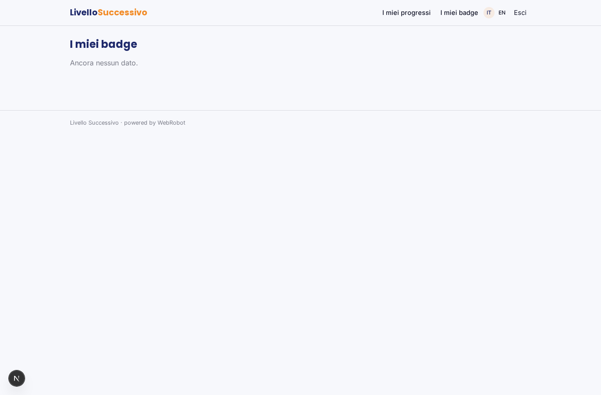
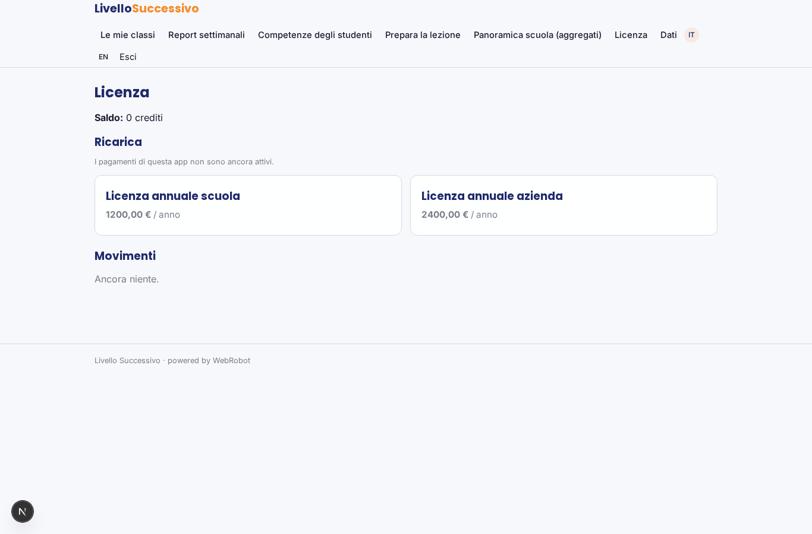

# Livello Successivo

_Dal gioco ai risultati: competenze, recuperi e report per ogni classe._

**Manifest:** valid (schema + runtime contract) · **Functional test:** passed (16 checks passed)

## Description given to the app builder (Italian)

Mi serve Livello Successivo, la piattaforma di gestione per un prodotto di apprendimento basato sul gioco per scuole e aziende. Descrivo solo lo strato software di gestione e analisi: il gioco vero, con la sua interfaccia, è sviluppato a parte. Il docente o il formatore crea una classe, invita gli studenti con un codice e sceglie i percorsi di gioco legati agli obiettivi didattici, per esempio educazione finanziaria o sicurezza sul lavoro. Gli studenti giocano e ogni partita invia gli eventi alla piattaforma: livello raggiunto, risposte date, tempo, errori. Un agente analizza questi dati, stima il livello di competenza di ciascuno studente su ogni obiettivo, individua chi è in difficoltà e suggerisce al docente attività di recupero e domande per la discussione in classe. Ogni settimana il docente riceve un report della classe; lo studente vede i propri progressi e badge. Una chat aiuta il docente a preparare la lezione partendo dai risultati. I dati dei minori vanno gestiti con cura: il docente vede solo le sue classi, la scuola dati aggregati. Licenza annuale per scuola o azienda.

## Functional test: what did not pass

- **template instance created and run** (template class_watch): reserved to teacher/admin _(warning)_
- **saved record shown where its collection is read** (view my_progress): a record was saved in assessments (by admin-data, admin-data) but the page does not show it (as user) _(warning)_
- **saved record shown where its collection is read** (view my_badges): a record was saved in badges (by admin-data, admin-data) but the page does not show it (as user) _(warning)_

## Features not expressible today (spec.extensions)

- **game_connection**: Il gioco (sviluppato a parte) invia gli eventi con POST a /api/hooks/game_event usando il secret dell'app, includendo class_code, student_id pseudonimo, teacher_email e student_email se lo studente ha un account. L'iscrizione con codice classe avviene nel gioco.
- **minors_compliance**: Consenso dei genitori, informativa GDPR e nomina a responsabile del trattamento vanno gestiti contrattualmente con la scuola; non sono modellati qui.

## Screenshots (interpretive runtime, no data)

### home-anon

### home-mobile

### home

### classes

### reports

### students

### coach_chat

### school_overview

### my_progress

### my_badges

### account

