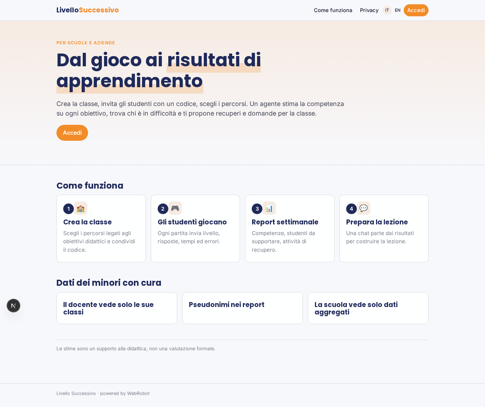
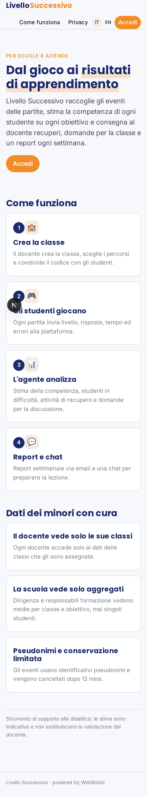
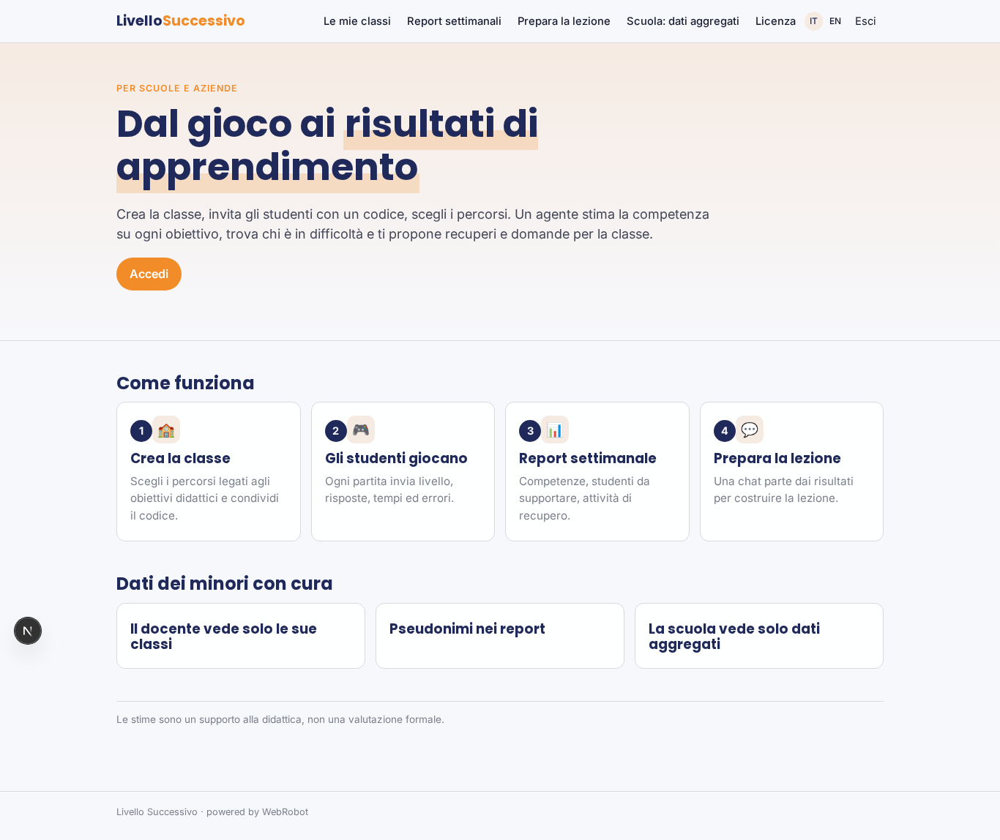
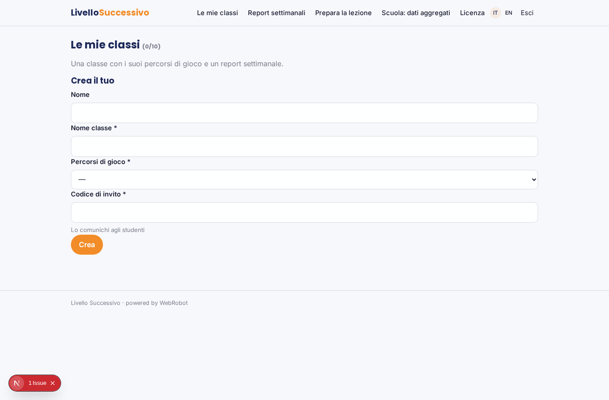
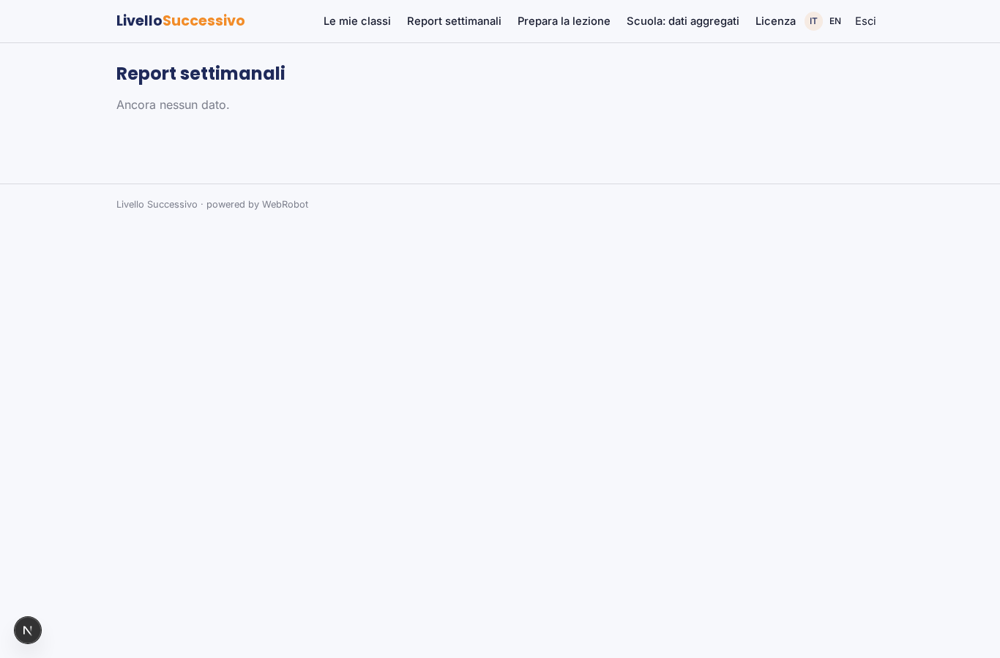
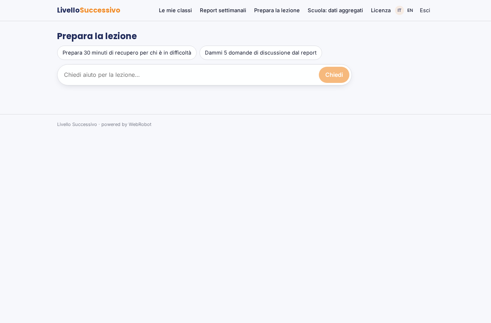
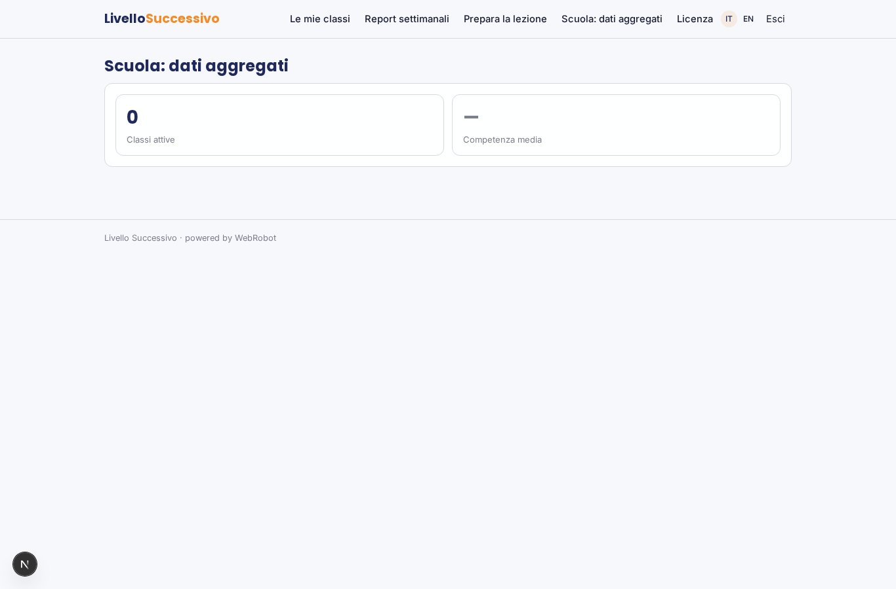
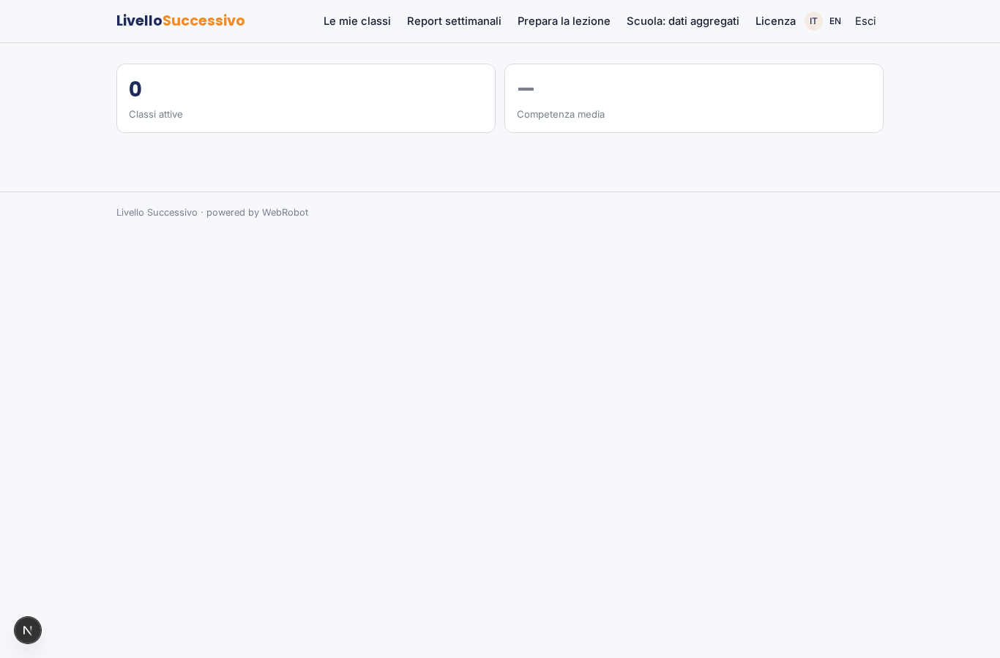
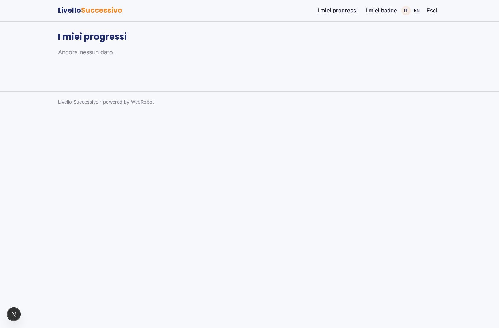
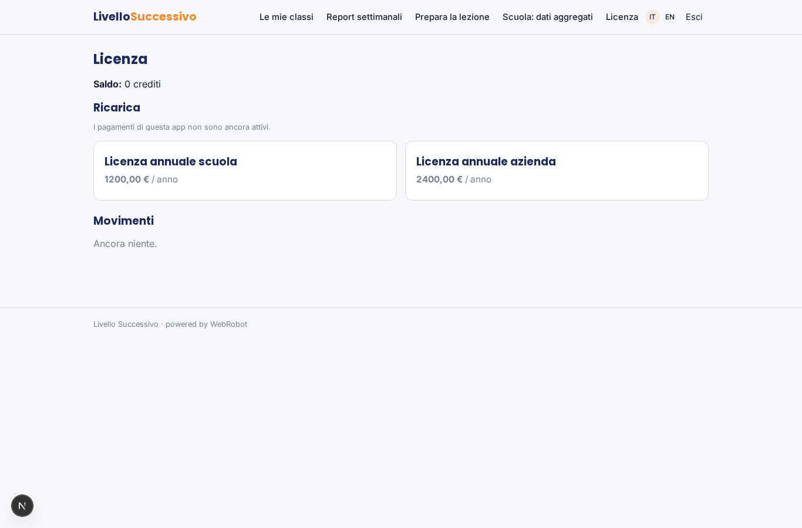

# Livello Successivo

_Dal gioco ai risultati di apprendimento, classe per classe._

**Manifest status:** valid (schema validator + runtime contract)

## Description given to the app builder (Italian)

Mi serve Livello Successivo, la piattaforma di gestione per un prodotto di apprendimento basato sul gioco per scuole e aziende. Descrivo solo lo strato software di gestione e analisi: il gioco vero, con la sua interfaccia, è sviluppato a parte. Il docente o il formatore crea una classe, invita gli studenti con un codice e sceglie i percorsi di gioco legati agli obiettivi didattici, per esempio educazione finanziaria o sicurezza sul lavoro. Gli studenti giocano e ogni partita invia gli eventi alla piattaforma: livello raggiunto, risposte date, tempo, errori. Un agente analizza questi dati, stima il livello di competenza di ciascuno studente su ogni obiettivo, individua chi è in difficoltà e suggerisce al docente attività di recupero e domande per la discussione in classe. Ogni settimana il docente riceve un report della classe; lo studente vede i propri progressi e badge. Una chat aiuta il docente a preparare la lezione partendo dai risultati. I dati dei minori vanno gestiti con cura: il docente vede solo le sue classi, la scuola dati aggregati. Licenza annuale per scuola o azienda.

## Features not expressible today (spec.extensions)

- **event_ingestion**: Il gioco deve inviare gli eventi al webhook con segreto dell'app e indicare la classe (codice di invito). Il webhook scrive in game_events della classe; la verifica del codice e l'autenticazione del gioco vanno completate fuori dal manifest.
- **student_join**: Ingresso dello studente con codice di invito e collegamento account studente alla classe non ancora espressi: oggi il progresso dello studente (student_progress) e i dati aggregati di scuola (school_stats) richiedono un passo di sincronizzazione dedicato.
- **weekly_email**: L'invio via email del report settimanale al docente non è ancora disponibile: il docente lo trova nella vista Report.

## Screenshots (interpretive runtime)

### home-anon

### home-mobile

### home

### classes

### reports

### coach

### school_overview

### school_kpi

### my_progress

### account

