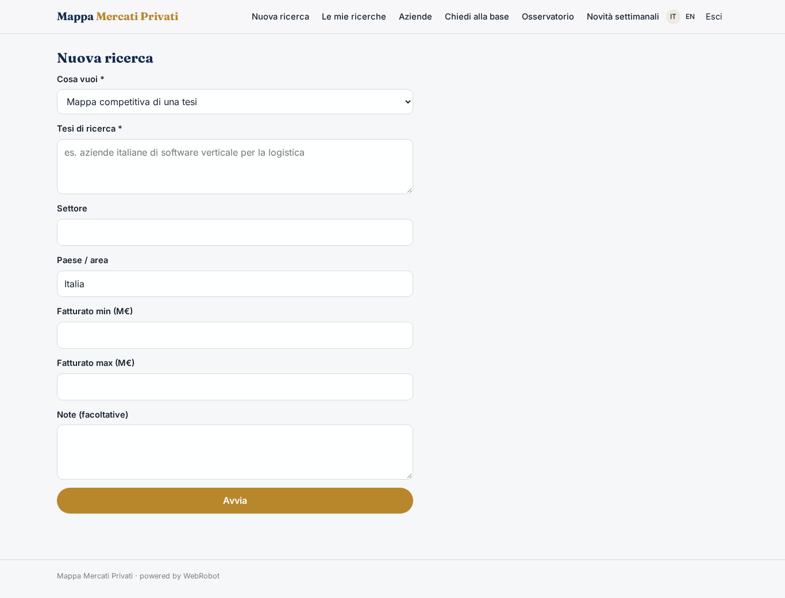
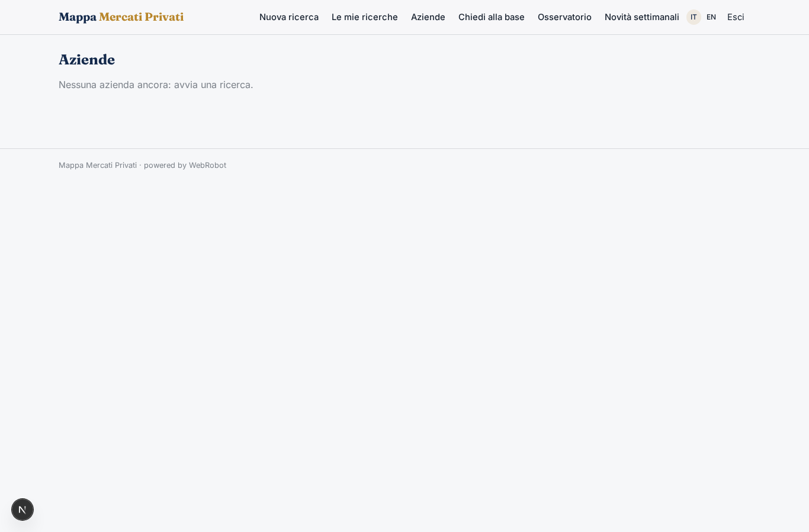
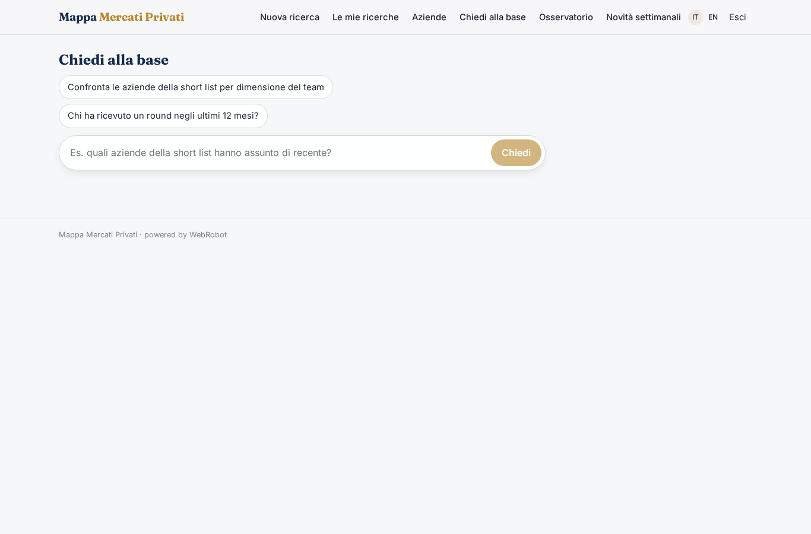
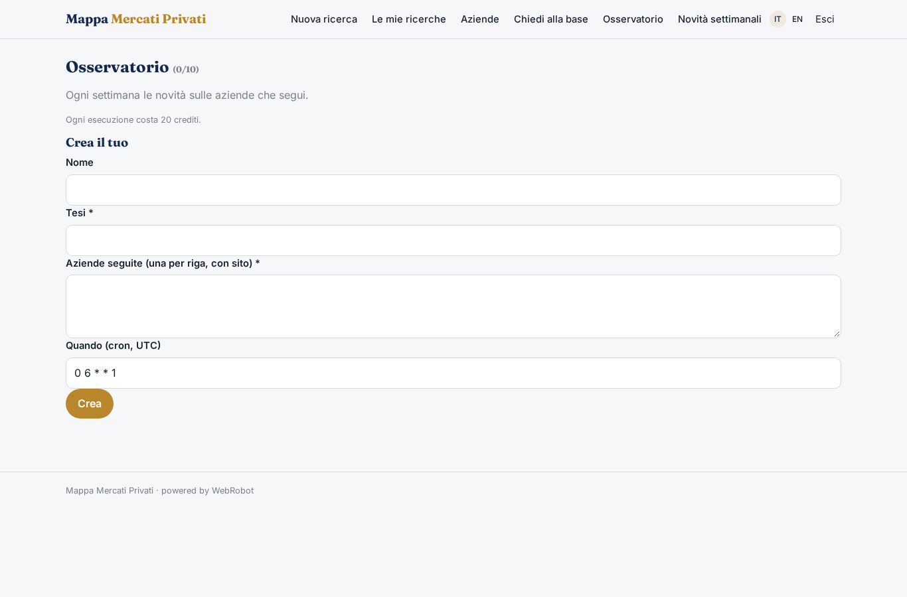
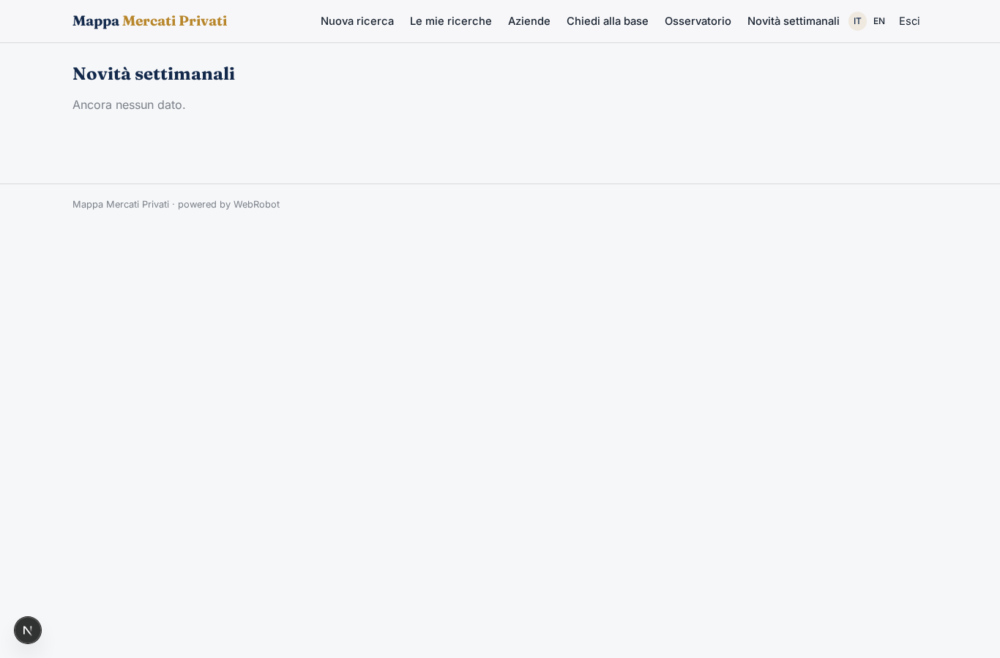
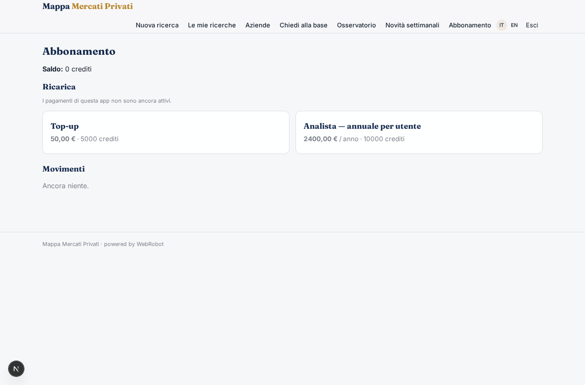

# Mappa Mercati Privati

_Intelligence sulle aziende non quotate, a partire dalla tua tesi._

**Stato manifest:** valido (validatore Python + contratto runtime)

## Descrizione data all'app builder

Mi serve Mappa Mercati Privati, una piattaforma di intelligence su aziende non quotate per fondi, banche d'affari e corporate development. L'analista definisce una tesi di ricerca, per esempio aziende italiane di software verticale per la logistica tra 5 e 50 milioni di fatturato. Un agente cerca sul web con ricerche mirate, visita i siti delle aziende, legge news e comunicati, ed estrae per ciascuna attività, prodotti, clienti citati, dimensione del team, sede, round di finanziamento e segnali di crescita come nuove assunzioni o aperture. I dati vengono indicizzati in un motore di ricerca con filtri e raccolti in una base di conoscenza su cui l'analista può fare domande in chat. I dati di bilancio e le informazioni del registro imprese vengono da un fornitore a pagamento via API, che il cliente collega con la propria licenza. Per ogni azienda l'agente produce una scheda standard secondo un template, e per la tesi una mappa competitiva con long list e short list. Ogni settimana segnala le novità sulle aziende seguite. Ogni team vede solo le proprie tesi. Abbonamento annuale per utente.

## Funzioni non esprimibili oggi (spec.extensions)

- **registry_financials_provider**: Balance-sheet and company-registry data from a paid API provider connected with each customer's own licence: not available yet (connectors needing customer credentials). For now the agents mark these data as 'to verify'.
- **team_workspaces**: Team-level sharing: today each user sees only their own theses, with per-record invitations (viewer/editor) for colleagues; organisation-wide team workspaces are not available.
- **search_engine_filters**: The indexed search with facets is served by the searchable companies collection and its table view; advanced facet filters would need a dedicated search index.
- **email_digest**: Weekly news is shown in the app; email delivery of the digest is not available yet.

## Screenshot (runtime interpretativo)

### home-anon

### home-mobile

### home

### new_run

### history

### companies

### ask

### watches

### updates

### account

